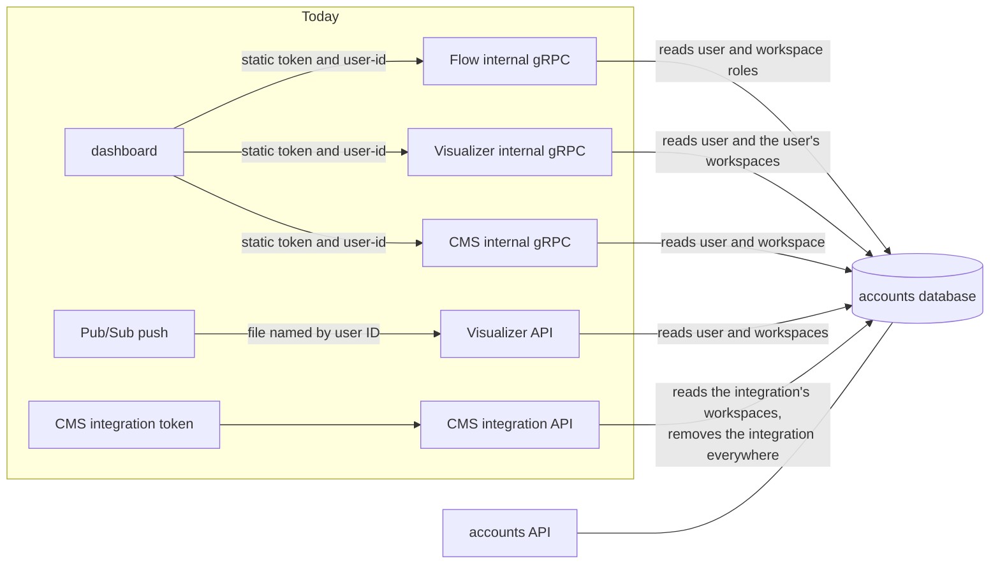
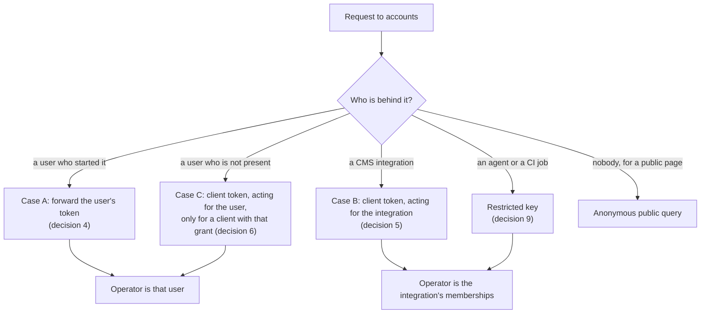
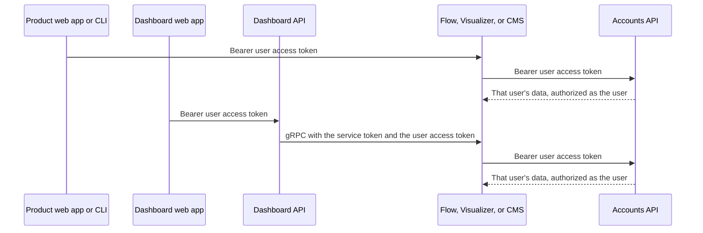
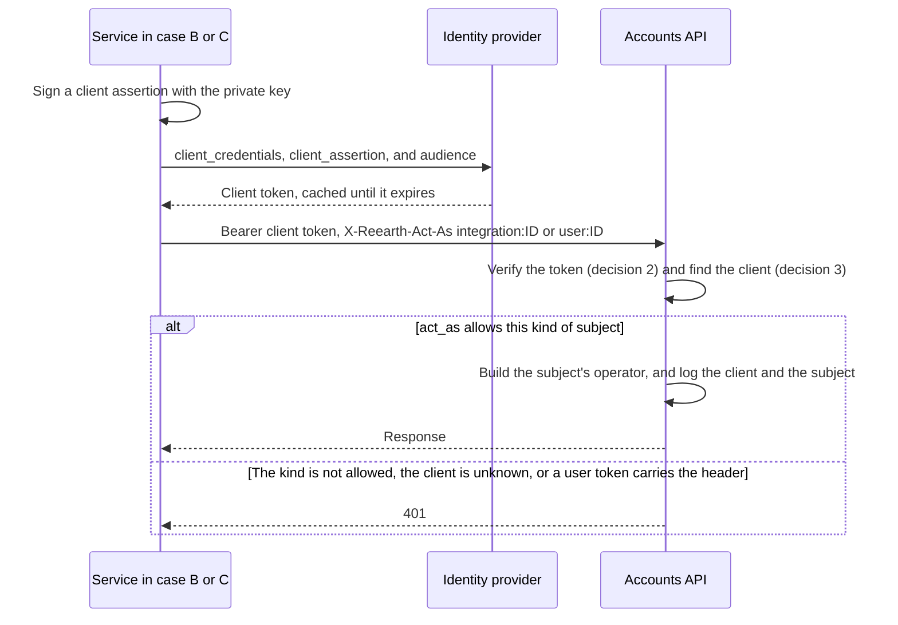
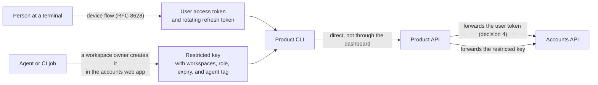

# ADR-0002: Service callers for the accounts API

- **Status:** Accepted 2026-11-10. Amendment proposed 2026-11-19.
- **Date:** 2026-11-10 (amended 2026-11-19)
- **Deciders:** @pyshx

## Amendment summary

The first version said that each registered client stands for one fixed accounts integration and sees only that integration's workspaces (old decision 4). That model fits a third-party automation that works in a known set of workspaces. It does not fit the platform services that call accounts without a user token today.

We listed every call that Flow, Visualizer, and CMS make without a user token. The calls fall into three kinds, and none of them is "one fixed integration":

1. Calls made for a user who started the request.
2. Calls made for a CMS integration.
3. Calls made for a user who is not present.

This amendment replaces old decision 4 with decisions 4, 5, and 6. It adds decision 7 (rules for every client token) and decision 9 (CLIs and agents), and renumbers the rest. Decisions 1, 2, and 3 stay as they were, with one change: the registry entry now lists what a client may act for, instead of naming a fixed integration.

## Context

Accounts accepts only end-user tokens. Work without a user token therefore goes around accounts:

1. Flow, Visualizer, and CMS read the accounts database directly. Those reads skip every authorization rule, and one leaked connection string exposes every tenant.
2. Their internal gRPC APIs accept a static shared token and a `user-id` value. Whoever holds that one token can act as any user.

Accounts also has two static keys, `REEARTH_ACCOUNTS_REST_API_KEY` and `REEARTH_ACCOUNTS_SYNC_SSO_API_KEY`. Each one is a long-lived shared secret with no identity, no scope, and no expiry.

The callers run on more than one platform. Most run on Cloud Run, and Re:Earth Serve runs on Cloudflare Workers. A self-hosted deployment can bring its own OIDC provider, and terraform configures the identity provider for each environment. The scheme therefore cannot depend on one cloud's runtime identity.

Each product will also ship a CLI, and agents will run most of those CLIs. They need credentials too.

### What the services do today without a user token

| Kind of access | Callers | What the caller needs from accounts |
|---|---|---|
| A user started the request | Flow, Visualizer, and CMS internal gRPC, which the dashboard calls for a signed-in user | The user, the user's workspaces and roles, and permission decisions for that user |
| A CMS integration | The CMS integration API, which builds its operator from the integration's memberships. When an integration is deleted, CMS removes it from every workspace. | The integration's workspaces and roles, and a way to remove the integration's memberships |
| A user who is not present | The Visualizer project import, which a Pub/Sub push starts for an uploaded file | The user that the upload names |
| Anonymous | Public project and workspace pages | A public workspace by alias, which accounts already serves without a token |

### Other platforms prove the user instead of naming one

| Platform | When a user is behind the call | When no user is behind the call |
|---|---|---|
| Microsoft Entra ([On-Behalf-Of flow](https://learn.microsoft.com/entra/identity-platform/v2-oauth2-on-behalf-of-flow)) | The middle tier exchanges the user's token for a downstream token for the same user. | Client credentials with application permissions, only for work that has no user |
| Auth0 ([On-Behalf-Of token exchange](https://auth0.com/docs/secure/call-apis-on-users-behalf/on-behalf-of-token-exchange)) | An RFC 8693 exchange. `sub` stays the user, and `act` and `azp` name the service. The user's token is the proof. | Client credentials |
| Atlassian ([user impersonation for Connect apps](https://developer.atlassian.com/cloud/jira/platform/user-impersonation-for-connect-apps/)) | To act as a user, an app needs the `ACT_AS_USER` scope and a token exchange. Jira ignores a user ID in a plain service token. | Services sign their own JWT with a private key (ASAP). An app acts inside its installation. |
| Netflix ([edge authentication](https://netflixtechblog.com/edge-authentication-and-token-agnostic-identity-propagation-514e47e0b602)) | The edge authenticates the user once and attaches an internal "Passport" to the call. Services do not accept an identity field that a caller can set. | Service identity |
| Stripe ([Connect](https://stripe.com/docs/connect/authentication), [CLI keys](https://docs.stripe.com/stripe-cli/keys), [MCP and agents](https://docs.stripe.com/mcp)) | The CLI pairs with the dashboard in a browser and gets restricted keys that expire. Interactive agents use OAuth with consent for each account. | A platform uses its own key and a `Stripe-Account` header, and it can name only accounts connected to it. Autonomous agents get restricted keys with an agent tag and minimal permissions. |
| Google ([BeyondProd](https://docs.cloud.google.com/docs/security/beyondprod), [end-user context tickets](https://docs.cloud.google.com/docs/security/infrastructure/design#access_management_of_end_user_data)) | A central service verifies the user's credential and issues a short-lived end-user context ticket. Services pass the ticket on each RPC. | A separate identity for each service (ALTS) |
| Google Workspace ([domain-wide delegation](https://docs.cloud.google.com/iam/docs/best-practices-service-accounts#domain-wide-delegation)) | A service account with domain-wide delegation can put any user's email in `sub` and act as that user. Google recommends against it, because it cannot limit which users the account acts as. | A service account acts as itself on resources shared with it. |
| GitHub Apps ([installation tokens](https://docs.github.com/en/apps/creating-github-apps/authenticating-with-a-github-app/authenticating-as-a-github-app-installation), [user tokens](https://docs.github.com/en/apps/creating-github-apps/authenticating-with-a-github-app/authenticating-with-a-github-app-on-behalf-of-a-user)) | A user token reaches only what both the user and the installation can reach. The audit log names the user and marks the app. | The app signs a JWT and exchanges it for a one-hour installation token, limited to the repositories and permissions that the owner granted. |
| Shopify ([access tokens](https://shopify.dev/docs/apps/build/authentication-authorization/access-tokens)) | An online token is tied to the staff member who opened the app and has that member's permissions. | An offline token acts for the store, within the scopes the merchant approved, for webhooks and background jobs. |

The platforms agree on six rules:

1. A caller proves who the user is. It never just names the user. OWASP says the same about identity headers between services: a plain user-ID header is not a credential, because any caller that can set it can forge a user ([OWASP Identity Propagation Patterns](https://cheatsheetseries.owasp.org/cheatsheets/Identity_Propagation_Patterns_Cheat_Sheet.html)). NIST asks for signed user-context tokens and a separate identity for each service ([NIST SP 800-204A](https://nvlpubs.nist.gov/nistpubs/SpecialPublications/NIST.SP.800-204a.pdf)).
2. A token with no user is for work that has no user.
3. Acting for a tenant is the default for background work. Shopify offline tokens, GitHub installation tokens, and Slack bot tokens all work this way.
4. Acting as a user without that user present is a rare grant, given explicitly to one client and limited to named operations. Atlassian Forge limits offline impersonation to scopes marked for it. Google's domain-wide delegation shows what goes wrong without a limit.
5. Every log entry names both the client and the subject it acted for.
6. A person at a CLI gets a user token. An unattended agent gets its own narrow, expiring credential that people can list and revoke, never a copy of a user token.

We rejected these options:

- **Cloud runtime identity, such as Google ID tokens.** Cloudflare Workers cannot get one, so we would run two schemes.
- **The static keys.** They have no identity, no scope, and no expiry.
- **Direct database access.** It skips authorization, and one leaked credential exposes every tenant.
- **A self-hosted issuer, such as Ory Hydra.** It adds a stateful service to run in every environment.
- **SPIFFE and SPIRE.** They need their own infrastructure on every platform.
- **One fixed integration per client, as in this ADR's first version.** A platform service works across tenants, so its integration would need a membership in every workspace.
- **Any registered client may name any user in a header.** Netflix and Atlassian moved away from this kind of field. One leaked key could act as every user.
- **One identity provider client per agent.** The number of clients grows with every agent, and a client has no workspace scope.
- **OAuth Transaction Tokens ([draft-ietf-oauth-transaction-tokens](https://datatracker.ietf.org/doc/draft-ietf-oauth-transaction-tokens/)).** A transaction token service exchanges the inbound credential for a short-lived signed token that every service in the call chain forwards unchanged. It solves case A and case C cleanly. It is still an Internet-Draft, and it needs a token service that we would run in every environment. We revisit it when it becomes an RFC and an identity provider we use offers it.

## Decision

The first question for any request is who stands behind it. The answer picks the case.

### 1. A service authenticates with client credentials and a private key

This decision is unchanged. A service gets an access token for the accounts audience with the OAuth client credentials grant. It authenticates to the identity provider with `private_key_jwt` (RFC 7523). The identity provider does not accept a client secret for these clients. The service fetches a token on the first call that needs one, keeps it in memory until it expires, and sends it as `Authorization: Bearer`.

Every caller is open source, so the caller code lives in reearthx as the `servicetoken` package.

Identity providers can limit `private_key_jwt` by plan. Auth0 offers it for the client credentials grant only on its Enterprise plan ([Auth0 credentials](https://auth0.com/docs/secure/application-credentials)). Each environment's tenant must support it before that environment registers a client (see Open questions).

Identity providers can also meter client tokens. Auth0 includes between 1,000 and 5,000 machine-to-machine tokens a month, depending on the plan ([Auth0 pricing](https://auth0.com/pricing)). Each running instance fetches one token for each token lifetime, so keep the lifetime at 24 hours and fetch only on demand.

### 2. Accounts verifies each client token strictly

This decision is unchanged. Accounts accepts a client token only when all of these checks pass:

1. `iss` exactly matches a configured issuer.
2. The signature verifies against that issuer's published keys.
3. The audience is the accounts audience.
4. The token has not expired.
5. The client credentials grant issued the token, and the token names no user.
6. Its client ID is registered (decision 3).

A request carries either a user token or a client token, never both.

### 3. Terraform registers each client in the calling service's own module

For each calling service, in each environment that needs it, the service's terraform module creates these resources. There is no separate caller module.

1. The identity provider client.
2. The client's private key.
3. A grant for the accounts audience only.
4. A secret that holds the private key, which only the service's own account can read.
5. An entry in `REEARTH_ACCOUNTS_SERVICE_CALLERS`.

An entry is `{"issuer", "client_id", "name", "act_as"}`. `act_as` lists what the client may act for: `"integration"`, `"user"`, both, or neither. Accounts matches client IDs exactly, with no wildcards, and returns `401` to an unregistered client. Accounts stores no token.

To rotate a key, follow these steps:

1. In terraform, register the new public key next to the old one.
2. Switch the callers to the new private key and redeploy them.
3. In terraform, remove the old public key.

### 4. A call made for a user carries that user's token

When a user started the request, the user's own access token goes with the call to accounts:

- A product's web app and its CLI call that product's API directly with the user's token. Neither one goes through the dashboard.
- The dashboard calls the Flow, Visualizer, and CMS internal gRPC APIs only for its own pages. It sends the signed-in user's token in the gRPC metadata. The static service token then guards only the hop from the dashboard to the service. Each service stops reading `user-id` once it reads the token, and the dashboard stops sending `user-id` once all three do.
- The service forwards the token to accounts on the normal user path.

Case A uses no client token, and accounts needs no change for it. A service that needs only case A gets no identity provider client.

Forwarding works today because every Re:Earth API shares one audience, so the user's token is already valid at accounts. A forwarded bearer token gives every service on the path the user's full rights until it expires ([RFC 6750](https://www.rfc-editor.org/rfc/rfc6750.html#section-1.2)). The standard next step is the On-Behalf-Of exchange (RFC 8693). The service trades the user's token for one whose audience is accounts, whose `sub` stays the user, and whose `act` and `azp` name the service. Auth0 has offered this exchange as generally available since May 2026 ([Auth0 On-Behalf-Of](https://auth0.com/docs/secure/call-apis-on-users-behalf/on-behalf-of-token-exchange)). We move case A to it when we split audiences.

An MCP server in front of a product API must not forward the user's token at all. The MCP authorization specification forbids a server to accept or pass on a token that was not issued for it ([MCP authorization](https://modelcontextprotocol.io/specification/2026-07-28/basic/authorization)). A product's MCP server uses the On-Behalf-Of exchange from the start.

### 5. An app that a tenant installs acts for its integration

A client registered with `"integration"` in `act_as` sends its client token and `X-Reearth-Act-As: integration:<id>`. Accounts builds the operator from that integration's workspace memberships and roles. The first version built the same operator for one fixed integration. Now the request names the integration. Stripe's `Stripe-Account` header works the same way.

Accounts adds two endpoints for this case, in both REST and GraphQL:

- A lookup of the acting integration's workspaces and roles.
- A removal of the acting integration from all its workspaces, for use when the integration is deleted.

### 6. Acting for a user who is not present is a rare, explicit grant

A client registered with `"user"` in `act_as` may send `X-Reearth-Act-As: user:<id>`. Accounts then authorizes the call as that user, on a short list of read operations only: the user's profile, and the user's workspaces and roles. Every other route returns `403` to a case C call. Google's domain-wide delegation shows the risk of an unlimited grant, and Atlassian Forge limits offline impersonation in the same way. We give this grant only where no user token can exist. Today the only such caller is the Visualizer project import, which a storage event starts. The better fix is to record the uploader's identity while the user is present, so that no client needs the grant. When that fix ships, we remove the grant.

### 7. Every client token follows the same rules

1. A client token without `X-Reearth-Act-As` is anonymous. It sees only what public queries serve.
2. A user token with `X-Reearth-Act-As` gets `401`.
3. The operator is the subject's own operator, and it goes through the same interactors and Cerbos checks as the subject's own calls. A client gains no power beyond naming a subject that its registration allows.
4. These routes stay closed to every client token, even one that acts for a user: writes to `/users/me`, MFA, account deletion, removal of the user's own logins, and signup.
5. A client may use REST and GraphQL for reads and writes. The subject's role limits what it can do.

### 8. Accounts logs who made every client call

On every call with a client token, accounts logs the client ID, the registered name, and the subject that the call acts for.

### 9. A person at a CLI uses a user token, and an agent uses a restricted key

1. A person signs in to a product CLI with the device authorization flow. The CLI stores the access token and a rotating refresh token. Its calls follow decision 4.
2. An agent or a CI job uses a restricted key that accounts issues and a workspace owner creates. The key names its workspaces and its role. It expires after 90 days by default, carries an agent tag, and appears in a list where the owner can revoke it. An accounts integration backs each key, so the key can do no more than that integration's role in those workspaces. The product forwards the key, and accounts resolves it to the integration's operator, as in decision 5.
3. No agent gets a client's credentials or a copy of a user token.
4. A product's MCP server follows the MCP authorization specification: it publishes protected resource metadata (RFC 9728), accepts only tokens issued for its own audience (RFC 8707), and calls accounts through the On-Behalf-Of exchange (decision 4).

The restricted key follows Stripe's agent-tagged restricted keys ([Stripe API keys](https://docs.stripe.com/keys)) and Cloudflare's scoped API tokens for CI and agents ([Wrangler authorization](https://developers.cloudflare.com/workers/authorization/)). GitHub goes one step further for unattended agents: an app signs a JWT and exchanges it for a one-hour token. If restricted keys leak in practice, we add the same exchange so that the long-lived key never reaches a product API. The OpenID Foundation's Agent Auth working group is drafting standards for agent identity and delegation ([AAuth charter](https://openid.net/wg/aauth/charter/)). We revisit this decision when those standards ship.

This decision sets the direction. Building it is separate work.

### 10. We retire the static keys and direct database access

1. We remove the two static keys one release after this ADR ships.
2. Each service that reads the accounts database directly moves to the accounts API, in its own repository. A call without a user follows decisions 4, 5, and 6. A call that a user started carries that user's token.

## Consequences

- A service that needs only case A has no identity provider client and no secret.
- To add a case B or case C caller, you change terraform in that service's module, for each environment the service runs in.
- Terraform state holds the private keys, so access to the state stays restricted.
- Accounts stores no secret for clients. It caches the issuers' public keys.
- Identity providers can meter client credentials tokens. Each instance fetches a token only when it needs one and caches it, so the count stays low.
- Removing the static keys breaks any caller of them that we do not know about.
- A service that stops reading the database directly can see less data than before, because accounts now authorizes its calls.
- A leaked key of a case B client can act for any integration that the client can name. A leaked key of a case C client can read any user's profile and workspaces, and nothing more (decision 6). Both leaks expose less than a leaked database connection string or the static gRPC token, and accounts logs the client on every call.

### A user who copies their own token gets no extra rights

A signed-in user can call the accounts API directly with their own token. The accounts web app makes the same calls. The token must give that user nothing beyond their own rights.

| Risk | Control |
|---|---|
| A user token reaches a path meant for clients | Accounts honors `X-Reearth-Act-As` only with a registered client token. A user token with the header gets `401` (decision 7). |
| A route returns more than the user's own data | Each route either checks the caller's role or returns only the caller's data. A privacy test generated from the schema covers GraphQL. REST gets the same test. |
| One token works at every Re:Earth API, because they share an audience | The token gains no rights, because each API authorizes the same user. If accounts ever needs to accept a call only through one service, we split the audiences and use the On-Behalf-Of exchange. Accounts then sees `azp` and `act`. |
| A user sends a large number of calls | The load balancer applies rate limits per client. Accounts adds limits per user later. |
| Someone steals a token | Tokens have a short lifetime. Tokens bound to the sender (DPoP, RFC 9449) stop a thief who has the token but not the key. Auth0 offers DPoP only on its Enterprise plan ([Auth0 DPoP](https://support.auth0.com/center/s/article/availability-of-demonstrating-proof-of-possession-dpop-in-auth0)). |

DPoP does not stop a signed-in user from calling accounts with their own token, because that user holds both the token and the key. Only two controls stop that call: an audience that accounts does not accept on user tokens, and a downstream token that the On-Behalf-Of exchange issues to the calling service. We do not need that today, because the user gains nothing by calling accounts directly. We adopt both controls if accounts ever needs to accept a call only through one service.

### Reach, identities, secrets, and accepted risks

Every environment that registers a client follows these rules.

| What changes | Before | After |
|---|---|---|
| Who can call the accounts API | A user token, or no token for public queries | Also a registered client, only as the subjects its `act_as` allows. An unregistered client, a user token with `X-Reearth-Act-As`, and a case C call outside the read list get `401` or `403`. |
| Who can get a client token | Nobody, for the accounts audience | Only a registered client, with a `private_key_jwt` assertion and only for the accounts audience. No client secret exists. |
| What the internal gRPC token can do | Act as any user, by sending `user-id` | Nothing on its own. The service gets the user from the user's token (decision 4). The static token is removed once all three services read the token. |
| What a service can read from the accounts database | Every tenant's data | Nothing. Decision 10 removes the connection strings. |

Identities and roles:

- Each calling service gets one identity provider client per environment. Its only grant is the accounts audience. It has no access to the identity provider's management API.
- Each service's own runtime identity can read its own private-key secret and nothing more. Terraform grants that on the one secret, never project-wide.
- The terraform identity that creates the clients needs the right to manage clients in the identity provider. Give that right to the apply step only. Give the plan step, which runs on pull requests, a read-only credential.

Secrets and data:

- The service reads its private key from the secret manager by reference. The key is never an inline value in code, config, or the environment definition.
- Tokens stay in memory and are never logged. Accounts logs the client ID, the registered name, and the subject ID, never a token or an email.

These risks are accepted, each with its mitigation:

1. Terraform state holds the private keys. Access to the state stays restricted. To keep keys out of state, generate the key outside terraform and give terraform only the public key, at the cost of a manual rotation step.
2. A case C client can read any user's profile, including the email, and workspaces, not only the uploader's. Accounts logs every such call, and the grant goes away when the uploader is recorded (decision 6).
3. Case A forwards a bearer user token until audiences split (decision 4).
4. The static internal token stays until all three services read the user's token.
5. If a tenant cannot use `private_key_jwt` and takes the fallback in open question 1, accounts checks replay and token lifetime in its own code. That code needs its own tests and security review.

## Open questions

1. **Does each environment's identity provider tenant support `private_key_jwt` for client credentials?** On Auth0 this needs the Enterprise plan. If a tenant does not support it, one option is a self-signed assertion in the style of Atlassian's ASAP ([ASAP specification](https://s2sauth.bitbucket.io/spec/)). The service signs a short-lived JWT with its private key, and accounts verifies it against the public key in the registry. That option needs no identity provider client and no token quota, but accounts must then check `jti` for replay and enforce a short lifetime itself.
2. **Should case B limit a client to the integrations it created?** Stripe lets a platform name only accounts connected to it. Accounts could record the client that created each integration and allow case B only for those. Existing integrations would need a backfill.
