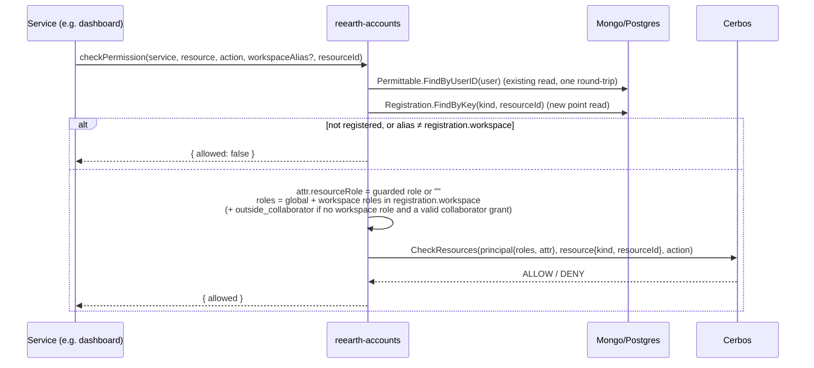
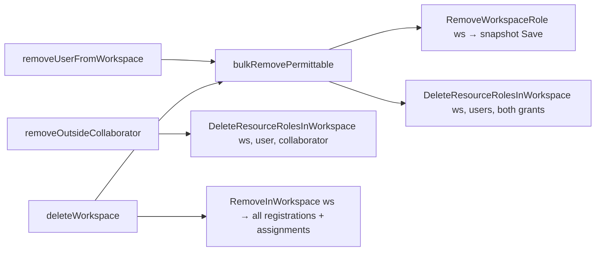

# リソース単位のロール割り当て（汎用的なリソース単位メンバーシップ）

> **Status: DRAFT.** 本ドキュメントは [resource-role-binding.md](resource-role-binding.md)
> の日本語版です。内容に差異がある場合は英語版を正とします。
>
> project 単位で（より一般には、各サービスのリソース単位で）メンバーとロールを設定できるようにします。
> これにより各サービス（dashboard、visualizer、cms など）は、メンバー管理の仕組みをそれぞれ作らずに
> project member を持てます。その際、**reearth-accounts は project が何であるかを知りません**。
> 最初に使うのは Dashboard の project です。コード上では、ロールの割り当ては `...Binding` /
> `resource_bindings` という名前の型・テーブルで表します。

## Document Signature

|           |                |
|-----------|----------------|
| Creator   | soneda-yuya    |
| Leader    | TBD            |
| Task Link | TBD            |
| Developer | TBD            |

## Background / Problem Statement

### 動機（プロダクト上の背景）

- SSO の導入にあたり「ワークスペースを自由に作成できるべきか」を議論し、
  オプションでワークスペースの作成を制限できるべきという意見が出ました。
  制限すると、1 つのワークスペースで多数の project を管理することになります。
- 現状、メンバーは workspace 単位でしか割り当てられないため、顧客は workspace ごとに
  メンバーを管理しています。ただし、project ごとに関係するメンバーは異なります。
  workspace を跨いで project を共有したい場合、顧客は現在 project を対象の
  workspace へコピーして対応しています。
- project ごとにメンバーと権限を割り当てられるようにすることで、workspace を
  組織として機能させられます。SSO / SCIM とは別の機能ですが、ワークスペースの作成を
  制限できるようになった時点で使えるよう、早めに実装できる状態にしたいと考えています。
- 目指すモデルは GitHub に近いものです。workspace と project の関係は、GitHub の
  organization と repository の関係に相当します。GitHub に organization member、
  repository member、そして *outside collaborator*（organization には所属せず、特定の
  repository にだけアクセスできる人）があるのと同様に、Re:Earth にも workspace member、
  project member、外部コラボレーターを持たせます。

### 現状

- Re:Earth の権限は reearth-accounts が判定しています。各サービス（dashboard、visualizer、
  cms など）は、操作を許可する前に「このユーザーはこの操作をしてよいか」を accounts に問い合わせます。
- ユーザーのロールは **workspace 単位** で持っています（ほかにプラットフォーム全体のロールが少しあります）。
  workspace に参加すると、その workspace のすべての project に対して同じロールを持つことになります。
- そのため権限チェックで分かるのは「どの workspace か」だけで、「どの project か」は分かりません。
  同じ workspace の中で「user A は project P を編集できるが project Q は編集できない」といった
  指定はできず、workspace 外の人に1つの project だけへのアクセスを与えることもできません。

### 課題

プロダクトでは **project 単位のメンバーシップ** が必要です。たとえば
「workspace の reader である user A を project P の editor にする」や、
「workspace に所属していない user B は project P でだけ作業でき、workspace 内のほかの project は
見られない」といったものです。現在 accounts が表現できる最も細かい単位は workspace です。

各サービスが project のメンバーシップを独自に実装すると、次の問題が起きます。

1. 招待・ロール変更・削除の API と UI がサービスごとに重複する。
2. 各サービスは、project member を掃除するために **workspace メンバーシップの変更**
   （workspace からのユーザー削除、workspace の削除）に反応しなければならない。
   その情報を持つのは accounts だけなので、サービスごとにイベントや同期の仕組みが必要になる。
   取りこぼすと、すでに抜けた workspace の project にユーザーがアクセスできてしまう。
3. 「project member は、workspace のメンバーか、その project に明示的に招待された外部コラボレーターの
   どちらかである」という制約を、結局 accounts を呼ばずにサービス内だけで検証することはできない。
4. 権限のルールが 1 か所（accounts）で判定されず、各サービスにばらばらに散らばる。

### 制約（この設計の形を決めている理由）

accounts は *project* が何であるかを取り込んではいけません。project の存在、名前、
公開範囲、中身、ライフサイクルは引き続き各サービスが持ちます。accounts が持つのは、
権限の判定に必要な「この project はこの workspace に属し、このユーザーはそれに対して
このロールを持つ（workspace メンバーとして、または外部コラボレーターとして）」という情報だけです。

## Goals

1. **project ごとにメンバーとロールを設定できる。** workspace 全体だけでなく、特定の project
   に対してロールを与えられる。モデルは次のとおり。
   - **workspace メンバー**（owner / maintainer / writer / reader）は、今と同じく workspace の
     ロールによって workspace 内の **すべての** project を見られる。project のロールは、その project での
     アクセスを **引き上げる** ことはできる（例: workspace の reader を project P の writer にすると P を
     編集できる）が、引き下げることはない。
   - **外部コラボレーター**（名前は仮）は、workspace のメンバー **ではない** が、特定の project で
     ロールを与えられた人。その project **だけ** を見て操作でき、有効なのは project のロールだけ。
2. **権限チェックで、対象の project を考慮できる。** サービスが accounts に「このユーザーは
   この操作をしてよいか」と問い合わせたとき、その project でのユーザーのロールを踏まえて判定できる。
   判定には常にその project が実際に属する workspace を使うため、呼び出し側が別の workspace を
   指定してアクセスを得ることはできない。
3. **メンバーの整合性が保たれる。** project は必ず1つの workspace に属し、project member は必ず
   workspace のメンバーかその project の外部コラボレーターのどちらかであり、一度 owner が設定されたら
   owner が0人になることはない。複数人が同時にメンバーを変更しても崩れない。
4. **外れるとアクセスもなくなる。** ユーザーを workspace から外すと、その workspace 内のすべての
   project でのロールも自動で取り消される。外部コラボレーターが workspace 内の最後の project から
   外れると、その workspace との関係はなくなる。各サービスが個別に後始末をする必要はない。
5. **accounts は汎用的なままにする。** accounts は「project」が何かを知らない。どのサービスも、
   権限ポリシーを追加するだけで、自分のリソース（例: CMS のモデル）に同じ仕組みを使える。
   accounts の変更は不要。
6. **既存の動作を壊さない。** 現在の権限チェックとポリシーは、これまでとまったく同じように動く。
7. **一部の project だけへのアクセスを1ステップで与えられる。** UI から管理者は、人を project に
   直接追加する（workspace にいなければ外部コラボレーターになる）ことも、workspace のメンバー画面から
   選んだ project の外部コラボレーターとして人を招待することもできる。どちらも、すべて成功するか
   何も変わらないかの1ステップで行う（*Design → UI からの追加* を参照）。
8. **シートを GitHub と同じように数える。** 外部コラボレーターは、workspace 内のいくつの project に
   参加していても workspace のシートを1つ使い、追加するときには workspace のシートの上限が適用される。
   accounts は課金に必要な数を提供できる。

## Non-Goals

1. **project の詳細情報を accounts に保存すること。** 名前、公開範囲、所有者、日時など
   project の情報は、引き続きそれを持つサービスが管理する。
2. **project が実在するかを確認すること。** accounts は project を登録したサービスを信頼する。
   project を登録できるのはサービスだけで、ユーザーは登録できない。
3. **project の削除を accounts が自分で検知すること。** project が削除されたら、
   それを持つサービスが accounts に知らせる。
4. **入れ子のリソースや権限の継承**（例: folder → project → layer）。後から権限ポリシーで
   追加できるが、今回は対象外。
5. **integration を project のメンバーにすること。** 最初のバージョンでは、project のメンバーに
   なれるのは人（ユーザーアカウント）だけで、integration や API トークンはなれない。
6. **project の属性（例: 公開 / 非公開）を権限の判定に使うこと。** *Open Questions* で扱う。
   最初のバージョンはロールだけで判定する。
7. **project メンバーシップの招待メールを送ること。** メールには project 名が入るが、
   accounts はそれを知らないため、サービス側で送る。

## Functional Requirements

1. **権限チェックの速さを保つ。** project を指定しない権限チェックの負荷は今とまったく同じ。
   project を指定するチェックで増えるのは、その project がどの workspace に属するかを調べる
   小さく速い参照1回だけ。ユーザーの project ロールは、accounts がすでに読み込んでいるデータと
   一緒に読む。
2. **名前と ID に上限を設ける。** リソースの種別名とリソース ID には最大長と使える文字の制限があり、
   保存するデータを小さく予測しやすい状態に保つ。
3. **現実的な規模を想定する。** 1ユーザーあたりの project ロールの割り当ては約 1,000 件まで、
   1 project あたりのメンバーは約 1,000 人まで。
4. **project のメンバー一覧をすばやく取得できる。** 返すのはメンバーが誰か、そのロール、そして
   それぞれが workspace メンバーか外部コラボレーターかだけで、名前などの詳細はサービス側が持つ。
5. **accounts が対応するすべてのデータベースで動く。** どのデータベースを使う環境でも、
   メンバーの変更は同じように動作する。
6. **workspace ごとのシート数を取得できる。** accounts は、workspace の外部コラボレーターが
   何人いるかをすばやく返せる（1人は1回だけ数え、メンバーでもある人は重ねて数えない）。課金は
   これを使って、シート数を workspace メンバー + 外部コラボレーターとして数えられる。

技術的な詳細: *Solution Options → Option 1 → 詳細な要件* を参照。

## Solution Options

この節ではシステム設計を詳しく説明します。実装に関心のある方向けの内容で、ほかの節は
この節を読まなくても理解できます。

### Option 1（推奨）: リソース登録 + `Permittable` に埋め込んだロールの割り当て

3つの状態を持ちます。いずれも accounts にとっては中身を解釈しないものです。

| 状態 | 目的 |
|---|---|
| **リソース登録** `(resourceKind, resourceID) → workspaceID, version` | リソースの workspace の範囲を正として持つ。所有するサービスが登録したことの証明。不変条件のためのリソース単位の直列化ポイント |
| `Permittable` 上の **リソースロール** `(workspaceID, resourceKind, resourceID, roleID, grant)` | そのリソースに対するユーザーのロールと、それが workspace メンバーと外部コラボレーターのどちらに与えられたか。permittable と一緒に読むので、参照のための追加読み込みは不要 |
| **workspace ロック** `workspaceID → version` | ユーザーがメンバーか外部コラボレーターかを決めるすべての処理と、シートの上限のための、workspace 単位の直列化ポイント |

#### ドメイン

```go
// server/pkg/resource/registration.go (new package, no service-specific code)
type Registration struct {
    createdAt   time.Time
    kind        Kind   // validated per FR-3
    resourceID  ID     // validated per FR-3
    version     int64  // bumped by every membership mutation of this resource
    workspaceID workspace.ID
}

// server/pkg/permittable/permittable.go
type Permittable struct {
    id             ID
    resourceRoles  []ResourceRole // NEW
    roleIDs        []role.ID
    updatedAt      time.Time
    userID         user.ID
    workspaceRoles []WorkspaceRole
}

type Grant string

const (
    GrantMember       Grant = "member"       // granted to a workspace member
    GrantCollaborator Grant = "collaborator" // granted to an outside collaborator
)

type ResourceRole struct {
    grant        Grant
    resourceID   resource.ID
    resourceKind resource.Kind
    roleID       role.ID
    workspaceID  workspace.ID // copied from the registration
}
```

**読み込み時のガード。** `ResourceRole(kind, id)` は、そのリソースに対するユーザーのロールが
まだ有効な場合にだけ返します。

- `grant = member`: **ユーザーが `workspaceID` の workspace ロールを持っている間だけ** 有効（従来どおり）。
- `grant = collaborator`: それ単独で有効。ユーザーは workspace ロールを持たない前提。

ユーザーが workspace のメンバーかどうかを変えるすべての操作は、同じトランザクションの中で、その
ユーザーのロールの割り当ての `grant` も書き換えます（*ライフサイクルと連動削除* を参照）。そうした操作は
すべて workspace ロックで直列化されるので、コミット後に両者が食い違うことはありません。ガードは
多層防御として残します。ロールはユーザーごとに `(kind, id)` 1つにつき1つです。accounts のどこにも、
`kind` で `switch` する処理はありません。

**workspace W の外部コラボレーター** とは、`workspaceID` が W である有効な `collaborator` のロールの
割り当てを1つ以上持つユーザーのことです。これは保存するものではなく導出するもので、外部コラボレーター
専用のレコードはありません。そのため最後の割り当てを外すと、関係（とシート）は自動的になくなります。
外部コラボレーターが workspace のメンバー一覧や `Permittable.workspaceRoles` に現れることはありません。

ロールは既存の `roles` テーブル（`owner` / `maintainer` / `writer` / `reader`）を再利用します。
リソース種別ごとのロールの意味は、その種別の Cerbos ポリシーだけで定義します。

#### ストレージ

**PostgreSQL**: マイグレーション `0005_resource_role_binding.up.sql`

```sql
CREATE TABLE resource_registrations (
    resource_kind text NOT NULL CHECK (octet_length(resource_kind) <= 64),
    resource_id   text NOT NULL CHECK (octet_length(resource_id) <= 128),
    workspace_id  text NOT NULL,
    version       bigint NOT NULL DEFAULT 0,
    created_at    timestamptz NOT NULL DEFAULT now(),
    PRIMARY KEY (resource_kind, resource_id)
);
CREATE INDEX resource_registrations_workspace_idx
    ON resource_registrations (workspace_id);

CREATE TABLE permittable_resource_roles (
    permittable_id text NOT NULL REFERENCES permittables(id) ON DELETE CASCADE,
    resource_kind  text NOT NULL,
    resource_id    text NOT NULL,
    workspace_id   text NOT NULL,
    role_id        text NOT NULL,
    grant_type     text NOT NULL CHECK (grant_type IN ('member', 'collaborator')),
    PRIMARY KEY (permittable_id, resource_kind, resource_id),
    FOREIGN KEY (resource_kind, resource_id)
        REFERENCES resource_registrations (resource_kind, resource_id) ON DELETE CASCADE
);
CREATE INDEX permittable_resource_roles_resource_idx
    ON permittable_resource_roles (resource_kind, resource_id);
CREATE INDEX permittable_resource_roles_workspace_idx
    ON permittable_resource_roles (workspace_id, grant_type, permittable_id);

CREATE TABLE resource_workspace_locks (
    workspace_id text PRIMARY KEY,
    version      bigint NOT NULL DEFAULT 0
);
```

```sql
-- 0005_resource_role_binding.down.sql
DROP TABLE IF EXISTS resource_workspace_locks;
DROP TABLE IF EXISTS permittable_resource_roles;
DROP TABLE IF EXISTS resource_registrations;
```

**MongoDB**

- 新しいコレクション `resource_registrations` を追加します。`{ resource_kind: 1, resource_id: 1 }`
  に一意インデックス、`{ workspace_id: 1 }` にインデックスを張ります
  （スキーマは `mongoschemagen` で登録し、`server/CLAUDE.md` の手順に従ってマイグレーションを追加）。
- permittable ドキュメントに任意の配列 `resource_roles` を追加します（各要素は `grant` を持つ）。
  インデックスは `{ "resource_roles.resource_kind": 1, "resource_roles.resource_id": 1 }` と
  `{ "resource_roles.workspace_id": 1, "resource_roles.grant": 1 }` です。
- 新しいコレクション `resource_workspace_locks`（`_id` = workspace ID、`version`）を追加します。

#### リポジトリの変更（スナップショットではなく対象を絞った書き込み）

既存のスナップショット保存 `Save` / `SaveMany` が、リソースロールを上書きしたり
復活させたりできないようにします。

- **Mongo** の `Permittable.Save` は、ドキュメントの置き換えから、`role_ids`、`workspace_roles`、
  `updated_at` だけの `$set` に切り替えます。`resource_roles` は下記の対象を絞った操作だけが書き込みます。
- **Postgres** の `Permittable.Save` はもともと `permittable_workspace_roles` しか書き直さないので、
  リソースロールについては手を加えません。
- **Postgres** の `hydrate` は、ベースの行に加えて workspace ロールとリソースロールを
  `json_agg` のサブセレクトで返す1本のクエリに置き換えます（FR-2）。

新しいリポジトリのインターフェース:

```go
// resource.RegistrationRepo
FindByKey(ctx, kind, id) (*resource.Registration, error)
Create(ctx, r resource.Registration) error              // ErrAlreadyExists on duplicate
LockForUpdate(ctx, kind, id) (*resource.Registration, error) // must run inside a transaction
Remove(ctx, kind, id) error                              // also removes all role assignments
RemoveInWorkspace(ctx, workspaceID) error                // all registrations + role assignments

// resource.WorkspaceLockRepo
Lock(ctx, workspaceID) error // must run inside a transaction; creates the row on first use

// permittable.Repo (additions)
FindResourceMembers(ctx, kind, id) ([]permittable.ResourceMember, error) // projection: userID + roleID + grant
CountResourceOwners(ctx, kind, id, ownerRoleID) (int, error)
UpsertResourceRole(ctx, userID, r permittable.ResourceRole) error
DeleteResourceRole(ctx, userID, kind, id) error
DeleteResourceRolesInWorkspace(ctx, workspaceID, userIDs, grant *Grant) error // nil = both grants
ConvertResourceGrants(ctx, workspaceID, userIDs, from, to Grant) error
FindOutsideCollaborators(ctx, workspaceID) ([]permittable.OutsideCollaborator, error) // userID + bindings
CountOutsideCollaborators(ctx, workspaceID) (int, error) // distinct users
```

| 操作 | Mongo | Postgres |
|---|---|---|
| `UpsertResourceRole` | 単一ドキュメントの更新: `(kind,id)` の要素を `$pull` してから新しい要素を `$push`（集約パイプラインを使った1回の `updateOne`） | `INSERT … ON CONFLICT (permittable_id, resource_kind, resource_id) DO UPDATE SET role_id = …, grant_type = …` |
| `DeleteResourceRole` | `$pull` | `DELETE … WHERE permittable_id=$1 AND resource_kind=$2 AND resource_id=$3` |
| `DeleteResourceRolesInWorkspace` | `updateMany` + `$pull {workspace_id[, grant]}` | `DELETE … WHERE workspace_id=$1 AND permittable_id = ANY($2) [AND grant_type=$3]` |
| `ConvertResourceGrants` | `{workspace_id, grant: from}` を `arrayFilters` にした `updateMany` → `$set grant: to` | `UPDATE … SET grant_type=$4 WHERE workspace_id=$1 AND permittable_id = ANY($2) AND grant_type=$3` |
| `FindResourceMembers` | 集約 `$match` → `$unwind` → `$match` → `$project {user_id, role_id, grant}` | `SELECT p.user_id, r.role_id, r.grant_type FROM permittable_resource_roles r JOIN permittables p …` |
| `CountOutsideCollaborators` / `FindOutsideCollaborators` | 集約 `$match {resource_roles: {$elemMatch: {workspace_id, grant: "collaborator"}}}` → 件数 / 射影 | `SELECT count(DISTINCT permittable_id) … WHERE workspace_id=$1 AND grant_type='collaborator'`（インデックスのみで完結） |
| `LockForUpdate` | トランザクション内で `findOneAndUpdate {$inc: {version: 1}}`（同じ登録に対する並行トランザクションは書き込み競合となり、リトライされる） | `SELECT … FOR UPDATE` |
| `WorkspaceLock.Lock` | トランザクション内で `findOneAndUpdate {_id: ws} {$inc: {version: 1}}, upsert`（書き込み競合 → リトライ） | `INSERT … ON CONFLICT DO NOTHING` の後に `SELECT … FOR UPDATE` |

#### 権限チェック

`CheckPermissionInput` に任意項目を1つ追加します。

```graphql
input CheckPermissionInput {
  service: String!
  resource: String!
  action: String!
  workspaceAlias: String
  resourceId: String   # NEW
}
```

`resourceId` が **ない** 場合、挙動は変わりません。

`resourceId` が **ある** 場合:

1. 登録 `(service:resource, resourceId)` を読み込む。**見つからなければ拒否。**
2. `workspaceAlias` が指定されていて、それが登録の `workspaceID` に解決されなければ **拒否**。
3. principal のロール = グローバルロール + **登録の `workspaceID`** におけるユーザーの workspace ロール
   （呼び出し元は workspace を選べない）。ユーザーがその workspace のロールを持たず、このリソースに
   有効な `collaborator` のロールの割り当てを持つ場合は、評価時だけのロール `outside_collaborator` を
   加える（保存はしない。Cerbos に空でないロールの一覧を渡し、ポリシーが外部コラボレーターを識別できる
   ようにするため）。
4. principal の属性 `resourceRole` = 読み込み時のガードを通過した、このリソースでのユーザーのロール。
   なければ `""`。
5. Cerbos のリソース ID は実際の `resourceId` にする。

**デフォルトのモデル。** workspace メンバー（`owner` / `maintainer` / `writer` / `reader`）では、
実効ロール = max(workspace ロール, リソースロール) です。今と同じく workspace ロールが workspace のすべての
リソースに対するアクセスを与え、リソースロールはそれに加算されるだけです。外部コラボレーターでは
リソースロールだけが有効です。各ロールの意味は両方のレベルで同じ（`owner` / `maintainer`: すべての操作と
メンバー管理、`writer`: 閲覧と編集、`reader`: 閲覧）なので、ポリシーは操作ごとに「workspace ロールの
ルール」と「`resourceRole` の条件のルール」の和集合として max を表現します。Cerbos はどちらかが
マッチすれば許可します。

ポリシーは引き続き各サービスの `definition.go` に置き、reearthx の generator がすでに
サポートしている条件を使います。`dashboard:project` の例:

```go
// dashboard: definition.go
resourceRole := func(expr string) *generator.Condition { return generator.SimpleExpr(expr) }
any := []string{"*"} // any principal role (including outside_collaborator); the condition does the gating

builder.AddResource("project", []generator.ActionDefinition{
    // workspace members: access to every project of the workspace via the workspace role
    // ("outside_collaborator" is never listed here)
    generator.NewActionDefinition("read", []string{"owner", "maintainer", "writer", "reader"}),
    generator.NewActionDefinition("edit", []string{"owner", "maintainer", "writer"}),
    generator.NewActionDefinition("delete", []string{"owner", "maintainer"}),
    generator.NewActionDefinition("manage_members", []string{"owner", "maintainer"}),
    // project roles: add on top of the workspace role; the only source of access for outside collaborators
    generator.NewActionDefinitionWithCondition("read", any, resourceRole(`P.attr.resourceRole != ""`)),
    generator.NewActionDefinitionWithCondition("edit", any, resourceRole(`P.attr.resourceRole in ["owner", "maintainer", "writer"]`)),
    generator.NewActionDefinitionWithCondition("delete", any, resourceRole(`P.attr.resourceRole in ["owner", "maintainer"]`)),
    generator.NewActionDefinitionWithCondition("manage_members", any, resourceRole(`P.attr.resourceRole in ["owner", "maintainer"]`)),
})
```

リソースロールは principal のロールではなく principal の **属性** として渡されるので、
project の `owner` が workspace の `owner` と取り違えられることはありません。project のロールは、
チェックで指定されたリソースに対してだけ有効です。プロダクトがこのデフォルトより厳しいルール
（例: workspace メンバーにも見えない private な project）を適用できるかは Open Question 1 で扱います。

**外部コラボレーターに関するポリシーの補足。** ポリシーは `outside_collaborator` に
`P.attr.resourceRole` の条件以外では何も許可してはいけません。明示的なロールの一覧で許可するルールは
もともとこれを含まないので、拒否されます（安全側に倒れる）。`resourceRole` の条件なしで `*` に許可する
ルールは、サービスごとに見直す必要があります。workspace 単位のリソース（例: `dashboard:workspace`）は
`resourceId` なしでチェックされるため、外部コラボレーターはそこで workspace ロールを持たず、拒否されます。
workspace 単位で何を見られるかは Open Question 7 で扱います。

#### メンバー管理 API

**ライフサイクル（M2M のみ）**: REST のサービス用ルートで、M2M の API キーで **のみ** 認証します
（ユーザーの JWT は拒否）。登録は、リソースが存在することとそのリソースがどの workspace に属するかを
accounts が知る手段です。登録をサービスに限定することで、ユーザーが未登録の ID を
自分のものとして主張する手段をなくします。

```
POST   /api/service/resources
       { workspaceId, resourceKind, resourceId, ownerUserId? }
       → creates the registration and, if ownerUserId is given, an `owner`
         role assignment (grant = member), in one transaction.
         ownerUserId must be a workspace member.
         409 if already registered with a different workspace; idempotent
         (200) if registered with the same workspace.
DELETE /api/service/resources/{resourceKind}/{resourceId}
       → removes the registration and every role assignment on the resource
         (of both grants).
GET    /api/service/workspaces/{workspaceId}/seat-usage
       → { memberCount, outsideCollaboratorCount, seatCount } for billing (FR-7).
```

**メンバーシップ（ユーザーの JWT、GraphQL）**:

```graphql
enum ResourceGrant { MEMBER OUTSIDE_COLLABORATOR }

input SetResourceMemberInput {
  resourceKind: String!
  resourceId: String!
  userId: ID!
  role: Role!
}
input RemoveResourceMemberInput {
  resourceKind: String!
  resourceId: String!
  userId: ID!
}
input ResourceRoleInput {
  resourceKind: String!
  resourceId: String!
  role: Role!
}
input InviteOutsideCollaboratorInput {
  workspaceId: ID!
  userId: ID!
  resources: [ResourceRoleInput!]!   # 1..100 entries, distinct (kind, id)
}
input RemoveOutsideCollaboratorInput {
  workspaceId: ID!
  userId: ID!
}

type ResourceMember { userId: ID!, role: Role!, grant: ResourceGrant! }
type ResourceBinding {
  workspaceId: ID!
  resourceKind: String!
  resourceId: String!
  role: Role!
  grant: ResourceGrant!
}
type OutsideCollaborator { userId: ID!, resources: [ResourceBinding!]! }
type WorkspaceSeatUsage {
  workspaceId: ID!
  memberCount: Int!
  outsideCollaboratorCount: Int!   # distinct users, members excluded
  seatCount: Int!                  # memberCount + outsideCollaboratorCount
}

extend type Query {
  resourceMembers(resourceKind: String!, resourceId: String!): [ResourceMember!]!
  # IDs only; the owning service hydrates names etc.
  # Without workspaceId it also lists workspaces where the user is only an outside collaborator.
  myResourceBindings(resourceKind: String!, workspaceId: ID): [ResourceBinding!]!
  outsideCollaborators(workspaceId: ID!): [OutsideCollaborator!]!
  workspaceSeatUsage(workspaceId: ID!): WorkspaceSeatUsage!
}

extend type Mutation {
  setResourceMember(input: SetResourceMemberInput!): ResourceMember
  removeResourceMember(input: RemoveResourceMemberInput!): Boolean!
  inviteOutsideCollaborator(input: InviteOutsideCollaboratorInput!): OutsideCollaborator
  removeOutsideCollaborator(input: RemoveOutsideCollaboratorInput!): Boolean!
}
```

ユーザーは `addUsersToWorkspace` と同じくユーザー ID で指定します。UI は既存のユーザー検索
（`userByNameOrEmail` / `searchUser`）で名前またはメールアドレスから探します。メールアドレスによる
新しい招待の仕組みは追加しません。

以下の「workspace 管理者」とは、`addUsersToWorkspace` / `removeUserFromWorkspace` が使う既存の
workspace のチェック（`add_member` / `delete_member`、つまり workspace の owner または maintainer）を
通過する操作者を指します。

ガード（汎用的で、種別固有のコードはなし）。すべての更新操作は **1つのトランザクション** で実行します。
ロックは決まった順序で取り（必要な場合はまず workspace ロック、次に `(kind, id)` でソートした登録）、
ガードはロック取得後に評価します。

| 操作 | ロック | ガード |
|---|---|---|
| `setResourceMember` | 登録の workspace の workspace ロック、次に登録 | 登録が存在する。操作者に `(kind, id)` への `manage_members` が Cerbos で許可されている。そのうえで: **対象ユーザーが workspace メンバー** → `grant = member`。**対象ユーザーがこのリソースにすでに `collaborator` の割り当てを持つ** → ロールの変更で、`grant` は `collaborator` のまま。**それ以外**（新しい外部コラボレーターの割り当て）→ 操作者は workspace 管理者でなければならない（v1。Open Question 7）。個人 workspace は拒否。対象ユーザーがまだその workspace の外部コラボレーターでなければシートの上限を確認する（下記）。変更が最後の `owner` を降格させる場合は最後の owner のルール |
| `removeResourceMember` | 登録 | Cerbos の `manage_members`、または操作者 == 対象ユーザー（自分で抜ける場合）。最後の owner のルール |
| `inviteOutsideCollaborator` | workspace ロック、次に各登録 | 操作者が workspace 管理者。個人 workspace は拒否。対象ユーザーが workspace メンバーで **ない**（メンバーなら `ErrAlreadyWorkspaceMember`。`setResourceMember` を使う）。すべての登録が存在し `workspaceId` に属する（そうでなければ呼び出し全体を拒否）。対象ユーザーがまだ外部コラボレーターでなければシートの上限。リソースごとに最後の owner のルール（既存のコラボレーターのロールが変わる場合がある）。そのうえで各項目について `UpsertResourceRole(grant = collaborator)`。すべてか無か |
| `removeOutsideCollaborator` | workspace ロック、次に対象ユーザーが `collaborator` の割り当てを持つすべての登録 | 操作者が workspace 管理者。対象ユーザーがそれらのリソースのいずれかで最後の `owner` なら拒否。そのうえで `DeleteResourceRolesInWorkspace(ws, [user], collaborator)` |
| `resourceMembers` | — | `(kind, id)` への Cerbos の `read`。結果は読み込み時のガードで絞り込む |
| `myResourceBindings` | — | 操作者自身のロールの割り当てのみ。読み込み時のガードで絞り込む |
| `outsideCollaborators`、`workspaceSeatUsage` | — | 操作者が workspace のメンバーを閲覧できる（`read_member`）。`seat-usage` のルートは M2M のみ |

**シートの上限。** 既存のメンバー数のフック（`enforceMemberCount`）を拡張し、シート数を
`members + CountOutsideCollaborators(ws)` として数えます。新しくシートを使う場合には必ず workspace ロックの
もとで実行します。すなわち、外部コラボレーターでない人を workspace メンバーとして追加するとき、または
あるユーザーの workspace 内で最初の `collaborator` の割り当てを作るときです。すでに外部コラボレーターである
ユーザーや、コラボレーターからメンバーに変わるユーザーは、追加のシートを使いません。

**最後の owner のルール:** リソースの owner 数を 1 以上から 0 にしてしまうメンバーシップの更新は
拒否します。owner はどちらの grant でも数えます。owner なしで登録されたリソース（例: 埋め戻し）は、
owner が設定されるまで workspace ロールで管理します。登録解除のエンドポイントはこのルールの対象外です。

**既存の workspace のフローの変更**（いずれもまず workspace ロックを取る）:

- `addUsersToWorkspace`: その workspace の外部コラボレーターであるユーザーは project のロールを保つ。
  同じトランザクションで `ConvertResourceGrants(ws, users, collaborator → member)` を行い、シートの
  チェックでは重ねて数えない。
- `removeUserFromWorkspace` / `removeMultipleUsersFromWorkspace`: 今と同じく、そのユーザーの
  workspace 内のロールの割り当てをすべて（両方の grant）削除する。一部を残して外部コラボレーターに
  変えることは Open Question 9。
- `deleteWorkspace`（`Workspace.Remove`）: `RemoveInWorkspace(ws)` で、その workspace のすべての登録と
  すべてのロールの割り当て（外部コラボレーターのものを含む）を削除する。

#### 並行性

| 競合 | 対策 |
|---|---|
| 同じリソースの別々のユーザーに対する2つの書き込みが、どちらも最後の owner のチェックを通過する | どちらも同じ登録に対して `LockForUpdate` を取る必要があり、後の方は待つ（Postgres）か、競合してリトライする（Mongo）。owner 数はロック取得後に読む。 |
| 2つのサービスが同じ `(kind, id)` を登録する | 主キー / 一意インデックスにより、負けた方は `ErrAlreadyExists` になる。 |
| 残りシートが1つのときに、2人の管理者が別々の新しい外部コラボレーターを追加する | どちらも workspace ロックを取る。後の方は待つかリトライし、ロック取得後に読むシート数には先の方が含まれる。ちょうど1つだけ成功する。 |
| 同じ新しい人を2人の管理者が同時に外部コラボレーターとして追加する | workspace ロックで直列化される。後の方は既存の外部コラボレーターと見なすので、追加のシートは使わない。 |
| `setResourceMember` が project のロールを割り当てている最中に、ユーザーが workspace から外される | どちらも workspace ロックを取るので、一方がもう一方の後に実行される。外す処理が後なら、新しい割り当ても削除される。先なら、`setResourceMember` は非メンバーと見なして外部コラボレーターの経路（管理者のチェック、シートの上限）を通る。さらに読み込み時のガードが、workspace ロールのないユーザーの `member` の割り当てを無視する。 |
| 外部コラボレーターが、別の project のロールを与えられている最中に workspace に追加される | どちらも workspace ロックを取る。workspace への追加が先なら新しい割り当ては `member` として書かれ、後なら `ConvertResourceGrants` で変換される。メンバーに `collaborator` の割り当てが残ることはない。 |
| workspace フローからの古いスナップショットの `Save` が、新しいロールの割り当てを上書きする（またはその逆） | スナップショット保存は `resource_roles` を書き込まず、ロールの割り当ての書き込みは `workspace_roles` を書き込まない（*リポジトリの変更* を参照）。 |
| リソースが重なる2つの複数リソースの操作がデッドロックする | ロックの順序を固定する: workspace ロック、次に `(kind, id)` でソートした登録。 |

#### ライフサイクルと連動削除

| イベント | 実行者 | ロールの割り当てへの影響 |
|---|---|---|
| リソース作成 | サービス（M2M） | `ownerUserId` = 作成者（`member`）として `POST /api/service/resources` を呼ぶ |
| リソース削除 | サービス（M2M） | `DELETE /api/service/resources/{kind}/{id}` でそのリソースの割り当てをすべて削除する。workspace 内の最後の割り当てがそこだった外部コラボレーターは、外部コラボレーターでなくなる（シートも空く）。呼び忘れると孤立した登録が残るが無害で、後から任意の掃除の仕組みで削除する |
| 既存のリソース（本機能以前） | サービス（M2M） | サービスが `resourceId` を送り始める前に、同じエンドポイント（冪等）で一度だけ埋め戻す |
| project メンバーの追加（`setResourceMember`） | accounts | workspace メンバーには `member` の割り当て。それ以外は `collaborator` の割り当て（まだでなければ外部コラボレーターになる） |
| 外部コラボレーターを project に招待 | accounts | `collaborator` の割り当てを1つのトランザクションで書き込む |
| 外部コラボレーターの workspace 内の最後の割り当てを削除 | accounts | ほかに何もしない。関係とシートは導出なので自動的になくなる |
| 外部コラボレーターを workspace から外す | accounts | `removeOutsideCollaborator` が workspace 内のその人の `collaborator` の割り当てをすべて削除する |
| 外部コラボレーターを workspace メンバーとして追加 | accounts | `addUsersToWorkspace` が workspace 内のその人の割り当てを `member` に変換する。シートは1つのまま |
| workspace メンバーを削除 | accounts | `bulkRemovePermittable` から `DeleteResourceRolesInWorkspace(ws, users, nil)` も呼ぶ |
| workspace 削除（`Workspace.Remove`） | accounts | `RemoveInWorkspace(ws)`: workspace のすべての登録と割り当て（外部コラボレーターのものを含む） |
| workspace の無効化 / 復元 | accounts | 変更なし（workspace ロールと同じ。復元に備えてデータを残す） |
| ユーザー削除（`DeleteMe`） | accounts | 現状、`DeleteMe` は permittable を削除しない。ユーザーが消えればロールの割り当てには到達できなくなる。`DeleteMe` で permittable を削除する修正は、本機能とは独立したフォローアップとして提案する。それまでは削除された外部コラボレーターも `CountOutsideCollaborators` に数えられてしまうため、件数は有効なユーザーと突き合わせる（または修正を先に入れる） |

**メリット**

- リソースの workspace の範囲はサーバー側で正として管理されるので、呼び出し元が
  別の workspace のロールを借りることはできない。
- accounts にリソースを存在させられるのは M2M 認証されたサービスだけなので、
  ユーザーが ID を自分のものとして主張することはできない。
- リソース全体の不変条件はリソースごとに1つのレコードで、メンバー / コラボレーターの判定とシートは
  workspace ごとに1つのレコードで、両バックエンドとも直列化される。
- ロールの割り当ての参照はすでに読み込まれた permittable の中で完結する。新たな読み込みは
  登録の主キー参照だけ。
- 外部コラボレーターのために新しい workspace ロールや専用のレコードは要らない。
- accounts はドメインに依存しないまま: 種別と ID は解釈しない値で、意味はポリシーが持つ。

**デメリット**

- `resourceId` を渡す `checkPermission` 呼び出しでポイント読み込みが1回増える。
- サービスはリソースを登録し（埋め戻しを含む）、削除時に登録を解除する必要がある。
- Mongo の `Save` の意味が置き換えから `$set` に変わる（既存コードに手が入る）。
- 既存の workspace メンバーのフローで、workspace ロックを取り、ロールの割り当てを変換または削除する
  必要がある。

#### 詳細な要件

*Functional Requirements* の技術的な形です。各項目は順に FR-1〜FR-7 で、この節のほかの部分では
この番号で参照します。

1. `resourceId` なしの `checkPermission`: 読み込みは **変わらない**。
   `resourceId` ありの場合: **インデックスが効くポイント読み込みが1回増える**
   （主キーによるリソース登録の読み込み）。ロールの割り当て自体は、すでに読み込まれた permittable から読む。
2. PostgreSQL では、`Permittable.FindByUserID` がベースの行、workspace ロール、リソースロールを
   **1回のラウンドトリップ** で読み込む（集約したサブセレクト）。そのため、リソースロールを追加しても
   `checkPermission` のクエリは増えない。
3. 項目の上限。ドメイン層と DB 制約の両方で強制する:
   - `resourceKind`: 64 バイト以下、`^[a-z0-9-]{1,32}:[a-z0-9_-]{1,31}$`
   - `resourceID`: 128 バイト以下、`^[A-Za-z0-9_.:-]{1,128}$`
4. 想定規模: 1ユーザーあたりのロールの割り当ては約 1,000 件以下（上記の上限で1件約 300 B 以下、
   つまり Mongo の1ドキュメントあたり約 300 KB 以下で、16 MB を大きく下回る）。
   1リソースあたりのメンバーは約 1,000 人以下。
5. 1リソースのメンバー一覧取得はインデックスが効き、そのリソースの `(userId, role, grant)` だけを返す。
   集約全体を組み立てることはしない。
6. すべての更新操作が MongoDB / PostgreSQL の両バックエンドと `memory` リポジトリで動くこと。
7. `CountOutsideCollaborators(ws)` はインデックス（`workspace_id, grant`）が効き、ユーザーを重複なく
   数える。`workspaceSeatUsage` はメンバー + 外部コラボレーターを、同じユーザーを2回数えずに返す。

範囲についての補足（*Non-Goals* の技術的な形）:

- リソースの存在は検証しない。accounts はリソースを登録する **M2M 認証された** サービスを信頼し、
  リソースの削除時に登録解除のエンドポイントを呼ぶこともそのサービスに任せる
  （*ライフサイクルと連動削除* を参照）。
- v1 のロールの割り当ては **ユーザーの principal のみ**。integration（M2M）の principal は
  リソースロールを持てない。
- v1 の `checkPermission` は、リソースの属性（例: `visibility`）を Cerbos に渡さない。
  ポリシーはロールだけを使う（*Open Questions の技術的な補足* を参照）。

#### リクエストの流れ（シーケンス図）

##### resource ID を指定した権限チェック



##### project の作成と project メンバーの追加（パターン a）

```mermaid
sequenceDiagram
    participant U as User
    participant S as Service
    participant A as reearth-accounts

    U->>S: createProject
    S->>S: persist project P
    S->>A: POST /api/service/resources {ws, "dashboard:project", P, owner=U} (M2M key)
    A->>A: U ∈ ws? → create registration + owner role assignment (member, one tx)
    A-->>S: 201
    U->>S: add B to P as writer
    S->>A: setResourceMember(kind, P, B, writer) (U's JWT)
    A->>A: begin tx; lock ws; lock registration; Cerbos manage_members for U?
    alt B ∈ ws
        A->>A: upsert (B, P, writer, member)
    else B ∉ ws
        A->>A: U is workspace admin? seat limit (if B is new to ws) → upsert (B, P, writer, collaborator)
    end
    A-->>S: { userId: B, role: writer, grant }
```

##### 選んだ project への外部コラボレーターの招待（パターン b）

```mermaid
sequenceDiagram
    participant U as Admin
    participant S as Service UI (e.g. dashboard)
    participant A as reearth-accounts

    U->>S: invite C as outside collaborator on P1, P2
    S->>A: userByNameOrEmail(...) → C's userId
    S->>A: inviteOutsideCollaborator(ws, C, [(kind,P1,writer), (kind,P2,reader)]) (U's JWT)
    A->>A: begin tx; lock ws
    A->>A: U is workspace admin? C ∉ ws? P1, P2 registered in ws?
    A->>A: seat limit (if C is not yet an outside collaborator)
    A->>A: LockForUpdate P1, P2 (sorted) → last-owner rule → upsert (collaborator) each
    A->>A: commit (any failure → roll back all)
    A-->>S: { userId: C, resources }
```

その後、外部コラボレーターには自分の project だけが見えます。サービスは `myResourceBindings` で
それを一覧し（workspace 切り替えに表示するためにも使う）、workspace 内のそれ以外の project に対する
`checkPermission` は拒否されます。

##### 削除時の連動



#### 技術的な補足: 影響・テスト・デプロイ・ロールバック・監視

##### 影響

1. **permittable のドキュメント / 行のサイズ** がロールの割り当て1件あたり約 300 B 以下増える。
2. **Mongo の `Permittable.Save`** が置き換えから `$set` に変わる。permittable の永続化に関する
   既存テストは引き続き通る必要があり、`Save` が `resource_roles` に触れないことを確認する
   新しいテストを追加する。
3. `resourceId` を渡した場合の **Cerbos のリソース ID の変更**: 影響を受けるのは、利用を始めた
   呼び出し元だけ。
4. **既存の workspace メンバーのフロー**（`addUsersToWorkspace`、`removeUserFromWorkspace`、
   `removeMultipleUsersFromWorkspace`、`deleteWorkspace`）は workspace ロックを取り、同じトランザクションで
   ロールの割り当てを変換または削除する。
5. **ポリシーの書き方**: ロール名は workspace とリソースで共通。リソースロールは `P.attr.resourceRole`
   でのみ判定する（principal のロールとして扱わない）。メンバーに対する workspace ロールの workspace 全体への
   許可はそのまま残し、`outside_collaborator` は workspace ロールのルールに決して含めない。サービスの
   既存の project ポリシーは、置き換えるのではなく `resourceRole` のルールを追加して拡張する（和集合 = max）。
6. **gqlclient**（`server/pkg/gqlclient`）の利用側は、新しいフィールドと `ResourceGrant` enum を使うために
   バージョンを上げる必要がある。古いクライアントには影響しない（workspace のメンバー一覧と `Role` enum は
   変わらない）。
7. **シート**: `enforceMemberCount` が外部コラボレーターを数える。課金はメンバー数だけでなく
   `workspaceSeatUsage` / `seat-usage` のルートを使う必要がある。
8. **workspace 切り替え**: 外部コラボレーターでしかないユーザーは workspace のメンバーシップを持たないので、
   サービスは `myResourceBindings` を使ってそうした workspace を表示する必要がある。

##### テスト

1. **ユニット**（`pkg/resource`、`pkg/permittable`）: 種別 / ID の検証と長さの上限。
   リソースごとにロールは1つ。grant の検証。読み込み時のガードが、対応する workspace ロールのない
   `member` の割り当てを除外し、`collaborator` の割り当ては残すこと。
2. **interactor**（`internal/usecase/interactor`）:
   - `CheckPermission`: `resourceId` なし → roles が変わらない（リグレッション）。
     未登録のリソース → 拒否。別の workspace の alias → 拒否。workspace ロールは alias ではなく
     登録から取られる。`resourceRole` が設定される / 空になる。リソースロールがある場合も、principal の
     ロールには workspace ロールが入っている（ポリシーが max を計算できる）。`outside_collaborator` は、
     そのリソースに有効なコラボレーターの割り当てを持つ非メンバーにだけ加わる。
   - 登録: M2M のみ（JWT は拒否）。owner は workspace のメンバーでなければならない。
     同じ workspace での重複は冪等、別の workspace なら 409。
   - `setResourceMember`: メンバーの対象 → `member`。非メンバーの対象 → `collaborator`。これは
     workspace 管理者だけができ、workspace にとって新しい人ならシートの上限を適用し、個人 workspace は拒否。
     既存のコラボレーターのロール変更は project の `manage_members` 保持者でもできる。`manage_members`
     がなければ拒否。最後の owner の保護。
   - `removeResourceMember`: 自分で抜けるのは許可。最後の owner の保護。コラボレーターの最後の割り当てを
     外すと `CountOutsideCollaborators` が1減る。
   - `inviteOutsideCollaborator`: 別の workspace のリソース、未登録のリソース、管理者でない操作者、
     すでにメンバーである対象、シートの上限のいずれでも、すべてか無か。既存のコラボレーターを別の
     リソースに招待しても追加のシートは使わない。
   - `removeOutsideCollaborator`: workspace 内のそのユーザーのコラボレーターの割り当てをすべて削除する。
     そのいずれかで最後の owner なら拒否。
   - 既存の外部コラボレーターに対する `addUsersToWorkspace`: 割り当てが `member` に変換され、シート数は
     変わらない。
   - 連動削除: `RemoveUserMember` / `RemoveMultipleUserMembers` は両方の grant を削除する。`Remove` は
     コラボレーターを含めてすべて削除する。
   - `workspaceSeatUsage`: メンバー + 重複のないコラボレーターで、二重に数えない。
3. **並行性**（`make test-integration`、両バックエンド）: 2つの goroutine が最後の2人の owner を
   同時に外す → ちょうど1つだけ成功する。同じキーの並行登録 → 1つだけ成功する。
   `UpsertResourceRole` の後の古いスナップショットの `Save` でもロールの割り当てが残る。残りシートが
   1つのときに別々の新しいコラボレーターを同時に招待 → ちょうど1つだけ成功する。`setResourceMember` の
   実行中にメンバーを外す → その後アクセスできない。コラボレーターの workspace への追加と新しい project
   ロールの付与が同時 → 割り当てはすべて `member` になる。
4. **リポジトリ**: すべての新しい操作の Mongo・Postgres・memory 実装。Postgres の
   `FindByUserID` が1本のクエリしか発行しないこと。
5. **マイグレーション**: 既存 DB に対する `0005` の up / down。既存の permittable が
   空の `resourceRoles` で読み込めること。
6. **E2E**（`server/e2e`）: 上記のルールで生成した `dashboard:project` のテスト用ポリシーを使い、
   次を確認する。
   - ロールの割り当てのない workspace の `reader` → workspace のすべての project で `read` は許可、
     `edit` は拒否。
   - workspace の `reader` + P のリソースロール `writer` → P でだけ `edit` が許可。
   - workspace の `writer` + P のリソースロール `reader` → P でも `edit` は許可のまま
     （リソースロールはアクセスを引き下げない）。
   - workspace の `owner` → すべての project ですべての操作が許可。
   - P で `writer` の外部コラボレーター → P でだけ `read` / `edit` が許可、ほかの project と
     workspace 単位のリソースでは拒否。
   - 別 workspace のユーザー → 拒否。

##### デプロイ

1. 後方互換性はあるか？ **あり。** 入力の任意項目、新しいコレクション / テーブル、
   新しいルートと GraphQL のフィールド・enum の追加のみ。`resourceId` がなければ挙動は変わらず、
   workspace のメンバー一覧も変わらない。
2. 部分的にデプロイできるか？ **できる。** 順序:
   1. accounts をデプロイする。
   2. 各サービスが既存リソースの登録を埋め戻す。
   3. 各サービスが作成時の登録 / 削除時の登録解除を始める。
   4. 各サービスが `P.attr.resourceRole` を使うポリシーをデプロイし、`resourceId` を送り始める。
      ステップ 4 より前は属性が存在せず、条件がマッチしない（安全側に倒れる）。
   5. 課金が `workspaceSeatUsage` / `seat-usage` に切り替わり、サービスがコラボレーターとしてだけ
      参加している workspace を `myResourceBindings` で表示する。
   6. 外部コラボレーターを作る UI を有効にする（ステップ 5 の後でのみ）。
3. 通知先: dashboard / visualizer / cms のオーナー、課金の担当者、Cerbos ポリシーの管理者。
4. 設定変更: なし（既存の M2M API キーを再利用する）。
5. DDL: Postgres のマイグレーション `0005` は起動時に自動で実行される（golang-migrate）。
   Mongo は起動時のマイグレーションでコレクションのスキーマとインデックスを作成する。
   accounts 側での埋め戻しはない。

##### ロールバック

1. 原因をチームの Slack チャンネルに共有する。
2. 外部コラボレーターの UI を無効にし、課金をメンバー数に戻してから、`resourceId` / `resourceRole` に
   依存する利用側サービス / ポリシーを戻す。
3. accounts のイメージを戻す。旧バイナリは新しいコレクション、テーブル、`resource_roles`
   フィールドを無視するので、**データのロールバックは不要**。
   旧バージョンの稼働中は外部コラボレーターはアクセスできず（機能が無効のため）、ロールフォワードで
   元に戻る。ただし割り当てが消えた場合は除く: 旧バージョンの Mongo の `Save` はドキュメント全体を
   置き換えるため、書き込んだ permittable の `resource_roles` は消える。機能は無効になっているので
   ロールバック中は許容でき、再度ロールフォワードする際にサービスが埋め戻しを再実行するが、消えた
   外部コラボレーターの割り当ては招待し直す必要がある。
4. スキーマ自体を削除する必要がある場合のみ、`0005` の down を実行する
   （登録、ロールの割り当て、workspace ロックが消えるので、先にダンプを取る）。

##### デプロイ後の確認と監視

- チェックリスト
  - dashboard の staging で project を作成し、登録と作成者への `owner` ロールの割り当てができることを確認する。
  - workspace の `reader` にある project のリソースロール `writer` を与え、その project を編集でき、
    ほかの project は閲覧だけできることを確認する。そのメンバーを workspace から外し、すべての
    project にアクセスできなくなることを確認する。
  - 別の workspace の alias を指定して `checkPermission` を呼び、拒否されることを確認する。
  - workspace 外のユーザーに対して `setResourceMember` を呼び、`collaborator` の割り当てになること、
    その project にだけアクセスできること、workspace のメンバー一覧に現れないこと、
    `outsideCollaboratorCount` が1増えることを確認する。
  - 2つの project に対して `inviteOutsideCollaborator` を呼び、両方に割り当てられること、シート数が
    1だけ増えることを確認する。`removeOutsideCollaborator` を呼び、すべてのアクセスがなくなり、
    シート数が減ることを確認する。
  - 外部コラボレーターを workspace に追加し、project のロールが残ること、シート数が変わらないことを
    確認する。
- メトリクス
  - `resourceId` あり / なしでの `checkPermission` の p50 / p95 レイテンシ。
  - 登録 / 登録解除 / `setResourceMember` / `inviteOutsideCollaborator` / `removeOutsideCollaborator`
    のエラー率（Mongo のトランザクションのリトライとシートの上限による拒否を含む）。
  - permittable あたりのロールの割り当て数（最大 / p99）。FR-4 の監視用。
- アラート
  - `checkPermission` のエラー率: Warning > 1%、Danger ≥ 5%。
  - `checkPermission` の p95 レイテンシ: Warning > ベースライン比 +20%。

#### Open Questions の技術的な補足

1. **`checkPermission` へのリソース属性の受け渡し:** 提案は、`CheckPermissionInput` に任意の
   `attributes: JSON` を追加し、Cerbos のリソースにそのまま渡すこと（例: `visibility`）。
   プロダクトごとのより厳しいルール（例: workspace メンバーも、リソースロールがなければ
   `private` な project を閲覧できない）は、workspace ロールのルールへの条件（例:
   `R.attr.visibility != "private"`）として表現する。上記のデフォルトのポリシーは加算のまま。
2. **一括チェック:** 一覧画面向けに、複数の `resourceId` に対する `checkPermissions` を用意する。
   Cerbos の `CheckResources` はすでに複数リソースに対応している。
3. **サービスごとの M2M キー:** v1 では登録 / 登録解除（`POST` / `DELETE /api/service/resources`）に
   既存の共有 M2M API キーを受け付ける。案: 各キーをそのサービス自身の種別（`dashboard:*`）に限定する。
4. **孤立データの掃除（sweeper）:** 登録解除のエンドポイントを呼ばずに削除されたリソースの登録を
   削除する。シートにも関係する: 孤立した登録が残ると、そのコラボレーターが数えられ続ける。
5. **integration メンバー:** M2M トークンをリソースの principal にすること（cms で必要になる可能性）。
6. **UI の配置:** どちらにしても accounts の変更はない。パターン (a) は `setResourceMember` を呼び、
   パターン (b) と外部コラボレーターの一覧は `inviteOutsideCollaborator` / `outsideCollaborators` /
   `removeOutsideCollaborator` を、どのサービスの画面からでも呼ぶ。
7. **外部コラボレーターの名前と権限:** GraphQL の enum の値と評価時だけのロール名は、最終的な名前に
   合わせる。workspace 単位で見えるもの（例: workspace 名）は、特定の workspace 単位の操作に
   `outside_collaborator` を並べることで許可する。そのためには、ユーザーがその workspace にコラボレーター
   の割り当てを持つ場合、`resourceId` なしのチェックでも principal にこのロールを加える必要がある。
   project の `manage_members` 保持者に外部コラボレーターの作成を許すなら、`setResourceMember` /
   `inviteOutsideCollaborator` の workspace 管理者のチェックを外す。
8. **公開 project の外部コラボレーターを無料にする:** accounts で project の公開範囲が必要になる
   （登録の属性、または Open Question 1 の `attributes`）。そのうえで `CountOutsideCollaborators` は、
   公開でないリソースにコラボレーターの割り当てを1つ以上持つユーザーだけを数える。
9. **削除時の変換:** `removeUserFromWorkspace` が残すリソースを受け取り、同じトランザクションでそれらを
   `ConvertResourceGrants`（member → collaborator）し、残りを削除する。シートは使われたまま。

### Option 2: ロールの割り当てを独立したコレクション / テーブルに置く（埋め込まない）

登録と API は同じですが、ロールの割り当てを permittable ではなく、独立した
`resource_bindings (kind, id, userID, role, grant)` コレクション / テーブルに置きます。

**メリット:** permittable が大きくならない。メンバー一覧とコラボレーター数の取得は単純なインデックス
スキャンになる。スナップショットの `Save` の意味を変える必要がない。

**デメリット:** `checkPermission` で、登録に加えてもう1回（ロールの割り当ての）読み込みが増える。
workspace の連動削除で2つのストアを更新する必要がある。

**結論:** Option 1 を採用します。1ユーザーあたりのロールの割り当て数が FR-4 に近づいた場合、
または Mongo の `Save` の変更にリスクがあると判明した場合は、Option 2 を再検討します。

### 検討して却下した案: 各サービスにメンバーシップを持たせる

*課題* の (1)〜(4) の重複と連動削除の問題があるため却下しました。
「メンバー情報はサービスに置き、ロールを属性として Cerbos に渡す」という派生案は、(4) しか解決しません。

## Design

**accounts が project ごとに持つのは、「どの workspace に属するか」と「誰がどのロールを持つか
（それぞれが workspace メンバーか外部コラボレーターか）」の2つだけ。** それ以外の project の情報は
すべてサービス側に残る。

### workspace メンバーと外部コラボレーター

- **workspace メンバー**（owner / maintainer / writer / reader）は、今と同じく workspace のロールによって
  workspace 内のすべての project を見られる。project のロールはその project でのアクセスを引き上げる
  ことはできるが、引き下げることはない。基本権限ですべての repository にアクセスできる GitHub の
  organization member に相当する。
- **外部コラボレーター**（名前は仮）は workspace のメンバーではない。特定の project にだけロールを持ち、
  その project だけを見て操作でき、有効なのは project のロールだけ。workspace のメンバー一覧には現れない。
  organization に所属せずに特定の repository にアクセスできる、GitHub の outside collaborator を
  モデルにしている。
- したがって、project member は必ず workspace メンバーかその project の外部コラボレーターのどちらか。
- **シート。** Re:Earth は workspace ごとのシート単位で課金される。GitHub と同じく、外部コラボレーターは
  workspace 内のいくつの project に参加していてもシートを1つ使い、追加するときには workspace のシートの
  上限が適用される。メンバーでもあり外部コラボレーターでもある人は1回だけ数える。accounts は workspace
  ごとの外部コラボレーターの人数を返すので、課金はシート数 = workspace メンバー + 外部コラボレーター
  として数えられる。

### project を指定した権限チェック

1. サービスが accounts に、ユーザーが特定の project に対してある操作（例: 編集）をしてよいかを
   問い合わせる。
2. accounts は、その project がどの workspace に属するかを調べる。サービスが登録していない
   project の場合や、問い合わせで別の workspace が指定されていた場合は「不可」と答える。
3. accounts は、その workspace でのユーザーのロールと、その project でのユーザーのロール（あれば）
   を合わせ、サービスの権限ポリシーで判定する。デフォルトでは次のとおり。
   - **workspace メンバー** は、workspace のロールと project のロールのうち高い方になる。
   - **外部コラボレーター** は project のロールだけで判定される。workspace 内のほかの project には
     アクセスできない。
4. workspace メンバーの project のロールが有効なのは、その人がその project の workspace のメンバーで
   ある間だけ。

### project の作成とメンバーの追加

1. ユーザーがサービスで project を作成する。サービスは project を保存し、作成者を owner として
   accounts に登録する（作成者は workspace のメンバーでなければならない）。
2. project のメンバーを管理できる人が、人をロール（例: writer）付きで追加する。その人が workspace
   メンバーなら、project のロールを与えるだけ。そうでなければ、その project の外部コラボレーターになる。
   これはシートを使うため、最初のバージョンでは workspace の owner または maintainer だけができる。
3. 同じ project のメンバー変更は1件ずつ順に処理するため、2人が同時に操作しても最後の owner が
   外れることはない。メンバーは自分で project から抜けられるが、最後の owner は抜けられない。
4. owner なしで登録された project（例: 本機能より前からある project）は、owner が設定されるまで
   workspace のロールで管理する。

### UI からの追加

管理者は、一部の project だけへのアクセスを **1ステップで** 与えられる。方法は次の2つで、
どちらもすべて成功するか何も変わらないかのどちらか。

- **(a) project から:** 人を project に直接追加する。workspace メンバーなら project のロールを与える
  だけで、それ以外の人はその project の外部コラボレーターになる。
- **(b) workspace のメンバー画面から:** workspace に追加する代わりに、選んだ project の外部
  コラボレーターとして人を招待する。通常の workspace メンバーとして追加する方法は既存のまま。

workspace の画面では、外部コラボレーターをメンバーとは別に一覧し（GitHub の「Outside collaborators」
タブのように）、それぞれの人の project を表示することを想定する。これらの画面をどこに置くか
（Dashboard か各サービスか）は Open Question 6 で扱う。

### 人を外す

- **workspace メンバーを workspace から外す** と、今と同じく、その人の workspace のロールと
  その workspace 内のすべての project のロールを取り消す。GitHub のように、一部の project のロールを
  残して外部コラボレーターにする選択肢を用意するかは未決事項とする。
- **外部コラボレーターの workspace 内の最後の project のロールを外す** と、その workspace との関係は
  なくなり、シートも使わなくなる。
- 管理者は、**外部コラボレーターを workspace のすべての project から1回の操作で外せる**。
- **外部コラボレーターを workspace に通常のメンバーとして追加する** と、project のロールは残る。以降は
  workspace メンバーとして数える（シートは1つのまま）。
- **workspace を削除する** と、その workspace のすべての project の登録と、外部コラボレーターのものを
  含むすべての project のロールを削除する。workspace を無効化しても何も消さず、復元できるようにしておく。

### 例: Dashboard の project

| 誰が | できること |
|---|---|
| workspace の owner / maintainer | workspace 内のすべての project を閲覧・編集・削除し、メンバーを管理できる |
| workspace の writer | workspace 内のすべての project を閲覧・編集できる |
| workspace の reader | workspace 内のすべての project を閲覧できる |
| workspace のロールに加えて持つ project のロール | その project でだけ workspace のロールに加算される。例: workspace の reader がある project の writer なら、その project を編集できる。workspace のロールで許される範囲を減らすことはない |
| project のロールを持つ外部コラボレーター（名前は仮） | その project だけを、project のロールの権限で扱える（owner / maintainer: 閲覧・編集・削除・メンバー管理、writer: 閲覧・編集、reader: 閲覧） |

それ以外の人はアクセスできない。各ロールの意味は workspace と project で同じで、workspace メンバーの
project へのアクセスは、2つのうち高い方になる。プロダクトがより厳しいルール（例: private な project）を
適用できるかは未決事項とする。

技術的な詳細: *Solution Options → Option 1 → リクエストの流れ（シーケンス図）* を参照。

## Potential Impact

1. **ユーザーあたりの保存データが少し増える。** project のロール1件につき、ユーザーの権限データが
   数百バイト増える。
2. **accounts の権限データの保存方法が一部変わる。** accounts が対応するデータベースの1つで、
   workspace の変更と project ロールの変更が互いに上書きしないよう、権限データの保存方法を変える。
   既存のテストと新しいテストで確認する。
3. **影響を受けるのは利用を始めたサービスだけ。** 権限チェックの挙動が変わるのは、特定の project を
   指定し始めたサービスだけで、それ以外はこれまでどおり。
4. **workspace メンバーの追加と削除で処理が少し増える。** その workspace での project ロールも同じ処理で
   更新または取り消すため。
5. **ロール名は workspace と project で共通。** 「owner」「maintainer」「writer」「reader」は
   どちらにもある。サービスの権限ポリシーを書く人は、「project の owner」と「workspace の owner」を
   別物として扱い、デフォルトのモデル（workspace のロールは引き続きすべての project へのアクセスを
   与え、project のロールはそれに加算されるだけで、外部コラボレーターには project のロール以上のものを
   与えない）を守る必要がある。
6. **更新が必要なのは機能を使うサービスだけ。** 新機能を使うサービスは、accounts と通信する
   クライアントライブラリを更新する必要がある。更新しないサービスはそのまま動く。
7. **シートと課金。** 外部コラボレーターはシートを使うため、課金は workspace メンバー + 外部コラボレーター
   を数える必要があり、シートの上限にも外部コラボレーターが含まれる。
8. **自分の workspace の見つけ方。** 外部コラボレーターは workspace のメンバーではないため、
   「自分の workspace」を一覧する画面では、一部の project だけに参加している workspace も表示する
   必要がある。

技術的な詳細: *Solution Options → Option 1 → 技術的な補足: 影響・テスト・デプロイ・ロールバック・監視*
を参照。

## Test Plan

1. **基本ルール。** リソースの種別名と ID の検証と長さの上限。1ユーザーが1つの project に持てる
   ロールは1つ。workspace メンバーがその project の workspace から外れたら project のロールは無視され、
   外部コラボレーターの project のロールは有効なまま。
2. **権限チェック。**
   - project を指定しないチェックは、今とまったく同じ結果になる。
   - 登録されていない project → 拒否。
   - project が属するものとは別の workspace を指定 → 拒否。
   - ユーザーの workspace ロールは、呼び出し側の指定ではなく、常に project が実際に属する
     workspace から取る。
   - project のロールを持たない workspace メンバーは、workspace のロールで与えられるアクセスを
     すべての project でそのまま持つ。
   - project のロールは、workspace メンバーのその project でのアクセスだけを引き上げ（workspace の
     reader が project の writer なら編集できる）、引き下げることはない（workspace の writer が project の
     reader でも編集できる）。
   - 外部コラボレーターは、自分の project にだけ、project のロールによってのみアクセスできる。
3. **project の登録。** 登録できるのはサービスだけ（ユーザーのログインでは拒否）。owner は
   workspace のメンバーでなければならない。同じ project を同じ workspace に再登録しても問題ないが、
   別の workspace への登録は拒否する。
4. **メンバーの管理。** メンバーを管理する権限のない人は拒否される。メンバーは自分で抜けられる。
   最後の owner は外せず、降格もできない。人を外部コラボレーターにできるのは workspace の owner または
   maintainer だけ。
5. **後始末。** 1人または複数のユーザーを workspace から外したとき、workspace を削除したときに、
   project のロールが取り消される。workspace を削除すると、その外部コラボレーターも取り消される。
6. **同時の変更。** 2人が最後の2人の owner を同時に外す → ちょうど1つだけ成功する。2つのサービスが
   同じ project を同時に登録する → 1つだけ成功する。workspace の変更と project ロールの変更が同時に
   保存されても、project ロールは消えない。残りシートが1つのときに2人の管理者が別々の新しい外部
   コラボレーターを追加する → ちょうど1つだけ成功する。
7. **対応するすべてのデータベース。** 既存データに対するデータベースの更新とその取り消しを含む。
   既存ユーザーが project ロールなしで正しく読み込めること。
8. **エンドツーエンド。** Dashboard の project 用のサンプルポリシーで、project のロールを持つ / 持たない
   workspace の reader、より低い project のロールを持つ workspace の writer、workspace の owner、
   別 workspace のユーザー、1つの project の外部コラボレーターの結果を確認する。
9. **外部コラボレーター。**
   - (a) workspace メンバーを project に追加すると project のロールが与えられるだけで、それ以外の人を
     追加するとその project の外部コラボレーターになる。
   - (b) 人を複数の project の外部コラボレーターとして招待すると、1ステップでちょうどそれらのロールが
     与えられる。どこかが失敗したら（別の workspace の project、権限がない、シートの上限に達している
     など）、何も変わらない。
   - 外部コラボレーターは workspace のメンバー一覧に現れず、自分の project 以外は何も見えない。
   - シート: 複数の project の外部コラボレーターもシートは1つ。メンバーでもあり外部コラボレーターでも
     ある人は1回だけ数える。追加するときにシートの上限が適用される。
   - 最後の project のロールを外す、または1回の操作で workspace から外すと、アクセスがなくなり、
     シートが空く。
   - 外部コラボレーターを workspace に追加すると、project のロールは残り、追加のシートは使わない。

技術的な詳細: *Solution Options → Option 1 → 技術的な補足: 影響・テスト・デプロイ・ロールバック・監視*
を参照。

## Deployment Plan

1. 後方互換性はあるか？ **あり。** すべて既存のものに追加する形。権限チェックで project を
   指定しないサービスには変化がなく、workspace のメンバー一覧も変わらない。
2. 段階的に展開できるか？ **できる。** 順序:
   1. accounts をデプロイする。
   2. 各サービスが既存の project を accounts に登録する（一度だけの埋め戻し）。
   3. 各サービスが、project の作成時に登録し、削除時に accounts へ知らせるようにする。
   4. 各サービスが project 単位の権限ルールを有効にし、権限チェックで project を指定し始める。
      このステップまでは project のロールは効かないため、誤ってアクセスできるようになる人はいない
      （安全側に倒れる）。
   5. 課金が外部コラボレーターを数え始め、サービスが外部コラボレーターとしてだけ参加している
      workspace を表示するようにする。
   6. 外部コラボレーターを追加する UI を有効にする（ステップ 5 の後でのみ）。
3. 通知先: dashboard / visualizer / cms のオーナー、課金の担当者、権限ポリシーの管理者。
4. 設定変更: なし。
5. データベースの変更: accounts の起動時に自動で適用される。accounts 側で既存データを変換する
   必要はない。

技術的な詳細: *Solution Options → Option 1 → 技術的な補足: 影響・テスト・デプロイ・ロールバック・監視*
を参照。

## Rollback Plan

1. 原因をチームの Slack チャンネルに共有する。
2. まず、外部コラボレーターを追加する UI を無効にし、課金を workspace メンバーだけを数える方法に戻し、
   project 単位の権限ルールを使っているサービス側でそれを無効にする。
3. accounts を前のバージョンに戻す。前のバージョンは新しいデータを無視するだけなので、
   **データのロールバックは不要**。
   注意: 前のバージョンの稼働中は、外部コラボレーターはアクセスできず（機能が無効のため）、権限データを
   保存したユーザーの project ロールが消えることがある。再度展開するときにサービスが埋め戻しをやり直すが、
   ロールが消えた外部コラボレーターは招待し直す必要がある。
4. 新しいデータ構造を完全に取り除く必要がある場合のみ、データベースの取り消しを実行する。
   project の登録とロールの割り当てがすべて消えるので、先にバックアップを取る。

技術的な詳細: *Solution Options → Option 1 → 技術的な補足: 影響・テスト・デプロイ・ロールバック・監視*
を参照。

## Post Deployment

- チェックリスト
  - Dashboard の staging で project を作成し、登録されていることと、作成者が owner に
    なっていることを確認する。
  - workspace の reader をある project の writer にし、その project を編集でき、ほかの project は
    閲覧だけできることを確認する。そのメンバーを workspace から外し、すべての project に
    アクセスできなくなることを確認する。
  - 別の workspace を指定してその project への権限を問い合わせ、拒否されることを確認する。
  - project から、workspace にいない人を追加し、外部コラボレーターになること、その project だけが
    見えること、workspace のメンバー一覧に現れないこと、シートを1つ使うことを確認する。
  - workspace の画面から、人を2つの project の外部コラボレーターとして招待し、ちょうどその2つだけが
    見えること、シートは1つしか使わないことを確認する。その人を workspace の外部コラボレーターから外し、
    アクセスできなくなり、シートが空くことを確認する。
  - 外部コラボレーターを workspace にメンバーとして追加し、project のロールが残ること、シート数が
    変わらないことを確認する。
- メトリクス
  - 権限チェックにかかる時間（通常時と、遅い方から 5%）。project を指定した場合と、しない場合。
  - project の登録 / 登録解除、メンバー変更、外部コラボレーターの追加・削除のエラー率（自動リトライと
    シートの上限による拒否を含む）。
  - ユーザーあたりの project ロール数（最大と上位 1%）。1ユーザーあたり約 1,000 件という想定を監視する。
- アラート
  - 権限チェックのエラー率: Warning 1% 超、Danger 5% 以上。
  - 権限チェックの応答時間（遅い方から 5%）: 通常の基準より 20% 超遅くなったら Warning。

技術的な詳細: *Solution Options → Option 1 → 技術的な補足: 影響・テスト・デプロイ・ロールバック・監視*
を参照。

## Open Questions

1. **プロダクトが private な project のような、より厳しいルールを適用できるようにするか。** デフォルトでは、
   workspace メンバーはすべての project を見られ、project のロールはそれに加算されるだけ。
   「private な project はメンバーだけ、public な project は workspace 全体が見られる」のようなルールは
   workspace メンバーも制限することになり、project が公開かどうかを知る必要がある。
   必要とするプロダクトが出てくるまで保留。
2. **一覧画面で複数の project をまとめてチェックできるようにするか。** project の一覧画面では
   project ごとに権限の判定が必要で、まとめて1回で判定できれば速くなる。
3. **各サービスの認証情報を、そのサービス自身のリソースに限定するか。** 最初のバージョンでは、
   すべてのサービスが共通のサービス用認証情報で project を登録する。各サービスが自分の種類の
   リソースだけを登録できるようにすべきか（例: Dashboard は Dashboard の project だけ）。
4. **サービスが知らせずに削除した project の登録を、自動で掃除する仕組みを作るか。** それとも、
   サービスが必ず知らせることに任せるか。
5. **integration を project のメンバーにする必要があるか**（例: cms で）。
6. **UI 上でどこでメンバーを管理するか。** project のメンバー管理を Dashboard だけで行うか、
   各サービス（visualizer / cms / flow）の画面でも行えるようにするか。accounts 側は変わらない
   （どの画面も同じメンバー管理の仕組みを使う）が、どのサービスに UI の対応が必要かが変わるため、
   デザイナーと合わせて決める。これは、*Design → UI からの追加* のパターン、(a) project の画面からの
   追加、(b) workspace のメンバー画面からの外部コラボレーターの招待、そして外部コラボレーターの一覧を、
   どこに置くかも決める。
7. **外部コラボレーターを何と呼び、何を見られ、誰が追加できるか。** 名前は仮。自分の project 以外に、
   workspace 単位で何か見られるか（例: workspace の名前や、ほかに誰がいるか）。workspace の owner でも
   maintainer でもない project の owner が、外部コラボレーターを追加してよいか（有料のシートを使うため）。
   （最初のバージョンの提案: できない。workspace の owner と maintainer だけ。）
8. **公開 project の外部コラボレーターを無料にするか。** GitHub は public な repository の outside
   collaborator には課金しない。Re:Earth も同じにするなら、accounts はどの project が公開かを知る
   必要がある。
9. **workspace メンバーを外すとき、選んだ project の外部コラボレーターとして残す選択肢を用意するか**
   （GitHub のように）。現状は、その workspace 内の project のロールをすべて取り消す。

技術的な詳細: *Solution Options → Option 1 → Open Questions の技術的な補足* を参照。

## Reviewed by

- Technical Architect: [name]
- Technical Leader: [name]
- Peers: [name]
