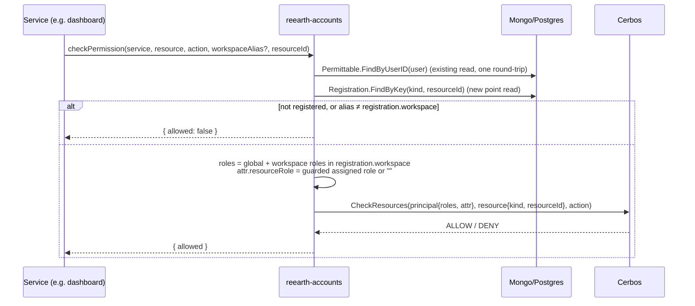
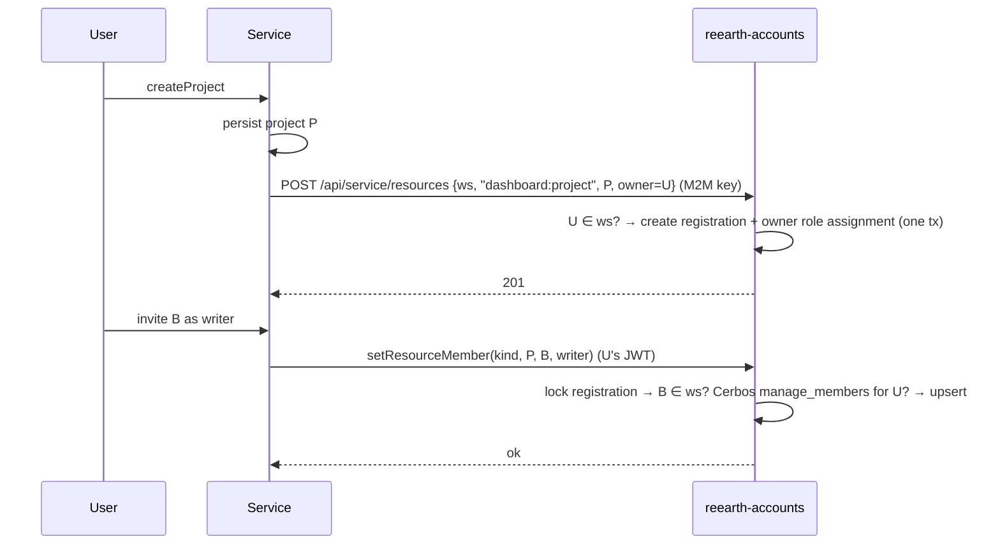
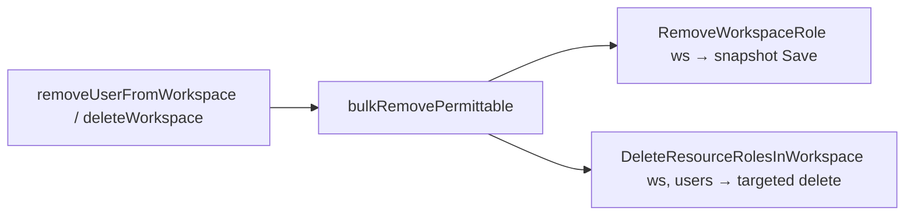

# リソース単位のロール割り当て（汎用的なリソース単位メンバーシップ）

> **Status: DRAFT.** 本ドキュメントは [resource-role-binding.md](resource-role-binding.md)
> の日本語版です。内容に差異がある場合は英語版を正とします。
>
> `permittable` に汎用的で中身を解釈しない **「user × resource → role」** のロールの割り当てを追加し、
> 各サービス（dashboard、visualizer、cms など）が *project member* のような
> リソース単位のメンバーシップを表現できるようにします。その際、
> **reearth-accounts は project が何であるかを知りません**。最初の利用者は
> `dashboard:project` です。コード上では、ロールの割り当ては `...Binding` /
> `resource_bindings` という名前の型・テーブルで表します。

## Document Signature

|           |                |
|-----------|----------------|
| Creator   | soneda-yuya    |
| Leader    | TBD            |
| Task Link | TBD            |
| Developer | TBD            |

## Background / Problem Statement

### 動機（プロダクト上の背景）

- SSO の導入にあたり「ワークスペースを自由に作成できるべきか」を議論し、
  オプションでワークスペースの作成を制限できるべきという意見が出ました。
  制限すると、1 つのワークスペースで多数の project を管理することになります。
- 現状、メンバーは workspace 単位でしか割り当てられないため、顧客は workspace ごとに
  メンバーを管理しています。ただし、project ごとに関係するメンバーは異なります。
  workspace を跨いで project を共有したい場合、顧客は現在 project を対象の
  workspace へコピーして対応しています。
- project ごとにメンバーと権限を割り当てられるようにすることで、workspace を
  組織として機能させられます。SSO / SCIM とは別の機能ですが、ワークスペースの作成を
  制限できるようになった時点で使えるよう、早めに実装できる状態にしたいと考えています。
- 目指すモデルは GitHub に近いものです。workspace と project の関係は、GitHub の
  organization と repository の関係に相当します。GitHub に organization member と
  repository member の両方があるのと同様に、Re:Earth にも workspace member と
  project member の両方を持たせます。

### 現状

- Re:Earth の権限は reearth-accounts が判定しています。各サービス（dashboard、visualizer、
  cms など）は、操作を許可する前に「このユーザーはこの操作をしてよいか」を accounts に問い合わせます。
- ユーザーのロールは **workspace 単位** で持っています（ほかにプラットフォーム全体のロールが少しあります）。
  workspace に参加すると、その workspace のすべての project に対して同じロールを持つことになります。
- そのため権限チェックで分かるのは「どの workspace か」だけで、「どの project か」は分かりません。
  同じ workspace の中で「user A は project P を編集できるが project Q は編集できない」といった
  指定はできません。

### 課題

プロダクトでは **project 単位のメンバーシップ** が必要です。たとえば
「user A は project P の editor、同じ workspace の user B は P を見られない」といったものです。
現在 accounts が表現できる最も細かい単位は workspace です。

各サービスが project のメンバーシップを独自に実装すると、次の問題が起きます。

1. 招待・ロール変更・削除の API と UI がサービスごとに重複する。
2. 各サービスは、project member を掃除するために **workspace メンバーシップの変更**
   （workspace からのユーザー削除、workspace の削除）に反応しなければならない。
   その情報を持つのは accounts だけなので、サービスごとにイベントや同期の仕組みが必要になる。
   取りこぼすと、すでに抜けた workspace の project にユーザーがアクセスできてしまう。
3. 「project member は workspace のメンバーでなければならない」という制約を、
   結局 accounts を呼ばずにサービス内だけで検証することはできない。
4. 認可ロジックが、1つの入口で評価される Cerbos ポリシーではなく N 個のサービスに分散する。

### 制約（この設計の形を決めている理由）

accounts は *project* のドメインを取り込んではいけません。project の存在、名前、
公開範囲、中身、ライフサイクルは引き続き各サービスが所有します。accounts が持ってよいのは
*認可* の概念、つまり「この解釈しないリソースはこの workspace に属し、この principal は
それに対してこのロールを持つ」だけです。

## Goals

1. **project ごとにメンバーとロールを設定できる。** workspace 全体だけでなく、特定の project
   に対してロールを与えられる（例: project P は編集できるが、project Q にはアクセスできない）。
2. **権限チェックで、対象の project を考慮できる。** サービスが accounts に「このユーザーは
   この操作をしてよいか」と問い合わせたとき、その project でのユーザーのロールを踏まえて判定できる。
   判定には常にその project が実際に属する workspace を使うため、呼び出し側が別の workspace を
   指定してアクセスを得ることはできない。
3. **メンバーの整合性が保たれる。** project は必ず1つの workspace に属し、一度 owner が
   設定されたら owner が0人になることはない。複数人が同時にメンバーを変更しても崩れない。
4. **workspace から外れると project へのアクセスもなくなる。** ユーザーを workspace から外すと、
   その workspace 内のすべての project でのロールも自動で取り消される。各サービスが個別に
   後始末をする必要はない。
5. **accounts は汎用的なままにする。** accounts は「project」が何かを知らない。どのサービスも、
   権限ポリシーを追加するだけで、自分のリソース（例: CMS のモデル）に同じ仕組みを使える。
   accounts の変更は不要。
6. **既存の動作を壊さない。** 現在の権限チェックとポリシーは、これまでとまったく同じように動く。

## Non-Goals

1. リソースのメタデータ（名前、公開範囲、所有者、タイムスタンプ）を accounts に保存すること。
2. リソースが実在するかを検証すること。accounts は、リソースを登録する
   **M2M 認証された** サービスを信頼する。
3. リソースの削除を検知すること。所有するサービスが登録解除のエンドポイントを呼ぶ責任を持つ
   （*ライフサイクル* を参照）。
4. リソースの階層・継承（例: folder → project → layer）。後からポリシーで重ねられるが、今回は対象外。
5. integration（M2M）をリソースのメンバーにすること。v1 はユーザーの principal のみ。
6. 任意のリソース属性（例: `visibility`）を `checkPermission` に渡すこと。
   Open Questions で扱う。v1 のポリシーはロールだけを使う。
7. リソースのメンバーシップの招待メール送信。メールにはリソース名が入るが、
   accounts はそれを持たないため、サービス側で送る。

## Functional Requirements

1. `resourceId` なしの `checkPermission`: 読み込みは **変わらない**。
   `resourceId` ありの場合: **インデックスが効くポイント読み込みが1回増える**
   （主キーによるリソース登録の読み込み）。ロールの割り当て自体は、すでに読み込まれた permittable から読む。
2. PostgreSQL では、`Permittable.FindByUserID` がベースの行、workspace ロール、リソースロールを
   **1回のラウンドトリップ** で読み込む（集約したサブセレクト）。そのため、リソースロールを追加しても
   `checkPermission` のクエリは増えない。
3. 項目の上限。ドメイン層と DB 制約の両方で強制する:
   - `resourceKind`: 64 バイト以下、`^[a-z0-9-]{1,32}:[a-z0-9_-]{1,31}$`
   - `resourceID`: 128 バイト以下、`^[A-Za-z0-9_.:-]{1,128}$`
4. 想定規模: 1ユーザーあたりのロールの割り当ては約 1,000 件以下（上記の上限で1件約 300 B 以下、
   つまり Mongo の1ドキュメントあたり約 300 KB 以下で、16 MB を大きく下回る）。
   1リソースあたりのメンバーは約 1,000 人以下。
5. 1リソースのメンバー一覧取得はインデックスが効き、そのリソースの `(userId, role)` だけを返す。
   集約全体を組み立てることはしない。
6. すべての更新操作が MongoDB / PostgreSQL の両バックエンドと `memory` リポジトリで動くこと。

## Solution Options

### Option 1（推奨）: リソース登録 + `Permittable` に埋め込んだロールの割り当て

2つの状態を持ちます。どちらも accounts にとっては中身を解釈しないものです。

| 状態 | 目的 |
|---|---|
| **リソース登録** `(resourceKind, resourceID) → workspaceID, version` | リソースの workspace の範囲を正として持つ。所有するサービスが登録したことの証明。不変条件のためのリソース単位の直列化ポイント |
| `Permittable` 上の **リソースロール** `(workspaceID, resourceKind, resourceID, roleID)` | そのリソースに対するユーザーのロール。permittable と一緒に読むので、参照のための追加読み込みは不要 |

#### ドメイン

```go
// server/pkg/resource/registration.go (new package, no service-specific code)
type Registration struct {
    createdAt   time.Time
    kind        Kind   // validated per FR-3
    resourceID  ID     // validated per FR-3
    version     int64  // bumped by every membership mutation of this resource
    workspaceID workspace.ID
}

// server/pkg/permittable/permittable.go
type Permittable struct {
    id             ID
    resourceRoles  []ResourceRole // NEW
    roleIDs        []role.ID
    updatedAt      time.Time
    userID         user.ID
    workspaceRoles []WorkspaceRole
}

type ResourceRole struct {
    resourceID   resource.ID
    resourceKind resource.Kind
    roleID       role.ID
    workspaceID  workspace.ID // copied from the registration
}
```

`ResourceRole(kind, id)` は、**ユーザーがまだ `workspaceID` の workspace ロールを持っている場合に限り**、
そのリソースに対するユーザーのロールを返します（読み込み時のガード。*並行性* を参照）。
ロールはユーザーごとに `(kind, id)` 1つにつき1つです。accounts のどこにも、`kind` で
`switch` する処理はありません。

ロールは既存の `roles` テーブル（`owner` / `maintainer` / `writer` / `reader`）を再利用します。
リソース種別ごとのロールの意味は、その種別の Cerbos ポリシーだけで定義します。

#### ストレージ

**PostgreSQL**: マイグレーション `0005_resource_role_binding.up.sql`

```sql
CREATE TABLE resource_registrations (
    resource_kind text NOT NULL CHECK (octet_length(resource_kind) <= 64),
    resource_id   text NOT NULL CHECK (octet_length(resource_id) <= 128),
    workspace_id  text NOT NULL,
    version       bigint NOT NULL DEFAULT 0,
    created_at    timestamptz NOT NULL DEFAULT now(),
    PRIMARY KEY (resource_kind, resource_id)
);
CREATE INDEX resource_registrations_workspace_idx
    ON resource_registrations (workspace_id);

CREATE TABLE permittable_resource_roles (
    permittable_id text NOT NULL REFERENCES permittables(id) ON DELETE CASCADE,
    resource_kind  text NOT NULL,
    resource_id    text NOT NULL,
    workspace_id   text NOT NULL,
    role_id        text NOT NULL,
    PRIMARY KEY (permittable_id, resource_kind, resource_id),
    FOREIGN KEY (resource_kind, resource_id)
        REFERENCES resource_registrations (resource_kind, resource_id) ON DELETE CASCADE
);
CREATE INDEX permittable_resource_roles_resource_idx
    ON permittable_resource_roles (resource_kind, resource_id);
CREATE INDEX permittable_resource_roles_workspace_idx
    ON permittable_resource_roles (workspace_id, permittable_id);
```

```sql
-- 0005_resource_role_binding.down.sql
DROP TABLE IF EXISTS permittable_resource_roles;
DROP TABLE IF EXISTS resource_registrations;
```

**MongoDB**

- 新しいコレクション `resource_registrations` を追加します。`{ resource_kind: 1, resource_id: 1 }`
  に一意インデックス、`{ workspace_id: 1 }` にインデックスを張ります
  （スキーマは `mongoschemagen` で登録し、`server/CLAUDE.md` の手順に従ってマイグレーションを追加）。
- permittable ドキュメントに任意の配列 `resource_roles` を追加します。インデックスは
  `{ "resource_roles.resource_kind": 1, "resource_roles.resource_id": 1 }` と
  `{ "resource_roles.workspace_id": 1 }` です。

#### リポジトリの変更（スナップショットではなく対象を絞った書き込み）

既存のスナップショット保存 `Save` / `SaveMany` が、リソースロールを上書きしたり
復活させたりできないようにします。

- **Mongo** の `Permittable.Save` は、ドキュメントの置き換えから、`role_ids`、`workspace_roles`、
  `updated_at` だけの `$set` に切り替えます。`resource_roles` は下記の対象を絞った操作だけが書き込みます。
- **Postgres** の `Permittable.Save` はもともと `permittable_workspace_roles` しか書き直さないので、
  リソースロールについては手を加えません。
- **Postgres** の `hydrate` は、ベースの行に加えて workspace ロールとリソースロールを
  `json_agg` のサブセレクトで返す1本のクエリに置き換えます（FR-2）。

新しいリポジトリのインターフェース:

```go
// resource.RegistrationRepo
FindByKey(ctx, kind, id) (*resource.Registration, error)
Create(ctx, r resource.Registration) error              // ErrAlreadyExists on duplicate
LockForUpdate(ctx, kind, id) (*resource.Registration, error) // must run inside a transaction
Remove(ctx, kind, id) error                              // also removes all role assignments

// permittable.Repo (additions)
FindResourceMembers(ctx, kind, id) ([]permittable.ResourceMember, error) // projection: userID + roleID
CountResourceOwners(ctx, kind, id, ownerRoleID) (int, error)
UpsertResourceRole(ctx, userID, r permittable.ResourceRole) error
DeleteResourceRole(ctx, userID, kind, id) error
DeleteResourceRolesInWorkspace(ctx, workspaceID, userIDs) error
```

| 操作 | Mongo | Postgres |
|---|---|---|
| `UpsertResourceRole` | 単一ドキュメントの更新: `(kind,id)` の要素を `$pull` してから新しい要素を `$push`（集約パイプラインを使った1回の `updateOne`） | `INSERT … ON CONFLICT (permittable_id, resource_kind, resource_id) DO UPDATE SET role_id = …` |
| `DeleteResourceRole` | `$pull` | `DELETE … WHERE permittable_id=$1 AND resource_kind=$2 AND resource_id=$3` |
| `DeleteResourceRolesInWorkspace` | `updateMany` + `$pull {workspace_id}` | `DELETE … WHERE workspace_id=$1 AND permittable_id = ANY($2)` |
| `FindResourceMembers` | 集約 `$match` → `$unwind` → `$match` → `$project {user_id, role_id}` | `SELECT p.user_id, r.role_id FROM permittable_resource_roles r JOIN permittables p …` |
| `LockForUpdate` | トランザクション内で `findOneAndUpdate {$inc: {version: 1}}`（同じ登録に対する並行トランザクションは書き込み競合となり、リトライされる） | `SELECT … FOR UPDATE` |

#### 権限チェック

`CheckPermissionInput` に任意項目を1つ追加します。

```graphql
input CheckPermissionInput {
  service: String!
  resource: String!
  action: String!
  workspaceAlias: String
  resourceId: String   # NEW
}
```

`resourceId` が **ない** 場合、挙動は変わりません。

`resourceId` が **ある** 場合:

1. 登録 `(service:resource, resourceId)` を読み込む。**見つからなければ拒否。**
2. `workspaceAlias` が指定されていて、それが登録の `workspaceID` に解決されなければ **拒否**。
3. principal のロール = グローバルロール + **登録の `workspaceID`** におけるユーザーの workspace ロール
   （呼び出し元は workspace を選べない）。
4. principal の属性 `resourceRole` = このリソースでユーザーに割り当てられたロール。
   割り当てがない場合（または読み込み時のガードで除外された場合）は `""`。
5. Cerbos のリソース ID は実際の `resourceId` にする。

ポリシーは引き続き各サービスの `definition.go` に置き、reearthx の generator がすでに
サポートしている条件を使います。`dashboard:project` の例:

```go
// dashboard: definition.go
resourceRole := func(expr string) *generator.Condition { return generator.SimpleExpr(expr) }
any := []string{"*"} // any principal role; the condition does the gating

builder.AddResource("project", []generator.ActionDefinition{
    // workspace admins keep full access to every project in their workspace
    generator.NewActionDefinition("read", []string{"owner", "maintainer"}),
    generator.NewActionDefinition("edit", []string{"owner", "maintainer"}),
    generator.NewActionDefinition("delete", []string{"owner", "maintainer"}),
    generator.NewActionDefinition("manage_members", []string{"owner", "maintainer"}),
    // project members
    generator.NewActionDefinitionWithCondition("read", any, resourceRole(`P.attr.resourceRole != ""`)),
    generator.NewActionDefinitionWithCondition("edit", any, resourceRole(`P.attr.resourceRole in ["owner", "writer"]`)),
    generator.NewActionDefinitionWithCondition("delete", any, resourceRole(`P.attr.resourceRole == "owner"`)),
    generator.NewActionDefinitionWithCondition("manage_members", any, resourceRole(`P.attr.resourceRole == "owner"`)),
})
```

リソースロールは principal のロールではなく principal の **属性** として渡されるので、
project の `owner` が workspace の `owner` と取り違えられることはありません。workspace ロールが
project メンバーシップに *加算される* のか、project メンバーシップによって *制限される* のかは、
プロダクトごとのポリシーで決めます。

#### メンバー管理 API

**ライフサイクル（M2M のみ）**: REST のサービス用ルートで、M2M の API キーで **のみ** 認証します
（ユーザーの JWT は拒否）。登録は、リソースが存在することとそのリソースがどの workspace に属するかを
accounts が知る手段です。登録をサービスに限定することで、ユーザーが未登録の ID を
自分のものとして主張する手段をなくします。

```
POST   /api/service/resources
       { workspaceId, resourceKind, resourceId, ownerUserId? }
       → creates the registration and, if ownerUserId is given, an `owner`
         role assignment, in one transaction. ownerUserId must be a workspace member.
         409 if already registered with a different workspace; idempotent
         (200) if registered with the same workspace.
DELETE /api/service/resources/{resourceKind}/{resourceId}
       → removes the registration and every role assignment on the resource.
```

**メンバーシップ（ユーザーの JWT、GraphQL）**:

```graphql
input SetResourceMemberInput {
  resourceKind: String!
  resourceId: String!
  userId: ID!
  role: Role!
}
input RemoveResourceMemberInput {
  resourceKind: String!
  resourceId: String!
  userId: ID!
}

type ResourceMember { userId: ID!, role: Role! }
type ResourceBinding { workspaceId: ID!, resourceKind: String!, resourceId: String!, role: Role! }

extend type Query {
  resourceMembers(resourceKind: String!, resourceId: String!): [ResourceMember!]!
  # IDs only; the owning service hydrates names etc.
  myResourceBindings(resourceKind: String!, workspaceId: ID): [ResourceBinding!]!
}

extend type Mutation {
  setResourceMember(input: SetResourceMemberInput!): ResourceMember
  removeResourceMember(input: RemoveResourceMemberInput!): Boolean!
}
```

ガード（汎用的で、種別固有のコードはなし）。すべての更新操作は、登録に対する `LockForUpdate`
から始まる1つのトランザクションで実行します。

| 操作 | ガード（ロック取得後に評価） |
|---|---|
| `setResourceMember` | 登録が存在する。対象ユーザーが登録の workspace のメンバーである。操作者に `(kind, id)` への `manage_members` が Cerbos で許可されている。変更が最後の `owner` を降格させる場合は拒否 |
| `removeResourceMember` | Cerbos の `manage_members`、または操作者 == 対象ユーザー（自分で抜ける場合）。最後の `owner` を外す場合は拒否 |
| `resourceMembers` | `(kind, id)` への Cerbos の `read`。結果は読み込み時のガードで絞り込む |
| `myResourceBindings` | 操作者自身のロールの割り当てのみ。読み込み時のガードで絞り込む |

**最後の owner のルール:** リソースの owner 数を 1 以上から 0 にしてしまうメンバーシップの更新は
拒否します。owner なしで登録されたリソース（例: 埋め戻し）は、owner が設定されるまで workspace ロールで
管理します。登録解除のエンドポイントはこのルールの対象外です。

#### 並行性

| 競合 | 対策 |
|---|---|
| 同じリソースの別々のユーザーに対する2つの書き込みが、どちらも最後の owner のチェックを通過する | どちらも同じ登録に対して `LockForUpdate` を取る必要があり、後の方は待つ（Postgres）か、競合してリトライする（Mongo）。owner 数はロック取得後に読む。 |
| 2つのサービスが同じ `(kind, id)` を登録する | 主キー / 一意インデックスにより、負けた方は `ErrAlreadyExists` になる。 |
| `setResourceMember` が workspace メンバーシップのチェックを通過した後、ロールの割り当てが書き込まれる前にユーザーが workspace から外され、連動削除が実行される | **読み込み時のガード**: ロールの割り当ては、ユーザーが現在その割り当ての workspace で workspace ロールを持っている場合にのみ有効とする。permittable はすでに読み込まれているので、追加の読み込みはかからない。残った孤立行は無害で、次に連動削除や登録解除のエンドポイントがその行に触れたときに削除される。 |
| workspace フローからの古いスナップショットの `Save` が、新しいロールの割り当てを上書きする（またはその逆） | スナップショット保存は `resource_roles` を書き込まず、ロールの割り当ての書き込みは `workspace_roles` を書き込まない（*リポジトリの変更* を参照）。 |

#### ライフサイクルと連動削除

| イベント | 実行者 | ロールの割り当てへの影響 |
|---|---|---|
| リソース作成 | サービス（M2M） | `ownerUserId` = 作成者として `POST /api/service/resources` を呼ぶ |
| リソース削除 | サービス（M2M） | `DELETE /api/service/resources/{kind}/{id}` を呼ぶ。呼び忘れると孤立した登録が残るが無害（そのリソースはサービス側にもう存在しない）。後から任意の掃除の仕組みで削除する |
| 既存のリソース（本機能以前） | サービス（M2M） | サービスが `resourceId` を送り始める前に、同じエンドポイント（冪等）で一度だけ埋め戻す |
| workspace からユーザーを削除 | accounts | `bulkRemovePermittable` から `DeleteResourceRolesInWorkspace` も呼ぶ |
| workspace 削除（`Workspace.Remove`） | accounts | 同じく `bulkRemovePermittable` 経由。その workspace の登録も削除する |
| workspace の無効化 / 復元 | accounts | 変更なし（workspace ロールと同じ。復元に備えてデータを残す） |
| ユーザー削除（`DeleteMe`） | accounts | 現状、`DeleteMe` は permittable を削除しない。ユーザーが消えればロールの割り当てには到達できなくなる。`DeleteMe` で permittable を削除する修正は、本機能とは独立したフォローアップとして提案する |

**メリット**

- リソースの workspace の範囲はサーバー側で正として管理されるので、呼び出し元が
  別の workspace のロールを借りることはできない。
- accounts にリソースを存在させられるのは M2M 認証されたサービスだけなので、
  ユーザーが ID を自分のものとして主張することはできない。
- リソース全体の不変条件は、両バックエンドでリソースごとに1つのレコードで直列化される。
- ロールの割り当ての参照はすでに読み込まれた permittable の中で完結する。新たな読み込みは
  登録の主キー参照だけ。
- accounts はドメインに依存しないまま: 種別と ID は解釈しない値で、意味はポリシーが持つ。

**デメリット**

- `resourceId` を渡す `checkPermission` 呼び出しでポイント読み込みが1回増える。
- サービスはリソースを登録し（埋め戻しを含む）、削除時に登録を解除する必要がある。
- Mongo の `Save` の意味が置き換えから `$set` に変わる（既存コードに手が入る）。

### Option 2: ロールの割り当てを独立したコレクション / テーブルに置く（埋め込まない）

登録と API は同じですが、ロールの割り当てを permittable ではなく、独立した
`resource_bindings (kind, id, userID, role)` コレクション / テーブルに置きます。

**メリット:** permittable が大きくならない。メンバー一覧は単純なインデックススキャンになる。
スナップショットの `Save` の意味を変える必要がない。

**デメリット:** `checkPermission` で、登録に加えてもう1回（ロールの割り当ての）読み込みが増える。
workspace の連動削除で2つのストアを更新する必要がある。

**結論:** Option 1 を採用します。1ユーザーあたりのロールの割り当て数が FR-4 に近づいた場合、
または Mongo の `Save` の変更にリスクがあると判明した場合は、Option 2 を再検討します。

### 検討して却下した案: 各サービスにメンバーシップを持たせる

*課題* の (1)〜(4) の重複と連動削除の問題があるため却下しました。
「メンバー情報はサービスに置き、ロールを属性として Cerbos に渡す」という派生案は、(4) しか解決しません。

## Design

### resource ID を指定した権限チェック



### project の作成とメンバー招待



### workspace メンバー削除時の連動



## Potential Impact

1. **permittable のドキュメント / 行のサイズ** がロールの割り当て1件あたり約 300 B 以下増える。
2. **Mongo の `Permittable.Save`** が置き換えから `$set` に変わる。permittable の永続化に関する
   既存テストは引き続き通る必要があり、`Save` が `resource_roles` に触れないことを確認する
   新しいテストを追加する。
3. `resourceId` を渡した場合の **Cerbos のリソース ID の変更**: 影響を受けるのは、利用を始めた
   呼び出し元だけ。
4. **workspace メンバー削除** で、対象を絞った削除が1回増える。
5. **ポリシーの書き方**: ロール名は workspace とリソースで共通。ポリシーは、リソースへのアクセスを
   principal のロールではなく `P.attr.resourceRole` で制御しなければならない。
6. **gqlclient**（`server/pkg/gqlclient`）の利用側は、新しいフィールドを使うためにバージョンを
   上げる必要がある。古いクライアントには影響しない。

## Test Plan

1. **ユニット**（`pkg/resource`、`pkg/permittable`）: 種別 / ID の検証と長さの上限。
   リソースごとにロールは1つ。読み込み時のガードが、対応する workspace ロールのない割り当てを除外すること。
2. **interactor**（`internal/usecase/interactor`）:
   - `CheckPermission`: `resourceId` なし → roles が変わらない（リグレッション）。
     未登録のリソース → 拒否。別の workspace の alias → 拒否。workspace ロールは alias ではなく
     登録から取られる。`resourceRole` が設定される / 空になる。
   - 登録: M2M のみ（JWT は拒否）。owner は workspace のメンバーでなければならない。
     同じ workspace での重複は冪等、別の workspace なら 409。
   - `setResourceMember` / `removeResourceMember`: メンバーでない対象ユーザーは拒否。
     `manage_members` がなければ拒否。自分で抜けるのは許可。最後の owner の保護。
   - 連動削除: `RemoveUserMember` / `RemoveMultipleUserMembers` / `Remove`。
3. **並行性**（`make test-integration`、両バックエンド）: 2つの goroutine が最後の2人の owner を
   同時に外す → ちょうど1つだけ成功する。同じキーの並行登録 → 1つだけ成功する。
   `UpsertResourceRole` の後の古いスナップショットの `Save` でもロールの割り当てが残る。
4. **リポジトリ**: すべての新しい操作の Mongo・Postgres・memory 実装。Postgres の
   `FindByUserID` が1本のクエリしか発行しないこと。
5. **マイグレーション**: 既存 DB に対する `0005` の up / down。既存の permittable が
   空の `resourceRoles` で読み込めること。
6. **E2E**（`server/e2e`）: 上記の条件で生成した `dashboard:project` のテスト用ポリシーを使い、
   メンバー / 非メンバー / workspace owner / 別 workspace の結果を確認する。

## Deployment Plan

1. 後方互換性はあるか？ **あり。** 入力の任意項目、新しいコレクション / テーブル、
   新しいルートと GraphQL フィールドの追加のみ。`resourceId` がなければ挙動は変わらない。
2. 部分的にデプロイできるか？ **できる。** 順序:
   1. accounts をデプロイする。
   2. 各サービスが既存リソースの登録を埋め戻す。
   3. 各サービスが作成時の登録 / 削除時の登録解除を始める。
   4. 各サービスが `P.attr.resourceRole` を使うポリシーをデプロイし、`resourceId` を送り始める。
      ステップ 4 より前は属性が存在せず、条件がマッチしない（安全側に倒れる）。
3. 通知先: dashboard / visualizer / cms のオーナー、Cerbos ポリシーの管理者。
4. 設定変更: なし（既存の M2M API キーを再利用する）。
5. DDL: Postgres のマイグレーション `0005` は起動時に自動で実行される（golang-migrate）。
   Mongo は起動時のマイグレーションでコレクションのスキーマとインデックスを作成する。
   accounts 側での埋め戻しはない。

## Rollback Plan

1. 原因をチームの Slack チャンネルに共有する。
2. `resourceId` / `resourceRole` に依存する利用側サービス / ポリシーを先に戻す。
3. accounts のイメージを戻す。旧バイナリは新しいコレクション、テーブル、`resource_roles`
   フィールドを無視するので、**データのロールバックは不要**。
   注意: 旧バージョンの Mongo の `Save` はドキュメント全体を置き換えるため、書き込んだ permittable の
   `resource_roles` は消える。機能は無効になっているのでロールバック中は許容でき、
   再度ロールフォワードする際にサービスが埋め戻しを再実行する。
4. スキーマ自体を削除する必要がある場合のみ、`0005` の down を実行する
   （登録とロールの割り当てが消えるので、先にダンプを取る）。

## Post Deployment

- チェックリスト
  - dashboard の staging で project を作成し、登録と作成者への `owner` ロールの割り当てができることを確認する。
  - workspace メンバーを招待してアクセスできることを確認する。そのメンバーを workspace から外し、
    project にアクセスできなくなることを確認する。
  - 別の workspace の alias を指定して `checkPermission` を呼び、拒否されることを確認する。
- メトリクス
  - `resourceId` あり / なしでの `checkPermission` の p50 / p95 レイテンシ。
  - 登録 / 登録解除 / `setResourceMember` のエラー率（Mongo のトランザクションのリトライを含む）。
  - permittable あたりのロールの割り当て数（最大 / p99）。FR-4 の監視用。
- アラート
  - `checkPermission` のエラー率: Warning > 1%、Danger ≥ 5%。
  - `checkPermission` の p95 レイテンシ: Warning > ベースライン比 +20%。

## Open Questions

1. **`checkPermission` へのリソース属性の受け渡し。** 「private な project はメンバーだけ、
   public な project は workspace 全体が見られる」のようなルールには、リソースの `visibility` が必要。
   提案: `CheckPermissionInput` に任意の `attributes: JSON` を追加し、Cerbos のリソースにそのまま渡す。
   必要とするプロダクトが出てくるまで保留。
2. **一括チェック**（複数の `resourceId` に対する `checkPermissions`）を一覧画面向けに作るか。
   Cerbos の `CheckResources` はすでに対応している。
3. **サービスごとの M2M キー。** v1 では登録 / 登録解除に既存の共有 API キーを受け付ける。
   各キーを、そのサービス自身の種別（`dashboard:*`）に限定すべきか。
4. 登録解除せずに削除されたリソースの登録を掃除する **孤立データの掃除の仕組み**:
   作る価値があるか、サービス側の規律に任せるか。
5. リソースへの **integration メンバー**（M2M トークン）: cms で必要か。
6. **UI 上でどこでメンバーを管理するか。** project のメンバー管理を Dashboard だけで
   行うか、各サービス（visualizer / cms / flow）の画面でも行えるようにするか。
   accounts の API は変わらない（どのクライアントも同じメンバー管理 API を呼ぶ）が、
   どのサービスに UI の対応が必要かが変わるため、デザイナーと合わせて決める。

## Reviewed by

- Technical Architect: [name]
- Technical Leader: [name]
- Peers: [name]
