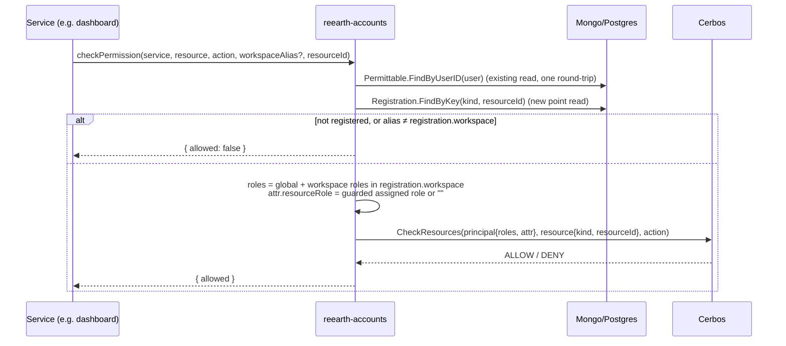
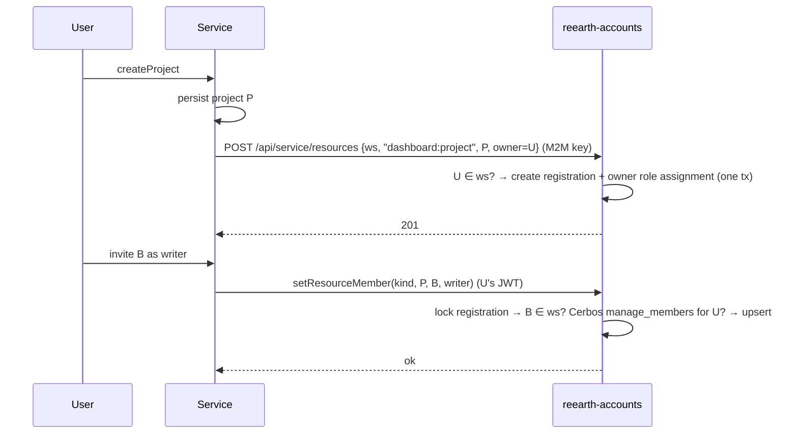
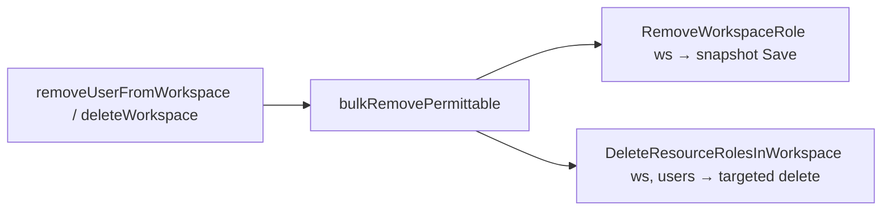

# リソース単位のロール割り当て（汎用的なリソース単位メンバーシップ）

> **Status: DRAFT.** 本ドキュメントは [resource-role-binding.md](resource-role-binding.md)
> の日本語版です。内容に差異がある場合は英語版を正とします。
>
> project 単位で（より一般には、各サービスのリソース単位で）メンバーとロールを設定できるようにします。
> これにより各サービス（dashboard、visualizer、cms など）は、メンバー管理の仕組みをそれぞれ作らずに
> project member を持てます。その際、**reearth-accounts は project が何であるかを知りません**。
> 最初に使うのは Dashboard の project です。コード上では、ロールの割り当ては `...Binding` /
> `resource_bindings` という名前の型・テーブルで表します。

## Document Signature

|           |                |
|-----------|----------------|
| Creator   | soneda-yuya    |
| Leader    | TBD            |
| Task Link | TBD            |
| Developer | TBD            |

## Background / Problem Statement

### 動機（プロダクト上の背景）

- SSO の導入にあたり「ワークスペースを自由に作成できるべきか」を議論し、
  オプションでワークスペースの作成を制限できるべきという意見が出ました。
  制限すると、1 つのワークスペースで多数の project を管理することになります。
- 現状、メンバーは workspace 単位でしか割り当てられないため、顧客は workspace ごとに
  メンバーを管理しています。ただし、project ごとに関係するメンバーは異なります。
  workspace を跨いで project を共有したい場合、顧客は現在 project を対象の
  workspace へコピーして対応しています。
- project ごとにメンバーと権限を割り当てられるようにすることで、workspace を
  組織として機能させられます。SSO / SCIM とは別の機能ですが、ワークスペースの作成を
  制限できるようになった時点で使えるよう、早めに実装できる状態にしたいと考えています。
- 目指すモデルは GitHub に近いものです。workspace と project の関係は、GitHub の
  organization と repository の関係に相当します。GitHub に organization member と
  repository member の両方があるのと同様に、Re:Earth にも workspace member と
  project member の両方を持たせます。

### 現状

- Re:Earth の権限は reearth-accounts が判定しています。各サービス（dashboard、visualizer、
  cms など）は、操作を許可する前に「このユーザーはこの操作をしてよいか」を accounts に問い合わせます。
- ユーザーのロールは **workspace 単位** で持っています（ほかにプラットフォーム全体のロールが少しあります）。
  workspace に参加すると、その workspace のすべての project に対して同じロールを持つことになります。
- そのため権限チェックで分かるのは「どの workspace か」だけで、「どの project か」は分かりません。
  同じ workspace の中で「user A は project P を編集できるが project Q は編集できない」といった
  指定はできません。

### 課題

プロダクトでは **project 単位のメンバーシップ** が必要です。たとえば
「workspace の reader である user A を project P の editor にする」や、
「project P だけに（workspace 全体ではなく）追加された user B は、workspace 内のほかの project を
見られない」といったものです。
現在 accounts が表現できる最も細かい単位は workspace です。

各サービスが project のメンバーシップを独自に実装すると、次の問題が起きます。

1. 招待・ロール変更・削除の API と UI がサービスごとに重複する。
2. 各サービスは、project member を掃除するために **workspace メンバーシップの変更**
   （workspace からのユーザー削除、workspace の削除）に反応しなければならない。
   その情報を持つのは accounts だけなので、サービスごとにイベントや同期の仕組みが必要になる。
   取りこぼすと、すでに抜けた workspace の project にユーザーがアクセスできてしまう。
3. 「project member は workspace のメンバーでなければならない」という制約を、
   結局 accounts を呼ばずにサービス内だけで検証することはできない。
4. 権限のルールが 1 か所（accounts）で判定されず、各サービスにばらばらに散らばる。

### 制約（この設計の形を決めている理由）

accounts は *project* が何であるかを取り込んではいけません。project の存在、名前、
公開範囲、中身、ライフサイクルは引き続き各サービスが持ちます。accounts が持つのは、
権限の判定に必要な「この project はこの workspace に属し、このユーザーはそれに対して
このロールを持つ」という情報だけです。

## Goals

1. **project ごとにメンバーとロールを設定できる。** workspace 全体だけでなく、特定の project
   に対してロールを与えられる。モデルは次のとおり。
   - **通常の workspace メンバー**（owner / maintainer / writer / reader）は、今と同じく workspace の
     ロールによって workspace 内の **すべての** project を見られる。project のロールは、その project での
     アクセスを **引き上げる** ことはできる（例: workspace の reader を project P の writer にすると P を
     編集できる）が、引き下げることはない。
   - **限定メンバー**（特定の project だけに追加された人。Goal 7 を参照）は、project のロールを持つ
     project **だけ** を見られる。
2. **権限チェックで、対象の project を考慮できる。** サービスが accounts に「このユーザーは
   この操作をしてよいか」と問い合わせたとき、その project でのユーザーのロールを踏まえて判定できる。
   判定には常にその project が実際に属する workspace を使うため、呼び出し側が別の workspace を
   指定してアクセスを得ることはできない。
3. **メンバーの整合性が保たれる。** project は必ず1つの workspace に属し、一度 owner が
   設定されたら owner が0人になることはない。複数人が同時にメンバーを変更しても崩れない。
4. **workspace から外れると project へのアクセスもなくなる。** ユーザーを workspace から外すと、
   その workspace 内のすべての project でのロールも自動で取り消される。各サービスが個別に
   後始末をする必要はない。
5. **accounts は汎用的なままにする。** accounts は「project」が何かを知らない。どのサービスも、
   権限ポリシーを追加するだけで、自分のリソース（例: CMS のモデル）に同じ仕組みを使える。
   accounts の変更は不要。
6. **既存の動作を壊さない。** 現在の権限チェックとポリシーは、これまでとまったく同じように動く。
7. **一部の project だけへのアクセスを1ステップで与えられる。** UI から管理者は、人を project に
   直接追加する（まだ workspace にいなければ同時に workspace にも追加する）ことも、workspace に人を
   追加するときに見られる project を選ぶこともできる。どちらも、すべて成功するか何も変わらないかの
   1ステップで行う。この方法で追加された人は、ロールを与えられた project だけが見える
   *限定メンバー* として workspace に所属する。通常の workspace メンバーは引き続きすべての project を
   見られる（*Design → UI からの追加* を参照）。

## Non-Goals

1. **project の詳細情報を accounts に保存すること。** 名前、公開範囲、所有者、日時など
   project の情報は、引き続きそれを持つサービスが管理する。
2. **project が実在するかを確認すること。** accounts は project を登録したサービスを信頼する。
   project を登録できるのはサービスだけで、ユーザーは登録できない。
3. **project の削除を accounts が自分で検知すること。** project が削除されたら、
   それを持つサービスが accounts に知らせる。
4. **入れ子のリソースや権限の継承**（例: folder → project → layer）。後から権限ポリシーで
   追加できるが、今回は対象外。
5. **integration を project のメンバーにすること。** 最初のバージョンでは、project のメンバーに
   なれるのは人（ユーザーアカウント）だけで、integration や API トークンはなれない。
6. **project の属性（例: 公開 / 非公開）を権限の判定に使うこと。** *Open Questions* で扱う。
   最初のバージョンはロールだけで判定する。
7. **project メンバーシップの招待メールを送ること。** メールには project 名が入るが、
   accounts はそれを知らないため、サービス側で送る。

## Functional Requirements

1. **権限チェックの速さを保つ。** project を指定しない権限チェックの負荷は今とまったく同じ。
   project を指定するチェックで増えるのは、その project がどの workspace に属するかを調べる
   小さく速い参照1回だけ。ユーザーの project ロールは、accounts がすでに読み込んでいるデータと
   一緒に読む。
2. **名前と ID に上限を設ける。** リソースの種別名とリソース ID には最大長と使える文字の制限があり、
   保存するデータを小さく予測しやすい状態に保つ。
3. **現実的な規模を想定する。** 1ユーザーあたりの project ロールの割り当ては約 1,000 件まで、
   1 project あたりのメンバーは約 1,000 人まで。
4. **project のメンバー一覧をすばやく取得できる。** 返すのはメンバーが誰かとそのロールだけで、
   名前などの詳細はサービス側が持つ。
5. **accounts が対応するすべてのデータベースで動く。** どのデータベースを使う環境でも、
   メンバーの変更は同じように動作する。

技術的な詳細: *Solution Options → Option 1 → 詳細な要件* を参照。

## Solution Options

この節ではシステム設計を詳しく説明します。実装に関心のある方向けの内容で、ほかの節は
この節を読まなくても理解できます。

### Option 1（推奨）: リソース登録 + `Permittable` に埋め込んだロールの割り当て

2つの状態を持ちます。どちらも accounts にとっては中身を解釈しないものです。

| 状態 | 目的 |
|---|---|
| **リソース登録** `(resourceKind, resourceID) → workspaceID, version` | リソースの workspace の範囲を正として持つ。所有するサービスが登録したことの証明。不変条件のためのリソース単位の直列化ポイント |
| `Permittable` 上の **リソースロール** `(workspaceID, resourceKind, resourceID, roleID)` | そのリソースに対するユーザーのロール。permittable と一緒に読むので、参照のための追加読み込みは不要 |

#### ドメイン

```go
// server/pkg/resource/registration.go (new package, no service-specific code)
type Registration struct {
    createdAt   time.Time
    kind        Kind   // validated per FR-3
    resourceID  ID     // validated per FR-3
    version     int64  // bumped by every membership mutation of this resource
    workspaceID workspace.ID
}

// server/pkg/permittable/permittable.go
type Permittable struct {
    id             ID
    resourceRoles  []ResourceRole // NEW
    roleIDs        []role.ID
    updatedAt      time.Time
    userID         user.ID
    workspaceRoles []WorkspaceRole
}

type ResourceRole struct {
    resourceID   resource.ID
    resourceKind resource.Kind
    roleID       role.ID
    workspaceID  workspace.ID // copied from the registration
}
```

`ResourceRole(kind, id)` は、**ユーザーがまだ `workspaceID` の workspace ロールを持っている場合に限り**、
そのリソースに対するユーザーのロールを返します（読み込み時のガード。*並行性* を参照）。
ロールはユーザーごとに `(kind, id)` 1つにつき1つです。accounts のどこにも、`kind` で
`switch` する処理はありません。

ロールは既存の `roles` テーブル（`owner` / `maintainer` / `writer` / `reader`）を再利用します。
リソース種別ごとのロールの意味は、その種別の Cerbos ポリシーだけで定義します。

**限定 workspace ロール（名前は仮: `limited`）。** workspace に所属するが、リソースロールを持つ
リソースだけを見られるようにする人のための、新しい workspace ロールの値です（GraphQL の `Role` enum と
`role.RoleType` に追加）。通常の workspace ロールと同じく、workspace のメンバー一覧と
`Permittable.workspaceRoles` に保存され、workspace のメンバー数（シート）の上限に数えられ、
「対象ユーザーは workspace のメンバーでなければならない」というチェックと読み込み時のガードの両方を
満たします。それ自体では何の権限も与えません（*権限チェック* のポリシーに関する補足を参照）。
workspace ロールとしてのみ有効で、`setResourceMember` と `addWorkspaceMemberWithResourceRoles` は
リソースロールとしての指定を拒否します。既存の `updateUserOfWorkspace` で owner 以外のほかのロールとの間で
変更でき、その変更はリソースロールには触れません。

#### ストレージ

**PostgreSQL**: マイグレーション `0005_resource_role_binding.up.sql`

```sql
CREATE TABLE resource_registrations (
    resource_kind text NOT NULL CHECK (octet_length(resource_kind) <= 64),
    resource_id   text NOT NULL CHECK (octet_length(resource_id) <= 128),
    workspace_id  text NOT NULL,
    version       bigint NOT NULL DEFAULT 0,
    created_at    timestamptz NOT NULL DEFAULT now(),
    PRIMARY KEY (resource_kind, resource_id)
);
CREATE INDEX resource_registrations_workspace_idx
    ON resource_registrations (workspace_id);

CREATE TABLE permittable_resource_roles (
    permittable_id text NOT NULL REFERENCES permittables(id) ON DELETE CASCADE,
    resource_kind  text NOT NULL,
    resource_id    text NOT NULL,
    workspace_id   text NOT NULL,
    role_id        text NOT NULL,
    PRIMARY KEY (permittable_id, resource_kind, resource_id),
    FOREIGN KEY (resource_kind, resource_id)
        REFERENCES resource_registrations (resource_kind, resource_id) ON DELETE CASCADE
);
CREATE INDEX permittable_resource_roles_resource_idx
    ON permittable_resource_roles (resource_kind, resource_id);
CREATE INDEX permittable_resource_roles_workspace_idx
    ON permittable_resource_roles (workspace_id, permittable_id);
```

```sql
-- 0005_resource_role_binding.down.sql
DROP TABLE IF EXISTS permittable_resource_roles;
DROP TABLE IF EXISTS resource_registrations;
```

**MongoDB**

- 新しいコレクション `resource_registrations` を追加します。`{ resource_kind: 1, resource_id: 1 }`
  に一意インデックス、`{ workspace_id: 1 }` にインデックスを張ります
  （スキーマは `mongoschemagen` で登録し、`server/CLAUDE.md` の手順に従ってマイグレーションを追加）。
- permittable ドキュメントに任意の配列 `resource_roles` を追加します。インデックスは
  `{ "resource_roles.resource_kind": 1, "resource_roles.resource_id": 1 }` と
  `{ "resource_roles.workspace_id": 1 }` です。

#### リポジトリの変更（スナップショットではなく対象を絞った書き込み）

既存のスナップショット保存 `Save` / `SaveMany` が、リソースロールを上書きしたり
復活させたりできないようにします。

- **Mongo** の `Permittable.Save` は、ドキュメントの置き換えから、`role_ids`、`workspace_roles`、
  `updated_at` だけの `$set` に切り替えます。`resource_roles` は下記の対象を絞った操作だけが書き込みます。
- **Postgres** の `Permittable.Save` はもともと `permittable_workspace_roles` しか書き直さないので、
  リソースロールについては手を加えません。
- **Postgres** の `hydrate` は、ベースの行に加えて workspace ロールとリソースロールを
  `json_agg` のサブセレクトで返す1本のクエリに置き換えます（FR-2）。

新しいリポジトリのインターフェース:

```go
// resource.RegistrationRepo
FindByKey(ctx, kind, id) (*resource.Registration, error)
Create(ctx, r resource.Registration) error              // ErrAlreadyExists on duplicate
LockForUpdate(ctx, kind, id) (*resource.Registration, error) // must run inside a transaction
Remove(ctx, kind, id) error                              // also removes all role assignments

// permittable.Repo (additions)
FindResourceMembers(ctx, kind, id) ([]permittable.ResourceMember, error) // projection: userID + roleID
CountResourceOwners(ctx, kind, id, ownerRoleID) (int, error)
UpsertResourceRole(ctx, userID, r permittable.ResourceRole) error
DeleteResourceRole(ctx, userID, kind, id) error
DeleteResourceRolesInWorkspace(ctx, workspaceID, userIDs) error
```

| 操作 | Mongo | Postgres |
|---|---|---|
| `UpsertResourceRole` | 単一ドキュメントの更新: `(kind,id)` の要素を `$pull` してから新しい要素を `$push`（集約パイプラインを使った1回の `updateOne`） | `INSERT … ON CONFLICT (permittable_id, resource_kind, resource_id) DO UPDATE SET role_id = …` |
| `DeleteResourceRole` | `$pull` | `DELETE … WHERE permittable_id=$1 AND resource_kind=$2 AND resource_id=$3` |
| `DeleteResourceRolesInWorkspace` | `updateMany` + `$pull {workspace_id}` | `DELETE … WHERE workspace_id=$1 AND permittable_id = ANY($2)` |
| `FindResourceMembers` | 集約 `$match` → `$unwind` → `$match` → `$project {user_id, role_id}` | `SELECT p.user_id, r.role_id FROM permittable_resource_roles r JOIN permittables p …` |
| `LockForUpdate` | トランザクション内で `findOneAndUpdate {$inc: {version: 1}}`（同じ登録に対する並行トランザクションは書き込み競合となり、リトライされる） | `SELECT … FOR UPDATE` |

#### 権限チェック

`CheckPermissionInput` に任意項目を1つ追加します。

```graphql
input CheckPermissionInput {
  service: String!
  resource: String!
  action: String!
  workspaceAlias: String
  resourceId: String   # NEW
}
```

`resourceId` が **ない** 場合、挙動は変わりません。

`resourceId` が **ある** 場合:

1. 登録 `(service:resource, resourceId)` を読み込む。**見つからなければ拒否。**
2. `workspaceAlias` が指定されていて、それが登録の `workspaceID` に解決されなければ **拒否**。
3. principal のロール = グローバルロール + **登録の `workspaceID`** におけるユーザーの workspace ロール
   （呼び出し元は workspace を選べない）。
4. principal の属性 `resourceRole` = このリソースでユーザーに割り当てられたロール。
   割り当てがない場合（または読み込み時のガードで除外された場合）は `""`。
5. Cerbos のリソース ID は実際の `resourceId` にする。

ポリシーは引き続き各サービスの `definition.go` に置き、reearthx の generator がすでに
サポートしている条件を使います。`dashboard:project` の例:

**デフォルトのモデル: 実効ロール = max(workspace ロール, リソースロール)。** 通常の workspace ロール
（`owner` / `maintainer` / `writer` / `reader`）では、今と同じく workspace ロールが workspace のすべての
リソースに対するアクセスを与え、リソースロールはそれに加算されるだけです。`limited` では、リソースロール
だけが有効です。各ロールの意味は両方のレベルで同じ（`owner` / `maintainer`: すべての操作とメンバー管理、
`writer`: 閲覧と編集、`reader`: 閲覧）なので、ポリシーは操作ごとに「workspace ロールのルール」と
「`resourceRole` の条件のルール」の和集合として max を表現します。Cerbos はどちらかがマッチすれば許可します。

```go
// dashboard: definition.go
resourceRole := func(expr string) *generator.Condition { return generator.SimpleExpr(expr) }
any := []string{"*"} // any principal role (including limited); the condition does the gating

builder.AddResource("project", []generator.ActionDefinition{
    // regular workspace members: access to every project of the workspace via the workspace role
    // ("limited" is never listed here)
    generator.NewActionDefinition("read", []string{"owner", "maintainer", "writer", "reader"}),
    generator.NewActionDefinition("edit", []string{"owner", "maintainer", "writer"}),
    generator.NewActionDefinition("delete", []string{"owner", "maintainer"}),
    generator.NewActionDefinition("manage_members", []string{"owner", "maintainer"}),
    // project roles: add on top of the workspace role; the only source of access for limited members
    generator.NewActionDefinitionWithCondition("read", any, resourceRole(`P.attr.resourceRole != ""`)),
    generator.NewActionDefinitionWithCondition("edit", any, resourceRole(`P.attr.resourceRole in ["owner", "maintainer", "writer"]`)),
    generator.NewActionDefinitionWithCondition("delete", any, resourceRole(`P.attr.resourceRole in ["owner", "maintainer"]`)),
    generator.NewActionDefinitionWithCondition("manage_members", any, resourceRole(`P.attr.resourceRole in ["owner", "maintainer"]`)),
})
```

リソースロールは principal のロールではなく principal の **属性** として渡されるので、
project の `owner` が workspace の `owner` と取り違えられることはありません。project のロールは、
チェックで指定されたリソースに対してだけ有効です。プロダクトがこのデフォルトより厳しいルール
（例: 通常の workspace メンバーにも見えない private な project）を適用できるかは Open Question 1 で扱います。

**限定 workspace ロールに関するポリシーの補足。** 各サービスのポリシーは、`limited` に
`P.attr.resourceRole` の条件以外では何も許可してはいけません。上の例のように明示的なロールの一覧で
許可するルールはもともと `limited` を含まないので、デフォルトで拒否されます（安全側に倒れる）。
`resourceRole` の条件なしで `*` に許可するルールと、workspace 単位のリソース（例: `dashboard:workspace`）は、
サービスごとに見直す必要があります。限定メンバーに workspace 単位でどの操作が必要か（例: workspace 切り替えで
表示するための workspace 名の読み取り）は Open Question 7 で扱います。

#### メンバー管理 API

**ライフサイクル（M2M のみ）**: REST のサービス用ルートで、M2M の API キーで **のみ** 認証します
（ユーザーの JWT は拒否）。登録は、リソースが存在することとそのリソースがどの workspace に属するかを
accounts が知る手段です。登録をサービスに限定することで、ユーザーが未登録の ID を
自分のものとして主張する手段をなくします。

```
POST   /api/service/resources
       { workspaceId, resourceKind, resourceId, ownerUserId? }
       → creates the registration and, if ownerUserId is given, an `owner`
         role assignment, in one transaction. ownerUserId must be a workspace member.
         409 if already registered with a different workspace; idempotent
         (200) if registered with the same workspace.
DELETE /api/service/resources/{resourceKind}/{resourceId}
       → removes the registration and every role assignment on the resource.
```

**メンバーシップ（ユーザーの JWT、GraphQL）**:

```graphql
input SetResourceMemberInput {
  resourceKind: String!
  resourceId: String!
  userId: ID!
  role: Role!
}
input RemoveResourceMemberInput {
  resourceKind: String!
  resourceId: String!
  userId: ID!
}

type ResourceMember { userId: ID!, role: Role! }
type ResourceBinding { workspaceId: ID!, resourceKind: String!, resourceId: String!, role: Role! }

extend type Query {
  resourceMembers(resourceKind: String!, resourceId: String!): [ResourceMember!]!
  # IDs only; the owning service hydrates names etc.
  myResourceBindings(resourceKind: String!, workspaceId: ID): [ResourceBinding!]!
}

extend type Mutation {
  setResourceMember(input: SetResourceMemberInput!): ResourceMember
  removeResourceMember(input: RemoveResourceMemberInput!): Boolean!
}
```

ガード（汎用的で、種別固有のコードはなし）。すべての更新操作は、登録に対する `LockForUpdate`
から始まる1つのトランザクションで実行します（下記の一括操作は、まず workspace で直列化してから
登録をロックします）。

| 操作 | ガード（ロック取得後に評価） |
|---|---|
| `setResourceMember` | 登録が存在する。対象ユーザーが登録の workspace のメンバーである。操作者に `(kind, id)` への `manage_members` が Cerbos で許可されている。変更が最後の `owner` を降格させる場合は拒否 |
| `removeResourceMember` | Cerbos の `manage_members`、または操作者 == 対象ユーザー（自分で抜ける場合）。最後の `owner` を外す場合は拒否 |
| `resourceMembers` | `(kind, id)` への Cerbos の `read`。結果は読み込み時のガードで絞り込む |
| `myResourceBindings` | 操作者自身のロールの割り当てのみ。読み込み時のガードで絞り込む |
| `addWorkspaceMemberWithResourceRoles` | 下記の *一括操作* を参照 |

**一括操作: workspace への追加とリソースロールの割り当てを1ステップで行う（ユーザーの JWT、GraphQL）。**
*Design → UI からの追加* の2つの UI パターンの両方をこれで実現します。

```graphql
input ResourceRoleInput {
  resourceKind: String!
  resourceId: String!
  role: Role!                        # must not be `limited`
}
input AddWorkspaceMemberWithResourceRolesInput {
  workspaceId: ID!
  userId: ID!
  resources: [ResourceRoleInput!]!   # 1..100 entries, distinct (kind, id)
}
type AddWorkspaceMemberWithResourceRolesPayload {
  addedToWorkspace: Boolean!         # false if the user was already a member
  workspaceRole: Role!               # the user's workspace role after the call
  resources: [ResourceBinding!]!
}

extend type Mutation {
  addWorkspaceMemberWithResourceRoles(
    input: AddWorkspaceMemberWithResourceRolesInput!
  ): AddWorkspaceMemberWithResourceRolesPayload
}
```

ユーザーは `addUsersToWorkspace` と同じくユーザー ID で指定します。UI は既存のユーザー検索
（`userByNameOrEmail` / `searchUser`）で名前またはメールアドレスから探します。メールアドレスによる
新しい招待の仕組みは追加しません。すべてのステップを **1つのトランザクション** で実行します。

1. workspace を読み込み、workspace で直列化する（Postgres: 行ロック。Mongo: workspace ドキュメントへの
   並行書き込みが競合し、リトライされる）。`addUsersToWorkspace` と同じく、個人 workspace は拒否する。
2. すべての項目を検証する: 登録が存在し、その `workspaceID` が `workspaceId` と一致する（一致しなければ
   呼び出し全体を拒否）。`role` が `limited` でない。操作者に `(kind, id)` への `manage_members` が
   Cerbos で許可されている。
3. ユーザーが **まだ workspace のメンバーでない** 場合: 操作者は `addUsersToWorkspace` の既存の
   メンバー追加チェック（`ActionAddMember`）と、メンバー数（シート）のフック `enforceMemberCount` も
   通過しなければならない（v1 のデフォルト。Open Question 7 を参照）。そのうえでユーザーを `limited` ロールで
   参加させ（`Members().Join`）、既存の `bulkUpdatePermittable` の経路で permittable の workspace ロールを
   書き込む。ユーザーが **すでにメンバーである** 場合は、workspace のメンバーシップとロールは変えない
   （降格もしない）。
4. 各登録に対して決まった順序（`(kind, id)` でソート）で `LockForUpdate` を取り、リソースごとに最後の
   owner のルールを適用してから（すでにメンバーであるユーザーの既存のロールを変える場合があるため）、
   各項目について `UpsertResourceRole` を行う。
5. どこかで失敗したらすべてロールバックする: workspace のメンバーシップも、シートの消費も、
   一部だけのロールの割り当ても残らない。

ユーザーの最後のリソースロールを外しても（`removeResourceMember`）、workspace からは **外れません**。
Open Question 8 を参照。

**最後の owner のルール:** リソースの owner 数を 1 以上から 0 にしてしまうメンバーシップの更新は
拒否します。owner なしで登録されたリソース（例: 埋め戻し）は、owner が設定されるまで workspace ロールで
管理します。登録解除のエンドポイントはこのルールの対象外です。

#### 並行性

| 競合 | 対策 |
|---|---|
| 同じリソースの別々のユーザーに対する2つの書き込みが、どちらも最後の owner のチェックを通過する | どちらも同じ登録に対して `LockForUpdate` を取る必要があり、後の方は待つ（Postgres）か、競合してリトライする（Mongo）。owner 数はロック取得後に読む。 |
| 2つのサービスが同じ `(kind, id)` を登録する | 主キー / 一意インデックスにより、負けた方は `ErrAlreadyExists` になる。 |
| `setResourceMember` が workspace メンバーシップのチェックを通過した後、ロールの割り当てが書き込まれる前にユーザーが workspace から外され、連動削除が実行される | **読み込み時のガード**: ロールの割り当ては、ユーザーが現在その割り当ての workspace で workspace ロールを持っている場合にのみ有効とする。permittable はすでに読み込まれているので、追加の読み込みはかからない。残った孤立行は無害で、次に連動削除や登録解除のエンドポイントがその行に触れたときに削除される。 |
| workspace フローからの古いスナップショットの `Save` が、新しいロールの割り当てを上書きする（またはその逆） | スナップショット保存は `resource_roles` を書き込まず、ロールの割り当ての書き込みは `workspace_roles` を書き込まない（*リポジトリの変更* を参照）。 |
| 2人の操作者が `addWorkspaceMemberWithResourceRoles` で同じ新しいユーザーを同時に追加する（リソースは異なる場合もある） | どちらも workspace で直列化する（ステップ 1）。後の方は待つ（Postgres）か、競合してリトライし（Mongo）、そのユーザーを既存メンバーとして扱ってリソースロールだけを追加する。workspace ロールは変わらず、シートは1回だけ数えられる。 |
| リソースが重なる2つの一括操作がデッドロックする | ロックの順序を固定する: まず workspace、次に `(kind, id)` でソートした登録。 |
| 一括操作の実行中にユーザーが workspace から外される | 一括操作が新しいユーザーを参加させる場合は、どちらも workspace のレコードに書き込むので直列化される。外す処理が後にコミットされれば、その連動削除が新しいロールの割り当てを削除する。それ以外の場合（および残る隙間）は、`setResourceMember` と同じく、workspace ロールをもう持たないユーザーのロールの割り当てを読み込み時のガードが無視する。 |

#### ライフサイクルと連動削除

| イベント | 実行者 | ロールの割り当てへの影響 |
|---|---|---|
| リソース作成 | サービス（M2M） | `ownerUserId` = 作成者として `POST /api/service/resources` を呼ぶ |
| リソース削除 | サービス（M2M） | `DELETE /api/service/resources/{kind}/{id}` を呼ぶ。呼び忘れると孤立した登録が残るが無害（そのリソースはサービス側にもう存在しない）。後から任意の掃除の仕組みで削除する |
| 既存のリソース（本機能以前） | サービス（M2M） | サービスが `resourceId` を送り始める前に、同じエンドポイント（冪等）で一度だけ埋め戻す |
| `addWorkspaceMemberWithResourceRoles` でユーザーを追加 | accounts | workspace のメンバーシップ（新規なら `limited`）とロールの割り当てを1つのトランザクションで書き込む |
| ユーザーの workspace 内の最後のロールの割り当てを削除 | accounts | そのロールの割り当てだけを削除する。workspace のメンバーシップ（とシート）は残る。その後 `limited` メンバーを workspace から外すべきかは Open Question 8 |
| workspace からユーザーを削除 | accounts | `bulkRemovePermittable` から `DeleteResourceRolesInWorkspace` も呼ぶ |
| workspace 削除（`Workspace.Remove`） | accounts | 同じく `bulkRemovePermittable` 経由。その workspace の登録も削除する |
| workspace の無効化 / 復元 | accounts | 変更なし（workspace ロールと同じ。復元に備えてデータを残す） |
| ユーザー削除（`DeleteMe`） | accounts | 現状、`DeleteMe` は permittable を削除しない。ユーザーが消えればロールの割り当てには到達できなくなる。`DeleteMe` で permittable を削除する修正は、本機能とは独立したフォローアップとして提案する |

**メリット**

- リソースの workspace の範囲はサーバー側で正として管理されるので、呼び出し元が
  別の workspace のロールを借りることはできない。
- accounts にリソースを存在させられるのは M2M 認証されたサービスだけなので、
  ユーザーが ID を自分のものとして主張することはできない。
- リソース全体の不変条件は、両バックエンドでリソースごとに1つのレコードで直列化される。
- ロールの割り当ての参照はすでに読み込まれた permittable の中で完結する。新たな読み込みは
  登録の主キー参照だけ。
- accounts はドメインに依存しないまま: 種別と ID は解釈しない値で、意味はポリシーが持つ。

**デメリット**

- `resourceId` を渡す `checkPermission` 呼び出しでポイント読み込みが1回増える。
- サービスはリソースを登録し（埋め戻しを含む）、削除時に登録を解除する必要がある。
- Mongo の `Save` の意味が置き換えから `$set` に変わる（既存コードに手が入る）。

#### 詳細な要件

*Functional Requirements* の技術的な形です。各項目は順に FR-1〜FR-6 で、この節のほかの部分では
この番号で参照します。

1. `resourceId` なしの `checkPermission`: 読み込みは **変わらない**。
   `resourceId` ありの場合: **インデックスが効くポイント読み込みが1回増える**
   （主キーによるリソース登録の読み込み）。ロールの割り当て自体は、すでに読み込まれた permittable から読む。
2. PostgreSQL では、`Permittable.FindByUserID` がベースの行、workspace ロール、リソースロールを
   **1回のラウンドトリップ** で読み込む（集約したサブセレクト）。そのため、リソースロールを追加しても
   `checkPermission` のクエリは増えない。
3. 項目の上限。ドメイン層と DB 制約の両方で強制する:
   - `resourceKind`: 64 バイト以下、`^[a-z0-9-]{1,32}:[a-z0-9_-]{1,31}$`
   - `resourceID`: 128 バイト以下、`^[A-Za-z0-9_.:-]{1,128}$`
4. 想定規模: 1ユーザーあたりのロールの割り当ては約 1,000 件以下（上記の上限で1件約 300 B 以下、
   つまり Mongo の1ドキュメントあたり約 300 KB 以下で、16 MB を大きく下回る）。
   1リソースあたりのメンバーは約 1,000 人以下。
5. 1リソースのメンバー一覧取得はインデックスが効き、そのリソースの `(userId, role)` だけを返す。
   集約全体を組み立てることはしない。
6. すべての更新操作が MongoDB / PostgreSQL の両バックエンドと `memory` リポジトリで動くこと。

範囲についての補足（*Non-Goals* の技術的な形）:

- リソースの存在は検証しない。accounts はリソースを登録する **M2M 認証された** サービスを信頼し、
  リソースの削除時に登録解除のエンドポイントを呼ぶこともそのサービスに任せる
  （*ライフサイクルと連動削除* を参照）。
- v1 のロールの割り当ては **ユーザーの principal のみ**。integration（M2M）の principal は
  リソースロールを持てない。
- v1 の `checkPermission` は、リソースの属性（例: `visibility`）を Cerbos に渡さない。
  ポリシーはロールだけを使う（*Open Questions の技術的な補足* を参照）。

#### リクエストの流れ（シーケンス図）

##### resource ID を指定した権限チェック



##### project の作成とメンバー招待



`setResourceMember` は、B がすでに workspace のメンバーであることを前提とします。まだ workspace に
いないかもしれない人を追加するには、UI は下記の一括操作を使います。

##### UI から1ステップで人を追加する

パターン (a) は1つのリソース（表示中の project）を渡し、パターン (b) は workspace の
「メンバー追加」ダイアログで選んだ project を渡します。どちらも同じ mutation を呼びます。

```mermaid
sequenceDiagram
    participant U as Admin
    participant S as Service UI (e.g. dashboard)
    participant A as reearth-accounts
    participant C as Cerbos

    U->>S: add C to project P1 (a)<br/>or add C to ws with projects P1, P2 (b)
    S->>A: userByNameOrEmail(...) → C's userId
    S->>A: addWorkspaceMemberWithResourceRoles(ws, C, [(kind,P1,writer), ...]) (U's JWT)
    A->>A: begin tx; serialize on ws
    A->>A: each Pn registered in ws?
    A->>C: manage_members on each Pn for U?
    alt C ∉ ws
        A->>A: add-member check + seat limit → Join(C, limited) + permittable workspace role
    else C ∈ ws
        A->>A: keep C's workspace role unchanged
    end
    A->>A: LockForUpdate P1, P2 … (sorted) → last-owner rule → UpsertResourceRole each
    A->>A: commit (any failure → roll back all)
    A-->>S: { addedToWorkspace, workspaceRole, resources }
```

その後、限定メンバーには自分の project だけが見えます。サービスは `myResourceBindings` でそれを一覧し、
それ以外の project に対する `checkPermission` は拒否されます。

##### workspace メンバー削除時の連動



#### 技術的な補足: 影響・テスト・デプロイ・ロールバック・監視

##### 影響

1. **permittable のドキュメント / 行のサイズ** がロールの割り当て1件あたり約 300 B 以下増える。
2. **Mongo の `Permittable.Save`** が置き換えから `$set` に変わる。permittable の永続化に関する
   既存テストは引き続き通る必要があり、`Save` が `resource_roles` に触れないことを確認する
   新しいテストを追加する。
3. `resourceId` を渡した場合の **Cerbos のリソース ID の変更**: 影響を受けるのは、利用を始めた
   呼び出し元だけ。
4. **workspace メンバー削除** で、対象を絞った削除が1回増える。
5. **ポリシーの書き方**: ロール名は workspace とリソースで共通。リソースロールは `P.attr.resourceRole`
   でのみ判定する（principal のロールとして扱わない）。通常のメンバーに対する workspace ロールの
   workspace 全体への許可はそのまま残し、`limited` は workspace ロールのルールに決して含めない。
   サービスの既存の project ポリシーは、置き換えるのではなく `resourceRole` のルールを追加して
   拡張する（和集合 = max）。
6. **gqlclient**（`server/pkg/gqlclient`）の利用側は、新しいフィールドを使うためにバージョンを
   上げる必要がある。古いクライアントには影響しない。
7. **`Role` enum の新しい値 `limited`**: workspace メンバーを厳密な enum でデコードするクライアントは、
   未知の値で失敗する可能性がある。workspace メンバーを読むすべてのサービスは、限定メンバーが
   作られる前にクライアントを更新する必要がある。
8. **ポリシー**: 各サービスの workspace 単位・リソース単位のポリシーを見直し、`limited` が
   `P.attr.resourceRole` 経由以外ではアクセスできないようにする必要がある。
9. **シート**: 限定メンバーもほかのメンバーと同じく、workspace のメンバー数の上限
   （`enforceMemberCount`）に数えられる。

##### テスト

1. **ユニット**（`pkg/resource`、`pkg/permittable`）: 種別 / ID の検証と長さの上限。
   リソースごとにロールは1つ。読み込み時のガードが、対応する workspace ロールのない割り当てを除外すること。
2. **interactor**（`internal/usecase/interactor`）:
   - `CheckPermission`: `resourceId` なし → roles が変わらない（リグレッション）。
     未登録のリソース → 拒否。別の workspace の alias → 拒否。workspace ロールは alias ではなく
     登録から取られる。`resourceRole` が設定される / 空になる。リソースロールがある場合も、principal の
     ロールには通常の workspace ロールが入っている（ポリシーが max を計算できる）。
   - 登録: M2M のみ（JWT は拒否）。owner は workspace のメンバーでなければならない。
     同じ workspace での重複は冪等、別の workspace なら 409。
   - `setResourceMember` / `removeResourceMember`: メンバーでない対象ユーザーは拒否。
     `manage_members` がなければ拒否。自分で抜けるのは許可。最後の owner の保護。
   - 連動削除: `RemoveUserMember` / `RemoveMultipleUserMembers` / `Remove`。
   - `addWorkspaceMemberWithResourceRoles`: メンバーでないユーザーは `limited` で参加し、すべてのロールの
     割り当てを得る。既存メンバーは workspace ロールが変わらず（降格しない）、ロールの割り当てだけが
     増える。別の workspace のリソース、未登録のリソース、`manage_members` がない、メンバー追加チェックの
     失敗、シートの上限 → 呼び出し全体が拒否され、メンバーシップもロールの割り当ても残らない。
     リソースロールとしての `limited` は拒否。個人 workspace は拒否。最後の owner のルールが適用される。
   - 限定メンバー: ロールの割り当てのないリソースにはアクセスできない。最後のロールの割り当てを
     `removeResourceMember` で外しても workspace のメンバーシップは残る。
3. **並行性**（`make test-integration`、両バックエンド）: 2つの goroutine が最後の2人の owner を
   同時に外す → ちょうど1つだけ成功する。同じキーの並行登録 → 1つだけ成功する。
   `UpsertResourceRole` の後の古いスナップショットの `Save` でもロールの割り当てが残る。
   同じ新しいユーザーに対する2つの `addWorkspaceMemberWithResourceRoles` を同時に実行 → ユーザーは
   1回だけ参加し、両方のロールの割り当てが残る。
4. **リポジトリ**: すべての新しい操作の Mongo・Postgres・memory 実装。Postgres の
   `FindByUserID` が1本のクエリしか発行しないこと。
5. **マイグレーション**: 既存 DB に対する `0005` の up / down。既存の permittable が
   空の `resourceRoles` で読み込めること。
6. **E2E**（`server/e2e`）: 上記のルールで生成した `dashboard:project` のテスト用ポリシーを使い、
   次を確認する。
   - ロールの割り当てのない workspace の `reader` → workspace のすべての project で `read` は許可、
     `edit` は拒否。
   - workspace の `reader` + P のリソースロール `writer` → P でだけ `edit` が許可。
   - workspace の `writer` + P のリソースロール `reader` → P でも `edit` は許可のまま
     （リソースロールはアクセスを引き下げない）。
   - workspace の `owner` → すべての project ですべての操作が許可。
   - ロールの割り当てのない `limited` → すべて拒否。`limited` + P のリソースロール `writer` →
     P でだけ `read` / `edit` が許可、ほかでは拒否。
   - 別 workspace のユーザー → 拒否。

##### デプロイ

1. 後方互換性はあるか？ **あり。** 入力の任意項目、新しいコレクション / テーブル、
   新しいルートと GraphQL フィールドの追加のみ。`resourceId` がなければ挙動は変わらない。
2. 部分的にデプロイできるか？ **できる。** 順序:
   1. accounts をデプロイする。
   2. 各サービスが既存リソースの登録を埋め戻す。
   3. 各サービスが作成時の登録 / 削除時の登録解除を始める。
   4. 各サービスが `P.attr.resourceRole` を使うポリシーをデプロイし、`resourceId` を送り始める。
      ステップ 4 より前は属性が存在せず、条件がマッチしない（安全側に倒れる）。
3. 通知先: dashboard / visualizer / cms のオーナー、Cerbos ポリシーの管理者。
4. 設定変更: なし（既存の M2M API キーを再利用する）。
5. DDL: Postgres のマイグレーション `0005` は起動時に自動で実行される（golang-migrate）。
   Mongo は起動時のマイグレーションでコレクションのスキーマとインデックスを作成する。
   accounts 側での埋め戻しはない。
6. 限定メンバー: `addWorkspaceMemberWithResourceRoles` を呼ぶ UI は、workspace メンバーを読むすべての
   サービスがクライアントを更新し、`limited` についてポリシーを見直した後で有効にする
   （*影響* の 7〜8 を参照）。

##### ロールバック

1. 原因をチームの Slack チャンネルに共有する。
2. `resourceId` / `resourceRole` に依存する利用側サービス / ポリシーを先に戻す。
3. accounts のイメージを戻す。旧バイナリは新しいコレクション、テーブル、`resource_roles`
   フィールドを無視するので、**データのロールバックは不要**。
   注意: 旧バージョンの Mongo の `Save` はドキュメント全体を置き換えるため、書き込んだ permittable の
   `resource_roles` は消える。機能は無効になっているのでロールバック中は許容でき、
   再度ロールフォワードする際にサービスが埋め戻しを再実行する。
   `limited` メンバーが存在する場合、旧バイナリはそのロールを知らない。ロールバックの前に、
   それらのメンバーを workspace から外すか、別のロールに変えるかを決める（`reader` に変えると
   アクセス範囲が広がる）。
4. スキーマ自体を削除する必要がある場合のみ、`0005` の down を実行する
   （登録とロールの割り当てが消えるので、先にダンプを取る）。

##### デプロイ後の確認と監視

- チェックリスト
  - dashboard の staging で project を作成し、登録と作成者への `owner` ロールの割り当てができることを確認する。
  - workspace の `reader` にある project のリソースロール `writer` を与え、その project を編集でき、
    ほかの project は閲覧だけできることを確認する。そのメンバーを workspace から外し、すべての
    project にアクセスできなくなることを確認する。
  - 別の workspace の alias を指定して `checkPermission` を呼び、拒否されることを確認する。
  - workspace 外のユーザーに対して `addWorkspaceMemberWithResourceRoles` を呼び、`limited` メンバーに
    なること、シートを使うこと、指定した project にだけアクセスできることを確認する。
- メトリクス
  - `resourceId` あり / なしでの `checkPermission` の p50 / p95 レイテンシ。
  - 登録 / 登録解除 / `setResourceMember` / `addWorkspaceMemberWithResourceRoles` のエラー率
    （Mongo のトランザクションのリトライを含む）。
  - permittable あたりのロールの割り当て数（最大 / p99）。FR-4 の監視用。
- アラート
  - `checkPermission` のエラー率: Warning > 1%、Danger ≥ 5%。
  - `checkPermission` の p95 レイテンシ: Warning > ベースライン比 +20%。

#### Open Questions の技術的な補足

1. **`checkPermission` へのリソース属性の受け渡し:** 提案は、`CheckPermissionInput` に任意の
   `attributes: JSON` を追加し、Cerbos のリソースにそのまま渡すこと（例: `visibility`）。
   プロダクトごとのより厳しいルール（例: 通常の workspace メンバーも、リソースロールがなければ
   `private` な project を閲覧できない）は、workspace ロールのルールへの条件（例:
   `R.attr.visibility != "private"`）として表現する。上記のデフォルトのポリシーは加算のまま。
2. **一括チェック:** 一覧画面向けに、複数の `resourceId` に対する `checkPermissions` を用意する。
   Cerbos の `CheckResources` はすでに複数リソースに対応している。
3. **サービスごとの M2M キー:** v1 では登録 / 登録解除（`POST` / `DELETE /api/service/resources`）に
   既存の共有 M2M API キーを受け付ける。案: 各キーをそのサービス自身の種別（`dashboard:*`）に限定する。
4. **孤立データの掃除（sweeper）:** 登録解除のエンドポイントを呼ばずに削除されたリソースの登録を
   削除する。
5. **integration メンバー:** M2M トークンをリソースの principal にすること（cms で必要になる可能性）。
6. **UI の配置:** どちらにしても accounts の変更はない。2つの UI パターン、(a) project からの追加と
   (b) workspace のメンバー追加ダイアログは、どのサービスの画面であっても
   `addWorkspaceMemberWithResourceRoles` を呼ぶ。
7. **限定 workspace ロール:** 最終的な識別子（仮に `limited`）。各ポリシーで与える workspace 単位の操作
   （例: workspace 名の読み取り）。workspace の管理者ではないリソースの `manage_members` 保持者が、
   *新しい* ユーザーを workspace に追加できるか（v1: できない。一括操作のステップ 3 で既存の
   メンバー追加チェックを要求する）。
8. **最後のロールの割り当ての削除:** そうすると決めた場合、`removeResourceMember`（と登録解除）は、
   workspace 内の最後のロールの割り当てが外れた `limited` メンバーを、同じトランザクションの中で
   既存の workspace メンバー削除の経路を使って workspace から外す。

### Option 2: ロールの割り当てを独立したコレクション / テーブルに置く（埋め込まない）

登録と API は同じですが、ロールの割り当てを permittable ではなく、独立した
`resource_bindings (kind, id, userID, role)` コレクション / テーブルに置きます。

**メリット:** permittable が大きくならない。メンバー一覧は単純なインデックススキャンになる。
スナップショットの `Save` の意味を変える必要がない。

**デメリット:** `checkPermission` で、登録に加えてもう1回（ロールの割り当ての）読み込みが増える。
workspace の連動削除で2つのストアを更新する必要がある。

**結論:** Option 1 を採用します。1ユーザーあたりのロールの割り当て数が FR-4 に近づいた場合、
または Mongo の `Save` の変更にリスクがあると判明した場合は、Option 2 を再検討します。

### 検討して却下した案: 各サービスにメンバーシップを持たせる

*課題* の (1)〜(4) の重複と連動削除の問題があるため却下しました。
「メンバー情報はサービスに置き、ロールを属性として Cerbos に渡す」という派生案は、(4) しか解決しません。

## Design

**accounts が project ごとに持つのは、「どの workspace に属するか」と「誰がどのロールを持つか」の
2つだけ。** それ以外の project の情報はすべてサービス側に残る。

### project を指定した権限チェック

1. サービスが accounts に、ユーザーが特定の project に対してある操作（例: 編集）をしてよいかを
   問い合わせる。
2. accounts は、その project がどの workspace に属するかを調べる。サービスが登録していない
   project の場合や、問い合わせで別の workspace が指定されていた場合は「不可」と答える。
3. accounts は、その workspace でのユーザーのロールと、その project でのユーザーのロール（あれば）
   を合わせ、サービスの権限ポリシーで判定する。デフォルトでは次のとおり。
   - **通常の workspace メンバー**（owner / maintainer / writer / reader）は、workspace のロールと
     project のロールのうち高い方になる。workspace のロールですでにすべての project が対象になっており、
     project のロールはそれを引き上げることしかできない。
   - **限定メンバー** は project のロールだけで判定される。project のロールがなければ、その project には
     アクセスできない。
4. project のロールが有効なのは、ユーザーがその project の workspace のメンバーである間だけ。

### project の作成とメンバー招待

1. ユーザーがサービスで project を作成する。サービスは project を保存し、作成者を owner として
   accounts に登録する（作成者は workspace のメンバーでなければならない）。
2. owner が人をロール（例: writer）付きで project に追加する。accounts は、招待する人が project の
   メンバーを管理する権限を持つことを確認してからロールを保存する。その人がすでに workspace に
   いれば、project のロールだけを追加する。いなければ、同時に限定メンバーとして workspace にも追加する
   （下記の *UI からの追加* を参照）。そのため「project member は workspace のメンバーでなければならない」
   というルールは常に満たされる。
3. 同じ project のメンバー変更は1件ずつ順に処理するため、2人が同時に操作しても最後の owner が
   外れることはない。メンバーは自分で project から抜けられるが、最後の owner は抜けられない。
4. owner なしで登録された project（例: 本機能より前からある project）は、owner が設定されるまで
   workspace のロールで管理する。

### UI からの追加

管理者は、一部の project だけへのアクセスを **1ステップで** 与えられる。方法は次の2つ。

- **(a) project から:** 人を project のメンバーとして直接追加する。その人がまだ workspace に
  いなければ、同時に workspace にも追加する。
- **(b) workspace から:** workspace に人を追加するときに、その人が見られる project を選ぶ。

どちらも accounts の同じ1つの操作を使う。その操作は、その人を workspace に追加し（まだいなければ）、
project のロールを同時に与える。すべて成功するか何も変わらないかのどちらかで、選んだ project なしで
workspace にだけ追加される、あるいはその逆、ということは起きない。

- **限定メンバー（名前は仮）。** この方法で追加された、まだ workspace にいなかった人は、新しい
  workspace ロールである *限定メンバー* として workspace に参加する。限定メンバーは workspace に
  所属するが、デフォルトではその workspace のどの project も見られず、project のロールを持つ
  project だけが見える。
- **通常のメンバーは制限されない。** 通常の workspace メンバー（owner / maintainer / writer / reader）は、
  workspace のロールによって引き続きすべての project を見られる。project のロールは、その project での
  アクセスを引き上げることはできるが、引き下げることはない。GitHub で言えば、通常のメンバーは
  基本権限ですべての repository にアクセスできる organization member に、限定メンバーは特定の
  repository にだけアクセスできる人に相当する。
- **シートを使う。** GitHub と同じく、限定メンバーも workspace のメンバーとして数える。Re:Earth は
  workspace ごとのシート単位で課金されるため、追加するとシートを1つ使い、workspace のメンバー数の
  上限も適用される。
- **既存メンバーは降格しない。** その人がすでに workspace にいる場合は、project のロールを与える
  だけで、workspace のロールはそのまま。
- 管理者は後から、通常の方法で限定メンバーを通常の workspace ロールに変えられる（その逆も可能）。

### workspace からのメンバー削除

ユーザーを workspace から外したり workspace を削除したりすると、accounts はその workspace での
ロールと、その workspace 内のすべての project でのロールを同じ処理の中で取り消す。workspace を
削除した場合は、その workspace の project の登録も削除する。workspace を無効化しても何も消さず、
復元できるようにしておく。

逆方向は自動では行わない: ある人の最後の project ロールを外しても、その人は workspace から
**外れない**。project のロールがなくなった限定メンバーは、管理者が外すまで workspace に残り、
シートも使い続ける。これを自動で行うべきかは未決事項とする。

### 例: Dashboard の project

| 誰が | できること |
|---|---|
| workspace の owner / maintainer | workspace 内のすべての project を閲覧・編集・削除し、メンバーを管理できる |
| workspace の writer | workspace 内のすべての project を閲覧・編集できる |
| workspace の reader | workspace 内のすべての project を閲覧できる |
| workspace のロールに加えて持つ project のロール | その project でだけ workspace のロールに加算される。例: workspace の reader がある project の writer なら、その project を編集できる。workspace のロールで許される範囲を減らすことはない |
| project のロールを持つ限定メンバー（名前は仮） | その project だけを、project のロールの権限で扱える（owner / maintainer: 閲覧・編集・削除・メンバー管理、writer: 閲覧・編集、reader: 閲覧） |
| project のロールを持たない限定メンバー | その project にアクセスできない |

各ロールの意味は workspace と project で同じで、通常のメンバーの project へのアクセスは、
2つのうち高い方になる。プロダクトがより厳しいルール（例: private な project）を適用できるかは
未決事項とする。

技術的な詳細: *Solution Options → Option 1 → リクエストの流れ（シーケンス図）* を参照。

## Potential Impact

1. **ユーザーあたりの保存データが少し増える。** project のロール1件につき、ユーザーの権限データが
   数百バイト増える。
2. **accounts の権限データの保存方法が一部変わる。** accounts が対応するデータベースの1つで、
   workspace の変更と project ロールの変更が互いに上書きしないよう、権限データの保存方法を変える。
   既存のテストと新しいテストで確認する。
3. **影響を受けるのは利用を始めたサービスだけ。** 権限チェックの挙動が変わるのは、特定の project を
   指定し始めたサービスだけで、それ以外はこれまでどおり。
4. **workspace メンバーの削除で処理が少し増える。** その workspace での project ロールも同じ処理で
   取り消すため。
5. **ロール名は workspace と project で共通。** 「owner」「maintainer」「writer」「reader」は
   どちらにもある。サービスの権限ポリシーを書く人は、「project の owner」と「workspace の owner」を
   別物として扱い、デフォルトのモデル（workspace のロールは引き続きすべての project へのアクセスを
   与え、project のロールはそれに加算されるだけ）を守る必要がある。
6. **更新が必要なのは機能を使うサービスだけ。** 新機能を使うサービスは、accounts と通信する
   クライアントライブラリを更新する必要がある。更新しないサービスはそのまま動く。
7. **限定メンバーもシートを使う。** 限定メンバーは、見られる project が1つだけでも、課金と
   workspace のメンバー数の上限の上では workspace のメンバーとして数えられる。
8. **すべてのプロダクトが対応すべき新しい workspace ロール。** 限定メンバーは新しい種類の
   workspace ロール。すべてのプロダクトの権限ポリシーは、これを「デフォルトでは project に
   アクセスできない」（project のロール経由でのみアクセスできる）ものとして扱う必要があり、
   workspace のメンバーを表示するすべてのサービスがこれを表示できる必要がある。すべてのサービスの
   準備ができるまで、限定メンバーは作らない。

技術的な詳細: *Solution Options → Option 1 → 技術的な補足: 影響・テスト・デプロイ・ロールバック・監視*
を参照。

## Test Plan

1. **基本ルール。** リソースの種別名と ID の検証と長さの上限。1ユーザーが1つの project に持てる
   ロールは1つ。ユーザーがその project の workspace から外れたら、project のロールは無視される。
2. **権限チェック。**
   - project を指定しないチェックは、今とまったく同じ結果になる。
   - 登録されていない project → 拒否。
   - project が属するものとは別の workspace を指定 → 拒否。
   - ユーザーの workspace ロールは、呼び出し側の指定ではなく、常に project が実際に属する
     workspace から取る。
   - project のロールを持たない通常の workspace メンバーは、workspace のロールで与えられるアクセスを
     すべての project でそのまま持つ。
   - project のロールは、通常のメンバーのその project でのアクセスだけを引き上げ（workspace の reader が
     project の writer なら編集できる）、引き下げることはない（workspace の writer が project の reader
     でも編集できる）。
   - 限定メンバーは、project のロールによってのみアクセスできる。
3. **project の登録。** 登録できるのはサービスだけ（ユーザーのログインでは拒否）。owner は
   workspace のメンバーでなければならない。同じ project を同じ workspace に再登録しても問題ないが、
   別の workspace への登録は拒否する。
4. **メンバーの管理。** workspace 外の人に、workspace への追加を伴わずに project のロールを与えることは
   できない（それは 9 の1ステップでの追加で行う）。メンバーを管理する権限のない人は拒否される。
   メンバーは自分で抜けられる。最後の owner は外せず、降格もできない。
5. **後始末。** 1人または複数のユーザーを workspace から外したとき、workspace を削除したときに、
   project のロールが取り消される。
6. **同時の変更。** 2人が最後の2人の owner を同時に外す → ちょうど1つだけ成功する。2つのサービスが
   同じ project を同時に登録する → 1つだけ成功する。workspace の変更と project ロールの変更が同時に
   保存されても、project ロールは消えない。
7. **対応するすべてのデータベース。** 既存データに対するデータベースの更新とその取り消しを含む。
   既存ユーザーが project ロールなしで正しく読み込めること。
8. **エンドツーエンド。** Dashboard の project 用のサンプルポリシーで、project のロールを持つ / 持たない
   workspace の reader、より低い project のロールを持つ workspace の writer、workspace の owner、
   別 workspace のユーザー、project のロールを持つ / 持たない限定メンバーの結果を確認する。
9. **1ステップでの追加。**
   - workspace にいない人を1つ以上の project に追加すると、1ステップで、ちょうどそれらの project の
     ロールを持つ限定メンバーになる。
   - すべてか無か: どこかが失敗したら（別の workspace の project、管理者が管理できない project、
     workspace のメンバー数の上限に達しているなど）、その人は workspace に追加されず、project の
     ロールも得ない。
   - すでに workspace にいる人を追加すると、project のロールが増えるだけで、workspace のロールは
     変わらず、降格もしない。
   - 限定メンバーは、project のロールを持たない project を見られない。
   - 限定メンバーの最後の project ロールを外しても、workspace には残る。
   - 2人の管理者が同じ新しい人を同時に追加する → その人は workspace に1回だけ追加され、両方の
     project のロールを得る。

技術的な詳細: *Solution Options → Option 1 → 技術的な補足: 影響・テスト・デプロイ・ロールバック・監視*
を参照。

## Deployment Plan

1. 後方互換性はあるか？ **あり。** すべて既存のものに追加する形。権限チェックで project を
   指定しないサービスには変化がない。
2. 段階的に展開できるか？ **できる。** 順序:
   1. accounts をデプロイする。
   2. 各サービスが既存の project を accounts に登録する（一度だけの埋め戻し）。
   3. 各サービスが、project の作成時に登録し、削除時に accounts へ知らせるようにする。
   4. 各サービスが project 単位の権限ルールを有効にし、権限チェックで project を指定し始める。
      このステップまでは project のロールは効かないため、誤ってアクセスできるようになる人はいない
      （安全側に倒れる）。
3. 通知先: dashboard / visualizer / cms のオーナー、権限ポリシーの管理者。
4. 設定変更: なし。
5. データベースの変更: accounts の起動時に自動で適用される。accounts 側で既存データを変換する
   必要はない。
6. 限定メンバー: 限定メンバーを追加する UI は、すべてのサービスが新しい workspace ロールを表示でき、
   その権限ポリシーがデフォルトでそのロールに project へのアクセスを与えないようになってから有効にする。

技術的な詳細: *Solution Options → Option 1 → 技術的な補足: 影響・テスト・デプロイ・ロールバック・監視*
を参照。

## Rollback Plan

1. 原因をチームの Slack チャンネルに共有する。
2. まず、project 単位の権限ルールを使っているサービス側で、それを無効にする。
3. accounts を前のバージョンに戻す。前のバージョンは新しいデータを無視するだけなので、
   **データのロールバックは不要**。
   注意: 前のバージョンの稼働中は、権限データを保存したユーザーの project ロールが消えることがある。
   その時点では機能が無効なので許容でき、再度展開するときにサービスが埋め戻しをやり直す。
   すでに限定メンバーがいる場合、前のバージョンはそのロールを知らない。ロールバックの前に、
   それらのメンバーを workspace から外すか、別のロールに変えるかを決める（通常のロールにすると
   アクセスできる範囲が広がる）。
4. 新しいデータ構造を完全に取り除く必要がある場合のみ、データベースの取り消しを実行する。
   project の登録とロールの割り当てがすべて消えるので、先にバックアップを取る。

技術的な詳細: *Solution Options → Option 1 → 技術的な補足: 影響・テスト・デプロイ・ロールバック・監視*
を参照。

## Post Deployment

- チェックリスト
  - Dashboard の staging で project を作成し、登録されていることと、作成者が owner に
    なっていることを確認する。
  - workspace の reader をある project の writer にし、その project を編集でき、ほかの project は
    閲覧だけできることを確認する。そのメンバーを workspace から外し、すべての project に
    アクセスできなくなることを確認する。
  - 別の workspace を指定してその project への権限を問い合わせ、拒否されることを確認する。
  - project から、workspace にいない人を追加し、限定メンバーになること、シートを使うこと、
    その project だけが見えることを確認する。
  - workspace から人を追加して project を2つ選び、ちょうどその2つだけが見えることを確認する。
- メトリクス
  - 権限チェックにかかる時間（通常時と、遅い方から 5%）。project を指定した場合と、しない場合。
  - project の登録 / 登録解除、メンバー変更、1ステップでの追加のエラー率（自動リトライを含む）。
  - ユーザーあたりの project ロール数（最大と上位 1%）。1ユーザーあたり約 1,000 件という想定を監視する。
- アラート
  - 権限チェックのエラー率: Warning 1% 超、Danger 5% 以上。
  - 権限チェックの応答時間（遅い方から 5%）: 通常の基準より 20% 超遅くなったら Warning。

技術的な詳細: *Solution Options → Option 1 → 技術的な補足: 影響・テスト・デプロイ・ロールバック・監視*
を参照。

## Open Questions

1. **プロダクトが private な project のような、より厳しいルールを適用できるようにするか。** デフォルトでは、
   通常の workspace メンバーはすべての project を見られ、project のロールはそれに加算されるだけ。
   「private な project はメンバーだけ、public な project は workspace 全体が見られる」のようなルールは
   通常のメンバーも制限することになり、project が公開かどうかを知る必要がある。
   必要とするプロダクトが出てくるまで保留。
2. **一覧画面で複数の project をまとめてチェックできるようにするか。** project の一覧画面では
   project ごとに権限の判定が必要で、まとめて1回で判定できれば速くなる。
3. **各サービスの認証情報を、そのサービス自身のリソースに限定するか。** 最初のバージョンでは、
   すべてのサービスが共通のサービス用認証情報で project を登録する。各サービスが自分の種類の
   リソースだけを登録できるようにすべきか（例: Dashboard は Dashboard の project だけ）。
4. **サービスが知らせずに削除した project の登録を、自動で掃除する仕組みを作るか。** それとも、
   サービスが必ず知らせることに任せるか。
5. **integration を project のメンバーにする必要があるか**（例: cms で）。
6. **UI 上でどこでメンバーを管理するか。** project のメンバー管理を Dashboard だけで行うか、
   各サービス（visualizer / cms / flow）の画面でも行えるようにするか。accounts 側は変わらない
   （どの画面も同じメンバー管理の仕組みを使う）が、どのサービスに UI の対応が必要かが変わるため、
   デザイナーと合わせて決める。これは、*Design → UI からの追加* の2つの1ステップのパターン、
   (a) project の画面からの追加と (b) workspace の「メンバー追加」ダイアログでの project の選択を、
   どこに置くかも決める。
7. **限定メンバーのロールの名前と、正確に何ができるか。** 名前は仮。自分の project を見ること以外に、
   workspace 単位で何か必要か（例: workspace の名前や workspace のメンバー一覧を見ること）。また、
   workspace の管理者ではない project の owner が、この方法で *新しい* 人を workspace に追加してよいか
   （有料のシートを使うため）。（最初のバージョンの提案: できない。すでに workspace にメンバーを
   追加できる人だけができる。）
8. **ある人の最後の project ロールを外したら、workspace からも外すか。** 現状は外さない。project の
   ロールがなくなった限定メンバーは、管理者が外すまで workspace に残り、シートを使い続ける。自動で
   外せばシートが空くが、管理者が驚く可能性がある。

技術的な詳細: *Solution Options → Option 1 → Open Questions の技術的な補足* を参照。

## Reviewed by

- Technical Architect: [name]
- Technical Leader: [name]
- Peers: [name]
