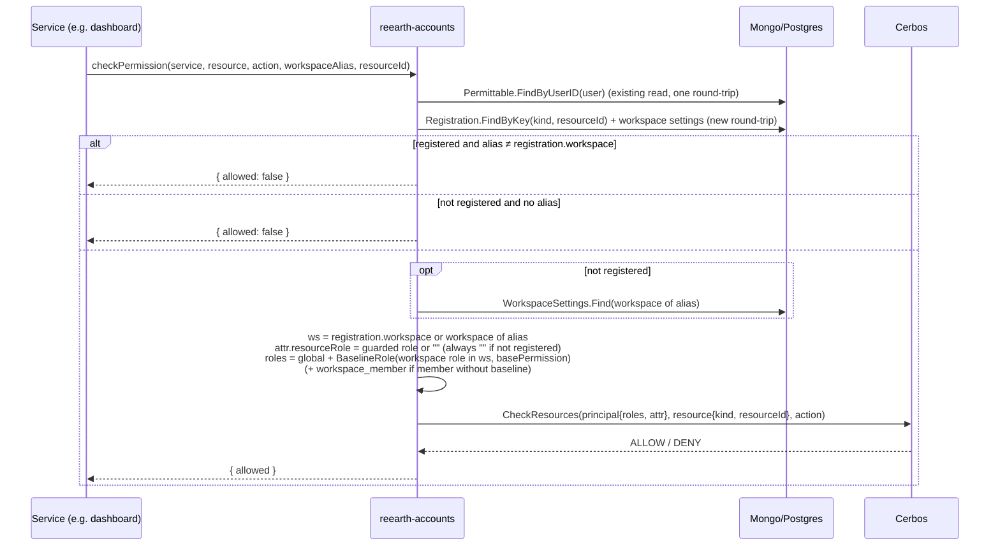
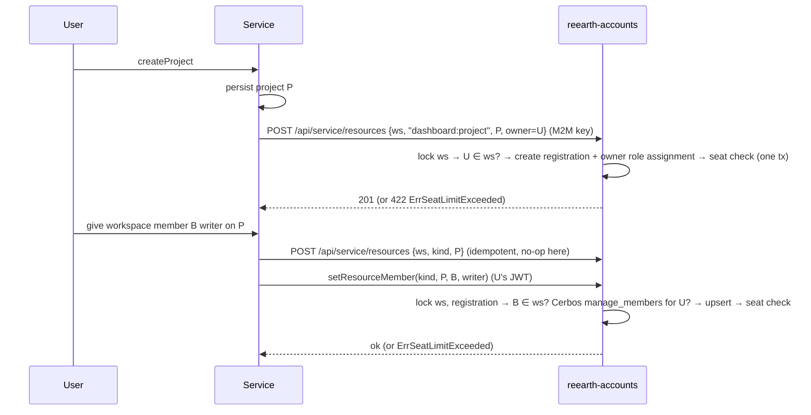
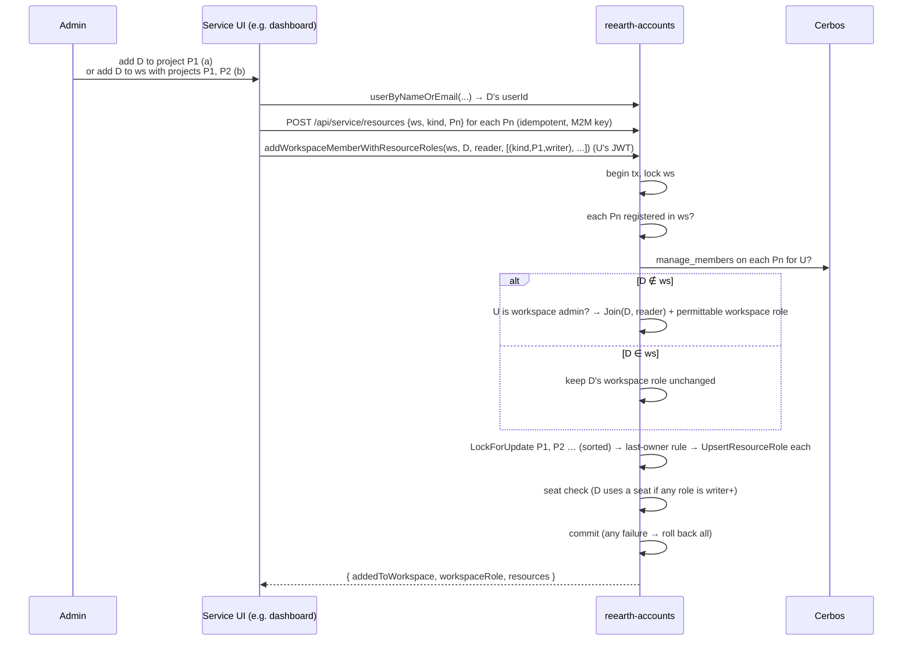
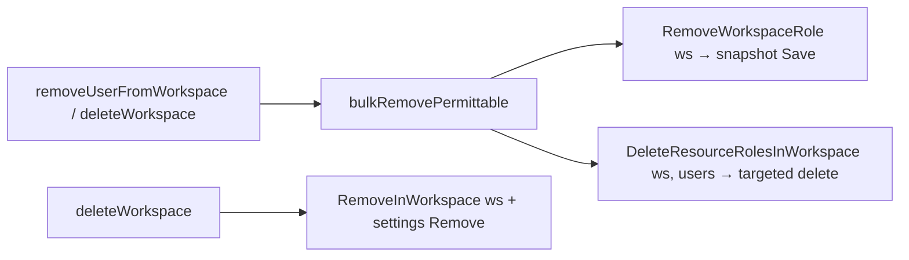
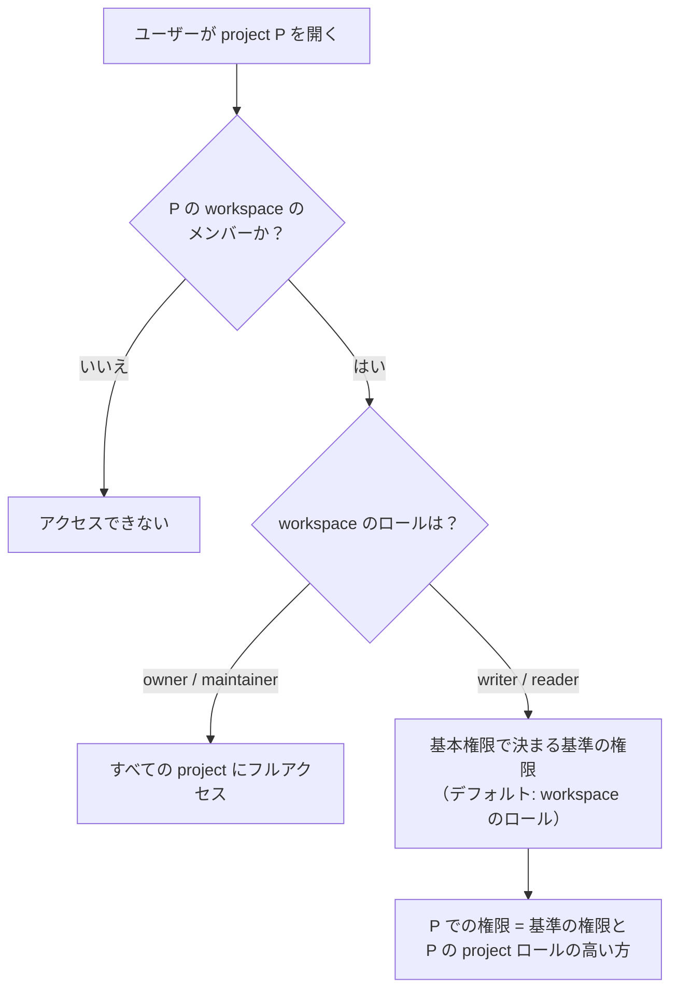
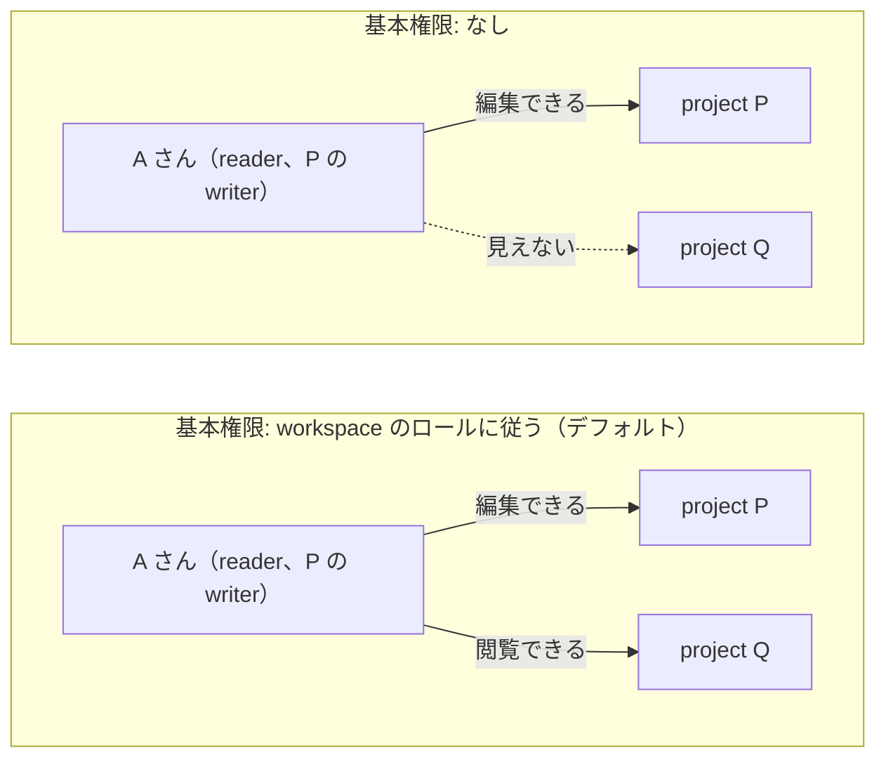

# リソース単位のロール割り当て（汎用的なリソース単位メンバーシップ）

> **Status: DRAFT.** 英語版: [resource-role-binding.md](resource-role-binding.md)。
> 内容に差異がある場合は、本ドキュメント（日本語版）を正とします。
>
> project 単位で（より一般には、各サービスのリソース単位で）メンバーとロールを設定できるようにします。
> これにより各サービス（dashboard、visualizer、cms など）は、メンバー管理の仕組みをそれぞれ作らずに
> project member を持てます。その際、**reearth-accounts は project が何であるかを知りません**。
> 最初に使うのは Dashboard の project です。コード上では、ロールの割り当ては `...Binding` /
> `resource_bindings` という名前の型・テーブルで表します。

## このドキュメントの読み方

*Goals* 以降には技術的な内容が含まれます。次の2段階で読んでください。

1. **まずコンセプトを確認する。** *Background / Problem Statement* を読み、コンセプトに
   違和感がないか（おかしな点、矛盾、顧客にとって分かりにくい点がないか）を確認してください。
2. **次に技術的な導入を確認する。** *Goals* 以降を読み、各サービス（dashboard、visualizer、
   cms、flow）に導入する際の難易度や懸念点を確認してください。*Solution Options* はシステム
   設計の詳細なので、実装に関心がある方向けです。

## Document Signature

|           |                |
|-----------|----------------|
| Creator   | soneda-yuya    |
| Leader    | TBD            |
| Task Link | TBD            |
| Developer | TBD            |

## Background / Problem Statement

### 動機（プロダクト上の背景）

- SSO の導入にあたり「ワークスペースを自由に作成できるべきか」を議論し、
  オプションでワークスペースの作成を制限できるべきという意見が出ました。
  制限すると、1 つのワークスペースで多数の project を管理することになります。
  SSO を使う組織がワークスペースの作成を制限したい理由は次のとおりです。
  - **会社のデータを会社の管理下に置く。** 誰でもワークスペースを作れると、社員が会社の
    project やデータを、組織の管理者が見ることも管理することもできないワークスペースに
    置けてしまいます。
  - **退職時に確実にアクセスを止める。** SSO / SCIM で退職者を組織のワークスペースから外せても、
    本人が作ったワークスペースとその中のデータは管理の外に残ります。
  - **メンバー管理を 1 か所にまとめる。** 管理者は、社員が個別に作った多数のワークスペースを
    追いかけるのではなく、組織のワークスペースで「誰が何にアクセスできるか」を管理したいと考えています。
- ただし、ワークスペースの作成を制限すると新しい問題が生じます。今は workspace のメンバー全員が
  その workspace のすべての project を見られるため、社員全員が1つの組織の workspace で作業するように
  なると、チーム同士がお互いの project を見られないようにする方法がありません。組織は、全員を
  workspace のメンバー（SSO / SCIM で管理）のままにしつつ、project ごとに誰が見られるかを決める
  必要があります。
- 現状、メンバーは workspace 単位でしか割り当てられないため、顧客は workspace ごとに
  メンバーを管理しています。ただし、project ごとに関係するメンバーは異なります。
  workspace を跨いで project を共有したい場合、顧客は現在 project を対象の
  workspace へコピーして対応しています。
- project ごとにメンバーと権限を割り当てられるようにすることで、workspace を
  組織として機能させられます。SSO / SCIM とは別の機能ですが、ワークスペースの作成を
  制限できるようになった時点で使えるよう、早めに実装できる状態にしたいと考えています。
- 目指すモデルは GitHub に近いものです。workspace と project の関係は、GitHub の
  organization と repository の関係に相当します。

  | GitHub | Re:Earth |
  |---|---|
  | organization member | workspace メンバー |
  | organization owner | workspace の owner / maintainer |
  | organization の base permission（すべてのメンバーにすべての repository で適用） | workspace の **基本権限** |
  | repository のロール | project のロール |

  基本権限を「なし」にすると、メンバーはロールを与えられた project だけを見られます。これにより、
  1つの workspace の中でチームを分けたり、取引先の担当者に1つの project だけを見せたりできます。

  たとえば workspace の reader が見られる project は、基本権限によって次のように変わります。

  | 基本権限 | workspace の reader が見られる project |
  |---|---|
  | workspace のロールに従う（デフォルト） | すべての project を閲覧できる（今の Re:Earth と同じ） |
  | Reader | すべての project を閲覧できる |
  | Writer | すべての project を閲覧・編集できる |
  | なし | project のロールを持つ project だけ |

  どの設定でも、project のロールを持つ project では、そのロールまで権限が上がります
  （例: project P の writer なら P を編集できる）。
- GitHub との違いは次のとおりです。

  | 観点 | GitHub | Re:Earth |
  |---|---|---|
  | organization / workspace の外の人 | *outside collaborator*（organization のメンバーではないが repository にアクセスできる人）がいる | 設けない。**アクセスできる人は全員 workspace のメンバー** なので、SSO / SCIM、シート、メンバー一覧、削除をすべて1か所で管理できる |
  | メンバーごとのロール | owner 以外は全員 member で、人ごとの writer / reader の区別はない | workspace の writer / reader を残す。workspace 単位の操作（例: project の作成）はこのロールで決まる |
  | 基本権限の選択肢とデフォルト | none / read / write / admin などから選ぶ。デフォルトは read | 「workspace のロールに従う」を加え、これをデフォルトにする。デフォルトのままなら今の Re:Earth と同じ挙動 |
  | シート | メンバー全員が課金対象 | 少なくとも1つの project を **編集** できるメンバーだけがシートを使う。閲覧しかできない人は無料（今の Dashboard の「reader はシートを使わない」を project 単位に広げたもの） |

### 現状

- Re:Earth の権限は reearth-accounts が判定しています。各サービス（dashboard、visualizer、
  cms など）は、操作を許可する前に「このユーザーはこの操作をしてよいか」を accounts に問い合わせます。
- ユーザーのロールは **workspace 単位** で持っています（ほかにプラットフォーム全体のロールが少しあります）。
  workspace に参加すると、その workspace のすべての project に対して同じロールを持つことになります。
- そのため権限チェックで分かるのは「どの workspace か」だけで、「どの project か」は分かりません。
  同じ workspace の中で「user A は project P を編集できるが project Q は編集できない」といった
  指定はできず、workspace に人を追加すると、その人には必ずすべての project が見えます。

### 課題

プロダクトでは **project 単位のメンバーシップ** が必要です。たとえば
「workspace の reader である user A を project P の editor にする」、
「この workspace ではメンバーは自分が追加された project だけを見られ、チーム X はチーム Y の
project を見られない」、「取引先の user B を workspace に追加するが、project P でだけ作業できる」
といったものです。現在 accounts が表現できる最も細かい単位は workspace です。

各サービスが project のメンバーシップを独自に実装すると、次の問題が起きます。

1. 招待・ロール変更・削除の API と UI がサービスごとに重複する。
2. 各サービスは、project member を掃除するために **workspace メンバーシップの変更**
   （workspace からのユーザー削除、workspace の削除）に反応しなければならない。
   その情報を持つのは accounts だけなので、サービスごとにイベントや同期の仕組みが必要になる。
   取りこぼすと、すでに抜けた workspace の project にユーザーがアクセスできてしまう。
3. 「project member は workspace のメンバーでなければならない」という制約を、
   結局 accounts を呼ばずにサービス内だけで検証することはできない。
4. 権限のルールが 1 か所（accounts）で判定されず、各サービスにばらばらに散らばる。

### 制約（この設計の形を決めている理由）

accounts は *project* が何であるかを取り込んではいけません。project の存在、名前、
公開範囲、中身、ライフサイクルは引き続き各サービスが持ちます。accounts が持つのは、
権限の判定に必要な「この project はこの workspace に属し、このユーザーはそれに対して
このロールを持つ」という情報と、各 workspace の基本権限だけです。

## Goals

1. **project ごとにメンバーとロールを設定できる。** workspace メンバーに、workspace 全体だけでなく
   特定の project に対してロールを与えられる。モデルは次のとおり。
   - **workspace の owner と maintainer** は、常に workspace 内のすべての project にフルアクセスできる。
   - **workspace の writer と reader** は、すべての project で、workspace の基本権限（Goal 7）で決まる
     基準のアクセスを得る。デフォルトではこれは workspace のロールで、今とまったく同じ。project の
     ロールは、その project でのアクセスを **引き上げる** ことはできる（例: workspace の reader を
     project P の writer にすると P を編集できる）が、引き下げることはない。
2. **権限チェックで、対象の project を考慮できる。** サービスが accounts に「このユーザーは
   この操作をしてよいか」と問い合わせたとき、その project でのユーザーのロールを踏まえて判定できる。
   判定にはその project が属する workspace を使う。project のロールが一度でも付いた project は
   accounts がその workspace を覚えているので、呼び出し側が別の workspace を指定してアクセスを得ることは
   できない。まだロールが付いたことのない project では、サービスが自分のデータから読んだ workspace を
   使う（ユーザーの入力ではない）。
3. **メンバーの整合性が保たれる。** project は必ず1つの workspace に属し、project member は必ず
   その workspace のメンバーであり、一度 owner が設定されたら owner が0人になることはない。
   複数人が同時にメンバーを変更しても崩れない。
4. **workspace から外れると project へのアクセスもなくなる。** ユーザーを workspace から外すと、
   その workspace 内のすべての project でのロールも自動で取り消される。各サービスが個別に
   後始末をする必要はない。
5. **accounts は汎用的なままにする。** accounts は「project」が何かを知らない。どのサービスも、
   権限ポリシーを追加するだけで、自分のリソース（例: CMS のモデル）に同じ仕組みを使える。
   accounts の変更は不要。
6. **既存の動作を壊さない。** 現在の権限チェックとポリシーは、これまでとまったく同じように動く。
   既存の workspace ロールは変わらず、基本権限のデフォルトは今の挙動を再現する。
   - **互換性と移行:** 既存のデータ（メンバー、workspace のロール、権限データ、project）はそのまま
     使う。データの変換も、既存の project の一括登録（埋め戻し）もしない。新しい保存先は起動時に
     自動で作られ、機能が使われるまで空のまま。project は、最初に project のロールが付いたとき
     （または今後作成されたとき）に初めて accounts に登録される。基本権限がデフォルトで project の
     ロールがなければ、すべての権限チェックとシートの数は今とまったく同じ。
7. **workspace ごとに基本権限を持つ**（名前は仮）。GitHub の organization の base permission と同じ。
   値は「workspace のロールに従う」（デフォルト。今の挙動）、「なし」、「Reader」、「Writer」。
   workspace の writer と reader がすべての project で何を得るかを決める。owner と maintainer は常に
   フルアクセス。workspace の owner と maintainer が変更でき、変更はすぐに有効になる。「なし」+
   project のロールが、一部の project だけへのアクセスを与える方法になる。
8. **特定の project へのアクセスを1ステップで与えられる。** UI から管理者は、人を project に直接
   追加する（必要なら同時に workspace にも追加する）ことも、workspace に人を追加するときに
   どの project を与えるかを選ぶこともできる。どちらも、すべて成功するか何も変わらないかの1ステップで
   行う（*Design → UI からの追加* を参照）。
9. **シートは編集できるかどうかで決まる。** workspace メンバーは、その workspace の project を
   少なくとも1つ編集できればシートを使い、閲覧しかできない人や何も見えない人は使わない。accounts は
   すべてのサービスと課金のためにシートを1か所で数え、ある変更で誰かが新たにシートを使うことになる
   ときは、workspace がシートの上限を超えないようにする（*Design → シート* を参照）。

## Non-Goals

1. **project の詳細情報を accounts に保存すること。** 名前、公開範囲、所有者、日時など
   project の情報は、引き続きそれを持つサービスが管理する。
2. **project が実在するかを確認すること。** accounts は project を登録したサービスを信頼する。
   project を登録できるのはサービスだけで、ユーザーは登録できない。まだ登録されていない project では、
   サービスが伝える workspace を信頼する。
3. **project の削除を accounts が自分で検知すること。** project が削除されたら、
   それを持つサービスが accounts に知らせる。
4. **入れ子のリソースや権限の継承**（例: folder → project → layer）。後から権限ポリシーで
   追加できるが、今回は対象外。
5. **integration を project のメンバーにすること。** 最初のバージョンでは、project のメンバーに
   なれるのは人（ユーザーアカウント）だけで、integration や API トークンはなれない。
6. **project の属性（例: 公開 / 非公開）を権限の判定に使うこと。** *Open Questions* で扱う。
   最初のバージョンはロールと基本権限だけで判定する。これは「誰が閲覧・編集できるか」の判定の話で、
   シートの数え方の話ではない（公開 project とシートの関係は Open Question 15 で扱う）。
7. **project メンバーシップの招待メールを送ること。** メールには project 名が入るが、
   accounts はそれを知らないため、サービス側で送る。
8. **既存の project を一括で登録すること（埋め戻し）。** project は必要になったとき（最初に project の
   ロールが付くとき、または今後作成されるとき）に登録する。

## Functional Requirements

1. **権限チェックの速さを保つ。**（FR-1、FR-2） project を指定しない権限チェックの負荷は今とまったく同じ。
   project を指定するチェックで増えるのは、その project がどの workspace に属するかを（その
   workspace の基本権限と一緒に）調べる小さく速い参照だけ（登録されていない project では、workspace の
   基本権限の参照がもう1回）。ユーザーの project ロールは、accounts が
   すでに読み込んでいるデータと一緒に読む。
2. **名前と ID に上限を設ける。**（FR-3） リソースの種別名とリソース ID には最大長と使える文字の制限があり、
   保存するデータを小さく予測しやすい状態に保つ。
3. **現実的な規模を想定する。**（FR-4） 1ユーザーあたりの project ロールの割り当ては約 1,000 件まで、
   1 project あたりのメンバーは約 1,000 人まで。
4. **project のメンバー一覧をすばやく取得できる。**（FR-5） 返すのはメンバーが誰かとそのロールだけで、
   名前などの詳細はサービス側が持つ。
5. **accounts が対応するすべてのデータベースで動く。**（FR-6） どのデータベースを使う環境でも、
   メンバーの変更は同じように動作する。
6. **ある人が何を一覧できるかをサービスが分かる。**（FR-7） accounts は workspace ごとに、その人がすべての
   project を（どのレベルで）見られるのか、project のロールを持つ project だけを見られるのかをサービスに
   返せる。これにより、基本権限が何であっても一覧を正しく絞り込める。
7. **workspace ごとのシートの使用数を取得できる。**（FR-8） accounts は、workspace のメンバーのうち何人が
   （誰が）シートを使っているかをすばやく返せる。課金とすべてのサービスが同じ数を使う。

技術的な詳細: *Solution Options → Option 1 → 詳細な要件* を参照。

## Solution Options

この節ではシステム設計を詳しく説明します。実装に関心のある方向けの内容で、ほかの節は
この節を読まなくても理解できます。

### Option 1（推奨）: リソース登録 + `Permittable` に埋め込んだロールの割り当て

3つの状態を持ちます。いずれも accounts にとっては中身を解釈しないものです。

| 状態 | 目的 |
|---|---|
| **リソース登録** `(resourceKind, resourceID) → workspaceID, version` | リソースの workspace の範囲を正として持つ。所有するサービスが登録したことの証明。不変条件のためのリソース単位の直列化ポイント。**必要になったときにだけ作る**（作成時、または最初のリソースロールの付与の前）。既存のリソースは一括登録しない |
| `Permittable` 上の **リソースロール** `(workspaceID, resourceKind, resourceID, roleID)` | そのリソースに対するユーザーのロール。permittable と一緒に読むので、参照のための追加読み込みは不要 |
| **workspace のリソース設定** `workspaceID → basePermission, seatLimit, version` | workspace の基本権限とシートの上限。workspace 単位のロック（1ステップでの追加、workspace のメンバーとロールの変更、編集できる project のロールの付与、project の登録、基本権限の変更など、シートの使用数に影響しうるすべての変更のための直列化ポイント）も兼ねる |

#### ドメイン

```go
// server/pkg/resource/registration.go (new package, no service-specific code)
type Registration struct {
    createdAt   time.Time
    kind        Kind   // validated per FR-3
    resourceID  ID     // validated per FR-3
    version     int64  // bumped by every membership mutation of this resource
    workspaceID workspace.ID
}

// server/pkg/permittable/permittable.go
type Permittable struct {
    id             ID
    resourceRoles  []ResourceRole // NEW
    roleIDs        []role.ID
    updatedAt      time.Time
    userID         user.ID
    workspaceRoles []WorkspaceRole
}

type ResourceRole struct {
    resourceID   resource.ID
    resourceKind resource.Kind
    roleID       role.ID
    workspaceID  workspace.ID // copied from the registration
}
```

`ResourceRole(kind, id)` は、**ユーザーがまだ `workspaceID` の workspace ロールを持っている場合に限り**、
そのリソースに対するユーザーのロールを返します（読み込み時のガード。*並行性* を参照）。
ロールはユーザーごとに `(kind, id)` 1つにつき1つです。accounts のどこにも、`kind` で
`switch` する処理はありません。

ロールは既存の `roles` テーブル（`owner` / `maintainer` / `writer` / `reader`）を再利用します。
リソース種別ごとのロールの意味は、その種別の Cerbos ポリシーだけで定義します。

**基本権限。**

```go
// server/pkg/resource/settings.go
type BasePermission string

const (
    BaseFollowWorkspaceRole BasePermission = "follow_workspace_role" // default; also when no row exists
    BaseNone                BasePermission = "none"
    BaseReader              BasePermission = "reader"
    BaseWriter              BasePermission = "writer"
)

type WorkspaceSettings struct {
    basePermission BasePermission
    seatLimit      *int  // nil = unlimited; set by billing (M2M)
    version        int64 // bumped by every write and by Lock
    workspaceID    workspace.ID
}

// BaselineRole returns a member's baseline role on every resource of the workspace.
// ok == false means "no baseline" (the member only gets resource roles).
func BaselineRole(workspaceRole role.RoleType, base BasePermission) (r role.RoleType, ok bool)
```

| workspace ロール | workspace のロールに従う | なし | Reader | Writer |
|---|---|---|---|---|
| `owner` / `maintainer` | 同じロール | 同じロール | 同じロール | 同じロール |
| `writer` | `writer` | — | `reader` | `writer` |
| `reader` | `reader` | — | `reader` | `writer` |

設定は accounts に保存しますが、workspace のドキュメントではなく workspace ごとの専用レコードに
置きます。既存の workspace のフローは workspace をスナップショットとして保存する（Mongo はドキュメント
全体を置き換える）ため、workspace のフィールドにすると、同時に走る古い workspace の保存で元に戻されて
しまうおそれがあるからです。レコードがなければ「workspace のロールに従う」と見なすので、データの
マイグレーションは不要です。既存の workspace ロールは変えません。

**シート。**

```go
// server/pkg/resource/seat.go
var editRoles = []role.RoleType{role.RoleOwner, role.RoleMaintainer, role.RoleWriter}

// UsesSeat reports whether a member uses a seat in the workspace: workspace role
// owner / maintainer, or a baseline in editRoles, or any valid resource role in editRoles.
func UsesSeat(p *permittable.Permittable, ws workspace.ID, base BasePermission) bool
```

workspace のシートの使用数 = `UsesSeat` が true になるメンバーの数（重複なし）。「workspace のロールに
従う」でリソースロールがなければ、これは今の Dashboard の数（reearth-dashboard の
`server/pkg/subscription/service.go` の `GetCurrentSeatStatus`。ロールが `reader` でないメンバーを数える）
と一致します。

シートの上限は課金が持ち、accounts に送ります（`seatLimit`。`nil` は無制限で、今の「サブスクリプション
なし」と同じ）。これにより accounts は、変更と同じトランザクションの中で上限を強制できます。既存の
`enforceMemberCount` のフック（`WorkspaceMemberCountEnforcer`。現在は配線されていない）は、この
チェックに置き換えます。

**シートのチェック（`ensureSeats`）。** workspace ロックのもとで、トランザクション内で変更を適用した後、
コミットの前に実行します。`seatUsage(after) > seatUsage(before)` かつ `seatUsage(after) > seatLimit` なら、
トランザクションを `ErrSeatLimitExceeded` でロールバックします。使用数を増やさない変更は、workspace が
すでに上限を超えていても（例: 課金が上限を下げた後）常に許可します。シートを使わないメンバーを
シートを使うメンバーに変えうる、つまりこのチェックを行う操作は次のとおりです。

| 操作 | シートが増えうるとき |
|---|---|
| `setResourceMember` | 新しいロールが writer 以上 |
| `addWorkspaceMemberWithResourceRoles` | 新しいメンバーの workspace ロールか、与えるリソースロールのいずれかが writer 以上、または基準ロールで編集できる |
| `updateWorkspaceBasePermission` | 新しい値で、いずれかの基準ロールが writer に上がる（例: `Writer` へ、または `None` / `Reader` から「workspace のロールに従う」へ） |
| `addUsersToWorkspace` / `updateUserOfWorkspace` / `transferWorkspaceOwnership` | メンバーが `writer`、`maintainer`、`owner` になる |
| `ownerUserId` 付きの `POST /api/service/resources`（project の作成） | 作成者がそれまでシートを使っていなかった |

#### ストレージ

**PostgreSQL**: マイグレーション `0005_resource_role_binding.up.sql`

```sql
CREATE TABLE resource_registrations (
    resource_kind text NOT NULL CHECK (octet_length(resource_kind) <= 64),
    resource_id   text NOT NULL CHECK (octet_length(resource_id) <= 128),
    workspace_id  text NOT NULL,
    version       bigint NOT NULL DEFAULT 0,
    created_at    timestamptz NOT NULL DEFAULT now(),
    PRIMARY KEY (resource_kind, resource_id)
);
CREATE INDEX resource_registrations_workspace_idx
    ON resource_registrations (workspace_id);

CREATE TABLE permittable_resource_roles (
    permittable_id text NOT NULL REFERENCES permittables(id) ON DELETE CASCADE,
    resource_kind  text NOT NULL,
    resource_id    text NOT NULL,
    workspace_id   text NOT NULL,
    role_id        text NOT NULL,
    PRIMARY KEY (permittable_id, resource_kind, resource_id),
    FOREIGN KEY (resource_kind, resource_id)
        REFERENCES resource_registrations (resource_kind, resource_id) ON DELETE CASCADE
);
CREATE INDEX permittable_resource_roles_resource_idx
    ON permittable_resource_roles (resource_kind, resource_id);
CREATE INDEX permittable_resource_roles_workspace_idx
    ON permittable_resource_roles (workspace_id, permittable_id);

CREATE TABLE resource_workspace_settings (
    workspace_id    text PRIMARY KEY,
    base_permission text NOT NULL DEFAULT 'follow_workspace_role'
        CHECK (base_permission IN ('follow_workspace_role', 'none', 'reader', 'writer')),
    seat_limit      integer CHECK (seat_limit >= 0),   -- NULL = unlimited
    version         bigint NOT NULL DEFAULT 0
);
```

```sql
-- 0005_resource_role_binding.down.sql
DROP TABLE IF EXISTS resource_workspace_settings;
DROP TABLE IF EXISTS permittable_resource_roles;
DROP TABLE IF EXISTS resource_registrations;
```

マイグレーションはテーブルとインデックスを作るだけで、既存の行は変換しません。新しいテーブルは、
機能が使われるまで空のままです。

**MongoDB**

- 新しいコレクション `resource_registrations` を追加します。`{ resource_kind: 1, resource_id: 1 }`
  に一意インデックス、`{ workspace_id: 1 }` にインデックスを張ります
  （スキーマは `mongoschemagen` で登録し、`server/CLAUDE.md` の手順に従ってマイグレーションを追加）。
- permittable ドキュメントに任意の配列 `resource_roles` を追加します。インデックスは
  `{ "resource_roles.resource_kind": 1, "resource_roles.resource_id": 1 }` と
  `{ "resource_roles.workspace_id": 1 }` です。
- 新しいコレクション `resource_workspace_settings`（`_id` = workspace ID、`base_permission`、
  `seat_limit`、`version`）を追加します。

#### リポジトリの変更（スナップショットではなく対象を絞った書き込み）

既存のスナップショット保存 `Save` / `SaveMany` が、リソースロールを上書きしたり
復活させたりできないようにします。

- **Mongo** の `Permittable.Save` は、ドキュメントの置き換えから、`role_ids`、`workspace_roles`、
  `updated_at` だけの `$set` に切り替えます。`resource_roles` は下記の対象を絞った操作だけが書き込みます。
- **Postgres** の `Permittable.Save` はもともと `permittable_workspace_roles` しか書き直さないので、
  リソースロールについては手を加えません。
- **Postgres** の `hydrate` は、ベースの行に加えて workspace ロールとリソースロールを
  `json_agg` のサブセレクトで返す1本のクエリに置き換えます（FR-2）。

新しいリポジトリのインターフェース:

```go
// resource.RegistrationRepo
FindByKey(ctx, kind, id) (*resource.Registration, error)
Create(ctx, r resource.Registration) error              // ErrAlreadyExists on duplicate
LockForUpdate(ctx, kind, id) (*resource.Registration, error) // must run inside a transaction
Remove(ctx, kind, id) error                              // also removes all role assignments
RemoveInWorkspace(ctx, workspaceID) error                // all registrations + role assignments

// resource.WorkspaceSettingsRepo
Find(ctx, workspaceID) (*resource.WorkspaceSettings, error) // default settings when no row
Lock(ctx, workspaceID) (*resource.WorkspaceSettings, error) // must run inside a transaction; creates the row on first use
SetBasePermission(ctx, workspaceID, base resource.BasePermission) error // after Lock
SetSeatLimit(ctx, workspaceID, limit *int) error                       // after Lock
Remove(ctx, workspaceID) error

// permittable.Repo (additions)
FindResourceMembers(ctx, kind, id) ([]permittable.ResourceMember, error) // projection: userID + roleID
CountResourceOwners(ctx, kind, id, ownerRoleID) (int, error)
UpsertResourceRole(ctx, userID, r permittable.ResourceRole) error
DeleteResourceRole(ctx, userID, kind, id) error
DeleteResourceRolesInWorkspace(ctx, workspaceID, userIDs) error
FindSeatUsers(ctx, workspaceID, baselineEditRoles []role.ID, editRoles []role.ID) ([]user.ID, error)
```

| 操作 | Mongo | Postgres |
|---|---|---|
| `UpsertResourceRole` | 単一ドキュメントの更新: `(kind,id)` の要素を `$pull` してから新しい要素を `$push`（集約パイプラインを使った1回の `updateOne`） | `INSERT … ON CONFLICT (permittable_id, resource_kind, resource_id) DO UPDATE SET role_id = …` |
| `DeleteResourceRole` | `$pull` | `DELETE … WHERE permittable_id=$1 AND resource_kind=$2 AND resource_id=$3` |
| `DeleteResourceRolesInWorkspace` | `updateMany` + `$pull {workspace_id}` | `DELETE … WHERE workspace_id=$1 AND permittable_id = ANY($2)` |
| `FindResourceMembers` | 集約 `$match` → `$unwind` → `$match` → `$project {user_id, role_id}` | `SELECT p.user_id, r.role_id FROM permittable_resource_roles r JOIN permittables p …` |
| `LockForUpdate` | トランザクション内で `findOneAndUpdate {$inc: {version: 1}}`（同じ登録に対する並行トランザクションは書き込み競合となり、リトライされる） | `SELECT … FOR UPDATE` |
| `WorkspaceSettings.Lock` | トランザクション内で `findOneAndUpdate {_id: ws} {$inc: {version: 1}}, upsert`（書き込み競合 → リトライ） | `INSERT … ON CONFLICT DO NOTHING` の後に `SELECT … FOR UPDATE` |
| `FindSeatUsers` | `permittables` に対する集約: `ws` の workspace ロールを持ち、かつ（`workspace_roles` のロール ∈ 基準ロールで編集できるロール **または** `resource_roles` が `$elemMatch {workspace_id: ws, role_id ∈ 編集できるロール}`）のユーザーを `$match` → `$project user_id` | `SELECT DISTINCT p.user_id FROM permittables p JOIN permittable_workspace_roles w … WHERE w.workspace_id=$1 AND (w.role_id = ANY($2) OR EXISTS (SELECT 1 FROM permittable_resource_roles r WHERE r.permittable_id = p.id AND r.workspace_id=$1 AND r.role_id = ANY($3)))` |
| `checkPermission` 用の登録 + 設定 | `resource_registrations` に対する1回の集約: キーで `$match` → `workspace_id` で `resource_workspace_settings` を `$lookup`。登録がなければ、`workspaceAlias` から解決した workspace で `WorkspaceSettings.Find` | 1本のクエリ: `SELECT r.*, s.base_permission FROM resource_registrations r LEFT JOIN resource_workspace_settings s USING (workspace_id) WHERE …`。登録がなければ同じく `WorkspaceSettings.Find` |

#### 権限チェック

`CheckPermissionInput` に任意項目を1つ追加します。

```graphql
input CheckPermissionInput {
  service: String!
  resource: String!
  action: String!
  workspaceAlias: String
  resourceId: String   # NEW
}
```

`resourceId` が **ない** 場合、基本権限が何であっても挙動は変わりません。principal のロールは
今と同じく実際の workspace ロールです。

`resourceId` が **ある** 場合、サービスは今と同じく `workspaceAlias` も渡します（project が属する
workspace を、ユーザーの入力ではなくサービス自身のデータから読んで渡す）。

1. 登録 `(service:resource, resourceId)` を、その workspace の設定と一緒に読み込む（1回のラウンド
   トリップ）。
2. **登録がある場合:** 判定の workspace = 登録の `workspaceID`。`workspaceAlias` が指定されていて、それが
   登録の `workspaceID` に解決されなければ **拒否**（呼び出し元は workspace を選べない）。
   **登録がない場合**（まだ一度もリソースロールが付いていない）: 判定の workspace = `workspaceAlias` を
   解決した workspace。`workspaceAlias` がなければ **拒否**。その workspace の設定を読む（ポイント
   読み込み1回）。リソースロールはまだ存在しないので、判定は workspace のロールと基本権限だけで決まり、
   基本権限がデフォルトなら今とまったく同じ結果になる。
3. principal のロール = グローバルロール + **判定の workspace** におけるユーザーの **基準ロール**
   `BaselineRole(workspace ロール, basePermission)`。「workspace の
   ロールに従う」では基準ロールは workspace ロールなので、ロールは今とまったく同じになる。workspace
   メンバーが基準ロールを持たない場合（「なし」の `writer` / `reader`）は、代わりに評価時だけのロール
   `workspace_member` を加える（保存はしない。Cerbos に空でないロールの一覧を渡し、ポリシーがその場合を
   識別できるようにするため）。その workspace のロールを持たないユーザーにはどちらも付かないので、
   拒否される。
4. principal の属性: `resourceRole` = 読み込み時のガードを通過した、このリソースでのユーザーのロール。
   なければ `""`。`workspaceRole` = 実際の workspace ロール（なければ `""`）。必要なポリシーのため。
5. Cerbos のリソース ID は実際の `resourceId` にする。

**デフォルトのモデル。** リソースでの実効ロール = max(基準ロール, リソースロール) です。workspace の
`owner` / `maintainer` は常にフルの基準ロールを持ちます。`writer` / `reader` の基準ロールは基本権限で
決まり、「なし」ではリソースロールを通してしかリソースに届きません。各ロールの意味は両方のレベルで
同じ（`owner` / `maintainer`: すべての操作とメンバー管理、`writer`: 閲覧と編集、`reader`: 閲覧）なので、
ポリシーは操作ごとに「ロールの一覧のルール（基準ロールに対して評価される）」と「`resourceRole` の
条件のルール」の和集合として max を表現します。Cerbos はどちらかがマッチすれば許可します。accounts が
基準ロールを principal のロールに入れるので、既存のロールの一覧のルールは変更不要です。`resourceId`
ありのチェックでは自動的に基本権限に従い、`resourceId` なしのチェックでは実際の workspace ロールを
使い続けます。

ポリシーは引き続き各サービスの `definition.go` に置き、reearthx の generator がすでに
サポートしている条件を使います。`dashboard:project` の例:

```go
// dashboard: definition.go
resourceRole := func(expr string) *generator.Condition { return generator.SimpleExpr(expr) }
any := []string{"*"} // any principal role (incl. workspace_member); the condition does the gating

builder.AddResource("project", []generator.ActionDefinition{
    // baseline: with a resourceId these roles are the member's baseline role (workspace role + base permission)
    // ("workspace_member" is never listed here)
    generator.NewActionDefinition("read", []string{"owner", "maintainer", "writer", "reader"}),
    generator.NewActionDefinition("edit", []string{"owner", "maintainer", "writer"}),
    generator.NewActionDefinition("delete", []string{"owner", "maintainer"}),
    generator.NewActionDefinition("manage_members", []string{"owner", "maintainer"}),
    // project roles: add on top of the baseline; the only source of access without a baseline
    generator.NewActionDefinitionWithCondition("read", any, resourceRole(`P.attr.resourceRole != ""`)),
    generator.NewActionDefinitionWithCondition("edit", any, resourceRole(`P.attr.resourceRole in ["owner", "maintainer", "writer"]`)),
    generator.NewActionDefinitionWithCondition("delete", any, resourceRole(`P.attr.resourceRole in ["owner", "maintainer"]`)),
    generator.NewActionDefinitionWithCondition("manage_members", any, resourceRole(`P.attr.resourceRole in ["owner", "maintainer"]`)),
})
```

リソースロールは principal のロールではなく principal の **属性** として渡されるので、
project の `owner` が workspace の `owner` と取り違えられることはありません。project のロールは、
チェックで指定されたリソースに対してだけ有効です。基本権限に加えて project ごとに公開範囲を設けるか
（例: 「全メンバーに公開」の project）は Open Question 1 で扱います。

**基準ロールのないメンバーに関するポリシーの補足。** ポリシーは `workspace_member` に
`P.attr.resourceRole` の条件以外では何も許可してはいけません。明示的なロールの一覧で許可するルールは
もともとこれを含まないので、拒否されます（安全側に倒れる）。`resourceRole` の条件なしで `*` に許可する
ルールは、サービスごとに見直す必要があります。workspace 単位のリソース（例: `dashboard:workspace`、
「project の作成」、「project の一覧」）は `resourceId` なしでチェックされるため、実際の workspace
ロールを使い続けます。そのため「なし」でも workspace の writer は project を作成でき（その project の
owner になる）、一覧のエンドポイントも呼べます。**一覧はサービスが絞り込む必要があります**
（*ユーザーが見られるものの一覧* を参照）。

**ユーザーが見られるものの一覧。** 一覧画面は、リソースごとに `checkPermission` を呼ぶことは
できません（Open Question 2）。サービスは workspace ごとに1回問い合わせます。

```graphql
type ResourceAccess {
  workspaceId: ID!
  baselineRole: Role        # null = no baseline: only the bindings below are visible
  bindings: [ResourceBinding!]!
}
extend type Query {
  myResourceAccess(workspaceId: ID!, resourceKind: String!): ResourceAccess!
}
```

`baselineRole` があれば、ユーザーは workspace 内のその種別のすべてのリソースを少なくともそのレベルで
見られます（登録されているかどうかは関係なく、サービスは自分のリソースをすべて一覧する）。なければ
（「なし」のメンバー）、サービスは `bindings` だけを一覧します。`bindings` に入るリソースはロールが
付いているので、必ず登録済みです。

#### メンバー管理 API

**ライフサイクル（M2M のみ）**: REST のサービス用ルートで、M2M の API キーで **のみ** 認証します
（ユーザーの JWT は拒否）。登録は、リソースが存在することとそのリソースがどの workspace に属するかを
accounts が知る手段です。登録をサービスに限定することで、ユーザーが未登録の ID を
自分のものとして主張する手段をなくします。

**必要になったときの登録（遅延登録）。** サービスは次のときにだけ登録します。既存のリソースを一括で
登録することはありません。

- リソースの作成時に、作成者を `ownerUserId` として登録する（今後作成されるリソースはすべて登録される）。
- 既存のリソースに初めてリソースロールを付ける前（`setResourceMember` / `addWorkspaceMemberWithResourceRoles`
  を呼ぶ前）に、`ownerUserId` なしで登録する。`workspaceId` はサービス自身のデータから読む。

登録は冪等なので、サービスはロールを付ける前に毎回呼んでもよい。登録だけがあってロールがない状態は、
未登録と同じ判定になる（workspace のロールと基本権限だけ）ので、ロールの付与が失敗して登録だけが
残っても害はない。

```
POST   /api/service/resources
       { workspaceId, resourceKind, resourceId, ownerUserId? }
       → registers the resource on first use (creation, or before its first
         resource role). If ownerUserId is given, also an `owner` role
         assignment, in one transaction under the workspace lock.
         ownerUserId must be a workspace member; seat check (the creator may
         start using a seat) → 422 ErrSeatLimitExceeded.
         Idempotent: 200 if already registered with the same workspace (no
         change); 409 ErrWorkspaceMismatch if registered with a different one.
DELETE /api/service/resources/{resourceKind}/{resourceId}
       → removes the registration and every role assignment on the resource.
         Idempotent: 204 also when the resource was never registered.
PUT    /api/service/workspaces/{workspaceId}/seat-limit
       { seatLimit: int | null }
       → billing sets the workspace's seat limit (null = unlimited). Lowering
         it below current usage is accepted; it only blocks further increases.
GET    /api/service/workspaces/{workspaceId}/seat-usage
       → { seatCount, seatLimit, seatUserIds } for billing.
```

**メンバーシップと設定（ユーザーの JWT、GraphQL）**:

```graphql
enum BasePermission { FOLLOW_WORKSPACE_ROLE NONE READER WRITER }

extend type Workspace {
  basePermission: BasePermission!   # FOLLOW_WORKSPACE_ROLE when never set
}

input SetResourceMemberInput {
  resourceKind: String!
  resourceId: String!
  userId: ID!
  role: Role!
}
input RemoveResourceMemberInput {
  resourceKind: String!
  resourceId: String!
  userId: ID!
}
input ResourceRoleInput {
  resourceKind: String!
  resourceId: String!
  role: Role!
}
input AddWorkspaceMemberWithResourceRolesInput {
  workspaceId: ID!
  userId: ID!
  workspaceRole: Role               # used only if the user is not yet a member; default reader; not owner
  resources: [ResourceRoleInput!]!  # 0..100 entries, distinct (kind, id)
}
input UpdateWorkspaceBasePermissionInput {
  workspaceId: ID!
  basePermission: BasePermission!
}

type ResourceMember { userId: ID!, role: Role! }
type ResourceBinding { workspaceId: ID!, resourceKind: String!, resourceId: String!, role: Role! }
type AddWorkspaceMemberWithResourceRolesPayload {
  addedToWorkspace: Boolean!        # false if the user was already a member
  workspaceRole: Role!              # the user's workspace role after the call
  resources: [ResourceBinding!]!
}
type WorkspaceSeatUsage {
  workspaceId: ID!
  seatCount: Int!                   # distinct members for which UsesSeat is true
  seatLimit: Int                    # null = unlimited
  seatUserIds: [ID!]!
}

extend type Query {
  resourceMembers(resourceKind: String!, resourceId: String!): [ResourceMember!]!
  # IDs only; the owning service hydrates names etc.
  myResourceBindings(resourceKind: String!, workspaceId: ID): [ResourceBinding!]!
  myResourceAccess(workspaceId: ID!, resourceKind: String!): ResourceAccess!
  workspaceSeatUsage(workspaceId: ID!): WorkspaceSeatUsage!
}

extend type Mutation {
  setResourceMember(input: SetResourceMemberInput!): ResourceMember
  removeResourceMember(input: RemoveResourceMemberInput!): Boolean!
  addWorkspaceMemberWithResourceRoles(
    input: AddWorkspaceMemberWithResourceRolesInput!
  ): AddWorkspaceMemberWithResourceRolesPayload
  updateWorkspaceBasePermission(input: UpdateWorkspaceBasePermissionInput!): Workspace
}
```

ユーザーは `addUsersToWorkspace` と同じくユーザー ID で指定します。UI は既存のユーザー検索
（`userByNameOrEmail` / `searchUser`）で名前またはメールアドレスから探します。メールアドレスによる
新しい招待の仕組みは追加しません。

以下の「workspace 管理者」とは、`addUsersToWorkspace` が使う既存の workspace のチェック
（`add_member`、つまり workspace の owner または maintainer）を通過する操作者を指します。

ガード（汎用的で、種別固有のコードはなし）。すべての更新操作は **1つのトランザクション** で実行します。
ロックは決まった順序で取り（必要な場合はまず workspace ロック（`WorkspaceSettings.Lock`）、次に
`(kind, id)` でソートした登録）、ガードはロック取得後に評価します。

| 操作 | ロック | ガード |
|---|---|---|
| `setResourceMember` | workspace ロック、次に登録 | 登録が存在する（なければ `ErrNotRegistered`。サービスが先に冪等な登録を呼ぶ）。対象ユーザーが登録の workspace のメンバーである（そうでなければ `ErrNotWorkspaceMember`。`addWorkspaceMemberWithResourceRoles` を使う）。操作者に `(kind, id)` への `manage_members` が Cerbos で許可されている。変更が最後の `owner` を降格させる場合は拒否。シートのチェック |
| `removeResourceMember` | 登録 | Cerbos の `manage_members`、または操作者 == 対象ユーザー（自分で抜ける場合）。最後の `owner` を外す場合は拒否 |
| `addWorkspaceMemberWithResourceRoles` | workspace ロック、次に各登録 | すべての登録が存在し `workspaceId` に属する（そうでなければ呼び出し全体を拒否。サービスは各リソースについて先に冪等な登録を呼ぶ）。操作者にそれぞれへの `manage_members` が Cerbos で許可されている。ユーザーが **まだメンバーでない** 場合: 操作者が workspace 管理者（v1。Open Question 7）。個人 workspace は拒否。`workspaceRole`（デフォルト `reader`）は `addUsersToWorkspace` と同じく `owner` 以外。そのうえで `Members().Join` を行い、既存の `bulkUpdatePermittable` の経路で permittable の workspace ロールを書き込む。ユーザーが **すでにメンバーである** 場合: workspace のメンバーシップとロールは変えない（降格もしない。`workspaceRole` は無視する）。そのうえでリソースごとに最後の owner のルールを適用し、各項目について `UpsertResourceRole` を行い、シートのチェックを行う。どこかで失敗したらすべてロールバックする |
| `updateWorkspaceBasePermission` | workspace ロック | 操作者が既存の workspace の `manage` のチェック（owner / maintainer）を通過する。個人 workspace は拒否（v1。Open Question 9）。そのうえで `SetBasePermission` とシートのチェック。次の `checkPermission` から有効になり、ほかには何も書き換えない |
| `workspaceSeatUsage` | — | 操作者が workspace のメンバーを閲覧できる（`read_member`）。`seat-usage` のルートは M2M のみ |
| `resourceMembers` | — | `(kind, id)` への Cerbos の `read`。結果は読み込み時のガードで絞り込む |
| `myResourceBindings` | — | 操作者自身のロールの割り当てのみ。読み込み時のガードで絞り込む |
| `myResourceAccess` | — | 操作者自身のアクセスのみ。`baselineRole` は `BaselineRole(...)` から、`bindings` は読み込み時のガードで絞り込む |
| `Workspace.basePermission` | — | workspace を閲覧できる人（`read`）なら誰でも |

**最後の owner のルール:** リソースの owner 数を 1 以上から 0 にしてしまうメンバーシップの更新は
拒否します。owner なしで登録されたリソース（既存のリソースに初めて writer などを付けたとき）は、owner が
設定されるまで workspace ロールで管理します。登録解除のエンドポイントはこのルールの対象外です。

ユーザーの最後のリソースロールを外しても（`removeResourceMember`）、workspace からは **外れません**
（Open Question 8）。

**既存の workspace のフローの変更**（いずれもまず workspace ロックを取り、1ステップでの追加や
ほかのシートのチェックと直列化する）:

- `addUsersToWorkspace`、`updateUserOfWorkspace`、`transferWorkspaceOwnership`: シートのチェックを
  行う（`writer`、`maintainer`、`owner` になったメンバーは新たにシートを使うことがある）。
- `removeUserFromWorkspace` / `removeMultipleUsersFromWorkspace`: そのユーザーの workspace 内の
  ロールの割り当ても削除する（`DeleteResourceRolesInWorkspace`）。
- `deleteWorkspace`（`Workspace.Remove`）: `RemoveInWorkspace(ws)` で、その workspace のすべての登録と
  ロールの割り当てを削除し、`WorkspaceSettings.Remove(ws)` で設定を削除する。

#### 並行性

| 競合 | 対策 |
|---|---|
| 同じリソースの別々のユーザーに対する2つの書き込みが、どちらも最後の owner のチェックを通過する | どちらも同じ登録に対して `LockForUpdate` を取る必要があり、後の方は待つ（Postgres）か、競合してリトライする（Mongo）。owner 数はロック取得後に読む。 |
| 同じ `(kind, id)` の最初の登録が同時に走る（例: 2人の管理者が同じ既存の project に同時にロールを付ける） | 主キー / 一意インデックスにより、負けた方は `ErrAlreadyExists` を受け取り、登録を読み直す。workspace が同じなら成功（冪等）として続け、違えば 409 `ErrWorkspaceMismatch`。 |
| 最初の登録の最中に権限チェックが走る | チェックは「未登録」か「登録済み」のどちらかを見る。ロールはまだないので、どちらでも workspace のロールと基本権限だけで同じ結果になる。 |
| `setResourceMember` が workspace メンバーシップのチェックを通過した後、ロールの割り当てが書き込まれる前にユーザーが workspace から外され、連動削除が実行される | **読み込み時のガード**: ロールの割り当ては、ユーザーが現在その割り当ての workspace で workspace ロールを持っている場合にのみ有効とする。permittable はすでに読み込まれているので、追加の読み込みはかからない。残った孤立行は無害で、次に連動削除や登録解除のエンドポイントがその行に触れたときに削除される。 |
| workspace フローからの古いスナップショットの `Save` が、新しいロールの割り当てを上書きする（またはその逆） | スナップショット保存は `resource_roles` を書き込まず、ロールの割り当ての書き込みは `workspace_roles` を書き込まない（*リポジトリの変更* を参照）。 |
| 2人の管理者が `addWorkspaceMemberWithResourceRoles` で同じ新しい人を同時に追加する（project は異なる場合もある） | どちらも workspace ロックを取る。後の方は待つかリトライし、既存のメンバーと見なしてロールの割り当てだけを追加する。workspace ロールは変わらず、シートは1回だけ数えられる。 |
| 残りシートが1つのときに、2人の管理者がそれぞれ別の人に新たにシートを使わせる（新しいメンバー、編集できる project のロール、workspace のロールの変更、project の作成） | そうした操作はどれも workspace ロックを取り、トランザクション内でシートの使用数を計算するので、ちょうど1つだけ成功する。 |
| 編集できる project のロールの付与中に基本権限が引き上げられる | どちらも workspace ロックを取る。後の方は先の方を含めて使用数を計算する。 |
| 1ステップでの追加の実行中に、そのユーザーが workspace から外される | どちらも workspace ロックを取る。外す処理が後にコミットされれば、その連動削除が新しいロールの割り当てを削除する。先なら、追加の処理はそのユーザーを新しい人として扱う（管理者のチェック、シートの上限）。残る隙間は読み込み時のガードが補う。 |
| リソースが重なる2つの複数リソースの操作がデッドロックする | ロックの順序を固定する: workspace ロック、次に `(kind, id)` でソートした登録。 |
| 2人の管理者が同時に基本権限を変更する、または変更が workspace の保存と競合する | 設定は専用のレコードにあり、workspace ロックのもとで書き込む。最後にコミットした値が有効になり、workspace のスナップショットの `Save` で元に戻されることはない。 |
| 基本権限の変更中に権限チェックが走る | チェックは登録と同じラウンドトリップで設定を読むので、古い値か新しい値のどちらかを見る。次のチェックは新しい値を見る。accounts は設定をキャッシュしない。`checkPermission` / `myResourceAccess` の結果をキャッシュするサービスは、そのキャッシュの TTL の後に変更が反映されるので、キャッシュは短くする（または変更時に無効化する）必要がある。 |

#### ライフサイクルと連動削除

| イベント | 実行者 | ロールの割り当てへの影響 |
|---|---|---|
| リソース作成（本機能の導入後） | サービス（M2M） | `ownerUserId` = 作成者として `POST /api/service/resources` を呼ぶ |
| リソース削除 | サービス（M2M） | `DELETE /api/service/resources/{kind}/{id}` を呼ぶ。そこでだけ編集できたメンバーはシートを使わなくなる。呼び忘れると孤立した登録が残る。ほぼ無害（そのリソースはサービス側にもう存在しない）だが、その編集できるロールはシートとして数えられ続ける。後から任意の掃除の仕組みで削除する |
| 既存のリソース（本機能以前） | — | 登録しない。権限チェックは `workspaceAlias` の workspace のロールと基本権限で決まる |
| 既存のリソースに初めてリソースロールを付ける | サービス（M2M）→ accounts | サービスが `ownerUserId` なしで `POST /api/service/resources`（冪等）を呼び、続けて `setResourceMember` / `addWorkspaceMemberWithResourceRoles` を呼ぶ |
| `addWorkspaceMemberWithResourceRoles` で人を追加 | accounts | workspace のメンバーシップ（新規の場合）とロールの割り当てを1つのトランザクションで書き込む |
| メンバーの workspace 内の最後のロールの割り当てを削除 | accounts | そのロールの割り当てだけを削除する。workspace のメンバーシップは残る（もう何も編集できなければシートは空く） |
| シートの上限の変更 | 課金（M2M） | なし。今後の増加だけが新しい上限でチェックされる |
| workspace からユーザーを削除 | accounts | `bulkRemovePermittable` から `DeleteResourceRolesInWorkspace` も呼ぶ |
| workspace 削除（`Workspace.Remove`） | accounts | `RemoveInWorkspace(ws)`: workspace のすべての登録とロールの割り当て。設定のレコードも削除する |
| workspace の無効化 / 復元 | accounts | 変更なし（workspace ロールと同じ。復元に備えてデータを残す） |
| 基本権限の変更 | accounts | なし: ロールの割り当てには触れない。チェック時に導出する基準ロールだけが変わる |
| ユーザー削除（`DeleteMe`） | accounts | 現状、`DeleteMe` は permittable を削除しない。ユーザーが消えればロールの割り当てには到達できなくなる。`DeleteMe` で permittable を削除する修正は、本機能とは独立したフォローアップとして提案する |

**メリット**

- リソースの workspace の範囲はサーバー側で正として管理されるので、呼び出し元が
  別の workspace のロールを借りることはできない。
- accounts にリソースを存在させられるのは M2M 認証されたサービスだけなので、
  ユーザーが ID を自分のものとして主張することはできない。
- リソース全体の不変条件はリソースごとに1つのレコードで、workspace 全体の判断（1ステップでの追加、
  シート、基本権限）は workspace ごとに1つのレコードで、両バックエンドとも直列化される。
- ロールの割り当ての参照はすでに読み込まれた permittable の中で完結する。新たな読み込みは、
  workspace の設定を結合した登録の主キー参照だけ。
- アクセスできる人は全員 workspace のメンバーなので、SSO / SCIM と削除は既存のメンバーのフローの
  まま動き、シートは1か所で、変更と同じトランザクションの中で数えて強制できる。
- accounts はドメインに依存しないまま: 種別と ID は解釈しない値で、意味はポリシーが持つ。

**デメリット**

- `resourceId` を渡す `checkPermission` 呼び出しでラウンドトリップが1回増える。
- サービスはリソースの作成時と最初のロールの付与の前に登録し（埋め戻しはしない）、削除時に登録を
  解除する必要がある。
- 未登録のリソースでは、workspace の正しさはサービスが渡す `workspaceAlias` に依存する（登録後は
  accounts が強制する）。
- Mongo の `Save` の意味が置き換えから `$set` に変わる（既存コードに手が入る）。
- 既存の workspace メンバーのフローで、workspace ロックを取り、シートのチェックを行う必要がある。
  課金はシートの上限を accounts に送る必要がある。
- 基本権限がデフォルト以外の場合、サービスは workspace の writer / reader がすべてを見られると
  仮定せず、`myResourceAccess` で一覧を絞り込む必要がある。

#### 詳細な要件

*Functional Requirements* の技術的な形です。各項目は順に FR-1〜FR-8 で、この節のほかの部分では
この番号で参照します。*Functional Requirements* の各項目に、対応する FR の番号を付けています
（1 → FR-1・FR-2、2 → FR-3、3 → FR-4、4 → FR-5、5 → FR-6、6 → FR-7、7 → FR-8）。

1. `resourceId` なしの `checkPermission`: 読み込みも principal のロールも **変わらない**。
   `resourceId` ありの場合: 登録済みなら **ラウンドトリップが1回増える**（主キーによるリソース登録の
   読み込みに、主キーによる workspace の設定を結合する。Postgres は `LEFT JOIN`、Mongo は `$lookup`）。
   未登録なら、その空振りに加えて workspace の設定のポイント読み込みが1回（`workspaceAlias` の解決は
   今もしている）。ロールの割り当て自体は、すでに読み込まれた permittable から読む。
2. PostgreSQL では、`Permittable.FindByUserID` がベースの行、workspace ロール、リソースロールを
   **1回のラウンドトリップ** で読み込む（集約したサブセレクト）。そのため、リソースロールを追加しても
   `checkPermission` のクエリは増えない。
3. 項目の上限。ドメイン層と DB 制約の両方で強制する:
   - `resourceKind`: 64 バイト以下、`^[a-z0-9-]{1,32}:[a-z0-9_-]{1,31}$`
   - `resourceID`: 128 バイト以下、`^[A-Za-z0-9_.:-]{1,128}$`
4. 想定規模: 1ユーザーあたりのロールの割り当ては約 1,000 件以下（上記の上限で1件約 300 B 以下、
   つまり Mongo の1ドキュメントあたり約 300 KB 以下で、16 MB を大きく下回る）。
   1リソースあたりのメンバーは約 1,000 人以下。
5. 1リソースのメンバー一覧取得はインデックスが効き、そのリソースの `(userId, role)` だけを返す。
   集約全体を組み立てることはしない。
6. すべての更新操作が MongoDB / PostgreSQL の両バックエンドと `memory` リポジトリで動くこと。
7. `myResourceAccess(ws, kind)` のコストは、すでに読み込まれた permittable と、workspace の設定の
   ポイント読み込み1回。
8. `workspaceSeatUsage(ws)` / シートのチェックは、インデックスが効く1本のクエリ（`FindSeatUsers`。
   workspace ロールとリソースロールの `workspace_id` のインデックスを使う）と設定のレコードだけで済み、
   workspace 全体を読み込むことはない。

範囲についての補足（*Non-Goals* の技術的な形）:

- リソースの存在は検証しない。accounts はリソースを登録する **M2M 認証された** サービスを信頼し、
  リソースの削除時に登録解除のエンドポイントを呼ぶこともそのサービスに任せる
  （*ライフサイクルと連動削除* を参照）。未登録のリソースでは、`checkPermission` でサービスが渡す
  `workspaceAlias` を信頼する。
- 既存のリソースの埋め戻しはしない（遅延登録）。
- v1 のロールの割り当ては **ユーザーの principal のみ**。integration（M2M）の principal は
  リソースロールを持てない。
- v1 の `checkPermission` は、リソースの属性（例: `visibility`）を Cerbos に渡さない。
  ポリシーはロールだけを使う（*Open Questions の技術的な補足* を参照）。

#### リクエストの流れ（シーケンス図）

##### resource ID を指定した権限チェック



##### project の作成と workspace メンバーの追加



##### UI から1ステップで人を追加する（パターン a と b）

パターン (a) は1つのリソース（表示中の project）を渡し、パターン (b) は workspace の
「メンバー追加」ダイアログで選んだ project を渡します。どちらも同じ mutation を呼びます。



##### workspace メンバー削除時の連動



#### 技術的な補足: 影響・テスト・デプロイ・ロールバック・監視

##### 影響

1. **permittable のドキュメント / 行のサイズ** がロールの割り当て1件あたり約 300 B 以下増える。
2. **Mongo の `Permittable.Save`** が置き換えから `$set` に変わる。permittable の永続化に関する
   既存テストは引き続き通る必要があり、`Save` が `resource_roles` に触れないことを確認する
   新しいテストを追加する。
3. `resourceId` を渡した場合の **Cerbos のリソース ID の変更**: 影響を受けるのは、利用を始めた
   呼び出し元だけ。
4. **既存の workspace メンバーのフロー** は workspace ロックを取る。メンバーの削除では、対象を絞った
   削除が1回増える。
5. **ポリシーの書き方**: ロール名は workspace とリソースで共通。リソースロールは `P.attr.resourceRole`
   でのみ判定する（principal のロールとして扱わない）。`resourceId` があるときロールの一覧のルールは
   基準ロールに対して評価され、`workspace_member` はそこに決して含めない。サービスの既存の project
   ポリシーは、置き換えるのではなく `resourceRole` のルールを追加して拡張する（和集合 = max）。
6. **gqlclient**（`server/pkg/gqlclient`）の利用側は、新しいフィールドを使うためにバージョンを
   上げる必要がある。古いクライアントには影響しない（workspace のメンバー一覧と `Role` enum は
   変わらない）。
7. **基本権限と一覧**: サービスは、workspace の `writer` / `reader` がすべてのリソースを見られると仮定しては
   いけない。一覧のエンドポイントは `myResourceAccess` を使い、`baselineRole` が null なら `bindings` に
   絞り込む。`resourceId` ありのチェックはすでに設定に従う。
8. **基本権限の UI**: workspace の設定画面で `Workspace.basePermission` を表示・編集する（owner /
   maintainer のみ）。
9. **Dashboard のシートのロジックを accounts に移す**: reearth-dashboard の
   `server/pkg/subscription/service.go` の `GetCurrentSeatStatus` / `TempGetCurrentSeatStatus`（reader 以外の
   メンバーを数える）と、project の作成 / 更新 / 削除での `IsOverUsedSeat` のガードは、メンバーを数える
   代わりに `workspaceSeatUsage` / `seat-usage` を使う必要がある。課金はサブスクリプションが変わるたびに
   `PUT /api/service/workspaces/{id}/seat-limit` で `seatLimit` を送る。
10. **新しい拒否**: `setResourceMember`、`addWorkspaceMemberWithResourceRoles`、
    `updateWorkspaceBasePermission`、`addUsersToWorkspace`、`updateUserOfWorkspace`、
    `transferWorkspaceOwnership`、project の登録は `ErrSeatLimitExceeded` を返すことがある。呼び出し側は
    すべて分かりやすいメッセージを表示する必要がある。
11. **遅延登録と `workspaceAlias`**: サービスは project の作成時に登録し、既存の project に初めてロールを
    付ける前に冪等な登録を呼ぶ。`resourceId` を渡す `checkPermission` では、project の workspace を自分の
    データから読んで `workspaceAlias` に渡す（未登録の project はこれで判定される）。
12. **互換性と移行**: 既存のデータは変換せず、埋め戻しもしない。新しいテーブル / コレクションは起動時に
    作られ、機能が使われるまで空のまま。基本権限がデフォルトでリソースロールがなければ、`checkPermission`
    の結果と `seatCount` は今と同じ。

##### テスト

1. **ユニット**（`pkg/resource`、`pkg/permittable`）: 種別 / ID の検証と長さの上限。
   リソースごとにロールは1つ。読み込み時のガードが、対応する workspace ロールのない割り当てを除外すること。
   上の表のすべてのセルについての `BaselineRole`（設定のレコードがなければ「workspace のロールに従う」）。
   workspace ロール × 基本権限 × リソースロールの組み合わせごとの `UsesSeat`。
2. **interactor**（`internal/usecase/interactor`）:
   - `CheckPermission`: `resourceId` なし → 設定にかかわらず roles が変わらない（リグレッション）。
     未登録のリソース + alias → alias の workspace のロールと基本権限で判定（デフォルトなら今と同じ。
     「なし」なら owner / maintainer だけ許可）。未登録 + alias なし → 拒否。登録済み + 別の workspace の
     alias → 拒否。登録済みでは workspace ロールは alias ではなく登録から取られる。`resourceRole` が設定される / 空になる。`resourceId` ありでは、基本権限ごとに
     principal のロールが基準ロール（なければ `workspace_member`）と一致する。workspace ロールのない
     ユーザー → 古いロールの割り当てがあっても拒否。
   - 登録: M2M のみ（JWT は拒否）。owner は workspace のメンバーでなければならない。
     同じ workspace での重複は冪等（ロールは変わらない）、別の workspace なら 409。`ownerUserId` なしの
     登録だけでは判定が変わらない。登録解除は未登録でも成功する。
   - `setResourceMember` / `removeResourceMember`: 未登録のリソース → `ErrNotRegistered`。メンバーでない対象ユーザーは拒否。
     `manage_members` がなければ拒否。自分で抜けるのは許可。最後の owner の保護。最後のロールの
     割り当てを外しても workspace のメンバーシップは残る。
   - `addWorkspaceMemberWithResourceRoles`: メンバーでないユーザーは指定された（デフォルト `reader`）
     workspace ロールで参加し、すべてのロールの割り当てを得る。既存メンバーは workspace ロールが
     変わらず（降格しない）、ロールの割り当てだけが増える。別の workspace のリソース、未登録のリソース、
     `manage_members` がない、新しい人に対する管理者でない操作者、workspace ロールとしての `owner`、
     個人 workspace、シートの上限のいずれでも、呼び出し全体が拒否され、メンバーシップもロールの
     割り当ても残らない。最後の owner のルールが適用される。
   - `updateWorkspaceBasePermission`: owner / maintainer のみ。個人 workspace は拒否。次のチェックで
     新しい値が使われる。
   - `myResourceAccess`: 設定と workspace ロールごとの `baselineRole`。「なし」のメンバーでは null。
   - `workspaceSeatUsage`: デフォルトの設定でリソースロールがなければ、以前の Dashboard の数と一致する。
     writer のリソースロールを持つ reader は、そのロールがいくつあっても1回だけ数える。「なし」で
     reader のリソースロールしか持たない writer は数えない。
   - シートのチェック: 上限に達しているとき、*シートのチェック* の表の各操作は `ErrSeatLimitExceeded` で
     拒否され、何も残らない。シートが増えない同じ操作は成功する。上限を超えていてもシートを空ける
     操作は成功する。`seatLimit = null` では決して止めない。
   - 連動削除: `RemoveUserMember` / `RemoveMultipleUserMembers` / `Remove`。
3. **並行性**（`make test-integration`、両バックエンド）: 2つの goroutine が最後の2人の owner を
   同時に外す → ちょうど1つだけ成功する。同じキーの並行登録 → 1つだけ成功する。
   `UpsertResourceRole` の後の古いスナップショットの `Save` でもロールの割り当てが残る。同じ新しい人に
   対する2つの1ステップでの追加を同時に実行 → 1回だけ参加し、両方のロールの割り当てが残る。残り
   シートが1つのときに、種類の違うシートを増やす操作（1ステップでの追加、`setResourceMember` の
   writer、project の登録、基本権限を `Writer` に）を同時に実行 → ちょうど1つだけ成功する。同じ既存の
   リソースの最初の登録を同時に実行 → 1つの登録になり、どちらも成功する。
4. **リポジトリ**: すべての新しい操作の Mongo・Postgres・memory 実装。Postgres の
   `FindByUserID` が1本のクエリしか発行しないこと。
5. **マイグレーション**: 既存 DB に対する `0005` の up / down。既存の行が変更されないこと。既存の
   permittable が空の `resourceRoles` で読み込めること。設定のレコードがない workspace が「workspace の
   ロールに従う」と読めること。登録のない既存の project に対するチェックが今と同じ結果になること。
6. **E2E**（`server/e2e`）: 上記のルールで生成した `dashboard:project` のテスト用ポリシーを使い、
   次を確認する。
   - ロールの割り当てのない workspace の `reader` → workspace のすべての project で `read` は許可、
     `edit` は拒否。
   - workspace の `reader` + P のリソースロール `writer` → P でだけ `edit` が許可。
   - workspace の `writer` + P のリソースロール `reader` → P でも `edit` は許可のまま
     （リソースロールはアクセスを引き下げない）。
   - workspace の `owner` → すべての project ですべての操作が許可。
   - 別 workspace のユーザー → 拒否。
   - 未登録の project（alias 付き）: デフォルトでは今と同じ結果。
   - 基本権限「なし」: ロールの割り当てのない workspace の `reader` / `writer` → すべての project
     （未登録の project を含む）で拒否。P のリソースロール `writer` があれば → P でだけ `read` / `edit`。workspace の `maintainer` →
     すべての project ですべての操作。
   - 基本権限「Writer」: workspace の `reader` → すべての project で `edit` が許可。基本権限「Reader」:
     workspace の `writer` → リソースロールで許されない限り `edit` は拒否。

##### デプロイ

1. 後方互換性はあるか？ **あり。** 入力の任意項目、新しいコレクション / テーブル、
   新しいルートと GraphQL のフィールド・enum の追加のみ。`resourceId` がなければ挙動は変わらず、
   workspace のメンバー一覧とロールも変わらない。既存のデータは変換せず、埋め戻しもしない。
2. 部分的にデプロイできるか？ **できる。** 順序:
   1. accounts をデプロイする。`seatLimit` が設定されていなければ、シートのチェックは止めない。
   2. 課金がすべての workspace の `seatLimit` を送り、Dashboard は `GetCurrentSeatStatus` /
      `IsOverUsedSeat` を `seat-usage` に切り替える。切り替えの前に、すべての workspace で `seatCount` を
      Dashboard の数と比べる。デフォルトの設定でリソースロールがなければ一致する。
   3. 各サービスが作成時の登録（作成者を owner として）/ 削除時の登録解除と、最初のロールの付与の前の
      冪等な登録を始める。既存のリソースは登録しない。
   4. 各サービスが `P.attr.resourceRole` を使うポリシーをデプロイし、`resourceId`（と、今と同じく
      `workspaceAlias`）を送り始める。登録のない既存の project は今と同じ結果になる。ステップ 4 より前は
      属性が存在せず、条件がマッチしない（安全側に倒れる）。
   5. 1ステップでの追加の UI を有効にする。
   6. サービスが `myResourceAccess` で一覧を絞り込むようにし、そのうえで基本権限を変更する UI を
      有効にする。workspace が変更するまではすべての workspace が「workspace のロールに従う」なので、
      ステップ 1〜5 で誰のアクセスもシートの数も変わらない（新しい編集できる project のロールと新しい
      project の分を除く）。
3. 通知先: dashboard / visualizer / cms のオーナー、課金の担当者、Cerbos ポリシーの管理者。
4. 設定変更: なし（既存の M2M API キーを再利用する）。
5. DDL: Postgres のマイグレーション `0005` は起動時に自動で実行される（golang-migrate）。
   Mongo は起動時のマイグレーションでコレクションのスキーマとインデックスを作成する。
   既存の行は変更せず、accounts でもサービスでも埋め戻しはない。新しいテーブル / コレクションは
   機能が使われるまで空のまま。

##### ロールバック

1. 原因をチームの Slack チャンネルに共有する。
2. 1ステップでの追加と基本権限の UI を無効にしてから、`resourceId` / `resourceRole` に依存する利用側
   サービス / ポリシーを戻す。基本権限がデフォルト以外の workspace では **アクセスが広がる**: 旧
   バージョンには基本権限がないので、その writer / reader は再びすべての project を見られるようになる。
   そうした workspace（`base_permission <> 'follow_workspace_role'`）を洗い出し、ロールバックの前に
   管理者に知らせる。「なし」に依存している workspace があれば、修正して前に進めることを優先する。
   Dashboard のシートの状態を自前のメンバー数に戻す。リソースロールでシートを使っていた reader
   （数えられなくなる）と、「なし」の workspace（writer が再び数えられる）では、使用数が変わることがある。
3. accounts のイメージを戻す。旧バイナリは新しいコレクション、テーブル、`resource_roles`
   フィールドを無視するので、**データのロールバックは不要**。
   注意: 旧バージョンの Mongo の `Save` はドキュメント全体を置き換えるため、書き込んだ permittable の
   `resource_roles` は消える。機能は無効になっているのでロールバック中は許容できるが、消えたロールの
   割り当ては自動では戻らない（埋め戻しはない）ので、ロールフォワード後に付け直す。ロールバックの
   期間は短くする。登録は残る（ロールのない登録は未登録と同じ判定になる）。1ステップで追加された人は
   workspace のメンバーのまま残る。
4. スキーマ自体を削除する必要がある場合のみ、`0005` の down を実行する
   （登録、ロールの割り当て、基本権限を含む workspace の設定が消えるので、先にダンプを取る）。

##### デプロイ後の確認と監視

- チェックリスト
  - dashboard の staging で project を作成し、登録と作成者への `owner` ロールの割り当てができることを確認する。
  - 登録のない既存の project に対する `checkPermission`（alias 付き）が、デプロイ前と同じ結果になることを
    確認する。その project に初めて `setResourceMember` でロールを付け、その時点で登録されることを確認する。
  - workspace の `reader` にある project のリソースロール `writer` を与え、その project を編集でき、
    ほかの project は閲覧だけできることを確認する。そのメンバーを workspace から外し、すべての
    project にアクセスできなくなることを確認する。
  - 別の workspace の alias を指定して `checkPermission` を呼び、拒否されることを確認する。
  - Dashboard を切り替える前に、すべての workspace で `seatCount` が Dashboard の今の数と一致することを
    確認する。
  - workspace 外のユーザーに対して project の `writer` を付けて `addWorkspaceMemberWithResourceRoles` を
    呼び、そのロールを持つ `reader` のメンバーになり、`seatUserIds` に入ることを確認する。project の
    `reader` を付けた場合は入らないことを確認する。
  - `seatCount == seatLimit` のときに reader に `setResourceMember(writer)` を呼び、
    `ErrSeatLimitExceeded` になり何も変わらないことを確認する。
  - 設定のレコードがない workspace が `FOLLOW_WORKSPACE_ROLE` を返し、そのメンバーのチェックが
    変わらないことを確認する。
  - staging の workspace で `updateWorkspaceBasePermission(NONE)` を呼び、リソースロールのない `reader` が
    すべての project で拒否されること、`myResourceAccess` が `baselineRole: null` を返すこと、
    `maintainer` は引き続きフルアクセスできること、元に戻すと次のチェックでアクセスが戻ることを確認する。
- メトリクス
  - `resourceId` あり / なしでの `checkPermission` の p50 / p95 レイテンシ。
  - 登録 / 登録解除 / `setResourceMember` / `addWorkspaceMemberWithResourceRoles` /
    `updateWorkspaceBasePermission` のエラー率（Mongo のトランザクションのリトライとシートの上限による
    拒否を含む）。
  - permittable あたりのロールの割り当て数（最大 / p99）。FR-4 の監視用。
  - 操作と workspace ごとの `ErrSeatLimitExceeded` の件数。`workspaceSeatUsage` のレイテンシ。
- アラート
  - `checkPermission` のエラー率: Warning > 1%、Danger ≥ 5%。
  - `checkPermission` の p95 レイテンシ: Warning > ベースライン比 +20%。

#### Open Questions の技術的な補足

1. **project ごとの公開範囲:** メンバーを制限することは基本権限で行う。「なし」でも workspace 全体が
   閲覧できる project が必要なら、`CheckPermissionInput` に任意の `attributes: JSON` を追加して Cerbos の
   リソースにそのまま渡し（例: `visibility`）、`R.attr.visibility == "workspace"` のときに
   `workspace_member` に `read` を許可するといったルールにするのが案。その場合、サービスは
   `myResourceAccess` から作る一覧にそうした project も加える必要がある。
2. **一括チェック:** 一覧画面向けに、複数の `resourceId` に対する `checkPermissions` を用意する。
   Cerbos の `CheckResources` はすでに複数リソースに対応している。
3. **サービスごとの M2M キー:** v1 では登録 / 登録解除（`POST` / `DELETE /api/service/resources`）に
   既存の共有 M2M API キーを受け付ける。案: 各キーをそのサービス自身の種別（`dashboard:*`）に限定する。
4. **孤立データの掃除（sweeper）:** 登録解除のエンドポイントを呼ばずに削除されたリソースの登録を
   削除する。
5. **integration メンバー:** M2M トークンをリソースの principal にすること（cms で必要になる可能性）。
6. **UI の配置:** どちらにしても accounts の変更はない。どちらのパターンも、どのサービスの画面からでも
   `addWorkspaceMemberWithResourceRoles` を呼ぶ。既存のメンバーに project のロールを与えるだけなら
   `setResourceMember` も使える。
7. **デフォルトの workspace ロールと、新しい人を追加できる人:** デフォルトは
   `addWorkspaceMemberWithResourceRoles` の `workspaceRole` のデフォルト（`reader`）。project の
   `manage_members` 保持者に新しい人の追加を許すなら、「まだメンバーでない」場合の workspace 管理者の
   チェックを外す。
8. **最後の project のロールで workspace からも外す:** そうすると決めた場合、`removeResourceMember`
   （と登録解除）は、同じトランザクションの中で workspace ロックのもと、workspace 内の最後のロールの
   割り当てが外れたメンバーを、既存の workspace メンバー削除の経路で外す。対象は基準ロールのない
   （「なし」の）メンバーだけ。そうしたメンバーはもともとシートを使っていないので、シートには影響しない。
9. **個人 / Free の workspace での基本権限:** v1 では個人 workspace に対する
   `updateWorkspaceBasePermission` を拒否する。プランで制限するなら、そのガードにプランのチェック
   （`enforceMemberCount` と同じ情報源）を加える。
10. **基本権限の値としての `Maintainer`:** enum に `MAINTAINER` を、`BaselineRole` の表に列を追加する
    だけで、ほかは変わらない。すべてのメンバーがすべての project のメンバーを管理できるようになるため、
    v1 では入れない。
11. **設定の範囲:** workspace ごとにプラットフォーム全体で1つ（workspace ごとに1レコードで、すべての
    リソース種別に適用）を提案する。サービスごとにするなら、レコードを `(workspaceID, service)` で持ち、
    登録の種別の接頭辞で引く。FR-1 のラウンドトリップは変わらない。
12. **シートの上限を超える場合:** v1 は `ensureSeats` から `ErrSeatLimitExceeded`（M2M のルートでは 422）で
    拒否する。「許可して超過を示す」案なら、拒否をやめ、今の Dashboard の `IsOverUsedSeat` のように
    `workspaceSeatUsage` で `seatCount > seatLimit` を見せる。project の作成だけを別扱いにするなら、
    `POST /api/service/resources` でだけチェックを省く。
13. **「編集」の意味:** `UsesSeat` はサービスごとの操作ではなくロールのレベル（`editRoles` = writer、
    maintainer、owner）を使うので、すべてのリソース種別で同じになる。サービスごとに線を変える必要が
    あれば、`editRoles` を種別ごと（サービスがポリシーと同じように宣言する）にする必要がある。
14. **未登録の project の workspace:** 未登録の project では `workspaceAlias` を信頼する。accounts が
    常に強制するようにするには、サービスが任意の時点で既存の project を `ownerUserId` なしで登録すればよい
    （冪等で、判定は変わらない）。一括で行う場合も、サービスごとに少しずつ行う場合も、同じ
    エンドポイントでよい。
15. **公開 project とシート:** 無料にするなら、登録に任意の `public: Boolean` を持たせ、サービスが登録時と
    公開範囲の変更時（新しい M2M のルート `PUT /api/service/resources/{kind}/{id}/visibility` など）に
    送る。`UsesSeat` / `FindSeatUsers` は、公開のリソースのロールを編集できるロールとして数えないように
    する。公開範囲の変更は workspace ロックのもとで `ensureSeats` を通し、非公開にして上限を超えるなら
    `ErrSeatLimitExceeded` で拒否する。未登録の project はロールを持たないので影響しない。v1 では
    何もしない。
16. **アクセスのリクエスト:** `(workspaceId, resourceKind, resourceId, targetUserId または email)` を
    キーにしたリクエストのレコード（要求者、ロール、状態）を持つ。承認は、承認者の ID で
    `addWorkspaceMemberWithResourceRoles` または `setResourceMember` を呼ぶだけにして、既存のガード
    （`manage_members`、新しい人には workspace 管理者、最後の owner のルール）とシートのチェックを
    そのまま効かせる。メールアドレスだけの新しい人は、既存のユーザー検索や招待の流れでユーザーになって
    から承認する。workspace のメンバー一覧（`read_member`）は `resourceId` なしの workspace 単位の
    チェックなので、基本権限の影響を受けない。

### Option 2: ロールの割り当てを独立したコレクション / テーブルに置く（埋め込まない）

登録と API は同じですが、ロールの割り当てを permittable ではなく、独立した
`resource_bindings (kind, id, userID, role)` コレクション / テーブルに置きます。

**メリット:** permittable が大きくならない。メンバー一覧は単純なインデックススキャンになる。
スナップショットの `Save` の意味を変える必要がない。

**デメリット:** `checkPermission` で、登録に加えてもう1回（ロールの割り当ての）読み込みが増える。
workspace の連動削除で2つのストアを更新する必要がある。

**結論:** Option 1 を採用します。1ユーザーあたりのロールの割り当て数が FR-4 に近づいた場合、
または Mongo の `Save` の変更にリスクがあると判明した場合は、Option 2 を再検討します。

### 検討して却下した案: 各サービスにメンバーシップを持たせる

*課題* の (1)〜(4) の重複と連動削除の問題があるため却下しました。
「メンバー情報はサービスに置き、ロールを属性として Cerbos に渡す」という派生案は、(4) しか解決しません。

### 検討して却下した案: 外部コラボレーター

GitHub の outside collaborator のような、workspace のメンバーではないが project のロールを持つ人も
検討しましたが、却下しました。2種類目のメンバーシップ、別のシートの数え方、専用の削除や一覧のフローが
必要になり、SSO / SCIM の管理の外に置かれてしまうためです。基本権限を「なし」にして、一部の project の
ロールだけを持つ workspace メンバーとして追加すれば、全員を1つのメンバー一覧に保ったまま同じ
アクセスを与えられます。

## Design

**accounts が project ごとに持つのは、「どの workspace に属するか」と「誰がどのロールを持つか」の
2つだけ。** workspace ごとには、基本権限という設定を1つ持つ。それ以外の project の情報はすべて
サービス側に残る。

**project は必要になるまで accounts に登録しない。** project へのアクセスは、project のロールが
なければ workspace のロールと基本権限から決まるので、project のロールが付くまでは accounts が project を
知っている必要はない。そのため既存の project を一括で登録すること（埋め戻し）はしない。今後作成する
project は、作成者を owner として作成時に登録する。既存の project は、最初に project のロールが付く
ときに登録する。

### workspace メンバー、ロール、基本権限

- **project にアクセスできる人は全員 workspace のメンバー。** 人は今と同じく（管理者によって、または
  SSO / SCIM によって）workspace に追加され、メンバー一覧に表示され、何かを編集できればシートを使い
  （*シート* を参照）、外されるとすべてのアクセスを失う。
- **workspace のロール**（owner / maintainer / writer / reader）は変わらず、メンバー管理や project の
  作成といった workspace 単位のことは引き続きこのロールで決まる。
  - **owner と maintainer** は、GitHub の organization owner と同じく、常にすべての project に
    フルアクセスできる。
  - **writer と reader** は、すべての project で workspace の基本権限（下記）で決まるレベルを得る。
    project のロールはその project でのアクセスを引き上げることはできるが、引き下げることはない。
- GitHub と違い、外部コラボレーターはない。取引先の担当者も workspace のメンバーとして追加し、
  基本権限と project のロールで何を見られるかを決める。

### 基本権限

各 workspace は、GitHub の organization の base permission と同じく **基本権限**（名前は仮）を持つ。
これは、workspace の writer と reader がすべての project で何を得るかを決める。

| 基本権限 | writer と reader がすべての project で得るもの |
|---|---|
| **workspace のロールに従う**（デフォルト） | workspace のロール。今の挙動とまったく同じ |
| **なし** | 何もなし。project のロールを持つ project だけが見える |
| **Reader** | 閲覧 |
| **Writer** | 閲覧と編集 |

- owner と maintainer は、設定にかかわらず常にフルアクセス。
- 各 project で、writer や reader は基本権限と project のロールのうち高い方を得る。
- 変更できるのは workspace の owner と maintainer だけで、変更はすべてのメンバーにすぐ反映される。
- **一部の project だけへのアクセスを与える。** 基本権限を「なし」にし、人に project のロールを与える。
  たとえば:
  - **1つの SSO workspace の中のチーム。** ワークスペースの作成が制限され、社員全員が1つの組織の
    workspace で作業する場合、各チームに自分たちの project のロールを与える。社員は SSO / SCIM で管理
    される workspace のメンバーのままで、それぞれ自分の project だけを見られる。
  - **取引先の担当者。** workspace に（例: reader として）追加し、担当する1つの project のロールを与える。
    それ以外は何も見えない。

例: 基本権限ごとに、workspace の **reader** が見られる project:

| 基本権限 | workspace の reader が見られる project |
|---|---|
| workspace のロールに従う（デフォルト） | すべての project を閲覧できる（今の Re:Earth と同じ） |
| Reader | すべての project を閲覧できる |
| Writer | すべての project を閲覧・編集できる |
| なし | project のロールを持つ project だけ |

どの設定でも、project のロールを持つ project では、そのロールまで権限が上がる
（例: project P の writer なら P を編集できる）。

#### 図

project へのアクセスの決まり方:



例: workspace W に project P と Q がある。A さんは workspace の reader で、P の writer。



### シート

Re:Earth は workspace ごとのシート単位で課金される。**workspace メンバーは、その workspace の project を
少なくとも1つ編集できればシートを使う。** 閲覧しかできない人や何も見えない人はシートを使わない。
次のいずれかに当てはまるメンバーがシートを使う。

- workspace のロールが owner または maintainer（すべてを編集できる）。
- 基本権限によってすべての project を編集できる（「workspace のロールに従う」の writer、または
  「Writer」のときの全員）。
- 少なくとも1つの project で、編集できる project のロール（writer、maintainer、owner）を持つ。

何個の project を編集できても、1人は1回だけ数える。基本権限がデフォルトで project のロールがなければ、
これは今の Dashboard のルール（reader 以外の全員がシートを使う）とまったく同じ。未登録の project には
project のロールがないので、シートの数を変えることはない。project が公開か非公開かは関係なく、公開
project だけを編集できる人もシートを使う（Open Question 15）。

例:

- project P の **writer** である workspace の **reader** はシートを使う。
- 「なし」のもとで、project のロールがすべて **reader** の workspace の **writer** はシートを使わない。
- 「Writer」のもとでは、workspace の **reader** もシートを使う（すべての project を編集できるため）。
- **project を作成する** と作成者がその owner になるので、project を作成した reader はシートを使い始める。

シートの使用数は、project のロール、workspace のロール、基本権限が変わるとすぐに変わる。ある変更で
誰かが新たにシートを使うことになり、workspace に空きシートがない場合、その変更は分かりやすい
メッセージとともに拒否される（Open Question 12）。シートを空ける変更は常に許可される。

### project を指定した権限チェック

1. サービスが accounts に、ユーザーが特定の project に対してある操作（例: 編集）をしてよいかを
   問い合わせる。
2. accounts は、その project がどの workspace に属するかを調べる。
   - **登録済みの project**（一度でも project のロールが付いた、または本機能の導入後に作成された）:
     accounts が覚えている workspace を使う。問い合わせで別の workspace が指定されていた場合は
     「不可」と答える。
   - **未登録の project**（既存の project で、まだ project のロールが付いたことがない）: サービスが
     自分のデータから読んで伝える workspace を使う。project のロールはまだないので、workspace の
     ロールと基本権限だけで決まり、基本権限がデフォルトなら今とまったく同じ結果になる。「なし」の
     もとでは、workspace の owner と maintainer だけが見られる。
   - この違いのため、未登録の project で正しい workspace を使うことはサービスに任される（ユーザーの
     入力ではなくサービス自身のデータを使う）。登録後は accounts が強制する。
3. accounts は、その workspace でのユーザーのロール、workspace の基本権限、その project でのユーザーの
   ロール（あれば）を合わせ、サービスの権限ポリシーで判定する。
   - workspace の **owner と maintainer** はフルアクセス。
   - workspace の **writer と reader** は、基本権限で得るものと project のロールのうち高い方になる
     （「なし」なら project のロールだけ）。
   - workspace のメンバーでない人はアクセスできない。
4. project のロールが有効なのは、ユーザーがその project の workspace のメンバーである間だけ。
5. project を指定しないチェック（例: 「このユーザーはこの workspace に project を作成してよいか」）は、
   今と同じく workspace のロールを使う。そのためサービスは project を一覧するとき、その人がすべての
   project を見られるのか、project のロールを持つ project だけなのかを accounts に問い合わせ、それに
   合わせて一覧を絞り込む。

### project の作成とメンバーの追加

1. ユーザーがサービスで project を作成する。サービスは project を保存し、作成者を owner として
   accounts に登録する（作成者は workspace のメンバーでなければならない）。そのため「なし」でも、
   作成者はその project を見られる。本機能の導入前からある project は登録しない。
2. project のメンバーを管理できる人が、workspace のメンバーにその project のロール（例: writer）を
   与える。その project がまだ登録されていなければ、サービスがこのときに登録する。accounts は、その人が
   workspace にいること、操作者がメンバーを管理できることを確認してからロールを保存する。まだ workspace に
   いない人は、下記の1ステップでの追加で加える。
3. 同じ project のメンバー変更は1件ずつ順に処理するため、2人が同時に操作しても最後の owner が
   外れることはない。メンバーは自分で project から抜けられるが、最後の owner は抜けられない。
4. 本機能より前からある project は、最初のロールが付いて登録されても owner がいないことがある。
   owner が設定されるまでは workspace のロールで管理する。

### UI からの追加

管理者は、特定の project へのアクセスを **1ステップで** 与えられる。方法は次の2つで、
どちらもすべて成功するか何も変わらないかのどちらか。

- **(a) project から:** 人を project に直接追加する。まだ workspace のメンバーでなければ、同時に
  workspace にも追加し（デフォルトは reader。仮。管理者がほかの workspace ロールを選ぶこともできる）、
  project のロールを与える。
- **(b) workspace から:** workspace に人を追加するときに、どの project をどのロールで与えるかを選ぶ。

新しい人を workspace に追加すると、その結果何かを編集できるならシートを1つ使い（*シート* を参照）、
最初のバージョンでは workspace の owner と maintainer だけができる。すでにメンバーなら、project のロールを与えるだけで、workspace の
ロールは変えない。基本権限が「workspace のロールに従う」の場合、reader として追加した人は引き続き
すべての project を閲覧できる。選んだ project だけに限るには、workspace を「なし」にする。

**誰が人を追加できるか。** project のメンバーを管理できる人（その project の owner / maintainer、
workspace の owner / maintainer）は、すでに workspace のメンバーである人を直接 project に追加できる。
まだ workspace にいない人を追加するには、最初のバージョンでは workspace の owner か maintainer が必要。
そのため、次の場合には「アクセスのリクエスト」の流れが必要になる。

- 追加を頼みたい人（依頼する側）が、その project の writer / reader（メンバーを管理できない）である場合。
- 追加される人が、まだ workspace にいない場合。

project のメンバーが workspace のユーザーを探して（新しい人ならメールアドレスを入れて）、ロールを選んで
リクエストを送り、承認できる人が承認または却下する流れを、今後の追加機能として検討する
（*Open Question 16*）。

**要決定（UI/UX）: メンバーをどこで管理するか。** UI/UX の観点で、project のメンバー管理（上の
パターン (a)・(b) を含む）を **Dashboard からのみ** 行えるようにするか、**各サービス**（visualizer /
cms / flow）**からも** 行えるようにするかを決める必要がある。accounts の仕組みはどちらでも変わらないが、
どのサービスに UI の対応が必要か、ユーザーがどこでアクセスを管理するかが変わる。デザイナーと合わせて
決める（*Open Question 6*）。

### 人を外す

- **workspace から人を外す** と、その人の workspace のロールと、その workspace 内のすべての project の
  ロールを同じ処理の中で取り消す。
- **ある人の最後の project のロールを外しても**、その人は workspace から **外れない**。管理者が外す
  までメンバーのまま残る。もう何も編集できなければ、シートは使わなくなる。
- **workspace を削除する** と、その workspace のすべての project の登録と project のロールを削除する。
  workspace を無効化しても何も消さず、復元できるようにしておく。

### 例: Dashboard の project

| 誰が | 基本権限「workspace のロールに従う」（デフォルト） | 基本権限「なし」 | シートを使うか |
|---|---|---|---|
| workspace の owner / maintainer | すべての project を閲覧・編集・削除し、メンバーを管理できる | 同じ | 使う |
| workspace の writer | すべての project を閲覧・編集できる | project のロールを持つ project だけを、そのロールで扱える | デフォルト: 使う。「なし」: writer 以上の project のロールがあるときだけ |
| workspace の reader | すべての project を閲覧できる | project のロールを持つ project だけを、そのロールで扱える | writer 以上の project のロールがあるときだけ |
| workspace の writer / reader が持つ project のロール | その project でだけ workspace のロールに加算される。例: workspace の reader がある project の writer なら、その project を編集できる。減らすことはない | その project へのアクセスそのもの | writer、maintainer、owner の project のロールがあればシートを使う |

project のロールの権限: owner / maintainer は閲覧・編集・削除・メンバー管理、writer は閲覧・編集、
reader は閲覧。基本権限が「Reader」または「Writer」なら、workspace の writer と reader はすべての
project でそのレベルを得て、さらに project のロールの分が加わる（「Writer」では全員がシートを使う）。
workspace のメンバーでない人はアクセスできない。「なし」でも1つの project を workspace 全体に公開できるようにするかは未決事項とする。

技術的な詳細: *Solution Options → Option 1 → リクエストの流れ（シーケンス図）* を参照。

## Potential Impact

1. **ユーザーあたりの保存データが少し増える。** project のロール1件につき、ユーザーの権限データが
   数百バイト増える。
2. **accounts の権限データの保存方法が一部変わる。** accounts が対応するデータベースの1つで、
   workspace の変更と project ロールの変更が互いに上書きしないよう、権限データの保存方法を変える。
   既存のテストと新しいテストで確認する。
3. **影響を受けるのは利用を始めたサービスだけ。** 権限チェックの挙動が変わるのは、特定の project を
   指定し始めたサービスだけで、それ以外はこれまでどおり。
4. **workspace メンバーの削除で処理が少し増える。** その workspace での project ロールも同じ処理で
   取り消すため。
5. **ロール名は workspace と project で共通。** 「owner」「maintainer」「writer」「reader」は
   どちらにもある。サービスの権限ポリシーを書く人は、「project の owner」と「workspace の owner」を
   別物として扱い、モデル（owner と maintainer はすべての project を見られ、writer と reader は基本権限で
   得るものに project のロールが加わる）を守る必要がある。
6. **更新が必要なのは機能を使うサービスだけ。** 新機能を使うサービスは、accounts と通信する
   クライアントライブラリを更新する必要がある。更新しないサービスはそのまま動く。
7. **サービスは workspace の writer と reader がすべてを見られると仮定してはいけない。** workspace の
   基本権限がデフォルト以外のときは、project の一覧などの画面で、writer と reader には見てよいものだけを
   表示する必要がある。
8. **基本権限を UI に表示する必要がある。** workspace の設定画面で表示し、owner と maintainer が変更
   できるようにする。管理者が、ある人が project を見られない理由を分かるようにするため。
9. **シートの数はアクセスに合わせて変わる。** ある人に1つの project の writer を与える、workspace の
   ロールを変える、project を作成する、基本権限を変えると、シートの使用数がすぐに変わることがある。
   基本権限を「Writer」にすると、すべての reader が一度にシートを使い始めることがある。課金とすべての
   サービスは、自分でメンバーを数えるのではなく accounts からシートの数を取る必要があり、workspace に
   空きシートがないときは、いくつかの操作が拒否されるようになる。
10. **データの移行はない。** 既存のメンバー、workspace のロール、権限データ、project はそのまま使い、
    変換も一括登録（埋め戻し）もしない。新しい保存先は起動時に自動で作られ、機能が使われるまで空のまま。
    基本権限がデフォルトで project のロールがなければ、すべての権限チェックとシートの数は今と同じ。
11. **未登録の project の workspace はサービス任せ。** project のロールが付いたことのない project では、
    accounts はサービスが伝える workspace を信頼する。サービスはこれを自分のデータから読む必要があり、
    ユーザーの入力から取ってはいけない。project のロールが付いて登録された後は、accounts が強制する。
    各サービスは、project の作成時に登録し、既存の project に初めてロールを付ける前にも登録する必要がある。
    これは新しいリスクではない。今の権限チェックはすべて、サービスが渡す workspace で判定しており、
    同じ前提に立っている。登録済みの project では accounts も確認するので、今より安全になる。

技術的な詳細: *Solution Options → Option 1 → 技術的な補足: 影響・テスト・デプロイ・ロールバック・監視*
を参照。

## Test Plan

1. **基本ルール。** リソースの種別名と ID の検証と長さの上限。1ユーザーが1つの project に持てる
   ロールは1つ。ユーザーがその project の workspace から外れたら、project のロールは無視される。
2. **権限チェック。**
   - project を指定しないチェックは、基本権限にかかわらず、今とまったく同じ結果になる。
   - 登録されていない既存の project → サービスが伝える workspace のロールと基本権限で判定され、基本権限が
     デフォルトなら今とまったく同じ結果になる。「なし」なら owner と maintainer だけが見られる。
     workspace が伝えられなければ拒否。
   - 登録済みの project で、project が属するものとは別の workspace を指定 → 拒否。
   - 登録済みの project では、ユーザーの workspace ロールは、呼び出し側の指定ではなく、常に project が
     実際に属する workspace から取る。
   - 基本権限がデフォルトなら、project のロールを持たない workspace の writer や reader は、workspace の
     ロールで与えられるアクセスをすべての project でそのまま持つ。
   - project のロールは、writer や reader のその project でのアクセスだけを引き上げ（workspace の
     reader が project の writer なら編集できる）、引き下げることはない（workspace の writer が project の
     reader でも編集できる）。
3. **project の登録。** 登録できるのはサービスだけ（ユーザーのログインでは拒否）。owner は
   workspace のメンバーでなければならない。同じ project を同じ workspace に再登録しても問題ないが、
   別の workspace への登録は拒否する。新しい project は作成時に登録され、既存の project は最初に
   project のロールが付くときに初めて登録される。既存の project を一括で登録することはない。
4. **メンバーの管理。** project のロールを与えられるのは workspace のメンバーだけ（外の人は 9 の
   1ステップでの追加で加える）。メンバーを管理する権限のない人は拒否される。メンバーは自分で抜け
   られる。最後の owner は外せず、降格もできない。最後の project のロールを外しても workspace には残る。
5. **後始末。** 1人または複数のユーザーを workspace から外したとき、workspace を削除したときに、
   project のロールが取り消される。
6. **同時の変更。** 2人が最後の2人の owner を同時に外す → ちょうど1つだけ成功する。2つのサービスが
   同じ project を同時に登録する → 1つだけ成功する。workspace の変更と project ロールの変更が同時に
   保存されても、project ロールは消えない。2人の管理者が同じ新しい人を同時に追加する → その人は
   1回だけ追加され、両方の project のロールを得る。残りシートが1つのときに2人の管理者がそれぞれ別の人に
   新たにシートを使わせる → ちょうど1つだけ成功する。
7. **対応するすべてのデータベース。** 既存データに対するデータベースの更新とその取り消しを含む。
   既存のデータが変更されないこと。既存ユーザーが project ロールなしで正しく読み込めること。登録のない
   既存の project のチェックが今と同じ結果になること。
8. **エンドツーエンド。** Dashboard の project 用のサンプルポリシーで、project のロールを持つ / 持たない
   workspace の reader、より低い project のロールを持つ workspace の writer、workspace の owner、
   別 workspace のユーザー、そして「なし」のもとで project のロールを持つ / 持たない reader と
   maintainer の結果を確認する。
9. **1ステップでの追加。**
   - (a) workspace にいない人を project に追加すると、1ステップで、その project のロールを持つ
     メンバー（デフォルトは reader）になる。
   - (b) 複数の project を選んで人を workspace に追加すると、1ステップでちょうどそれらの project の
     ロールが与えられる。
   - すべてか無か: どこかが失敗したら（別の workspace の project、権限がない、シートの上限に達している
     など）、その人は追加されず、project のロールも得ない。
   - すでにメンバーである人を追加すると、project のロールが増えるだけで、workspace のロールは
     変わらず、降格もしない。
   - 新しい人を追加できるのは workspace の owner と maintainer だけで、何かを編集できるならシートを使う。
10. **基本権限。**
    - 一度も変更していない workspace は、今とまったく同じように動く。
    - 「なし」では、writer と reader は project のロールを持つ project だけを見られる。owner と
      maintainer は引き続きすべてを見られる。project を作成したメンバーはその project を見られる。
    - 「Reader」または「Writer」では、writer と reader はすべての project でそのレベルを得て、さらに
      project のロールの分が加わる。
    - 変更できるのは owner と maintainer だけで、変更は次のチェックから適用される。
    - project の一覧では、「なし」のメンバーには自分の project だけが表示される。
11. **シート。**
    - 基本権限がデフォルトで project のロールがなければ、シートの数は今の Dashboard の数（reader 以外の
      全員）と同じ。
    - ある project の writer になった reader はシートを使い始め、そのロールを失うとシートが空く。
    - 「なし」のもとで reader の project のロールしか持たない writer はシートを使わない。
    - 基本権限を「Writer」にするとすべての reader が数えられ、「なし」にすると編集できる project の
      ロールを持たないメンバーのシートが空く。
    - project を作成すると、作成者がシートを使う。
    - 何個の project を編集できても、1人は1回だけ数える。
    - 空きシートがないときは、誰かに新たにシートを使わせる変更はすべて分かりやすいメッセージとともに
      拒否され、何も変わらない。シートを空ける変更は常に成功する。2人の管理者が同時に最後のシートを
      使おうとする → ちょうど1つだけ成功する。

技術的な詳細: *Solution Options → Option 1 → 技術的な補足: 影響・テスト・デプロイ・ロールバック・監視*
を参照。

## Deployment Plan

1. 後方互換性はあるか？ **あり。** すべて既存のものに追加する形。権限チェックで project を
   指定しないサービスには変化がなく、workspace のメンバーとロールも変わらない。既存のデータ
   （メンバー、workspace のロール、権限データ、project）はそのまま使い、変換も一括登録（埋め戻し）も
   しない。基本権限がデフォルトで project のロールがなければ、すべての権限チェックとシートの数は今と同じ。
2. 段階的に展開できるか？ **できる。** 順序:
   1. accounts をデプロイする。課金が各 workspace のシートの上限を伝えるまでは、シートを制限しない。
   2. 課金が各 workspace のシートの上限を accounts に伝え、accounts のシートの数を使うように切り替える。
      基本権限がデフォルトで project のロールがまだないので、数は今の Dashboard のルール（reader 以外の
      全員）とまったく同じで、誰のシートの使用も変わらない。
   3. 各サービスが、project の作成時に登録し、既存の project に初めてロールを付ける前にも登録し、削除時に
      accounts へ知らせるようにする。既存の project は登録しない。
   4. 各サービスが project 単位の権限ルールを有効にし、権限チェックで project を指定し始める。
      登録のない既存の project は今と同じ結果になる。このステップまでは project のロールは効かないため、
      誤ってアクセスできるようになる人はいない（安全側に倒れる）。
   5. 1ステップで人を追加する UI を有効にする。
   6. サービスが、それぞれの人が見てよいもので project の一覧を絞り込むようにし、そのうえで基本権限を
      変更する UI を有効にする。すべての workspace は「workspace のロールに従う」から始まるので、
      管理者が何かを変えるまで誰のアクセスもシートの使用も変わらない。安全に展開できる。
3. 通知先: dashboard / visualizer / cms のオーナー、課金の担当者、権限ポリシーの管理者。
4. 設定変更: なし。
5. データベースの変更: accounts の起動時に自動で適用される。新しい保存先を作るだけで、既存の
   データは変換しない。新しい保存先は機能が使われるまで空のまま。データの移行も埋め戻しもない。

技術的な詳細: *Solution Options → Option 1 → 技術的な補足: 影響・テスト・デプロイ・ロールバック・監視*
を参照。

## Rollback Plan

1. 原因をチームの Slack チャンネルに共有する。
2. まず、1ステップで人を追加する UI と基本権限を変更する UI を無効にし、project 単位の権限ルールを
   使っているサービス側でそれを無効にする。基本権限がデフォルト以外の workspace では
   **ロールバックするとアクセスが広がる**: その writer と reader は再びすべての project を見られるように
   なる。先にそうした workspace の管理者に知らせ、「なし」に依存している場合は修正して前に進める
   ことを優先する。課金を自前のシートの数（reader 以外の全員）に戻す。project のロールでシートを
   使っていた人では、シートの使用が変わることがある。
3. accounts を前のバージョンに戻す。前のバージョンは新しいデータを無視するだけなので、
   **データのロールバックは不要**。
   注意: 前のバージョンの稼働中は、権限データを保存したユーザーの project ロールが消えることがある。
   その時点では機能が無効なので許容できるが、消えたロールは自動では戻らない（埋め戻しはない）ので、
   再度展開した後に付け直す。そのためロールバックの期間は短くする。1ステップで追加された人は
   workspace のメンバーのまま残る。
4. 新しいデータ構造を完全に取り除く必要がある場合のみ、データベースの取り消しを実行する。
   project の登録、project のロール、基本権限の設定がすべて消えるので、先にバックアップを取る。

技術的な詳細: *Solution Options → Option 1 → 技術的な補足: 影響・テスト・デプロイ・ロールバック・監視*
を参照。

## Post Deployment

- チェックリスト
  - Dashboard の staging で project を作成し、登録されていることと、作成者が owner に
    なっていることを確認する。
  - 本機能より前からある project が、デプロイ後も今と同じように見られることを確認する。その project に
    初めてロールを付け、そのときに登録されることを確認する。
  - workspace の reader をある project の writer にし、その project を編集でき、ほかの project は
    閲覧だけできることを確認する。そのメンバーを workspace から外し、すべての project に
    アクセスできなくなることを確認する。
  - 別の workspace を指定してその project への権限を問い合わせ、拒否されることを確認する。
  - 課金を切り替える前に、すべての workspace で accounts のシートの数が Dashboard の今の数と一致する
    ことを確認する。
  - project から、workspace にいない人をその project の writer として追加し、そのロールを持つ reader の
    メンバーになり、シートを使うことを確認する。別の人を reader として追加し、シートを使わないことを
    確認する。
  - 空きシートがないときに reader に writer の project のロールを与えようとし、分かりやすいメッセージ
    とともに拒否され、何も変わらないことを確認する。
  - workspace から人を追加して project を2つ選び、ちょうどその2つの project のロールを得ることを
    確認する。
  - 既存の workspace が「workspace のロールに従う」になっていて、そのメンバーのアクセスが変わって
    いないことを確認する。
  - staging の workspace の基本権限を「なし」にし、project のロールを持たない reader には project が
    見えないこと（project の一覧でも）、maintainer は引き続きすべて見られること、元に戻すとすぐに
    アクセスが戻ることを確認する。
- メトリクス
  - 権限チェックにかかる時間（通常時と、遅い方から 5%）。project を指定した場合と、しない場合。
  - project の登録 / 登録解除、メンバー変更、1ステップでの追加、基本権限の変更のエラー率（自動
    リトライとシートの上限による拒否を含む）。
  - ユーザーあたりの project ロール数（最大と上位 1%）。1ユーザーあたり約 1,000 件という想定を監視する。
  - 空きシートがないために拒否された変更の数（workspace ごと）。
- アラート
  - 権限チェックのエラー率: Warning 1% 超、Danger 5% 以上。
  - 権限チェックの応答時間（遅い方から 5%）: 通常の基準より 20% 超遅くなったら Warning。

技術的な詳細: *Solution Options → Option 1 → 技術的な補足: 影響・テスト・デプロイ・ロールバック・監視*
を参照。

## Open Questions

1. **project ごとの公開範囲は必要か。** メンバーに project を見せないことは、基本権限（「なし」+
   project のロール）で行う。残るのは逆の場合で、「なし」のもとでも1つの project を workspace 全体に
   公開できる（「全メンバーに公開」の project）ようにするか。GitHub の internal repository に相当する。
   そのためには accounts が project の公開範囲を知る必要がある。必要とするプロダクトが出てくるまで保留。
2. **一覧画面で複数の project をまとめてチェックできるようにするか。** project の一覧画面では
   project ごとに権限の判定が必要で、まとめて1回で判定できれば速くなる。
3. **各サービスの認証情報を、そのサービス自身のリソースに限定するか。** 最初のバージョンでは、
   すべてのサービスが共通のサービス用認証情報で project を登録する。各サービスが自分の種類の
   リソースだけを登録できるようにすべきか（例: Dashboard は Dashboard の project だけ）。
4. **サービスが知らせずに削除した project の登録を、自動で掃除する仕組みを作るか。** それとも、
   サービスが必ず知らせることに任せるか。
5. **integration を project のメンバーにする必要があるか**（例: cms で）。
6. **UI 上でどこでメンバーを管理するか。** project のメンバー管理を Dashboard だけで行うか、
   各サービス（visualizer / cms / flow）の画面でも行えるようにするか。accounts 側は変わらない
   （どの画面も同じメンバー管理の仕組みを使う）が、どのサービスに UI の対応が必要かが変わるため、
   デザイナーと合わせて決める。これは、*Design → UI からの追加* の2つの1ステップのパターン、
   (a) project の画面からの追加と (b) workspace の「メンバー追加」ダイアログでの project の選択を、
   どこに置くかも決める。
7. **project から追加した人にどの workspace ロールを与え、誰が追加できるか。** 仮に reader とし、
   管理者が選ぶこともできる。workspace の owner でも maintainer でもない project の owner が、この方法で
   新しい人を workspace に追加してよいか（有料のシートを使うことがあるため）。（最初のバージョンの提案: できない。
   workspace の owner と maintainer だけ。）
8. **ある人の最後の project のロールを外したら、workspace からも外すか。** 現状は外さない。「なし」の
   もとではそのメンバーはどの project も見られないが、管理者が外すまでメンバー一覧に残る。シートは
   もう使わないので、これはメンバー一覧を整理するための問題。自動で外すと管理者が驚く可能性がある。
9. **Free プランや個人 workspace でも基本権限を使えるようにするか。** 個人 workspace のメンバーは
   1人なので、最初のバージョンでは提供しない。有料プランの機能にするかはプロダクトの判断。
10. **基本権限の値として「Maintainer」を認めるか。** 認めると、すべての writer と reader がすべての
    project のメンバーを管理できるようになる。最初のバージョンでは「workspace のロールに従う」「なし」
    「Reader」「Writer」だけを提供する。
11. **基本権限はサービスごとか、プラットフォーム全体か。** 提案: workspace ごとに1つの設定で、すべての
    サービス（Dashboard、Visualizer、CMS、Flow）に適用する。管理者は1回設定すれば済み、どのサービスでも
    同じものが見える。
12. **変更でシートの上限を超える場合はどうするか。** 編集できる project のロールを与える、workspace の
    ロールを上げる、基本権限を変える、人を追加する、project を作成すると、誰かが新たにシートを使うことが
    ある。提案: workspace に空きシートがないことを伝える分かりやすいメッセージとともに変更を拒否する
    （そのため、上限に達しているときは reader は project を作成できない）。代案: 今の Dashboard のように
    許可して workspace をシート超過として示す、または project の作成だけ別扱いにする。
13. **「編集」はすべてのサービスで同じ意味か。** シートのルールは、writer、maintainer、owner のロールを
    どこでも「編集できる」と数える。Visualizer、CMS、Flow でもそれで正しいか。writer でなくても編集
    できるロールや、writer でも実際には編集できないロールがあるサービスはないか。
14. **未登録の project の workspace をサービスに任せてよいか。** project のロールが付いたことのない
    既存の project では、どの workspace に属するかをサービスが自分のデータから伝え、accounts はそれを
    信頼する（今の権限チェックと同じ）。project のロールが付いて登録された後は accounts が強制する。
    これで十分か、それとも将来、各サービスが既存の project も少しずつ登録して、accounts が常に強制
    できるようにするか（任意で、いつでもできる）。
15. **公開 project だけを編集できる人はシートを使うか。** 今のルールでは、公開か非公開かに関係なく、
    どれか1つでも project を編集できる人はシートを使う。GitHub は public な repository の outside
    collaborator には課金しないが、Re:Earth には outside collaborator がないので、無料にするならメンバーに
    対する新しい料金のルールになる。その場合、accounts は各 project が公開か非公開かを知る必要がある
    （今は知らず、サービスが持っている）。たとえばサービスが登録時と変更時にそれを伝える。また、project の
    公開範囲が変わるとシートの数も変わり、project を非公開にするとシートの上限を超える場合は、その変更が
    拒否されることになる。提案: 最初のバージョンは「どこかで編集できればシートを使う」のままにし、
    事業・課金の担当と合わせて決める。
16. **「アクセスのリクエスト」を用意するか。** *Design → UI からの追加* のとおり、project の writer / reader
    はメンバーを追加できず、まだ workspace にいない人の追加には workspace の owner / maintainer が必要。
    そこで、project のメンバーが workspace のユーザーを探して（新しい人ならメールアドレスを入れて）、
    ロールを選んでリクエストを送れるようにするか。承認するのは、workspace の既存メンバーなら project の
    owner / maintainer、workspace に新しく加わる人やシートが新たに必要になる場合は workspace の
    owner / maintainer。承認すると既存の1ステップでの追加が実行される（すべてか無か、シートのチェックも
    同じ）。未決の点:
    - リクエストをどこに保存して表示するか（accounts か、各サービス / Dashboard か）。通知をどうするか。
    - 自分自身のアクセスをリクエストできるようにするか（非公開 project のリンクを開いたときの
      「アクセスをリクエスト」のように）。
    - 最初のバージョンに入れるか、後から追加するか。提案: 後から追加する。最初のバージョンでは、
      承認時に呼ぶ API（1ステップでの追加など）を用意しておく。
    - workspace のユーザーを探すこと: workspace のメンバー一覧は今もメンバーが見られる。これは project
      単位ではなく workspace 単位のことなので、基本権限が「なし」でも見られる（確認する）。

技術的な詳細: *Solution Options → Option 1 → Open Questions の技術的な補足* を参照。

## Reviewed by

- Technical Architect: [name]
- Technical Leader: [name]
- Peers: [name]
