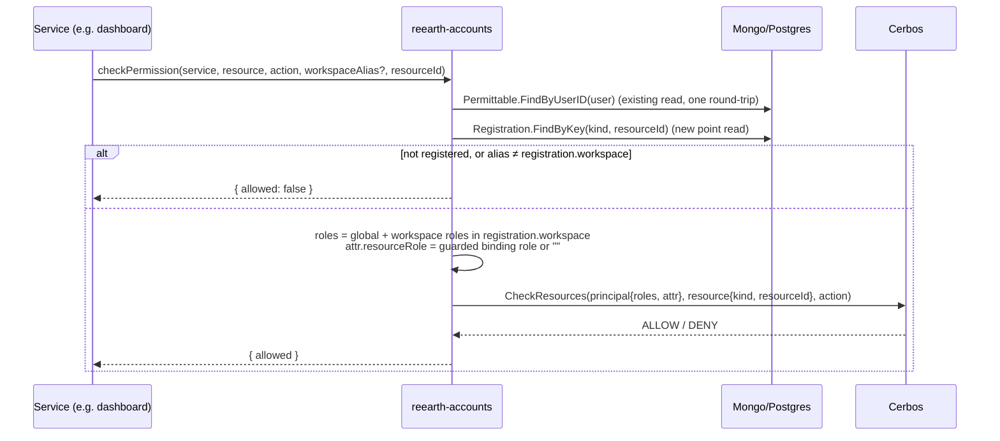
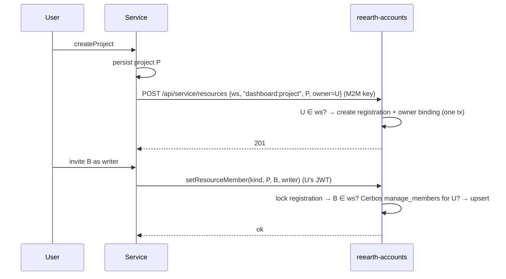
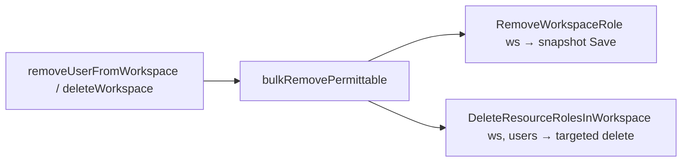

# Resource Role Binding (Generic Per-Resource Membership)

> **Status: DRAFT.** Adds a generic, opaque **"user × resource → role"** binding to
> `permittable`, so that consumer services (dashboard, visualizer, cms, …) can
> express per-resource membership such as *project members* **without
> reearth-accounts learning what a project is**. The first consumer is
> `dashboard:project`.
>
> Japanese version: [resource-role-binding.ja.md](resource-role-binding.ja.md)

## Document Signature

|           |                |
|-----------|----------------|
| Creator   | soneda-yuya    |
| Leader    | TBD            |
| Task Link | TBD            |
| Developer | TBD            |

## Background / Problem Statement

### Motivation (product context)

- While introducing SSO, we discussed whether users should be able to create
  workspaces freely, and there was a request to make workspace creation
  restrictable via an option. With that restriction, a single workspace would
  have to hold many projects.
- Today members can only be assigned per workspace, so customers manage members
  workspace by workspace — even though the people involved differ from project
  to project. When customers want to share a project across workspaces, they
  currently copy the project into the target workspace.
- Assigning members and permissions per project lets a workspace function as an
  organization. This is a separate feature from SSO / SCIM, but we want to make
  it implementable early so it is ready when workspace creation can be
  restricted.

### Current situation

- Permissions across Re:Earth are decided by reearth-accounts. Each service
  (dashboard, visualizer, cms, ...) asks accounts "may this user perform this
  action?" before allowing it.
- A user's role is held **per workspace** (plus a few platform-wide roles).
  Joining a workspace gives the same role on every project in that workspace.
- A permission check therefore only knows *which workspace* the request is
  about, not *which project*. There is no way to say "user A can edit project P
  but not project Q" within the same workspace.

#### Implementation details (for reference)

- reearth-accounts is the authorization hub for the Re:Earth platform. A user's
  roles are stored on the `permittable.Permittable` aggregate
  (`server/pkg/permittable/permittable.go`):
  - `roleIDs` — global roles
  - `workspaceRoles` — `(workspaceID, roleID)` pairs, maintained by the
    `Workspace` interactor whenever membership changes
    (`updatePermittable` / `bulkRemovePermittable` in
    `server/internal/usecase/interactor/workspace.go`).
- `Query.checkPermission(service, resource, action, workspaceAlias)` builds a
  Cerbos principal from *global roles + the roles of that workspace* and checks
  resource kind `"<service>:<resource>"`
  (`server/internal/usecase/interactor/cerbos.go`). There is **no resource
  instance ID** in the input; the resource ID is synthesized from
  service/resource/workspaceAlias/userId.
- Resource kinds such as `dashboard:project` already exist as Cerbos policies,
  generated from each service's `definition.go` with the reearthx
  `cerbos/generator` (`NewActionDefinition` / `NewActionDefinitionWithCondition`).
  Accounts treats `"<service>:<resource>"` as an opaque string.
- Service-to-service (M2M) calls are authenticated with a configured API key
  (`internal/adapter/http/middleware_apikey.go`).
- Persistence today saves the whole permittable snapshot: Mongo replaces the
  document; Postgres upserts the row and deletes/re-inserts every
  `permittable_workspace_roles` child row
  (`internal/infrastructure/postgres/permittable.go`). Postgres reads hydrate
  child rows with a second query.

### Problem

Products need **project-level membership**: "user A is an editor of project P,
user B (same workspace) cannot see P". Today the finest granularity accounts
can express is the workspace.

If each service implements project membership on its own:

1. Invite / role-change / remove APIs and UI are duplicated per service.
2. Each service must react to **workspace membership changes** (user removed from
   workspace, workspace deleted) to clean up its project members. Only accounts
   owns that information, so every service needs an event/sync path, and a miss
   leaves a user with access to a project in a workspace they have left.
3. "A project member must be a member of the workspace" cannot be validated
   locally by the service without calling accounts anyway.
4. Authorization logic splits across N services instead of living in Cerbos
   policies evaluated through one entry point.

### Constraint (the reason for this design's shape)

Accounts must **not** absorb the *project* domain. Project existence, names,
visibility, content and lifecycle remain owned by each service. Accounts may
only own the *authorization* concept: "this opaque resource belongs to this
workspace, and this principal holds this role on it".

## Goals

1. Accounts can store and evaluate a role binding for **any** resource instance,
   identified by an opaque `(resourceKind, resourceID)` pair.
2. `checkPermission` can evaluate a check against a specific resource instance,
   **scoped to the workspace the resource actually belongs to** (never a
   caller-chosen workspace), and makes the caller's resource role available to
   Cerbos policies.
3. Resource-wide invariants (one workspace per resource, at least one owner
   once one exists) hold under concurrent writes on every backend.
4. Workspace membership changes automatically revoke resource bindings
   (a user removed from a workspace loses every binding in it).
5. The words `project` / service-specific kinds never appear in accounts Go code
   or schema; adding a new resource kind (e.g. `cms:model`) requires **only a
   Cerbos policy** (via the service's `definition.go`), no accounts code change.
6. Fully backward compatible: existing `checkPermission` calls and existing
   policies behave identically.

## Non-Goals

1. Storing any resource metadata (name, visibility, owner, timestamps) in accounts.
2. Validating that a resource exists. Accounts trusts the **M2M-authenticated**
   service that registers it.
3. Detecting resource deletion. The owning service is responsible for calling
   the unregister endpoint (see *Lifecycle*).
4. Resource hierarchies / inheritance (e.g. folder → project → layer). Can be
   layered later via policy; out of scope now.
5. Integration (M2M) members on resources. Only user principals in v1.
6. Passing arbitrary resource attributes (e.g. `visibility`) into
   `checkPermission`. Tracked as an Open Question; v1 policies use roles only.
7. Sending invite emails for resource membership. Emails carry resource
   names, which accounts does not have; the service sends them.

## Functional Requirements

1. `checkPermission` without `resourceId`: **no change** in reads.
   With `resourceId`: **one additional indexed point read** (the resource
   registration, by primary key). The binding itself is read from the
   already-loaded permittable.
2. On PostgreSQL, `Permittable.FindByUserID` loads the base row, workspace roles
   and resource roles in **one round-trip** (aggregated sub-selects), so adding
   resource roles does not add a query to `checkPermission`.
3. Field limits, enforced in the domain layer and as DB constraints:
   - `resourceKind`: ≤ 64 bytes, `^[a-z0-9-]{1,32}:[a-z0-9_-]{1,31}$`
   - `resourceID`: ≤ 128 bytes, `^[A-Za-z0-9_.:-]{1,128}$`
4. Expected scale: ≤ ~1,000 bindings per user (≤ ~300 B each with the limits
   above, i.e. ≤ ~300 KB per Mongo document, well under 16 MB) and ≤ ~1,000
   members per resource.
5. Listing members of one resource is index-backed and returns only
   `(userId, role)` for that resource — it never hydrates whole aggregates.
6. All mutations work on both MongoDB and PostgreSQL backends and in the
   `memory` repo.

## Solution Options

### Option 1 (Recommended): Resource registration + bindings embedded in `Permittable`

Two pieces of state, both opaque to accounts:

| State | Purpose |
|---|---|
| **Resource registration** `(resourceKind, resourceID) → workspaceID, version` | Authoritative workspace scope of the resource; proof the owning service registered it; per-resource serialization point for invariants |
| **Resource role** on `Permittable` `(workspaceID, resourceKind, resourceID, roleID)` | The user's role on that resource; read together with the permittable for zero-read lookup |

#### Domain

```go
// server/pkg/resource/registration.go (new package, no service-specific code)
type Registration struct {
    createdAt   time.Time
    kind        Kind   // validated per FR-3
    resourceID  ID     // validated per FR-3
    version     int64  // bumped by every membership mutation of this resource
    workspaceID workspace.ID
}

// server/pkg/permittable/permittable.go
type Permittable struct {
    id             ID
    resourceRoles  []ResourceRole // NEW
    roleIDs        []role.ID
    updatedAt      time.Time
    userID         user.ID
    workspaceRoles []WorkspaceRole
}

type ResourceRole struct {
    resourceID   resource.ID
    resourceKind resource.Kind
    roleID       role.ID
    workspaceID  workspace.ID // copied from the registration
}
```

`ResourceRole(kind, id)` returns the user's role on a resource **only if the
user still holds a workspace role in `workspaceID`** (read-time guard, see
*Concurrency*). One role per `(kind, id)` per user. No `switch` on `kind`
anywhere in accounts.

Roles reuse the existing `roles` table (`owner` / `maintainer` / `writer` /
`reader`). Their meaning per resource kind is defined solely by that kind's
Cerbos policy.

#### Storage

**PostgreSQL** — migration `0005_resource_role_binding.up.sql`:

```sql
CREATE TABLE resource_registrations (
    resource_kind text NOT NULL CHECK (octet_length(resource_kind) <= 64),
    resource_id   text NOT NULL CHECK (octet_length(resource_id) <= 128),
    workspace_id  text NOT NULL,
    version       bigint NOT NULL DEFAULT 0,
    created_at    timestamptz NOT NULL DEFAULT now(),
    PRIMARY KEY (resource_kind, resource_id)
);
CREATE INDEX resource_registrations_workspace_idx
    ON resource_registrations (workspace_id);

CREATE TABLE permittable_resource_roles (
    permittable_id text NOT NULL REFERENCES permittables(id) ON DELETE CASCADE,
    resource_kind  text NOT NULL,
    resource_id    text NOT NULL,
    workspace_id   text NOT NULL,
    role_id        text NOT NULL,
    PRIMARY KEY (permittable_id, resource_kind, resource_id),
    FOREIGN KEY (resource_kind, resource_id)
        REFERENCES resource_registrations (resource_kind, resource_id) ON DELETE CASCADE
);
CREATE INDEX permittable_resource_roles_resource_idx
    ON permittable_resource_roles (resource_kind, resource_id);
CREATE INDEX permittable_resource_roles_workspace_idx
    ON permittable_resource_roles (workspace_id, permittable_id);
```

```sql
-- 0005_resource_role_binding.down.sql
DROP TABLE IF EXISTS permittable_resource_roles;
DROP TABLE IF EXISTS resource_registrations;
```

**MongoDB**

- New collection `resource_registrations` with a unique index on
  `{ resource_kind: 1, resource_id: 1 }` and an index on `{ workspace_id: 1 }`
  (schema registered via `mongoschemagen`, migration added per
  `server/CLAUDE.md`).
- New optional array `resource_roles` on the permittable document, with indexes
  `{ "resource_roles.resource_kind": 1, "resource_roles.resource_id": 1 }` and
  `{ "resource_roles.workspace_id": 1 }`.

#### Repository changes (targeted writes, never snapshot writes)

The existing snapshot `Save` / `SaveMany` must not be able to overwrite or
resurrect resource roles:

- **Mongo** `Permittable.Save` switches from document replacement to
  `$set` of `role_ids`, `workspace_roles`, `updated_at` only. `resource_roles`
  is written exclusively by the targeted operations below.
- **Postgres** `Permittable.Save` already only rewrites
  `permittable_workspace_roles`; it is left untouched for resource roles.
- **Postgres** `hydrate` is replaced by a single query returning the base row
  plus `json_agg` sub-selects of workspace roles and resource roles (FR-2).

New repository interfaces:

```go
// resource.RegistrationRepo
FindByKey(ctx, kind, id) (*resource.Registration, error)
Create(ctx, r resource.Registration) error              // ErrAlreadyExists on duplicate
LockForUpdate(ctx, kind, id) (*resource.Registration, error) // must run inside a transaction
Remove(ctx, kind, id) error                              // also removes all bindings

// permittable.Repo (additions)
FindResourceMembers(ctx, kind, id) ([]permittable.ResourceMember, error) // projection: userID + roleID
CountResourceOwners(ctx, kind, id, ownerRoleID) (int, error)
UpsertResourceRole(ctx, userID, r permittable.ResourceRole) error
DeleteResourceRole(ctx, userID, kind, id) error
DeleteResourceRolesInWorkspace(ctx, workspaceID, userIDs) error
```

| Operation | Mongo | Postgres |
|---|---|---|
| `UpsertResourceRole` | single-document update: `$pull` the `(kind,id)` element then `$push` the new one (one `updateOne` with an aggregation pipeline) | `INSERT … ON CONFLICT (permittable_id, resource_kind, resource_id) DO UPDATE SET role_id = …` |
| `DeleteResourceRole` | `$pull` | `DELETE … WHERE permittable_id=$1 AND resource_kind=$2 AND resource_id=$3` |
| `DeleteResourceRolesInWorkspace` | `updateMany` + `$pull {workspace_id}` | `DELETE … WHERE workspace_id=$1 AND permittable_id = ANY($2)` |
| `FindResourceMembers` | aggregation `$match` → `$unwind` → `$match` → `$project {user_id, role_id}` | `SELECT p.user_id, r.role_id FROM permittable_resource_roles r JOIN permittables p …` |
| `LockForUpdate` | in a transaction: `findOneAndUpdate {$inc: {version: 1}}` (concurrent transactions on the same registration hit a write conflict and are retried) | `SELECT … FOR UPDATE` |

#### Authorization check

`CheckPermissionInput` gains one optional field:

```graphql
input CheckPermissionInput {
  service: String!
  resource: String!
  action: String!
  workspaceAlias: String
  resourceId: String   # NEW
}
```

When `resourceId` is **absent**, behavior is unchanged.

When `resourceId` is **present**:

1. Load the registration `(service:resource, resourceId)`. **Not found → deny.**
2. If `workspaceAlias` is given and does not resolve to the registration's
   `workspaceID` → **deny**.
3. Principal roles = global roles + the user's workspace roles **in the
   registration's `workspaceID`** (the caller cannot choose the workspace).
4. Principal attribute `resourceRole` = the user's binding role on this
   resource, or `""` if none (or if the read-time guard drops it).
5. The Cerbos resource ID is the real `resourceId`.

Policies stay in each service's `definition.go`, using the conditions the
reearthx generator already supports. Example for `dashboard:project`:

```go
// dashboard: definition.go
resourceRole := func(expr string) *generator.Condition { return generator.SimpleExpr(expr) }
any := []string{"*"} // any principal role; the condition does the gating

builder.AddResource("project", []generator.ActionDefinition{
    // workspace admins keep full access to every project in their workspace
    generator.NewActionDefinition("read", []string{"owner", "maintainer"}),
    generator.NewActionDefinition("edit", []string{"owner", "maintainer"}),
    generator.NewActionDefinition("delete", []string{"owner", "maintainer"}),
    generator.NewActionDefinition("manage_members", []string{"owner", "maintainer"}),
    // project members
    generator.NewActionDefinitionWithCondition("read", any, resourceRole(`P.attr.resourceRole != ""`)),
    generator.NewActionDefinitionWithCondition("edit", any, resourceRole(`P.attr.resourceRole in ["owner", "writer"]`)),
    generator.NewActionDefinitionWithCondition("delete", any, resourceRole(`P.attr.resourceRole == "owner"`)),
    generator.NewActionDefinitionWithCondition("manage_members", any, resourceRole(`P.attr.resourceRole == "owner"`)),
})
```

Because resource roles arrive as a principal **attribute**, not as principal
roles, a project `owner` is never mistaken for a workspace `owner`. Whether
workspace roles *add to* or are *restricted by* project membership is a
per-product policy decision.

#### Membership management API

**Lifecycle (M2M only)** — REST service routes, authenticated **only** by the
M2M API key (a user JWT is rejected). Registration is how accounts learns that a
resource exists and which workspace it belongs to; restricting it to services
removes any way for a user to claim an unregistered ID.

```
POST   /api/service/resources
       { workspaceId, resourceKind, resourceId, ownerUserId? }
       → creates the registration and, if ownerUserId is given, an `owner`
         binding, in one transaction. ownerUserId must be a workspace member.
         409 if already registered with a different workspace; idempotent
         (200) if registered with the same workspace.
DELETE /api/service/resources/{resourceKind}/{resourceId}
       → removes the registration and every binding of the resource.
```

**Membership (user JWT, GraphQL)**:

```graphql
input SetResourceMemberInput {
  resourceKind: String!
  resourceId: String!
  userId: ID!
  role: Role!
}
input RemoveResourceMemberInput {
  resourceKind: String!
  resourceId: String!
  userId: ID!
}

type ResourceMember { userId: ID!, role: Role! }
type ResourceBinding { workspaceId: ID!, resourceKind: String!, resourceId: String!, role: Role! }

extend type Query {
  resourceMembers(resourceKind: String!, resourceId: String!): [ResourceMember!]!
  # IDs only; the owning service hydrates names etc.
  myResourceBindings(resourceKind: String!, workspaceId: ID): [ResourceBinding!]!
}

extend type Mutation {
  setResourceMember(input: SetResourceMemberInput!): ResourceMember
  removeResourceMember(input: RemoveResourceMemberInput!): Boolean!
}
```

Guards (generic, no kind-specific code). Every mutation runs in one transaction
that starts with `LockForUpdate` on the registration:

| Operation | Guard (evaluated after the lock) |
|---|---|
| `setResourceMember` | registration exists; target user is a member of the registration's workspace; Cerbos allows `manage_members` on `(kind, id)` for the operator; if the change downgrades the last `owner`, reject |
| `removeResourceMember` | Cerbos `manage_members`, or operator == target (self-leave); if it removes the last `owner`, reject |
| `resourceMembers` | Cerbos `read` on `(kind, id)`; result filtered by the read-time guard |
| `myResourceBindings` | operator's own bindings only, filtered by the read-time guard |

**Last-owner rule:** a membership mutation that would take the owner count of a
resource from ≥ 1 to 0 is rejected. A resource registered without an owner (e.g.
backfill) is managed by workspace roles until an owner is set. The unregister
endpoint is exempt.

#### Concurrency

| Race | Mitigation |
|---|---|
| Two writers on different users of the same resource both pass the last-owner check | Both must take `LockForUpdate` on the same registration; the second waits (Postgres) or conflicts and retries (Mongo). The owner count is read after the lock. |
| Two services register the same `(kind, id)` | Primary key / unique index; the loser gets `ErrAlreadyExists`. |
| `setResourceMember` passes the workspace-membership check, then the user is removed from the workspace and the cascade runs before the binding is written | **Read-time guard**: a binding is honored only if the user currently holds a workspace role in the binding's workspace. The permittable is already loaded, so this costs no read. The orphaned row is harmless and is removed the next time the cascade or the unregister endpoint touches it. |
| A stale snapshot `Save` from the workspace flow overwrites a newer binding (or vice versa) | Snapshot saves never write `resource_roles`; binding writes never write `workspace_roles` (see *Repository changes*). |

#### Lifecycle and cascades

| Event | Who acts | Effect on bindings |
|---|---|---|
| Resource created | Service (M2M) | `POST /api/service/resources` with `ownerUserId` = creator |
| Resource deleted | Service (M2M) | `DELETE /api/service/resources/{kind}/{id}`. A missed call leaves an orphan registration — harmless (the resource no longer exists in the service), cleaned by an optional sweeper later |
| Existing resources (pre-feature) | Service (M2M) | One-off backfill via the same endpoint (idempotent), before the service starts sending `resourceId` |
| User removed from workspace | Accounts | `bulkRemovePermittable` also calls `DeleteResourceRolesInWorkspace` |
| Workspace deleted (`Workspace.Remove`) | Accounts | Same path via `bulkRemovePermittable`; registrations of the workspace are removed too |
| Workspace deactivated / restored | Accounts | No change (mirrors workspace roles; data kept for restore) |
| User deleted (`DeleteMe`) | Accounts | Today `DeleteMe` does not delete the permittable. Bindings are unreachable once the user is gone; deleting the permittable on `DeleteMe` is proposed as a follow-up fix (independent of this feature) |

**Pros**

- Workspace scope of a resource is authoritative and server-side, so a caller
  cannot borrow roles from another workspace.
- Only M2M-authenticated services can make a resource exist in accounts, so
  users cannot claim IDs.
- Resource-wide invariants are serialized on one record per resource on both
  backends.
- Binding lookup stays inside the already-loaded permittable; the only new read
  is a primary-key lookup of the registration.
- Accounts remains domain-agnostic: opaque kind/ID, semantics in policies.

**Cons**

- One extra point read for `checkPermission` calls that pass `resourceId`.
- Services must register resources (including a backfill) and unregister on delete.
- Mongo `Save` semantics change from replace to `$set` (touches existing code).

### Option 2: Bindings in their own collection/table (no embedding)

Same registration and API, but bindings live in a standalone
`resource_bindings (kind, id, userID, role)` collection/table instead of on the
permittable.

**Pros:** no permittable growth; member listing is a plain index scan; snapshot
`Save` semantics do not need to change.

**Cons:** `checkPermission` needs a second extra read (the binding) on top of
the registration; workspace cascades touch two stores.

**Decision:** Option 1. Revisit Option 2 if per-user binding counts approach
FR-4 or if the Mongo `Save` change proves risky.

### Alternative considered and rejected: membership in each service

Rejected because of the duplication and cascade problems in *Problem* (1)–(4).
The variant "services keep members but pass the role to Cerbos as an attribute"
solves only (4).

## Design

### Permission check with a resource ID



### Project creation and member invite



### Workspace member removal cascade



## Potential Impact

1. **Permittable document/row size** grows by ≤ ~300 B per binding.
2. **Mongo `Permittable.Save`** changes from replace to `$set`; existing tests
   for permittable persistence must still pass, and a new test verifies that
   `Save` leaves `resource_roles` untouched.
3. **Cerbos resource ID change** when `resourceId` is passed: only callers that
   opt in are affected.
4. **Workspace member removal** issues one additional targeted delete.
5. **Policy authoring**: role names are shared between workspace and resource
   scopes; policies must gate resource access on `P.attr.resourceRole`, not on
   principal roles.
6. **gqlclient** (`server/pkg/gqlclient`) consumers need a version bump to use
   the new fields; old clients are unaffected.

## Test Plan

1. **Unit** (`pkg/resource`, `pkg/permittable`): kind/ID validation and length
   limits; one role per resource; read-time guard drops bindings without a
   matching workspace role.
2. **Interactor** (`internal/usecase/interactor`):
   - `CheckPermission`: no `resourceId` → unchanged roles (regression);
     unregistered resource → deny; alias of another workspace → deny; workspace
     roles taken from the registration, not the alias; `resourceRole` set/empty.
   - Register: M2M only (JWT rejected); owner must be a workspace member;
     duplicate with same workspace is idempotent, different workspace is 409.
   - `setResourceMember` / `removeResourceMember`: non-member target rejected;
     denied without `manage_members`; self-leave allowed; last-owner protection.
   - Cascades: `RemoveUserMember` / `RemoveMultipleUserMembers` / `Remove`.
3. **Concurrency** (`make test-integration`, both backends): two goroutines
   removing the last two owners concurrently → exactly one succeeds; concurrent
   registrations of the same key → one succeeds; stale snapshot `Save` after
   `UpsertResourceRole` keeps the binding.
4. **Repository**: Mongo, Postgres and memory implementations of every new
   operation; Postgres `FindByUserID` issues a single query.
5. **Migration**: `0005` up/down on an existing DB; existing permittables load
   with empty `resourceRoles`.
6. **E2E** (`server/e2e`): a `dashboard:project` test policy generated with the
   conditions above; verify member / non-member / workspace-owner /
   other-workspace outcomes.

## Deployment Plan

1. Backward compatible? **Yes.** New optional input field, new collection/tables,
   new routes and GraphQL fields. Behavior is unchanged when `resourceId` is absent.
2. Partial deployment? **Yes.** Order:
   1. Deploy accounts.
   2. Each service backfills registrations for existing resources.
   3. Each service starts registering on create / unregistering on delete.
   4. Each service deploys policies using `P.attr.resourceRole` and starts
      sending `resourceId`. Before step 4 the attribute is absent and conditions
      never match (fail-closed).
3. Notify: dashboard / visualizer / cms owners; whoever maintains Cerbos policies.
4. Config changes: none (reuses the existing M2M API key).
5. DDL: Postgres migration `0005` runs automatically at startup (golang-migrate).
   Mongo: collection schema + indexes via the startup migration; no backfill in accounts.

## Rollback Plan

1. Notify the cause in the team Slack channel.
2. Revert consumer services / policies that rely on `resourceId` / `resourceRole` first.
3. Roll back the accounts image. The old binary ignores the new collection,
   tables and `resource_roles` field, so **no data rollback is required**.
   Note: the old Mongo `Save` replaces the whole document and will drop
   `resource_roles` of any permittable it writes — acceptable during rollback,
   since the feature is disabled; services re-run the backfill on roll-forward.
4. Only if the schema itself must be removed: run `0005` down (drops
   registrations and bindings — take a dump first).

## Post Deployment

- Checklist
  - Create a project in dashboard staging; verify the registration and the
    creator's `owner` binding.
  - Invite a workspace member; verify access. Remove them from the workspace;
    verify project access is lost.
  - Call `checkPermission` with the alias of another workspace; verify deny.
- Metrics
  - `checkPermission` p50/p95 latency with and without `resourceId`.
  - Error rate of register / unregister / `setResourceMember`, including
    Mongo transaction retries.
  - Count of bindings per permittable (max / p99) to watch FR-4.
- Alerting
  - `checkPermission` error rate: Warning > 1%, Danger ≥ 5%.
  - `checkPermission` p95 latency: Warning > +20% vs baseline.

## Open Questions

1. **Resource attributes in `checkPermission`.** Rules like "private projects are
   visible only to members, public ones to the whole workspace" need the
   resource's `visibility`. Proposal: optional `attributes: JSON` on
   `CheckPermissionInput`, passed through to the Cerbos resource. Deferred until
   a product needs it.
2. **Batch checks** (`checkPermissions` over many `resourceId`s) for list
   screens. Cerbos `CheckResources` already supports it.
3. **Per-service M2M keys.** v1 accepts the existing shared API key for
   register/unregister. Should each key be scoped to the kinds of its own
   service (`dashboard:*`)?
4. **Orphan sweeper** for registrations of resources deleted without unregister:
   worth it, or rely on service discipline?
5. **Integration members** on resources (M2M tokens) — needed by cms?
6. **Where members are managed in the UI.** Should project membership be
   managed only in the Dashboard, or also within each service's own UI
   (visualizer / cms / flow)? This does not change the accounts API (all
   clients call the same membership API), but it affects which services need
   UI work and is to be decided together with the designer.

## Reviewed by

- Technical Architect: [name]
- Technical Leader: [name]
- Peers: [name]
