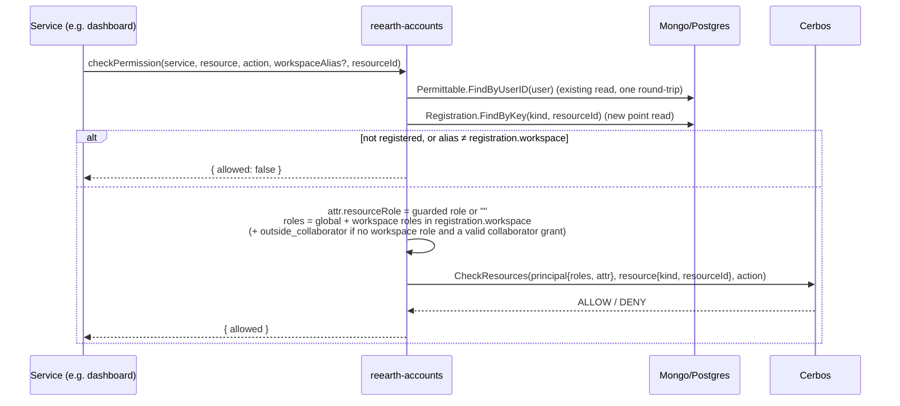
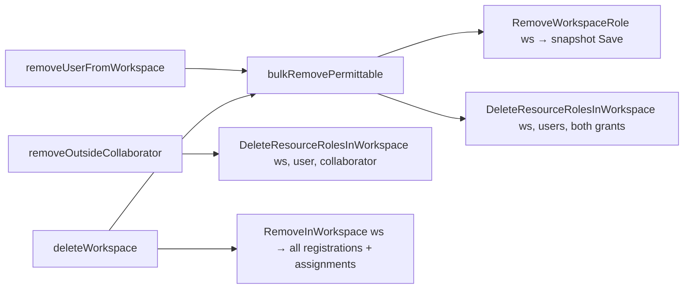

# Resource Role Assignment (Generic Per-Resource Membership)

> **Status: DRAFT.** Lets members and roles be set **per project** — and, more
> generally, per resource of any service — so that services (dashboard,
> visualizer, cms, …) can have project members without each building its own
> membership system, and **without reearth-accounts learning what a project
> is**. The first to use it is Dashboard projects. In code, a role assignment is
> represented by types and tables named `...Binding` / `resource_bindings`.
>
> Japanese version: [resource-role-binding.ja.md](resource-role-binding.ja.md)

## Document Signature

|           |                |
|-----------|----------------|
| Creator   | soneda-yuya    |
| Leader    | TBD            |
| Task Link | TBD            |
| Developer | TBD            |

## Background / Problem Statement

### Motivation (product context)

- While introducing SSO, we discussed whether users should be able to create
  workspaces freely, and there was a request to make workspace creation
  restrictable via an option. With that restriction, a single workspace would
  have to hold many projects.
- Today members can only be assigned per workspace, so customers manage members
  workspace by workspace — even though the people involved differ from project
  to project. When customers want to share a project across workspaces, they
  currently copy the project into the target workspace.
- Assigning members and permissions per project lets a workspace function as an
  organization. This is a separate feature from SSO / SCIM, but we want to make
  it implementable early so it is ready when workspace creation can be
  restricted.
- The intended model is close to GitHub's: a workspace relates to its projects
  the way a GitHub organization relates to its repositories. Just as GitHub has
  organization members, repository members and *outside collaborators* (people
  who are not in the organization but have access to specific repositories),
  Re:Earth would have workspace members, project members and outside
  collaborators.

### Current situation

- Permissions across Re:Earth are decided by reearth-accounts. Each service
  (dashboard, visualizer, cms, ...) asks accounts "may this user perform this
  action?" before allowing it.
- A user's role is held **per workspace** (plus a few platform-wide roles).
  Joining a workspace gives the same role on every project in that workspace.
- A permission check therefore only knows *which workspace* the request is
  about, not *which project*. There is no way to say "user A can edit project P
  but not project Q" within the same workspace, and no way to give someone
  outside the workspace access to just one project.

### Problem

Products need **project-level membership**: "user A, a reader of the workspace,
is an editor of project P", and "user B, who is not in the workspace, can work
on project P only and cannot see the other projects in the workspace". Today the
finest granularity accounts can express is the workspace.

If each service implements project membership on its own:

1. Invite / role-change / remove APIs and UI are duplicated per service.
2. Each service must react to **workspace membership changes** (user removed from
   workspace, workspace deleted) to clean up its project members. Only accounts
   owns that information, so every service needs an event/sync path, and a miss
   leaves a user with access to a project in a workspace they have left.
3. "A project member is either a member of the workspace or an outside
   collaborator explicitly invited to that project" cannot be validated locally
   by the service without calling accounts anyway.
4. Permission rules end up scattered across every service, instead of being
   decided in one place (accounts).

### Constraint (the reason for this design's shape)

Accounts must **not** take over what a *project* is. Whether a project exists,
its name, visibility, content and lifecycle stay with each service. Accounts
only keeps what it needs to decide permissions: "this project belongs to this
workspace, and this user has this role on it — as a workspace member or as an
outside collaborator".

## Goals

1. **Members and roles can be set per project.** A person can be given a role on
   a specific project, not only on the whole workspace. The model is:
   - **Workspace members** (owner / maintainer / writer / reader) see **every**
     project in the workspace, as today, through their workspace role. A
     project role can **raise** their access on that project (for example, a
     workspace reader who is a writer on project P can edit P), but never lower
     it.
   - **Outside collaborators** (name tentative) are people who are **not**
     workspace members but were given a role on specific projects. They see and
     act on **only** those projects, and only their project role counts.
2. **Permission checks look at the specific project.** When a service asks
   accounts "may this user do this?", the answer can take the user's role on
   that particular project into account. The check always uses the workspace
   the project really belongs to, so a caller cannot get access by naming a
   different workspace.
3. **Membership rules stay consistent.** A project always belongs to exactly
   one workspace, every project member is either a workspace member or an
   outside collaborator of that project, and once a project has an owner it
   never ends up with none — even when several people change members at the
   same time.
4. **Leaving removes access.** When a user is removed from a workspace, their
   roles on every project in that workspace are removed automatically. When an
   outside collaborator is removed from their last project in a workspace, they
   no longer have anything to do with that workspace. Services do not need to
   clean this up themselves.
5. **Accounts stays generic.** Accounts does not know what a "project" is. Any
   service can use the same mechanism for its own resources (for example, a CMS
   model) just by adding a permission policy, with no change to accounts.
6. **Nothing existing breaks.** Current permission checks and policies keep
   working exactly as they do today.
7. **Access to only some projects can be given in one step.** From the UI, an
   admin can either add a person directly to a project — they become an outside
   collaborator if they are not in the workspace — or, from the workspace's
   member screen, invite a person as an outside collaborator on selected
   projects. Either way it is one step that either fully succeeds or changes
   nothing (see *Design → Adding people from the UI*).
8. **Seats are counted like on GitHub.** An outside collaborator uses one seat in
   the workspace, however many of its projects they are on, and the
   workspace's seat limit applies when adding one. Accounts can report the
   numbers billing needs.

## Non-Goals

1. **Storing project details in accounts.** Names, visibility, owners, dates and
   other information about a project stay in the service that owns it.
2. **Checking that a project really exists.** Accounts trusts the service that
   registers the project. Only services can register projects, not users.
3. **Noticing on its own when a project is deleted.** The service that owns the
   project must tell accounts when it is deleted.
4. **Nested resources and inherited permissions** (for example folder → project
   → layer). These could be added later through permission policies.
5. **Integrations as project members.** In the first version only people (user
   accounts) can be project members, not integrations or API tokens.
6. **Using project properties in permission decisions** (for example "public"
   or "private"). See *Open Questions*; the first version decides by roles only.
7. **Sending invitation emails for project membership.** The email mentions the
   project's name, which accounts does not know, so the service sends it.

## Functional Requirements

1. **Permission checks stay fast.** Checks that do not name a project cost
   exactly the same as today. Checks that name a project add only one small,
   quick lookup (which workspace the project belongs to); the user's project
   roles are read together with the data accounts already loads.
2. **Names and IDs have size limits.** The resource type name and the resource
   ID have a maximum length and a fixed set of allowed characters, so stored
   data stays small and predictable.
3. **Designed for realistic scale.** Up to about 1,000 project role assignments
   per user, and up to about 1,000 members per project.
4. **Listing a project's members is quick.** It returns only who the members are,
   their roles, and whether each is a workspace member or an outside
   collaborator; names and other details come from the service.
5. **Works with every database accounts supports.** Membership changes behave
   the same whichever database a deployment uses.
6. **Seat numbers are available per workspace.** Accounts can quickly say how
   many distinct people are outside collaborators of a workspace (each person
   counted once, and not counted again if they are also a member), so billing
   can count seats as workspace members plus outside collaborators.

Technical details: see *Solution Options → Option 1 → Detailed requirements*.

## Solution Options

This section describes the system design in detail and is intended for readers
interested in the implementation; the other sections can be read without it.

### Option 1 (Recommended): Resource registration + role assignments embedded in `Permittable`

Three pieces of state, all opaque to accounts:

| State | Purpose |
|---|---|
| **Resource registration** `(resourceKind, resourceID) → workspaceID, version` | Authoritative workspace scope of the resource; proof the owning service registered it; per-resource serialization point for invariants |
| **Resource role** on `Permittable` `(workspaceID, resourceKind, resourceID, roleID, grant)` | The user's role on that resource and whether it was granted to a workspace member or to an outside collaborator; read together with the permittable for zero-read lookup |
| **Workspace lock** `workspaceID → version` | Per-workspace serialization point for everything that decides whether a user is a member or an outside collaborator, and for the seat limit |

#### Domain

```go
// server/pkg/resource/registration.go (new package, no service-specific code)
type Registration struct {
    createdAt   time.Time
    kind        Kind   // validated per FR-3
    resourceID  ID     // validated per FR-3
    version     int64  // bumped by every membership mutation of this resource
    workspaceID workspace.ID
}

// server/pkg/permittable/permittable.go
type Permittable struct {
    id             ID
    resourceRoles  []ResourceRole // NEW
    roleIDs        []role.ID
    updatedAt      time.Time
    userID         user.ID
    workspaceRoles []WorkspaceRole
}

type Grant string

const (
    GrantMember       Grant = "member"       // granted to a workspace member
    GrantCollaborator Grant = "collaborator" // granted to an outside collaborator
)

type ResourceRole struct {
    grant        Grant
    resourceID   resource.ID
    resourceKind resource.Kind
    roleID       role.ID
    workspaceID  workspace.ID // copied from the registration
}
```

**Read-time guard.** `ResourceRole(kind, id)` returns the user's role on a
resource only if it is still valid:

- `grant = member`: valid **only while the user holds a workspace role in
  `workspaceID`** (as before).
- `grant = collaborator`: valid on its own; the user is not expected to hold a
  workspace role.

Every operation that changes whether a user is a workspace member also rewrites
the `grant` of that user's role assignments in the same transaction (see
*Lifecycle and cascades*), and all such operations serialize on the workspace
lock, so the two never disagree after a commit. The guard remains as defense in
depth. One role per `(kind, id)` per user. No `switch` on `kind` anywhere in
accounts.

An **outside collaborator of workspace W** is a user who holds at least one
valid `collaborator` role assignment whose `workspaceID` is W. This is derived,
not stored: there is no separate collaborator record, so removing the last such
assignment ends the association (and the seat) automatically. An outside
collaborator never appears in the workspace's member list or in
`Permittable.workspaceRoles`.

Roles reuse the existing `roles` table (`owner` / `maintainer` / `writer` /
`reader`). Their meaning per resource kind is defined solely by that kind's
Cerbos policy.

#### Storage

**PostgreSQL** — migration `0005_resource_role_binding.up.sql`:

```sql
CREATE TABLE resource_registrations (
    resource_kind text NOT NULL CHECK (octet_length(resource_kind) <= 64),
    resource_id   text NOT NULL CHECK (octet_length(resource_id) <= 128),
    workspace_id  text NOT NULL,
    version       bigint NOT NULL DEFAULT 0,
    created_at    timestamptz NOT NULL DEFAULT now(),
    PRIMARY KEY (resource_kind, resource_id)
);
CREATE INDEX resource_registrations_workspace_idx
    ON resource_registrations (workspace_id);

CREATE TABLE permittable_resource_roles (
    permittable_id text NOT NULL REFERENCES permittables(id) ON DELETE CASCADE,
    resource_kind  text NOT NULL,
    resource_id    text NOT NULL,
    workspace_id   text NOT NULL,
    role_id        text NOT NULL,
    grant_type     text NOT NULL CHECK (grant_type IN ('member', 'collaborator')),
    PRIMARY KEY (permittable_id, resource_kind, resource_id),
    FOREIGN KEY (resource_kind, resource_id)
        REFERENCES resource_registrations (resource_kind, resource_id) ON DELETE CASCADE
);
CREATE INDEX permittable_resource_roles_resource_idx
    ON permittable_resource_roles (resource_kind, resource_id);
CREATE INDEX permittable_resource_roles_workspace_idx
    ON permittable_resource_roles (workspace_id, grant_type, permittable_id);

CREATE TABLE resource_workspace_locks (
    workspace_id text PRIMARY KEY,
    version      bigint NOT NULL DEFAULT 0
);
```

```sql
-- 0005_resource_role_binding.down.sql
DROP TABLE IF EXISTS resource_workspace_locks;
DROP TABLE IF EXISTS permittable_resource_roles;
DROP TABLE IF EXISTS resource_registrations;
```

**MongoDB**

- New collection `resource_registrations` with a unique index on
  `{ resource_kind: 1, resource_id: 1 }` and an index on `{ workspace_id: 1 }`
  (schema registered via `mongoschemagen`, migration added per
  `server/CLAUDE.md`).
- New optional array `resource_roles` on the permittable document (elements
  carry `grant`), with indexes
  `{ "resource_roles.resource_kind": 1, "resource_roles.resource_id": 1 }` and
  `{ "resource_roles.workspace_id": 1, "resource_roles.grant": 1 }`.
- New collection `resource_workspace_locks` (`_id` = workspace ID, `version`).

#### Repository changes (targeted writes, never snapshot writes)

The existing snapshot `Save` / `SaveMany` must not be able to overwrite or
resurrect resource roles:

- **Mongo** `Permittable.Save` switches from document replacement to
  `$set` of `role_ids`, `workspace_roles`, `updated_at` only. `resource_roles`
  is written exclusively by the targeted operations below.
- **Postgres** `Permittable.Save` already only rewrites
  `permittable_workspace_roles`; it is left untouched for resource roles.
- **Postgres** `hydrate` is replaced by a single query returning the base row
  plus `json_agg` sub-selects of workspace roles and resource roles (FR-2).

New repository interfaces:

```go
// resource.RegistrationRepo
FindByKey(ctx, kind, id) (*resource.Registration, error)
Create(ctx, r resource.Registration) error              // ErrAlreadyExists on duplicate
LockForUpdate(ctx, kind, id) (*resource.Registration, error) // must run inside a transaction
Remove(ctx, kind, id) error                              // also removes all role assignments
RemoveInWorkspace(ctx, workspaceID) error                // all registrations + role assignments

// resource.WorkspaceLockRepo
Lock(ctx, workspaceID) error // must run inside a transaction; creates the row on first use

// permittable.Repo (additions)
FindResourceMembers(ctx, kind, id) ([]permittable.ResourceMember, error) // projection: userID + roleID + grant
CountResourceOwners(ctx, kind, id, ownerRoleID) (int, error)
UpsertResourceRole(ctx, userID, r permittable.ResourceRole) error
DeleteResourceRole(ctx, userID, kind, id) error
DeleteResourceRolesInWorkspace(ctx, workspaceID, userIDs, grant *Grant) error // nil = both grants
ConvertResourceGrants(ctx, workspaceID, userIDs, from, to Grant) error
FindOutsideCollaborators(ctx, workspaceID) ([]permittable.OutsideCollaborator, error) // userID + bindings
CountOutsideCollaborators(ctx, workspaceID) (int, error) // distinct users
```

| Operation | Mongo | Postgres |
|---|---|---|
| `UpsertResourceRole` | single-document update: `$pull` the `(kind,id)` element then `$push` the new one (one `updateOne` with an aggregation pipeline) | `INSERT … ON CONFLICT (permittable_id, resource_kind, resource_id) DO UPDATE SET role_id = …, grant_type = …` |
| `DeleteResourceRole` | `$pull` | `DELETE … WHERE permittable_id=$1 AND resource_kind=$2 AND resource_id=$3` |
| `DeleteResourceRolesInWorkspace` | `updateMany` + `$pull {workspace_id[, grant]}` | `DELETE … WHERE workspace_id=$1 AND permittable_id = ANY($2) [AND grant_type=$3]` |
| `ConvertResourceGrants` | `updateMany` with `arrayFilters` on `{workspace_id, grant: from}` → `$set grant: to` | `UPDATE … SET grant_type=$4 WHERE workspace_id=$1 AND permittable_id = ANY($2) AND grant_type=$3` |
| `FindResourceMembers` | aggregation `$match` → `$unwind` → `$match` → `$project {user_id, role_id, grant}` | `SELECT p.user_id, r.role_id, r.grant_type FROM permittable_resource_roles r JOIN permittables p …` |
| `CountOutsideCollaborators` / `FindOutsideCollaborators` | aggregation `$match {resource_roles: {$elemMatch: {workspace_id, grant: "collaborator"}}}` → count / project | `SELECT count(DISTINCT permittable_id) … WHERE workspace_id=$1 AND grant_type='collaborator'` (index-only) |
| `LockForUpdate` | in a transaction: `findOneAndUpdate {$inc: {version: 1}}` (concurrent transactions on the same registration hit a write conflict and are retried) | `SELECT … FOR UPDATE` |
| `WorkspaceLock.Lock` | in a transaction: `findOneAndUpdate {_id: ws} {$inc: {version: 1}}, upsert` (write conflict → retry) | `INSERT … ON CONFLICT DO NOTHING` then `SELECT … FOR UPDATE` |

#### Authorization check

`CheckPermissionInput` gains one optional field:

```graphql
input CheckPermissionInput {
  service: String!
  resource: String!
  action: String!
  workspaceAlias: String
  resourceId: String   # NEW
}
```

When `resourceId` is **absent**, behavior is unchanged.

When `resourceId` is **present**:

1. Load the registration `(service:resource, resourceId)`. **Not found → deny.**
2. If `workspaceAlias` is given and does not resolve to the registration's
   `workspaceID` → **deny**.
3. Principal roles = global roles + the user's workspace roles **in the
   registration's `workspaceID`** (the caller cannot choose the workspace). If
   the user holds no workspace role there but holds a valid `collaborator`
   role assignment on this resource, the evaluation-only principal role
   `outside_collaborator` is added (it is never stored; it gives Cerbos a
   non-empty role list and lets a policy recognize outside collaborators).
4. Principal attribute `resourceRole` = the user's role on this resource after
   the read-time guard, or `""` if none.
5. The Cerbos resource ID is the real `resourceId`.

**Default model.** For workspace members (`owner` / `maintainer` / `writer` /
`reader`), effective role = max(workspace role, resource role): the workspace
role grants its access on every resource of the workspace, as today, and the
resource role can only add to it. For outside collaborators only the resource
role counts. Each role means the same at both levels (`owner` / `maintainer`:
full control and member management; `writer`: read and edit; `reader`: read),
so a policy implements "max" as the union of a workspace-role rule and a
`resourceRole`-condition rule per action — Cerbos allows if either matches.

Policies stay in each service's `definition.go`, using the conditions the
reearthx generator already supports. Example for `dashboard:project`:

```go
// dashboard: definition.go
resourceRole := func(expr string) *generator.Condition { return generator.SimpleExpr(expr) }
any := []string{"*"} // any principal role (including outside_collaborator); the condition does the gating

builder.AddResource("project", []generator.ActionDefinition{
    // workspace members: access to every project of the workspace via the workspace role
    // ("outside_collaborator" is never listed here)
    generator.NewActionDefinition("read", []string{"owner", "maintainer", "writer", "reader"}),
    generator.NewActionDefinition("edit", []string{"owner", "maintainer", "writer"}),
    generator.NewActionDefinition("delete", []string{"owner", "maintainer"}),
    generator.NewActionDefinition("manage_members", []string{"owner", "maintainer"}),
    // project roles: add on top of the workspace role; the only source of access for outside collaborators
    generator.NewActionDefinitionWithCondition("read", any, resourceRole(`P.attr.resourceRole != ""`)),
    generator.NewActionDefinitionWithCondition("edit", any, resourceRole(`P.attr.resourceRole in ["owner", "maintainer", "writer"]`)),
    generator.NewActionDefinitionWithCondition("delete", any, resourceRole(`P.attr.resourceRole in ["owner", "maintainer"]`)),
    generator.NewActionDefinitionWithCondition("manage_members", any, resourceRole(`P.attr.resourceRole in ["owner", "maintainer"]`)),
})
```

Because resource roles arrive as a principal **attribute**, not as principal
roles, a project `owner` is never mistaken for a workspace `owner`: a project
role counts only for the resource named in the check. Whether a product may
apply stricter rules than this default (e.g. private projects that workspace
members cannot see) is Open Question 1.

**Policy note for outside collaborators.** Policies must grant
`outside_collaborator` nothing except through `P.attr.resourceRole` conditions.
Rules keyed to explicit role lists already exclude it (fail-closed). Rules that
grant on `*` without a `resourceRole` condition must be reviewed per service.
Workspace-level resources (e.g. `dashboard:workspace`) are checked without a
`resourceId`, so an outside collaborator has no workspace role there and is
denied; what they may see at the workspace level is Open Question 7.

#### Membership management API

**Lifecycle (M2M only)** — REST service routes, authenticated **only** by the
M2M API key (a user JWT is rejected). Registration is how accounts learns that a
resource exists and which workspace it belongs to; restricting it to services
removes any way for a user to claim an unregistered ID.

```
POST   /api/service/resources
       { workspaceId, resourceKind, resourceId, ownerUserId? }
       → creates the registration and, if ownerUserId is given, an `owner`
         role assignment (grant = member), in one transaction.
         ownerUserId must be a workspace member.
         409 if already registered with a different workspace; idempotent
         (200) if registered with the same workspace.
DELETE /api/service/resources/{resourceKind}/{resourceId}
       → removes the registration and every role assignment on the resource
         (of both grants).
GET    /api/service/workspaces/{workspaceId}/seat-usage
       → { memberCount, outsideCollaboratorCount, seatCount } for billing (FR-7).
```

**Membership (user JWT, GraphQL)**:

```graphql
enum ResourceGrant { MEMBER OUTSIDE_COLLABORATOR }

input SetResourceMemberInput {
  resourceKind: String!
  resourceId: String!
  userId: ID!
  role: Role!
}
input RemoveResourceMemberInput {
  resourceKind: String!
  resourceId: String!
  userId: ID!
}
input ResourceRoleInput {
  resourceKind: String!
  resourceId: String!
  role: Role!
}
input InviteOutsideCollaboratorInput {
  workspaceId: ID!
  userId: ID!
  resources: [ResourceRoleInput!]!   # 1..100 entries, distinct (kind, id)
}
input RemoveOutsideCollaboratorInput {
  workspaceId: ID!
  userId: ID!
}

type ResourceMember { userId: ID!, role: Role!, grant: ResourceGrant! }
type ResourceBinding {
  workspaceId: ID!
  resourceKind: String!
  resourceId: String!
  role: Role!
  grant: ResourceGrant!
}
type OutsideCollaborator { userId: ID!, resources: [ResourceBinding!]! }
type WorkspaceSeatUsage {
  workspaceId: ID!
  memberCount: Int!
  outsideCollaboratorCount: Int!   # distinct users, members excluded
  seatCount: Int!                  # memberCount + outsideCollaboratorCount
}

extend type Query {
  resourceMembers(resourceKind: String!, resourceId: String!): [ResourceMember!]!
  # IDs only; the owning service hydrates names etc.
  # Without workspaceId it also lists workspaces where the user is only an outside collaborator.
  myResourceBindings(resourceKind: String!, workspaceId: ID): [ResourceBinding!]!
  outsideCollaborators(workspaceId: ID!): [OutsideCollaborator!]!
  workspaceSeatUsage(workspaceId: ID!): WorkspaceSeatUsage!
}

extend type Mutation {
  setResourceMember(input: SetResourceMemberInput!): ResourceMember
  removeResourceMember(input: RemoveResourceMemberInput!): Boolean!
  inviteOutsideCollaborator(input: InviteOutsideCollaboratorInput!): OutsideCollaborator
  removeOutsideCollaborator(input: RemoveOutsideCollaboratorInput!): Boolean!
}
```

The user is identified by user ID, as in `addUsersToWorkspace`; the UI finds
them by name or email with the existing user lookup (`userByNameOrEmail` /
`searchUser`). No new email-based invitation is introduced.

"Workspace admin" below means the operator passes the existing workspace
check used by `addUsersToWorkspace` / `removeUserFromWorkspace`
(`add_member` / `delete_member`, i.e. workspace owner or maintainer).

Guards (generic, no kind-specific code). Every mutation runs in **one
transaction**; locks are taken in a fixed order — workspace lock first (where
needed), then registrations sorted by `(kind, id)` — and guards are evaluated
after the locks:

| Operation | Locks | Guard |
|---|---|---|
| `setResourceMember` | workspace lock of the registration's workspace, then the registration | registration exists; Cerbos allows `manage_members` on `(kind, id)` for the operator. Then: **target is a workspace member** → `grant = member`. **Target already has a `collaborator` assignment on this resource** → role change, `grant` stays `collaborator`. **Otherwise** (new outside-collaborator assignment) → operator must be a workspace admin (v1, Open Question 7); personal workspace rejected; if the target is not yet an outside collaborator of the workspace, the seat limit is checked (see below). Last-owner rule if the change downgrades the last `owner` |
| `removeResourceMember` | the registration | Cerbos `manage_members`, or operator == target (self-leave); last-owner rule |
| `inviteOutsideCollaborator` | workspace lock, then each registration | operator is a workspace admin; personal workspace rejected; target is **not** a workspace member (else `ErrAlreadyWorkspaceMember` — use `setResourceMember`); every registration exists and belongs to `workspaceId` (else the whole call is rejected); seat limit if the target is not yet an outside collaborator; last-owner rule per resource (an existing collaborator's role may change); then `UpsertResourceRole(grant = collaborator)` for each entry. All-or-nothing |
| `removeOutsideCollaborator` | workspace lock, then every registration where the target has a `collaborator` assignment | operator is a workspace admin; rejected if the target is the last `owner` of any of those resources; then `DeleteResourceRolesInWorkspace(ws, [user], collaborator)` |
| `resourceMembers` | — | Cerbos `read` on `(kind, id)`; result filtered by the read-time guard |
| `myResourceBindings` | — | operator's own role assignments only, filtered by the read-time guard |
| `outsideCollaborators`, `workspaceSeatUsage` | — | operator may read workspace members (`read_member`); `seat-usage` route: M2M only |

**Seat limit.** The existing member-count hook (`enforceMemberCount`) is
extended to count seats as `members + CountOutsideCollaborators(ws)`. It runs
under the workspace lock whenever a new seat would be used: adding a workspace
member who is not already an outside collaborator, or creating the first
`collaborator` assignment of a user in the workspace. A user who is already an
outside collaborator, or who converts from collaborator to member, uses no
additional seat.

**Last-owner rule:** a membership mutation that would take the owner count of a
resource from ≥ 1 to 0 is rejected. Owners of both grants count. A resource
registered without an owner (e.g. backfill) is managed by workspace roles until
an owner is set. The unregister endpoint is exempt.

**Changes to existing workspace flows** (all take the workspace lock first):

- `addUsersToWorkspace`: users who are outside collaborators of the workspace
  keep their project roles — `ConvertResourceGrants(ws, users, collaborator →
  member)` in the same transaction; the seat check does not count them again.
- `removeUserFromWorkspace` / `removeMultipleUsersFromWorkspace`: delete all of
  the users' role assignments in the workspace (both grants), as today.
  Keeping some of them by converting the user to an outside collaborator is
  Open Question 9.
- `deleteWorkspace` (`Workspace.Remove`): `RemoveInWorkspace(ws)` removes all
  registrations and all role assignments of the workspace, including outside
  collaborators'.

#### Concurrency

| Race | Mitigation |
|---|---|
| Two writers on different users of the same resource both pass the last-owner check | Both must take `LockForUpdate` on the same registration; the second waits (Postgres) or conflicts and retries (Mongo). The owner count is read after the lock. |
| Two services register the same `(kind, id)` | Primary key / unique index; the loser gets `ErrAlreadyExists`. |
| Two admins add two different new outside collaborators when one seat is left | Both take the workspace lock; the second waits / retries and its seat count, read after the lock, includes the first. Exactly one succeeds. |
| The same new person is added as an outside collaborator by two admins at once | Serialized on the workspace lock; the second sees an existing outside collaborator, so no extra seat is used. |
| A user is removed from the workspace while `setResourceMember` assigns them a project role | Both take the workspace lock, so one runs after the other. If the removal runs second, it deletes the new assignment; if it runs first, `setResourceMember` sees a non-member and takes the outside-collaborator path (admin check, seat limit). The read-time guard additionally ignores any `member` assignment of a user without a workspace role. |
| An outside collaborator is added to the workspace while being given another project role | Both take the workspace lock. If the workspace add runs first, the new assignment is written as `member`; if second, `ConvertResourceGrants` converts it. No `collaborator` assignment remains for a member. |
| A stale snapshot `Save` from the workspace flow overwrites a newer role assignment (or vice versa) | Snapshot saves never write `resource_roles`; role-assignment writes never write `workspace_roles` (see *Repository changes*). |
| Two multi-resource calls on overlapping resources deadlock | Fixed lock order: workspace lock, then registrations sorted by `(kind, id)`. |

#### Lifecycle and cascades

| Event | Who acts | Effect on role assignments |
|---|---|---|
| Resource created | Service (M2M) | `POST /api/service/resources` with `ownerUserId` = creator (`member`) |
| Resource deleted | Service (M2M) | `DELETE /api/service/resources/{kind}/{id}` removes all assignments on it. An outside collaborator whose last assignment in the workspace was on it stops being one (and frees the seat). A missed call leaves an orphan registration — harmless, cleaned by an optional sweeper later |
| Existing resources (pre-feature) | Service (M2M) | One-off backfill via the same endpoint (idempotent), before the service starts sending `resourceId` |
| Project member added (`setResourceMember`) | Accounts | `member` assignment for a workspace member; otherwise a `collaborator` assignment (the user becomes an outside collaborator if they were not one) |
| Outside collaborator invited to projects | Accounts | `collaborator` assignments written in one transaction |
| Outside collaborator's last assignment in a workspace removed | Accounts | Nothing else to do: the association and the seat end because they are derived |
| Outside collaborator removed from the workspace | Accounts | `removeOutsideCollaborator` deletes all their `collaborator` assignments in the workspace |
| Outside collaborator added as a workspace member | Accounts | `addUsersToWorkspace` converts their assignments in the workspace to `member`; still one seat |
| Workspace member removed | Accounts | `bulkRemovePermittable` also calls `DeleteResourceRolesInWorkspace(ws, users, nil)` |
| Workspace deleted (`Workspace.Remove`) | Accounts | `RemoveInWorkspace(ws)`: all registrations and assignments of the workspace, including outside collaborators' |
| Workspace deactivated / restored | Accounts | No change (mirrors workspace roles; data kept for restore) |
| User deleted (`DeleteMe`) | Accounts | Today `DeleteMe` does not delete the permittable. Role assignments are unreachable once the user is gone; deleting the permittable on `DeleteMe` is proposed as a follow-up fix (independent of this feature). Until then, a deleted outside collaborator would still be counted by `CountOutsideCollaborators`, so the count joins active users (or the fix lands first) |

**Pros**

- Workspace scope of a resource is authoritative and server-side, so a caller
  cannot borrow roles from another workspace.
- Only M2M-authenticated services can make a resource exist in accounts, so
  users cannot claim IDs.
- Resource-wide invariants are serialized on one record per resource, and
  member/collaborator decisions and seats on one record per workspace, on both
  backends.
- Role-assignment lookup stays inside the already-loaded permittable; the only new read
  is a primary-key lookup of the registration.
- Outside collaborators need no new workspace role and no separate record.
- Accounts remains domain-agnostic: opaque kind/ID, semantics in policies.

**Cons**

- One extra point read for `checkPermission` calls that pass `resourceId`.
- Services must register resources (including a backfill) and unregister on delete.
- Mongo `Save` semantics change from replace to `$set` (touches existing code).
- Existing workspace member flows must take the workspace lock and convert or
  delete role assignments.

#### Detailed requirements

The technical form of *Functional Requirements*. The items are FR-1 to FR-7 in
order; other parts of this section refer to them by those numbers.

1. `checkPermission` without `resourceId`: **no change** in reads.
   With `resourceId`: **one additional indexed point read** (the resource
   registration, by primary key). The role assignment itself is read from the
   already-loaded permittable.
2. On PostgreSQL, `Permittable.FindByUserID` loads the base row, workspace roles
   and resource roles in **one round-trip** (aggregated sub-selects), so adding
   resource roles does not add a query to `checkPermission`.
3. Field limits, enforced in the domain layer and as DB constraints:
   - `resourceKind`: ≤ 64 bytes, `^[a-z0-9-]{1,32}:[a-z0-9_-]{1,31}$`
   - `resourceID`: ≤ 128 bytes, `^[A-Za-z0-9_.:-]{1,128}$`
4. Expected scale: ≤ ~1,000 role assignments per user (≤ ~300 B each with the limits
   above, i.e. ≤ ~300 KB per Mongo document, well under 16 MB) and ≤ ~1,000
   members per resource.
5. Listing members of one resource is index-backed and returns only
   `(userId, role, grant)` for that resource — it never hydrates whole aggregates.
6. All mutations work on both MongoDB and PostgreSQL backends and in the
   `memory` repo.
7. `CountOutsideCollaborators(ws)` is index-backed (`workspace_id, grant`) and
   counts distinct users; `workspaceSeatUsage` returns members + outside
   collaborators with no user counted twice.

Scope notes (technical form of *Non-Goals*):

- Resource existence is not validated. Accounts trusts the
  **M2M-authenticated** service that registers a resource, and relies on that
  service to call the unregister endpoint when the resource is deleted (see
  *Lifecycle and cascades*).
- v1 role assignments are for **user principals only**; integration (M2M)
  principals cannot hold resource roles.
- v1 `checkPermission` passes no resource attributes (e.g. `visibility`) to
  Cerbos; policies use roles only (see *Technical notes on open questions*).

#### Request flows (sequence diagrams)

##### Permission check with a resource ID



##### Project creation and adding a project member (pattern a)

```mermaid
sequenceDiagram
    participant U as User
    participant S as Service
    participant A as reearth-accounts

    U->>S: createProject
    S->>S: persist project P
    S->>A: POST /api/service/resources {ws, "dashboard:project", P, owner=U} (M2M key)
    A->>A: U ∈ ws? → create registration + owner role assignment (member, one tx)
    A-->>S: 201
    U->>S: add B to P as writer
    S->>A: setResourceMember(kind, P, B, writer) (U's JWT)
    A->>A: begin tx; lock ws; lock registration; Cerbos manage_members for U?
    alt B ∈ ws
        A->>A: upsert (B, P, writer, member)
    else B ∉ ws
        A->>A: U is workspace admin? seat limit (if B is new to ws) → upsert (B, P, writer, collaborator)
    end
    A-->>S: { userId: B, role: writer, grant }
```

##### Inviting an outside collaborator to selected projects (pattern b)

```mermaid
sequenceDiagram
    participant U as Admin
    participant S as Service UI (e.g. dashboard)
    participant A as reearth-accounts

    U->>S: invite C as outside collaborator on P1, P2
    S->>A: userByNameOrEmail(...) → C's userId
    S->>A: inviteOutsideCollaborator(ws, C, [(kind,P1,writer), (kind,P2,reader)]) (U's JWT)
    A->>A: begin tx; lock ws
    A->>A: U is workspace admin? C ∉ ws? P1, P2 registered in ws?
    A->>A: seat limit (if C is not yet an outside collaborator)
    A->>A: LockForUpdate P1, P2 (sorted) → last-owner rule → upsert (collaborator) each
    A->>A: commit (any failure → roll back all)
    A-->>S: { userId: C, resources }
```

An outside collaborator then sees only their projects: the service lists them
with `myResourceBindings` (also to show the workspace in a switcher), and
`checkPermission` on any other project of the workspace is denied.

##### Removal cascades



#### Technical notes: impact, tests, deployment, rollback, monitoring

##### Impact

1. **Permittable document/row size** grows by ≤ ~300 B per role assignment.
2. **Mongo `Permittable.Save`** changes from replace to `$set`; existing tests
   for permittable persistence must still pass, and a new test verifies that
   `Save` leaves `resource_roles` untouched.
3. **Cerbos resource ID change** when `resourceId` is passed: only callers that
   opt in are affected.
4. **Existing workspace member flows** (`addUsersToWorkspace`,
   `removeUserFromWorkspace`, `removeMultipleUsersFromWorkspace`,
   `deleteWorkspace`) take the workspace lock and convert or delete role
   assignments in the same transaction.
5. **Policy authoring**: role names are shared between workspace and resource
   scopes. A resource role must be checked only through `P.attr.resourceRole`
   (never as a principal role); workspace roles keep their workspace-wide
   grants for members, and `outside_collaborator` is never listed in a
   workspace-role rule. Existing project policies of a service must be extended
   with the `resourceRole` rules (union = max), not replaced.
6. **gqlclient** (`server/pkg/gqlclient`) consumers need a version bump to use
   the new fields and the `ResourceGrant` enum; old clients are unaffected
   (the workspace member list and the `Role` enum do not change).
7. **Seats**: `enforceMemberCount` counts outside collaborators; billing must
   use `workspaceSeatUsage` / the `seat-usage` route instead of the member
   count alone.
8. **Workspace switchers**: a user who is only an outside collaborator has no
   workspace membership, so services must use `myResourceBindings` to show
   those workspaces.

##### Tests

1. **Unit** (`pkg/resource`, `pkg/permittable`): kind/ID validation and length
   limits; one role per resource; grant validation; the read-time guard drops a
   `member` assignment without a matching workspace role and keeps a
   `collaborator` assignment.
2. **Interactor** (`internal/usecase/interactor`):
   - `CheckPermission`: no `resourceId` → unchanged roles (regression);
     unregistered resource → deny; alias of another workspace → deny; workspace
     roles taken from the registration, not the alias; `resourceRole` set/empty;
     principal roles still carry the workspace role when a resource role is
     also present (so policies can compute max); `outside_collaborator` added
     only for a non-member with a valid collaborator grant on that resource.
   - Register: M2M only (JWT rejected); owner must be a workspace member;
     duplicate with same workspace is idempotent, different workspace is 409.
   - `setResourceMember`: member target → `member`; non-member target →
     `collaborator`, only for a workspace admin, seat limit applied for a
     person new to the workspace, personal workspace rejected; role change of
     an existing collaborator by a project `manage_members` holder allowed;
     denied without `manage_members`; last-owner protection.
   - `removeResourceMember`: self-leave allowed; last-owner protection;
     removing a collaborator's last assignment makes `CountOutsideCollaborators`
     drop by one.
   - `inviteOutsideCollaborator`: all-or-nothing on a resource of another
     workspace, an unregistered resource, a non-admin operator, a target who is
     already a member, or the seat limit; re-inviting an existing collaborator
     to more resources uses no extra seat.
   - `removeOutsideCollaborator`: removes every collaborator assignment of the
     user in the workspace; rejected if they are the last owner of any of them.
   - `addUsersToWorkspace` with an existing outside collaborator: assignments
     converted to `member`, seat count unchanged.
   - Cascades: `RemoveUserMember` / `RemoveMultipleUserMembers` remove both
     grants; `Remove` removes everything including collaborators.
   - `workspaceSeatUsage`: members + distinct collaborators, no double count.
3. **Concurrency** (`make test-integration`, both backends): two goroutines
   removing the last two owners concurrently → exactly one succeeds; concurrent
   registrations of the same key → one succeeds; stale snapshot `Save` after
   `UpsertResourceRole` keeps the role assignment; two concurrent invites of
   different new collaborators with one seat left → exactly one succeeds; a
   member removed while `setResourceMember` runs → no access afterwards;
   workspace add of a collaborator concurrent with a new project role → all of
   their assignments end as `member`.
4. **Repository**: Mongo, Postgres and memory implementations of every new
   operation; Postgres `FindByUserID` issues a single query.
5. **Migration**: `0005` up/down on an existing DB; existing permittables load
   with empty `resourceRoles`.
6. **E2E** (`server/e2e`): a `dashboard:project` test policy generated with the
   rules above; verify:
   - workspace `reader` without a role assignment → `read` allowed, `edit`
     denied, on every project of the workspace;
   - workspace `reader` + resource `writer` on P → `edit` allowed on P only;
   - workspace `writer` + resource `reader` on P → `edit` still allowed on P
     (a resource role never lowers access);
   - workspace `owner` → every action on every project;
   - outside collaborator with `writer` on P → `read` / `edit` on P only,
     denied on every other project and on workspace-level resources;
   - user from another workspace → denied.

##### Deployment

1. Backward compatible? **Yes.** New optional input field, new
   collections/tables, new routes and GraphQL fields and enum. Behavior is
   unchanged when `resourceId` is absent; the workspace member list is unchanged.
2. Partial deployment? **Yes.** Order:
   1. Deploy accounts.
   2. Each service backfills registrations for existing resources.
   3. Each service starts registering on create / unregistering on delete.
   4. Each service deploys policies using `P.attr.resourceRole` and starts
      sending `resourceId`. Before step 4 the attribute is absent and conditions
      never match (fail-closed).
   5. Billing switches to `workspaceSeatUsage` / `seat-usage`, and services show
      collaborator-only workspaces via `myResourceBindings`.
   6. Enable the UI that creates outside collaborators (only after step 5).
3. Notify: dashboard / visualizer / cms owners; billing owner; whoever maintains
   Cerbos policies.
4. Config changes: none (reuses the existing M2M API key).
5. DDL: Postgres migration `0005` runs automatically at startup (golang-migrate).
   Mongo: collection schema + indexes via the startup migration; no backfill in accounts.

##### Rollback

1. Notify the cause in the team Slack channel.
2. Disable the outside-collaborator UI, switch billing back to member counts,
   then revert consumer services / policies that rely on `resourceId` /
   `resourceRole`.
3. Roll back the accounts image. The old binary ignores the new collections,
   tables and `resource_roles` field, so **no data rollback is required**.
   Outside collaborators lose access while the old version runs (the feature is
   off) and get it back on roll-forward, unless their assignments were dropped:
   the old Mongo `Save` replaces the whole document and will drop
   `resource_roles` of any permittable it writes — acceptable during rollback,
   since the feature is disabled; services re-run the backfill on roll-forward,
   but dropped outside-collaborator assignments must be re-invited.
4. Only if the schema itself must be removed: run `0005` down (drops
   registrations, role assignments and workspace locks — take a dump first).

##### Post-deployment checks and monitoring

- Checklist
  - Create a project in dashboard staging; verify the registration and the
    creator's `owner` role assignment.
  - Give a workspace `reader` the resource role `writer` on a project; verify
    they can edit that project and still only read the others. Remove them from
    the workspace; verify all project access is lost.
  - Call `checkPermission` with the alias of another workspace; verify deny.
  - `setResourceMember` for a user outside the workspace; verify a
    `collaborator` assignment, access to that project only, absence from the
    workspace member list, and `outsideCollaboratorCount` + 1.
  - `inviteOutsideCollaborator` on two projects; verify both, and that the seat
    count rises by one only. `removeOutsideCollaborator`; verify all access is
    gone and the seat count drops.
  - Add an outside collaborator to the workspace; verify their project roles are
    kept and the seat count is unchanged.
- Metrics
  - `checkPermission` p50/p95 latency with and without `resourceId`.
  - Error rate of register / unregister / `setResourceMember` /
    `inviteOutsideCollaborator` / `removeOutsideCollaborator`, including Mongo
    transaction retries and seat-limit rejections.
  - Count of role assignments per permittable (max / p99) to watch FR-4.
- Alerting
  - `checkPermission` error rate: Warning > 1%, Danger ≥ 5%.
  - `checkPermission` p95 latency: Warning > +20% vs baseline.

#### Technical notes on open questions

1. **Resource attributes in `checkPermission`:** proposal — an optional
   `attributes: JSON` on `CheckPermissionInput`, passed through to the Cerbos
   resource (e.g. `visibility`). A stricter per-product rule (e.g. workspace
   members cannot read a `private` project without a resource role) would then
   be a condition on the workspace-role rules, e.g.
   `R.attr.visibility != "private"`; the default policy above stays additive.
2. **Batch checks:** a `checkPermissions` query over many `resourceId`s for list
   screens. Cerbos `CheckResources` already supports multiple resources.
3. **Per-service M2M keys:** v1 accepts the existing shared M2M API key for
   register/unregister (`POST` / `DELETE /api/service/resources`). Option: scope
   each key to the kinds of its own service (`dashboard:*`).
4. **Orphan sweeper:** would remove registrations of resources deleted without
   calling the unregister endpoint. It also matters for seats: an orphan
   registration keeps its collaborators counted.
5. **Integration members:** M2M tokens as resource principals (possibly needed
   by cms).
6. **UI placement:** no accounts change either way. Pattern (a) calls
   `setResourceMember`; pattern (b) and the outside-collaborators list call
   `inviteOutsideCollaborator` / `outsideCollaborators` /
   `removeOutsideCollaborator`, from whichever service hosts the screen.
7. **Outside collaborator name and permissions:** the GraphQL enum value and the
   evaluation-only role name follow the final name. Workspace-level visibility
   (e.g. the workspace name) would be granted by listing `outside_collaborator`
   on specific workspace-level actions, which requires also adding it to the
   principal for checks without `resourceId` when the user has collaborator
   assignments in that workspace. Letting project `manage_members` holders
   create outside collaborators would drop the workspace-admin check in
   `setResourceMember` / `inviteOutsideCollaborator`.
8. **Free outside collaborators on public projects:** needs project visibility
   in accounts (registration attribute or Open Question 1's `attributes`);
   `CountOutsideCollaborators` would then count only users with at least one
   collaborator assignment on a non-public resource.
9. **Convert on removal:** `removeUserFromWorkspace` would accept the resources
   to keep and, in the same transaction, `ConvertResourceGrants` for those
   (member → collaborator) and delete the rest; the seat stays in use.

### Option 2: Role assignments in their own collection/table (no embedding)

Same registration and API, but role assignments live in a standalone
`resource_bindings (kind, id, userID, role, grant)` collection/table instead of
on the permittable.

**Pros:** no permittable growth; member listing and collaborator counting are
plain index scans; snapshot `Save` semantics do not need to change.

**Cons:** `checkPermission` needs a second extra read (the role assignment) on top of
the registration; workspace cascades touch two stores.

**Decision:** Option 1. Revisit Option 2 if per-user role-assignment counts approach
FR-4 or if the Mongo `Save` change proves risky.

### Alternative considered and rejected: membership in each service

Rejected because of the duplication and cascade problems in *Problem* (1)–(4).
The variant "services keep members but pass the role to Cerbos as an attribute"
solves only (4).

## Design

**For each project, accounts keeps only two facts: which workspace it belongs
to, and who holds which role on it (and whether each of them is a workspace
member or an outside collaborator).** Everything else about the project stays
in the service.

### Workspace members and outside collaborators

- **Workspace members** (owner / maintainer / writer / reader) see every
  project in the workspace through their workspace role, as today. A project
  role can raise their access on that project, never lower it. They are like
  GitHub organization members whose base permission gives access to every
  repository.
- **Outside collaborators** (name tentative) are not workspace members. They
  have a role on specific projects only, see and act on only those projects, and
  only their project role counts. They do not appear in the workspace's member
  list. They are modeled on GitHub's outside collaborators, who have access to
  specific repositories without being organization members.
- So every project member is either a workspace member or an outside
  collaborator of that project.
- **Seats.** Re:Earth bills per seat per workspace. As on GitHub, an outside
  collaborator uses one seat in the workspace, however many of its projects they
  are on, and the workspace's seat limit applies when one is added. A person who
  is both a member and an outside collaborator is counted once. Accounts reports
  the number of outside collaborators per workspace so billing can count
  seats = workspace members + outside collaborators.

### Checking a permission on a project

1. A service asks accounts whether a user may do something (for example, edit)
   on a specific project.
2. Accounts looks up which workspace the project belongs to. If the service
   never registered the project, or the request names a different workspace,
   the answer is "no".
3. Accounts combines the user's role in that workspace with the user's role on
   the project (if any) and applies the service's permission policy. By
   default:
   - a **workspace member** gets the higher of their workspace role and their
     project role;
   - an **outside collaborator** gets only their project role; on any other
     project of the workspace they have no access.
4. A workspace member's project role only counts while they are still a member
   of the project's workspace.

### Creating a project and adding members

1. A user creates a project in a service. The service saves it and registers it
   with accounts, naming the creator as its owner (the creator must be a
   workspace member).
2. Someone allowed to manage the project's members adds a person with a role
   (for example, writer). If the person is a workspace member, they just get
   the project role. If not, they become an outside collaborator on that
   project — in the first version only a workspace owner or maintainer may do
   this, because it uses a seat.
3. Member changes on the same project are processed one at a time, so the last
   owner can never be removed, even when two people act at once. Members can
   leave a project themselves, except the last owner.
4. A project registered without an owner (for example, one that existed before
   this feature) is managed through workspace roles until an owner is set.

### Adding people from the UI

An admin can give someone access to only some projects in **one step**, in
either of two ways. Either everything succeeds or nothing changes.

- **(a) From a project:** add a person directly to the project. A workspace
  member just gets the project role; anyone else becomes an outside
  collaborator on that project.
- **(b) From the workspace's member screen:** invite a person as an outside
  collaborator on selected projects, instead of adding them to the workspace.
  Adding someone as a regular workspace member stays the existing flow.

The workspace screen is expected to list outside collaborators separately from
members (like GitHub's "Outside collaborators" tab), showing each person's
projects. Where these screens live (Dashboard or each service) is Open
Question 6.

### Removing people

- **Removing a workspace member** from the workspace removes their workspace
  role and all their project roles in that workspace, as today. Whether to offer
  turning them into an outside collaborator who keeps some project roles (as
  GitHub does) is an open question.
- **Removing an outside collaborator's last project role** in a workspace ends
  their connection to that workspace; they stop using a seat.
- An admin can **remove an outside collaborator from all projects of a
  workspace** in one action.
- **Adding an outside collaborator to the workspace** as a regular member keeps
  their project roles; from then on they count as a workspace member (still
  one seat).
- **Deleting a workspace** removes all its project registrations and every
  project role in it, including outside collaborators'. Deactivating a workspace
  removes nothing, so it can be restored.

### Example: Dashboard projects

| Who | What they can do |
|---|---|
| Workspace owner / maintainer | View, edit and delete every project in the workspace, and manage its members |
| Workspace writer | View and edit every project in the workspace |
| Workspace reader | View every project in the workspace |
| A project role on top of a workspace role | Adds to the workspace role on that project only — for example, a workspace reader who is a writer on a project can edit that project. It never reduces what the workspace role allows |
| Outside collaborator (name tentative) with a project role | That project only, with the project role's permissions (owner / maintainer: view, edit, delete and manage members; writer: view and edit; reader: view) |

Anyone else has no access. Each role means the same on a workspace and on a
project, and a workspace member's access to a project is the higher of the two.
Whether a product may apply stricter rules (for example, private projects) is an
open question.

Technical details: see *Solution Options → Option 1 → Request flows (sequence
diagrams)*.

## Potential Impact

1. **Slightly more stored data per user.** Each project role adds a few hundred
   bytes to the user's permission data.
2. **A change in how accounts saves permission data.** In one of the databases
   accounts supports, the way permission data is saved changes so that
   workspace changes and project role changes never overwrite each other. This
   is covered by the existing tests plus a new one.
3. **Only services that opt in are affected.** Permission checks change only for
   services that start naming a specific project; everything else behaves as
   today.
4. **Adding and removing workspace members does a little more work**, because
   their project roles in that workspace are updated or removed in the same
   step.
5. **Role names are shared between workspaces and projects.** "Owner",
   "maintainer", "writer" and "reader" exist at both levels. Whoever writes a
   service's permission policy must treat "project owner" and "workspace owner"
   as different things, and must keep the default model: workspace roles still
   give access to every project, a project role only adds to it, and outside
   collaborators get nothing beyond their project roles.
6. **Only services that use the feature need to update.** Services that use the
   new features must update the client library they use to talk to accounts;
   services that don't update keep working unchanged.
7. **Seats and billing.** Outside collaborators use seats, so billing must count
   workspace members plus outside collaborators, and the seat limit now
   includes them.
8. **Where people find their workspaces.** An outside collaborator is not a
   workspace member, so screens that list "my workspaces" must also show
   workspaces where the person only works on some projects.

Technical details: see *Solution Options → Option 1 → Technical notes: impact,
tests, deployment, rollback, monitoring*.

## Test Plan

1. **Basic rules.** Resource type names and IDs are validated and size-limited;
   a user has at most one role per project; a workspace member's project role is
   ignored once they are no longer in the project's workspace, while an outside
   collaborator's project role stays valid.
2. **Permission checks.**
   - Checks that do not name a project give exactly the same results as today.
   - A project that was never registered → denied.
   - Naming a workspace other than the project's own → denied.
   - The user's workspace role is always taken from the project's real
     workspace, not from what the caller says.
   - A workspace member without a project role keeps exactly the access their
     workspace role gives on every project.
   - A project role raises a workspace member's access on that project only (a
     workspace reader who is a project writer can edit it) and never lowers it
     (a workspace writer who is a project reader can still edit it).
   - An outside collaborator has access only to their own projects, only
     through their project role.
3. **Registering projects.** Only services can register (a user's login is
   rejected); the owner must be a workspace member; registering the same
   project again in the same workspace is harmless, but in a different
   workspace it is rejected.
4. **Managing members.** People without permission to manage members are
   refused; members can leave a project themselves; the last owner cannot be
   removed or downgraded; only a workspace owner or maintainer can make someone
   an outside collaborator.
5. **Cleanup.** Removing one or several users from a workspace, or deleting the
   workspace, removes their project roles; deleting a workspace also removes its
   outside collaborators.
6. **Simultaneous changes.** Two people removing the last two owners at the same
   time → exactly one succeeds. Two services registering the same project at the
   same time → exactly one succeeds. A workspace change saved at the same time
   as a project role change does not wipe out the project role. Two admins
   adding different new outside collaborators when one seat is left → exactly
   one succeeds.
7. **Every supported database**, including the database upgrade and its undo on
   existing data, and existing users loading correctly with no project roles.
8. **End to end.** With a sample Dashboard project policy, check the results for
   a workspace reader with and without a project role, a workspace writer with
   a lower project role, a workspace owner, a user from another workspace, and
   an outside collaborator on one project.
9. **Outside collaborators.**
   - (a) Adding a workspace member to a project only gives them the project
     role; adding anyone else makes them an outside collaborator on it.
   - (b) Inviting a person as an outside collaborator on several projects gives
     exactly those roles, in one step; if any part fails (a project from another
     workspace, no permission, the seat limit reached, …), nothing changes.
   - An outside collaborator is not in the workspace member list and sees
     nothing outside their projects.
   - Seats: an outside collaborator on several projects uses one seat; a person
     who is both a member and an outside collaborator is counted once; the seat
     limit is enforced when adding one.
   - Removing their last project role, or removing them from the workspace in
     one action, ends their access and frees the seat.
   - Adding an outside collaborator to the workspace keeps their project roles
     and uses no extra seat.

Technical details: see *Solution Options → Option 1 → Technical notes: impact,
tests, deployment, rollback, monitoring*.

## Deployment Plan

1. **Backward compatible? Yes.** Everything is added alongside what exists.
   Services that don't name a project in permission checks see no change, and
   the workspace member list does not change.
2. **Can it be rolled out gradually? Yes.** Order:
   1. Deploy accounts.
   2. Each service registers its existing projects with accounts (a one-off
      backfill).
   3. Each service starts registering new projects when they are created and
      telling accounts when they are deleted.
   4. Each service turns on its project-level permission rules and starts naming
      the project in permission checks. Until this step, project roles have no
      effect, so nobody gains access by mistake (fail-closed).
   5. Billing starts counting outside collaborators, and services show
      workspaces where a person is only an outside collaborator.
   6. The UI for adding outside collaborators is turned on — only after step 5.
3. **Who to notify:** the dashboard / visualizer / cms owners, the billing
   owner, and whoever maintains the permission policies.
4. **Configuration changes:** none.
5. **Database changes:** applied automatically when accounts starts. Accounts
   itself does not need to convert any existing data.

Technical details: see *Solution Options → Option 1 → Technical notes: impact,
tests, deployment, rollback, monitoring*.

## Rollback Plan

1. Share the cause in the team Slack channel.
2. First, turn off the UI for adding outside collaborators, switch billing back
   to counting workspace members only, and turn off project-level permission
   rules in the services that use them.
3. Roll accounts back to the previous version. The previous version simply
   ignores the new data, so **no data rollback is required**.
   Note: while the previous version runs, outside collaborators have no access
   (the feature is off), and it may drop the project roles of users whose
   permission data it saves. Services re-run the backfill when the feature is
   rolled out again; outside collaborators whose roles were dropped must be
   invited again.
4. Only if the new data structures must be removed completely: run the database
   downgrade. It deletes all project registrations and project roles, so take a
   backup first.

Technical details: see *Solution Options → Option 1 → Technical notes: impact,
tests, deployment, rollback, monitoring*.

## Post Deployment

- Checklist
  - Create a project in Dashboard staging; check that it is registered and that
    the creator is its owner.
  - Make a workspace reader a writer on one project; check that they can edit
    that project and can still only view the others. Remove them from the
    workspace; check that they lose access to every project.
  - Ask for a permission on the project while naming a different workspace;
    check that it is denied.
  - From the project, add a person who is not in the workspace; check that they
    become an outside collaborator, can see only that project, are not in the
    workspace member list, and use one seat.
  - From the workspace screen, invite a person as an outside collaborator on two
    projects; check that they see exactly those two and still use only one seat.
    Remove them from the workspace's outside collaborators; check that they lose
    access and the seat is freed.
  - Add an outside collaborator to the workspace as a member; check that they
    keep their project roles and the seat count does not change.
- Metrics
  - How long permission checks take (typical and slowest 5%), with and without a
    project named.
  - Error rate of registering / unregistering projects, changing members and
    adding or removing outside collaborators, including automatic retries and
    seat-limit rejections.
  - Number of project roles per user (maximum and top 1%), to watch the ~1,000
    per user assumption.
- Alerting
  - Permission check error rate: Warning above 1%, Danger at 5% or more.
  - Permission check response time (slowest 5%): Warning when more than 20%
    slower than the usual baseline.

Technical details: see *Solution Options → Option 1 → Technical notes: impact,
tests, deployment, rollback, monitoring*.

## Open Questions

1. **Should a product be able to apply stricter rules, such as private
   projects?** By default, workspace members see every project and a project
   role only adds to that. A rule like "private projects are visible only to
   their members, public ones to the whole workspace" would restrict workspace
   members too, and needs to know whether a project is public. Deferred until a
   product needs it.
2. **Should list screens be able to check many projects at once?** A screen that
   lists projects needs a permission answer for each one; one combined check
   would be faster.
3. **Should each service's credentials be limited to its own resources?** In the
   first version, all services register projects with the same shared service
   credential. Should each service be able to register only its own kinds of
   resources (for example, Dashboard only Dashboard projects)?
4. **Should we build an automatic cleanup** for projects that a service deleted
   without telling accounts, or rely on services always telling accounts?
5. **Do integrations need to be project members** (for example, in cms)?
6. **Where are members managed in the UI?** Should project membership be managed
   only in the Dashboard, or also within each service's own screens
   (visualizer / cms / flow)? This does not change accounts (every screen uses
   the same membership functions), but it affects which services need UI work
   and is to be decided together with the designer. It also decides where the
   patterns in *Design → Adding people from the UI* appear: (a) adding a person
   from a project's screen, (b) inviting an outside collaborator from the
   workspace's member screen, and the separate list of outside collaborators.
7. **What are outside collaborators called, what may they see, and who may add
   them?** The name is tentative. Beyond their own projects, may they see
   anything at the workspace level (for example, the workspace's name, or who
   else is in it)? May a project owner who is not a workspace owner or
   maintainer add outside collaborators, given that it uses a paid seat?
   (Proposed for the first version: no — only workspace owners and maintainers.)
8. **Should outside collaborators on public projects be free?** GitHub does not
   charge for outside collaborators on public repositories. If Re:Earth does the
   same, accounts needs to know which projects are public.
9. **When a workspace member is removed, should we offer to keep them as an
   outside collaborator** on selected projects, as GitHub does? Today all their
   project roles in the workspace are removed.

Technical details: see *Solution Options → Option 1 → Technical notes on open
questions*.

## Reviewed by

- Technical Architect: [name]
- Technical Leader: [name]
- Peers: [name]
