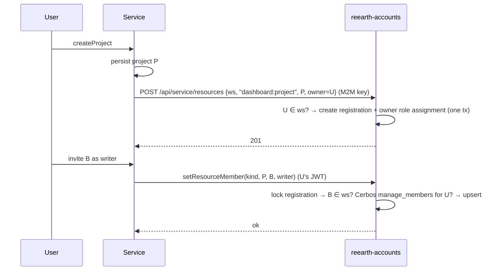
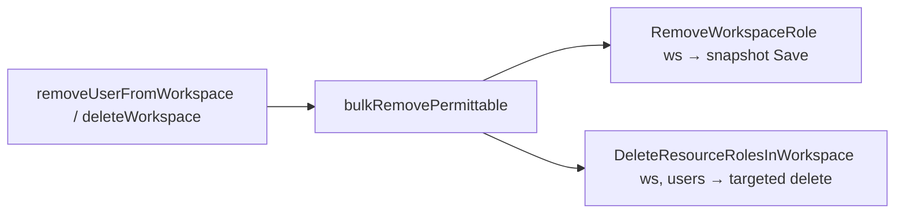

# Resource Role Assignment (Generic Per-Resource Membership)

> **Status: DRAFT.** Lets members and roles be set **per project** — and, more
> generally, per resource of any service — so that services (dashboard,
> visualizer, cms, …) can have project members without each building its own
> membership system, and **without reearth-accounts learning what a project
> is**. The first to use it is Dashboard projects. In code, a role assignment is
> represented by types and tables named `...Binding` / `resource_bindings`.
>
> Japanese version: [resource-role-binding.ja.md](resource-role-binding.ja.md)

## Document Signature

|           |                |
|-----------|----------------|
| Creator   | soneda-yuya    |
| Leader    | TBD            |
| Task Link | TBD            |
| Developer | TBD            |

## Background / Problem Statement

### Motivation (product context)

- While introducing SSO, we discussed whether users should be able to create
  workspaces freely, and there was a request to make workspace creation
  restrictable via an option. With that restriction, a single workspace would
  have to hold many projects.
- Today members can only be assigned per workspace, so customers manage members
  workspace by workspace — even though the people involved differ from project
  to project. When customers want to share a project across workspaces, they
  currently copy the project into the target workspace.
- Assigning members and permissions per project lets a workspace function as an
  organization. This is a separate feature from SSO / SCIM, but we want to make
  it implementable early so it is ready when workspace creation can be
  restricted.
- The intended model is close to GitHub's: a workspace relates to its projects
  the way a GitHub organization relates to its repositories. Just as GitHub has
  both organization members and repository members, Re:Earth would have both
  workspace members and project members.

### Current situation

- Permissions across Re:Earth are decided by reearth-accounts. Each service
  (dashboard, visualizer, cms, ...) asks accounts "may this user perform this
  action?" before allowing it.
- A user's role is held **per workspace** (plus a few platform-wide roles).
  Joining a workspace gives the same role on every project in that workspace.
- A permission check therefore only knows *which workspace* the request is
  about, not *which project*. There is no way to say "user A can edit project P
  but not project Q" within the same workspace.

### Problem

Products need **project-level membership**: "user A, a reader of the workspace,
is an editor of project P", and "user B, added only to project P (not to the
whole workspace), cannot see the other projects in the workspace". Today the
finest granularity accounts can express is the workspace.

If each service implements project membership on its own:

1. Invite / role-change / remove APIs and UI are duplicated per service.
2. Each service must react to **workspace membership changes** (user removed from
   workspace, workspace deleted) to clean up its project members. Only accounts
   owns that information, so every service needs an event/sync path, and a miss
   leaves a user with access to a project in a workspace they have left.
3. "A project member must be a member of the workspace" cannot be validated
   locally by the service without calling accounts anyway.
4. Permission rules end up scattered across every service, instead of being
   decided in one place (accounts).

### Constraint (the reason for this design's shape)

Accounts must **not** take over what a *project* is. Whether a project exists,
its name, visibility, content and lifecycle stay with each service. Accounts
only keeps what it needs to decide permissions: "this project belongs to this
workspace, and this user has this role on it".

## Goals

1. **Members and roles can be set per project.** A person can be given a role on
   a specific project, not only on the whole workspace. The model is:
   - **Regular workspace members** (owner / maintainer / writer / reader) see
     **every** project in the workspace, as today, through their workspace role.
     A project role can **raise** their access on that project (for example, a
     workspace reader who is a writer on project P can edit P), but never lower
     it.
   - **Limited members** (people added only to specific projects, see Goal 7)
     see **only** the projects where they have a project role.
2. **Permission checks look at the specific project.** When a service asks
   accounts "may this user do this?", the answer can take the user's role on
   that particular project into account. The check always uses the workspace
   the project really belongs to, so a caller cannot get access by naming a
   different workspace.
3. **Membership rules stay consistent.** A project always belongs to exactly
   one workspace, and once it has an owner it never ends up with none — even
   when several people change members at the same time.
4. **Leaving a workspace removes project access.** When a user is removed from a
   workspace, their roles on every project in that workspace are removed
   automatically. Services do not need to clean this up themselves.
5. **Accounts stays generic.** Accounts does not know what a "project" is. Any
   service can use the same mechanism for its own resources (for example, a CMS
   model) just by adding a permission policy, with no change to accounts.
6. **Nothing existing breaks.** Current permission checks and policies keep
   working exactly as they do today.
7. **Access to only some projects can be given in one step.** From the UI, an
   admin can either add a person directly to a project — adding them to the
   workspace at the same time if they are not in it yet — or, while adding a
   person to the workspace, choose which projects they can see. Either way it is
   one step that either fully succeeds or changes nothing. A person added this
   way belongs to the workspace as a *limited member* who sees only the projects
   they were given a role on, while regular workspace members keep seeing every
   project (see *Design → Adding people from the UI*).

## Non-Goals

1. **Storing project details in accounts.** Names, visibility, owners, dates and
   other information about a project stay in the service that owns it.
2. **Checking that a project really exists.** Accounts trusts the service that
   registers the project. Only services can register projects, not users.
3. **Noticing on its own when a project is deleted.** The service that owns the
   project must tell accounts when it is deleted.
4. **Nested resources and inherited permissions** (for example folder → project
   → layer). These could be added later through permission policies.
5. **Integrations as project members.** In the first version only people (user
   accounts) can be project members, not integrations or API tokens.
6. **Using project properties in permission decisions** (for example "public"
   or "private"). See *Open Questions*; the first version decides by roles only.
7. **Sending invitation emails for project membership.** The email mentions the
   project's name, which accounts does not know, so the service sends it.

## Functional Requirements

1. **Permission checks stay fast.** Checks that do not name a project cost
   exactly the same as today. Checks that name a project add only one small,
   quick lookup (which workspace the project belongs to); the user's project
   roles are read together with the data accounts already loads.
2. **Names and IDs have size limits.** The resource type name and the resource
   ID have a maximum length and a fixed set of allowed characters, so stored
   data stays small and predictable.
3. **Designed for realistic scale.** Up to about 1,000 project role assignments
   per user, and up to about 1,000 members per project.
4. **Listing a project's members is quick.** It returns only who the members are
   and their roles; names and other details come from the service.
5. **Works with every database accounts supports.** Membership changes behave
   the same whichever database a deployment uses.

Technical details: see *Solution Options → Option 1 → Detailed requirements*.

## Solution Options

This section describes the system design in detail and is intended for readers
interested in the implementation; the other sections can be read without it.

### Option 1 (Recommended): Resource registration + role assignments embedded in `Permittable`

Two pieces of state, both opaque to accounts:

| State | Purpose |
|---|---|
| **Resource registration** `(resourceKind, resourceID) → workspaceID, version` | Authoritative workspace scope of the resource; proof the owning service registered it; per-resource serialization point for invariants |
| **Resource role** on `Permittable` `(workspaceID, resourceKind, resourceID, roleID)` | The user's role on that resource; read together with the permittable for zero-read lookup |

#### Domain

```go
// server/pkg/resource/registration.go (new package, no service-specific code)
type Registration struct {
    createdAt   time.Time
    kind        Kind   // validated per FR-3
    resourceID  ID     // validated per FR-3
    version     int64  // bumped by every membership mutation of this resource
    workspaceID workspace.ID
}

// server/pkg/permittable/permittable.go
type Permittable struct {
    id             ID
    resourceRoles  []ResourceRole // NEW
    roleIDs        []role.ID
    updatedAt      time.Time
    userID         user.ID
    workspaceRoles []WorkspaceRole
}

type ResourceRole struct {
    resourceID   resource.ID
    resourceKind resource.Kind
    roleID       role.ID
    workspaceID  workspace.ID // copied from the registration
}
```

`ResourceRole(kind, id)` returns the user's role on a resource **only if the
user still holds a workspace role in `workspaceID`** (read-time guard, see
*Concurrency*). One role per `(kind, id)` per user. No `switch` on `kind`
anywhere in accounts.

Roles reuse the existing `roles` table (`owner` / `maintainer` / `writer` /
`reader`). Their meaning per resource kind is defined solely by that kind's
Cerbos policy.

**Limited workspace role (name tentative: `limited`).** A new workspace role
value (added to the GraphQL `Role` enum and `role.RoleType`) for people who
belong to the workspace but should see only the resources they hold a resource
role on. It is an ordinary workspace role: it is stored in the workspace's
member list and in `Permittable.workspaceRoles` like the others, counts toward
the workspace's member (seat) limit, and satisfies both the "target must be a
workspace member" check and the read-time guard. It grants nothing by itself
(see the policy note under *Authorization check*). It is valid only as a
workspace role: `setResourceMember` and `addWorkspaceMemberWithResourceRoles`
reject it as a resource role. The existing `updateUserOfWorkspace` can change it
to or from other non-owner roles; such a change never touches resource roles.

#### Storage

**PostgreSQL** — migration `0005_resource_role_binding.up.sql`:

```sql
CREATE TABLE resource_registrations (
    resource_kind text NOT NULL CHECK (octet_length(resource_kind) <= 64),
    resource_id   text NOT NULL CHECK (octet_length(resource_id) <= 128),
    workspace_id  text NOT NULL,
    version       bigint NOT NULL DEFAULT 0,
    created_at    timestamptz NOT NULL DEFAULT now(),
    PRIMARY KEY (resource_kind, resource_id)
);
CREATE INDEX resource_registrations_workspace_idx
    ON resource_registrations (workspace_id);

CREATE TABLE permittable_resource_roles (
    permittable_id text NOT NULL REFERENCES permittables(id) ON DELETE CASCADE,
    resource_kind  text NOT NULL,
    resource_id    text NOT NULL,
    workspace_id   text NOT NULL,
    role_id        text NOT NULL,
    PRIMARY KEY (permittable_id, resource_kind, resource_id),
    FOREIGN KEY (resource_kind, resource_id)
        REFERENCES resource_registrations (resource_kind, resource_id) ON DELETE CASCADE
);
CREATE INDEX permittable_resource_roles_resource_idx
    ON permittable_resource_roles (resource_kind, resource_id);
CREATE INDEX permittable_resource_roles_workspace_idx
    ON permittable_resource_roles (workspace_id, permittable_id);
```

```sql
-- 0005_resource_role_binding.down.sql
DROP TABLE IF EXISTS permittable_resource_roles;
DROP TABLE IF EXISTS resource_registrations;
```

**MongoDB**

- New collection `resource_registrations` with a unique index on
  `{ resource_kind: 1, resource_id: 1 }` and an index on `{ workspace_id: 1 }`
  (schema registered via `mongoschemagen`, migration added per
  `server/CLAUDE.md`).
- New optional array `resource_roles` on the permittable document, with indexes
  `{ "resource_roles.resource_kind": 1, "resource_roles.resource_id": 1 }` and
  `{ "resource_roles.workspace_id": 1 }`.

#### Repository changes (targeted writes, never snapshot writes)

The existing snapshot `Save` / `SaveMany` must not be able to overwrite or
resurrect resource roles:

- **Mongo** `Permittable.Save` switches from document replacement to
  `$set` of `role_ids`, `workspace_roles`, `updated_at` only. `resource_roles`
  is written exclusively by the targeted operations below.
- **Postgres** `Permittable.Save` already only rewrites
  `permittable_workspace_roles`; it is left untouched for resource roles.
- **Postgres** `hydrate` is replaced by a single query returning the base row
  plus `json_agg` sub-selects of workspace roles and resource roles (FR-2).

New repository interfaces:

```go
// resource.RegistrationRepo
FindByKey(ctx, kind, id) (*resource.Registration, error)
Create(ctx, r resource.Registration) error              // ErrAlreadyExists on duplicate
LockForUpdate(ctx, kind, id) (*resource.Registration, error) // must run inside a transaction
Remove(ctx, kind, id) error                              // also removes all role assignments

// permittable.Repo (additions)
FindResourceMembers(ctx, kind, id) ([]permittable.ResourceMember, error) // projection: userID + roleID
CountResourceOwners(ctx, kind, id, ownerRoleID) (int, error)
UpsertResourceRole(ctx, userID, r permittable.ResourceRole) error
DeleteResourceRole(ctx, userID, kind, id) error
DeleteResourceRolesInWorkspace(ctx, workspaceID, userIDs) error
```

| Operation | Mongo | Postgres |
|---|---|---|
| `UpsertResourceRole` | single-document update: `$pull` the `(kind,id)` element then `$push` the new one (one `updateOne` with an aggregation pipeline) | `INSERT … ON CONFLICT (permittable_id, resource_kind, resource_id) DO UPDATE SET role_id = …` |
| `DeleteResourceRole` | `$pull` | `DELETE … WHERE permittable_id=$1 AND resource_kind=$2 AND resource_id=$3` |
| `DeleteResourceRolesInWorkspace` | `updateMany` + `$pull {workspace_id}` | `DELETE … WHERE workspace_id=$1 AND permittable_id = ANY($2)` |
| `FindResourceMembers` | aggregation `$match` → `$unwind` → `$match` → `$project {user_id, role_id}` | `SELECT p.user_id, r.role_id FROM permittable_resource_roles r JOIN permittables p …` |
| `LockForUpdate` | in a transaction: `findOneAndUpdate {$inc: {version: 1}}` (concurrent transactions on the same registration hit a write conflict and are retried) | `SELECT … FOR UPDATE` |

#### Authorization check

`CheckPermissionInput` gains one optional field:

```graphql
input CheckPermissionInput {
  service: String!
  resource: String!
  action: String!
  workspaceAlias: String
  resourceId: String   # NEW
}
```

When `resourceId` is **absent**, behavior is unchanged.

When `resourceId` is **present**:

1. Load the registration `(service:resource, resourceId)`. **Not found → deny.**
2. If `workspaceAlias` is given and does not resolve to the registration's
   `workspaceID` → **deny**.
3. Principal roles = global roles + the user's workspace roles **in the
   registration's `workspaceID`** (the caller cannot choose the workspace).
4. Principal attribute `resourceRole` = the user's assigned role on this
   resource, or `""` if none (or if the read-time guard drops it).
5. The Cerbos resource ID is the real `resourceId`.

Policies stay in each service's `definition.go`, using the conditions the
reearthx generator already supports. Example for `dashboard:project`:

**Default model: effective role = max(workspace role, resource role).** For
regular workspace roles (`owner` / `maintainer` / `writer` / `reader`) the
workspace role grants its access on every resource of the workspace, as today,
and the resource role can only add to it. For `limited`, only the resource role
counts. Each role means the same at both levels (`owner` / `maintainer`: full
control and member management; `writer`: read and edit; `reader`: read), so a
policy implements "max" as the union of a workspace-role rule and a
`resourceRole`-condition rule per action — Cerbos allows if either matches.

```go
// dashboard: definition.go
resourceRole := func(expr string) *generator.Condition { return generator.SimpleExpr(expr) }
any := []string{"*"} // any principal role (including limited); the condition does the gating

builder.AddResource("project", []generator.ActionDefinition{
    // regular workspace members: access to every project of the workspace via the workspace role
    // ("limited" is never listed here)
    generator.NewActionDefinition("read", []string{"owner", "maintainer", "writer", "reader"}),
    generator.NewActionDefinition("edit", []string{"owner", "maintainer", "writer"}),
    generator.NewActionDefinition("delete", []string{"owner", "maintainer"}),
    generator.NewActionDefinition("manage_members", []string{"owner", "maintainer"}),
    // project roles: add on top of the workspace role; the only source of access for limited members
    generator.NewActionDefinitionWithCondition("read", any, resourceRole(`P.attr.resourceRole != ""`)),
    generator.NewActionDefinitionWithCondition("edit", any, resourceRole(`P.attr.resourceRole in ["owner", "maintainer", "writer"]`)),
    generator.NewActionDefinitionWithCondition("delete", any, resourceRole(`P.attr.resourceRole in ["owner", "maintainer"]`)),
    generator.NewActionDefinitionWithCondition("manage_members", any, resourceRole(`P.attr.resourceRole in ["owner", "maintainer"]`)),
})
```

Because resource roles arrive as a principal **attribute**, not as principal
roles, a project `owner` is never mistaken for a workspace `owner`: a project
role counts only for the resource named in the check. Whether a product may
apply stricter rules than this default (e.g. private projects that regular
workspace members cannot see) is Open Question 1.

**Policy note for the limited workspace role.** Every service's policies must
grant `limited` nothing except through `P.attr.resourceRole` conditions. Rules
keyed to explicit role lists (as in the example above) already exclude it, so it
is denied by default (fail-closed). Rules that grant on `*` without a
`resourceRole` condition, and workspace-level resources (e.g.
`dashboard:workspace`) must be reviewed per service. Which workspace-level
actions a limited member needs (e.g. reading the workspace name for a workspace
switcher) is Open Question 7.

#### Membership management API

**Lifecycle (M2M only)** — REST service routes, authenticated **only** by the
M2M API key (a user JWT is rejected). Registration is how accounts learns that a
resource exists and which workspace it belongs to; restricting it to services
removes any way for a user to claim an unregistered ID.

```
POST   /api/service/resources
       { workspaceId, resourceKind, resourceId, ownerUserId? }
       → creates the registration and, if ownerUserId is given, an `owner`
         role assignment, in one transaction. ownerUserId must be a workspace member.
         409 if already registered with a different workspace; idempotent
         (200) if registered with the same workspace.
DELETE /api/service/resources/{resourceKind}/{resourceId}
       → removes the registration and every role assignment on the resource.
```

**Membership (user JWT, GraphQL)**:

```graphql
input SetResourceMemberInput {
  resourceKind: String!
  resourceId: String!
  userId: ID!
  role: Role!
}
input RemoveResourceMemberInput {
  resourceKind: String!
  resourceId: String!
  userId: ID!
}

type ResourceMember { userId: ID!, role: Role! }
type ResourceBinding { workspaceId: ID!, resourceKind: String!, resourceId: String!, role: Role! }

extend type Query {
  resourceMembers(resourceKind: String!, resourceId: String!): [ResourceMember!]!
  # IDs only; the owning service hydrates names etc.
  myResourceBindings(resourceKind: String!, workspaceId: ID): [ResourceBinding!]!
}

extend type Mutation {
  setResourceMember(input: SetResourceMemberInput!): ResourceMember
  removeResourceMember(input: RemoveResourceMemberInput!): Boolean!
}
```

Guards (generic, no kind-specific code). Every mutation runs in one transaction
that starts with `LockForUpdate` on the registration (the combined operation
below serializes on the workspace first, then locks its registrations):

| Operation | Guard (evaluated after the lock) |
|---|---|
| `setResourceMember` | registration exists; target user is a member of the registration's workspace; Cerbos allows `manage_members` on `(kind, id)` for the operator; if the change downgrades the last `owner`, reject |
| `removeResourceMember` | Cerbos `manage_members`, or operator == target (self-leave); if it removes the last `owner`, reject |
| `resourceMembers` | Cerbos `read` on `(kind, id)`; result filtered by the read-time guard |
| `myResourceBindings` | operator's own role assignments only, filtered by the read-time guard |
| `addWorkspaceMemberWithResourceRoles` | see *Combined operation* below |

**Combined operation: add to the workspace and assign resource roles in one
step (user JWT, GraphQL).** Backs both UI patterns in *Design → Adding people
from the UI*.

```graphql
input ResourceRoleInput {
  resourceKind: String!
  resourceId: String!
  role: Role!                        # must not be `limited`
}
input AddWorkspaceMemberWithResourceRolesInput {
  workspaceId: ID!
  userId: ID!
  resources: [ResourceRoleInput!]!   # 1..100 entries, distinct (kind, id)
}
type AddWorkspaceMemberWithResourceRolesPayload {
  addedToWorkspace: Boolean!         # false if the user was already a member
  workspaceRole: Role!               # the user's workspace role after the call
  resources: [ResourceBinding!]!
}

extend type Mutation {
  addWorkspaceMemberWithResourceRoles(
    input: AddWorkspaceMemberWithResourceRolesInput!
  ): AddWorkspaceMemberWithResourceRolesPayload
}
```

The user is identified by user ID, as in `addUsersToWorkspace`; the UI finds
them by name or email with the existing user lookup (`userByNameOrEmail` /
`searchUser`). No new email-based invitation is introduced. All steps run in
**one transaction**:

1. Load the workspace and serialize on it (Postgres: row lock; Mongo: concurrent
   writes to the workspace document conflict and are retried). Personal
   workspaces are rejected, as in `addUsersToWorkspace`.
2. Validate every entry: the registration exists and its `workspaceID` equals
   `workspaceId` (otherwise the whole call is rejected); `role` is not
   `limited`; Cerbos allows `manage_members` on `(kind, id)` for the operator.
3. If the user is **not yet a workspace member**: the operator must also pass
   the existing add-member check of `addUsersToWorkspace` (`ActionAddMember`)
   and the member-count (seat) hook `enforceMemberCount` (v1 default; see Open
   Question 7). The user then joins with the `limited` role
   (`Members().Join`), and the permittable workspace role is written through the
   existing `bulkUpdatePermittable` path. If the user **is already a member**,
   workspace membership and role are left unchanged — never downgraded.
4. `LockForUpdate` each registration in a fixed order (sorted by `(kind, id)`),
   apply the last-owner rule per resource (the call can change an existing role
   of a user who is already a member), then `UpsertResourceRole` for each entry.
5. Any failure rolls back everything: no workspace membership, no seat used, no
   partial role assignments.

Removing a user's last resource role (`removeResourceMember`) does **not**
remove them from the workspace; see Open Question 8.

**Last-owner rule:** a membership mutation that would take the owner count of a
resource from ≥ 1 to 0 is rejected. A resource registered without an owner (e.g.
backfill) is managed by workspace roles until an owner is set. The unregister
endpoint is exempt.

#### Concurrency

| Race | Mitigation |
|---|---|
| Two writers on different users of the same resource both pass the last-owner check | Both must take `LockForUpdate` on the same registration; the second waits (Postgres) or conflicts and retries (Mongo). The owner count is read after the lock. |
| Two services register the same `(kind, id)` | Primary key / unique index; the loser gets `ErrAlreadyExists`. |
| `setResourceMember` passes the workspace-membership check, then the user is removed from the workspace and the cascade runs before the role assignment is written | **Read-time guard**: a role assignment is honored only if the user currently holds a workspace role in the role assignment's workspace. The permittable is already loaded, so this costs no read. The orphaned row is harmless and is removed the next time the cascade or the unregister endpoint touches it. |
| A stale snapshot `Save` from the workspace flow overwrites a newer role assignment (or vice versa) | Snapshot saves never write `resource_roles`; role-assignment writes never write `workspace_roles` (see *Repository changes*). |
| Two operators add the same new user with `addWorkspaceMemberWithResourceRoles` at once (possibly with different resources) | Both serialize on the workspace (step 1); the second waits (Postgres) or conflicts and retries (Mongo), then sees the user as an existing member and only adds its resource roles. The workspace role is not changed and the seat is counted once. |
| Two combined calls on overlapping resources deadlock | Fixed lock order: workspace first, then registrations sorted by `(kind, id)`. |
| The user is removed from the workspace while a combined call runs | When the call joins a new user, both write the workspace record, so they serialize; if the removal commits second, its cascade removes the new role assignments. Otherwise (and for any remaining gap) the read-time guard ignores role assignments of a user who no longer holds a workspace role, as with `setResourceMember`. |

#### Lifecycle and cascades

| Event | Who acts | Effect on role assignments |
|---|---|---|
| Resource created | Service (M2M) | `POST /api/service/resources` with `ownerUserId` = creator |
| Resource deleted | Service (M2M) | `DELETE /api/service/resources/{kind}/{id}`. A missed call leaves an orphan registration — harmless (the resource no longer exists in the service), cleaned by an optional sweeper later |
| Existing resources (pre-feature) | Service (M2M) | One-off backfill via the same endpoint (idempotent), before the service starts sending `resourceId` |
| User added with `addWorkspaceMemberWithResourceRoles` | Accounts | Workspace membership (`limited`, if new) and role assignments written in one transaction |
| User's last role assignment in a workspace removed | Accounts | Only that role assignment is removed; workspace membership (and the seat) stays. Whether a `limited` member should then be removed from the workspace is Open Question 8 |
| User removed from workspace | Accounts | `bulkRemovePermittable` also calls `DeleteResourceRolesInWorkspace` |
| Workspace deleted (`Workspace.Remove`) | Accounts | Same path via `bulkRemovePermittable`; registrations of the workspace are removed too |
| Workspace deactivated / restored | Accounts | No change (mirrors workspace roles; data kept for restore) |
| User deleted (`DeleteMe`) | Accounts | Today `DeleteMe` does not delete the permittable. Role assignments are unreachable once the user is gone; deleting the permittable on `DeleteMe` is proposed as a follow-up fix (independent of this feature) |

**Pros**

- Workspace scope of a resource is authoritative and server-side, so a caller
  cannot borrow roles from another workspace.
- Only M2M-authenticated services can make a resource exist in accounts, so
  users cannot claim IDs.
- Resource-wide invariants are serialized on one record per resource on both
  backends.
- Role-assignment lookup stays inside the already-loaded permittable; the only new read
  is a primary-key lookup of the registration.
- Accounts remains domain-agnostic: opaque kind/ID, semantics in policies.

**Cons**

- One extra point read for `checkPermission` calls that pass `resourceId`.
- Services must register resources (including a backfill) and unregister on delete.
- Mongo `Save` semantics change from replace to `$set` (touches existing code).

#### Detailed requirements

The technical form of *Functional Requirements*. The items are FR-1 to FR-6 in
order; other parts of this section refer to them by those numbers.

1. `checkPermission` without `resourceId`: **no change** in reads.
   With `resourceId`: **one additional indexed point read** (the resource
   registration, by primary key). The role assignment itself is read from the
   already-loaded permittable.
2. On PostgreSQL, `Permittable.FindByUserID` loads the base row, workspace roles
   and resource roles in **one round-trip** (aggregated sub-selects), so adding
   resource roles does not add a query to `checkPermission`.
3. Field limits, enforced in the domain layer and as DB constraints:
   - `resourceKind`: ≤ 64 bytes, `^[a-z0-9-]{1,32}:[a-z0-9_-]{1,31}$`
   - `resourceID`: ≤ 128 bytes, `^[A-Za-z0-9_.:-]{1,128}$`
4. Expected scale: ≤ ~1,000 role assignments per user (≤ ~300 B each with the limits
   above, i.e. ≤ ~300 KB per Mongo document, well under 16 MB) and ≤ ~1,000
   members per resource.
5. Listing members of one resource is index-backed and returns only
   `(userId, role)` for that resource — it never hydrates whole aggregates.
6. All mutations work on both MongoDB and PostgreSQL backends and in the
   `memory` repo.

Scope notes (technical form of *Non-Goals*):

- Resource existence is not validated. Accounts trusts the
  **M2M-authenticated** service that registers a resource, and relies on that
  service to call the unregister endpoint when the resource is deleted (see
  *Lifecycle and cascades*).
- v1 role assignments are for **user principals only**; integration (M2M)
  principals cannot hold resource roles.
- v1 `checkPermission` passes no resource attributes (e.g. `visibility`) to
  Cerbos; policies use roles only (see *Technical notes on open questions*).

#### Request flows (sequence diagrams)

##### Permission check with a resource ID


##### Project creation and member invite



`setResourceMember` requires B to already be a workspace member. To add someone
who may not be in the workspace yet, the UI uses the combined operation below.

##### Adding a person from the UI in one step

Pattern (a) passes one resource (the project being viewed); pattern (b) passes
the projects chosen in the workspace "add member" dialog. Both call the same
mutation.

```mermaid
sequenceDiagram
    participant U as Admin
    participant S as Service UI (e.g. dashboard)
    participant A as reearth-accounts
    participant C as Cerbos

    U->>S: add C to project P1 (a)<br/>or add C to ws with projects P1, P2 (b)
    S->>A: userByNameOrEmail(...) → C's userId
    S->>A: addWorkspaceMemberWithResourceRoles(ws, C, [(kind,P1,writer), ...]) (U's JWT)
    A->>A: begin tx; serialize on ws
    A->>A: each Pn registered in ws?
    A->>C: manage_members on each Pn for U?
    alt C ∉ ws
        A->>A: add-member check + seat limit → Join(C, limited) + permittable workspace role
    else C ∈ ws
        A->>A: keep C's workspace role unchanged
    end
    A->>A: LockForUpdate P1, P2 … (sorted) → last-owner rule → UpsertResourceRole each
    A->>A: commit (any failure → roll back all)
    A-->>S: { addedToWorkspace, workspaceRole, resources }
```

A limited member then sees only their projects: the service lists them with
`myResourceBindings`, and `checkPermission` on any other project is denied.

##### Workspace member removal cascade



#### Technical notes: impact, tests, deployment, rollback, monitoring

##### Impact

1. **Permittable document/row size** grows by ≤ ~300 B per role assignment.
2. **Mongo `Permittable.Save`** changes from replace to `$set`; existing tests
   for permittable persistence must still pass, and a new test verifies that
   `Save` leaves `resource_roles` untouched.
3. **Cerbos resource ID change** when `resourceId` is passed: only callers that
   opt in are affected.
4. **Workspace member removal** issues one additional targeted delete.
5. **Policy authoring**: role names are shared between workspace and resource
   scopes. A resource role must be checked only through `P.attr.resourceRole`
   (never as a principal role); workspace roles keep their workspace-wide
   grants for regular members, and `limited` is never listed in a
   workspace-role rule. Existing project policies of a service must be extended
   with the `resourceRole` rules (union = max), not replaced.
6. **gqlclient** (`server/pkg/gqlclient`) consumers need a version bump to use
   the new fields; old clients are unaffected.
7. **New `Role` enum value `limited`**: clients that decode workspace members
   with a strict enum may fail on the unknown value. Every service that reads
   workspace members must update its client before any limited member is
   created.
8. **Policies**: every service's workspace- and resource-level policies must be
   audited so that `limited` gets no access except via `P.attr.resourceRole`.
9. **Seats**: a limited member counts toward the workspace member limit
   (`enforceMemberCount`) like any other member.

##### Tests

1. **Unit** (`pkg/resource`, `pkg/permittable`): kind/ID validation and length
   limits; one role per resource; read-time guard drops role assignments without a
   matching workspace role.
2. **Interactor** (`internal/usecase/interactor`):
   - `CheckPermission`: no `resourceId` → unchanged roles (regression);
     unregistered resource → deny; alias of another workspace → deny; workspace
     roles taken from the registration, not the alias; `resourceRole` set/empty;
     principal roles still carry the regular workspace role when a resource
     role is also present (so policies can compute max).
   - Register: M2M only (JWT rejected); owner must be a workspace member;
     duplicate with same workspace is idempotent, different workspace is 409.
   - `setResourceMember` / `removeResourceMember`: non-member target rejected;
     denied without `manage_members`; self-leave allowed; last-owner protection.
   - Cascades: `RemoveUserMember` / `RemoveMultipleUserMembers` / `Remove`.
   - `addWorkspaceMemberWithResourceRoles`: non-member is joined as `limited`
     and gets every role assignment; existing member keeps their workspace role
     (no downgrade) and only gains role assignments; a resource from another
     workspace, an unregistered resource, a missing `manage_members`, a failed
     add-member check or the seat limit → whole call rejected with no
     membership and no role assignment left behind; `limited` as a resource
     role rejected; personal workspace rejected; last-owner rule applied.
   - Limited member: no access to any resource without a role assignment;
     `removeResourceMember` of their last role assignment keeps workspace
     membership.
3. **Concurrency** (`make test-integration`, both backends): two goroutines
   removing the last two owners concurrently → exactly one succeeds; concurrent
   registrations of the same key → one succeeds; stale snapshot `Save` after
   `UpsertResourceRole` keeps the role assignment; two concurrent
   `addWorkspaceMemberWithResourceRoles` calls for the same new user → user
   joined once, both sets of role assignments present.
4. **Repository**: Mongo, Postgres and memory implementations of every new
   operation; Postgres `FindByUserID` issues a single query.
5. **Migration**: `0005` up/down on an existing DB; existing permittables load
   with empty `resourceRoles`.
6. **E2E** (`server/e2e`): a `dashboard:project` test policy generated with the
   rules above; verify:
   - workspace `reader` without a role assignment → `read` allowed, `edit`
     denied, on every project of the workspace;
   - workspace `reader` + resource `writer` on P → `edit` allowed on P only;
   - workspace `writer` + resource `reader` on P → `edit` still allowed on P
     (a resource role never lowers access);
   - workspace `owner` → every action on every project;
   - `limited` without a role assignment → every action denied; `limited` +
     resource `writer` on P → `read` / `edit` on P only, denied elsewhere;
   - user from another workspace → denied.

##### Deployment

1. Backward compatible? **Yes.** New optional input field, new collection/tables,
   new routes and GraphQL fields. Behavior is unchanged when `resourceId` is absent.
2. Partial deployment? **Yes.** Order:
   1. Deploy accounts.
   2. Each service backfills registrations for existing resources.
   3. Each service starts registering on create / unregistering on delete.
   4. Each service deploys policies using `P.attr.resourceRole` and starts
      sending `resourceId`. Before step 4 the attribute is absent and conditions
      never match (fail-closed).
3. Notify: dashboard / visualizer / cms owners; whoever maintains Cerbos policies.
4. Config changes: none (reuses the existing M2M API key).
5. DDL: Postgres migration `0005` runs automatically at startup (golang-migrate).
   Mongo: collection schema + indexes via the startup migration; no backfill in accounts.
6. Limited members: enable the UI that calls
   `addWorkspaceMemberWithResourceRoles` only after every service that reads
   workspace members has updated its client and audited its policies for
   `limited` (see *Impact* 7–8).

##### Rollback

1. Notify the cause in the team Slack channel.
2. Revert consumer services / policies that rely on `resourceId` / `resourceRole` first.
3. Roll back the accounts image. The old binary ignores the new collection,
   tables and `resource_roles` field, so **no data rollback is required**.
   Note: the old Mongo `Save` replaces the whole document and will drop
   `resource_roles` of any permittable it writes — acceptable during rollback,
   since the feature is disabled; services re-run the backfill on roll-forward.
   If `limited` members exist, the old binary does not know that role; before
   rolling back, decide whether to remove them from their workspaces or change
   them to another role (changing to `reader` grants wider access).
4. Only if the schema itself must be removed: run `0005` down (drops
   registrations and role assignments — take a dump first).

##### Post-deployment checks and monitoring

- Checklist
  - Create a project in dashboard staging; verify the registration and the
    creator's `owner` role assignment.
  - Give a workspace `reader` the resource role `writer` on a project; verify
    they can edit that project and still only read the others. Remove them from
    the workspace; verify all project access is lost.
  - Call `checkPermission` with the alias of another workspace; verify deny.
  - Call `addWorkspaceMemberWithResourceRoles` for a user outside the
    workspace; verify they are a `limited` member, use a seat, and can access
    only the given project.
- Metrics
  - `checkPermission` p50/p95 latency with and without `resourceId`.
  - Error rate of register / unregister / `setResourceMember` /
    `addWorkspaceMemberWithResourceRoles`, including Mongo transaction retries.
  - Count of role assignments per permittable (max / p99) to watch FR-4.
- Alerting
  - `checkPermission` error rate: Warning > 1%, Danger ≥ 5%.
  - `checkPermission` p95 latency: Warning > +20% vs baseline.

#### Technical notes on open questions

1. **Resource attributes in `checkPermission`:** proposal — an optional
   `attributes: JSON` on `CheckPermissionInput`, passed through to the Cerbos
   resource (e.g. `visibility`). A stricter per-product rule (e.g. regular
   workspace members cannot read a `private` project without a resource role)
   would then be a condition on the workspace-role rules, e.g.
   `R.attr.visibility != "private"`; the default policy above stays additive.
2. **Batch checks:** a `checkPermissions` query over many `resourceId`s for list
   screens. Cerbos `CheckResources` already supports multiple resources.
3. **Per-service M2M keys:** v1 accepts the existing shared M2M API key for
   register/unregister (`POST` / `DELETE /api/service/resources`). Option: scope
   each key to the kinds of its own service (`dashboard:*`).
4. **Orphan sweeper:** would remove registrations of resources deleted without
   calling the unregister endpoint.
5. **Integration members:** M2M tokens as resource principals (possibly needed
   by cms).
6. **UI placement:** no accounts change either way. Both UI patterns, (a) from a
   project and (b) from the workspace member dialog, call
   `addWorkspaceMemberWithResourceRoles`, from whichever service hosts the
   screen.
7. **Limited workspace role:** final identifier (tentatively `limited`);
   workspace-level actions to grant it in each policy (e.g. reading the
   workspace name); whether a resource `manage_members` holder who is not a
   workspace admin may add a *new* user to the workspace (v1: no — step 3 of the
   combined operation requires the existing add-member check).
8. **Last role assignment removed:** if decided, `removeResourceMember` (and
   unregister) would, in the same transaction, remove a `limited` member whose
   last role assignment in that workspace was removed, via the existing
   workspace member removal path.

### Option 2: Role assignments in their own collection/table (no embedding)

Same registration and API, but role assignments live in a standalone
`resource_bindings (kind, id, userID, role)` collection/table instead of on the
permittable.

**Pros:** no permittable growth; member listing is a plain index scan; snapshot
`Save` semantics do not need to change.

**Cons:** `checkPermission` needs a second extra read (the role assignment) on top of
the registration; workspace cascades touch two stores.

**Decision:** Option 1. Revisit Option 2 if per-user role-assignment counts approach
FR-4 or if the Mongo `Save` change proves risky.

### Alternative considered and rejected: membership in each service

Rejected because of the duplication and cascade problems in *Problem* (1)–(4).
The variant "services keep members but pass the role to Cerbos as an attribute"
solves only (4).

## Design

**For each project, accounts keeps only two facts: which workspace it belongs
to, and who holds which role on it.** Everything else about the project stays in
the service.

### Checking a permission on a project

1. A service asks accounts whether a user may do something (for example, edit)
   on a specific project.
2. Accounts looks up which workspace the project belongs to. If the service
   never registered the project, or the request names a different workspace,
   the answer is "no".
3. Accounts combines the user's role in that workspace with the user's role on
   the project (if any) and applies the service's permission policy. By
   default:
   - a **regular workspace member** (owner / maintainer / writer / reader) gets
     the higher of their workspace role and their project role — the workspace
     role already covers every project, and a project role can only raise it;
   - a **limited member** gets only their project role; without one, they have
     no access to the project.
4. A project role only counts while the user is still a member of the project's
   workspace.

### Creating a project and inviting members

1. A user creates a project in a service. The service saves it and registers it
   with accounts, naming the creator as its owner (the creator must be a
   workspace member).
2. The owner adds a person to the project with a role (for example, writer).
   Accounts checks that the inviter is allowed to manage the project's members,
   then saves the role. If the person is already in the workspace, only the
   project role is added. If they are not, they are added to the workspace as a
   limited member at the same time (see *Adding people from the UI* below), so
   the rule "a project member must be a workspace member" is always met.
3. Member changes on the same project are processed one at a time, so the last
   owner can never be removed, even when two people act at once. Members can
   leave a project themselves, except the last owner.
4. A project registered without an owner (for example, one that existed before
   this feature) is managed through workspace roles until an owner is set.

### Adding people from the UI

An admin can give someone access to only some projects in **one step**, in
either of two ways:

- **(a) From a project:** add a person directly as a member of the project. If
  they are not yet in the workspace, they are added to the workspace at the
  same time.
- **(b) From the workspace:** when adding a person to the workspace, choose
  which projects they can see.

Both use the same single operation in accounts: it adds the person to the
workspace (if they are not already in it) and gives them their project roles
together. Either everything succeeds or nothing changes — the person is never
left in the workspace without the chosen projects, or vice versa.

- **Limited member (name tentative).** A person added this way who was not yet
  in the workspace joins it with a new workspace role, the *limited member*.
  A limited member belongs to the workspace but, by default, cannot see any of
  its projects; they see only the projects where they have a project role.
- **Regular members are not restricted.** Regular workspace members (owner /
  maintainer / writer / reader) keep seeing every project through their
  workspace role; a project role can only raise their access on that project,
  never lower it. In GitHub terms, a regular member is like an organization
  member whose base permission gives access to all repositories, and a limited
  member is like a person who has access only to specific repositories.
- **Uses a seat.** As on GitHub, a limited member still counts as a workspace
  member. Because Re:Earth is billed per seat per workspace, adding them uses a
  seat, and the workspace's member limit applies.
- **Existing members are not downgraded.** If the person is already in the
  workspace, they are just given the project roles; their workspace role stays
  as it is.
- An admin can later change a limited member to a regular workspace role (or
  back) in the usual way.

### Removing someone from a workspace

When a user is removed from a workspace, or the workspace is deleted, accounts
removes their workspace role and all their project roles in that workspace in
the same step. When a workspace is deleted, its project registrations are
removed too. Deactivating a workspace removes nothing, so it can be restored.

The reverse does not happen automatically: removing a person's last project
role does **not** remove them from the workspace. A limited member left with no
project roles stays in the workspace (and keeps using a seat) until an admin
removes them. Whether this should happen automatically is an open question.

### Example: Dashboard projects

| Who | What they can do |
|---|---|
| Workspace owner / maintainer | View, edit and delete every project in the workspace, and manage its members |
| Workspace writer | View and edit every project in the workspace |
| Workspace reader | View every project in the workspace |
| A project role on top of a workspace role | Adds to the workspace role on that project only — for example, a workspace reader who is a writer on a project can edit that project. It never reduces what the workspace role allows |
| Limited member (name tentative) with a project role | That project only, with the project role's permissions (owner / maintainer: view, edit, delete and manage members; writer: view and edit; reader: view) |
| Limited member without a project role | No access to the project |

Each role means the same on a workspace and on a project, and a regular
member's access to a project is the higher of the two. Whether a product may
apply stricter rules (for example, private projects) is an open question.

Technical details: see *Solution Options → Option 1 → Request flows (sequence
diagrams)*.

## Potential Impact

1. **Slightly more stored data per user.** Each project role adds a few hundred
   bytes to the user's permission data.
2. **A change in how accounts saves permission data.** In one of the databases
   accounts supports, the way permission data is saved changes so that
   workspace changes and project role changes never overwrite each other. This
   is covered by the existing tests plus a new one.
3. **Only services that opt in are affected.** Permission checks change only for
   services that start naming a specific project; everything else behaves as
   today.
4. **Removing a workspace member does a little more work**, because their
   project roles in that workspace are removed in the same step.
5. **Role names are shared between workspaces and projects.** "Owner",
   "maintainer", "writer" and "reader" exist at both levels. Whoever writes a
   service's permission policy must treat "project owner" and "workspace owner"
   as different things, and must keep the default model: workspace roles still
   give access to every project, and a project role only adds to it.
6. **Only services that use the feature need to update.** Services that use the
   new features must update the client library they use to talk to accounts;
   services that don't update keep working unchanged.
7. **Limited members use seats.** Each limited member counts as a workspace
   member for billing and for the workspace's member limit, even if they can
   see only one project.
8. **A new workspace role every product must handle.** The limited member is a
   new kind of workspace role. Every product's permission policy must treat it
   as "no project access by default" — access only through a project role — and
   every service that shows workspace members must be able to display it.
   Limited members should not be created until all services are ready.

Technical details: see *Solution Options → Option 1 → Technical notes: impact,
tests, deployment, rollback, monitoring*.

## Test Plan

1. **Basic rules.** Resource type names and IDs are validated and size-limited;
   a user has at most one role per project; a project role is ignored once the
   user is no longer in the project's workspace.
2. **Permission checks.**
   - Checks that do not name a project give exactly the same results as today.
   - A project that was never registered → denied.
   - Naming a workspace other than the project's own → denied.
   - The user's workspace role is always taken from the project's real
     workspace, not from what the caller says.
   - A regular workspace member without a project role keeps exactly the access
     their workspace role gives on every project.
   - A project role raises a regular member's access on that project only (a
     workspace reader who is a project writer can edit it) and never lowers it
     (a workspace writer who is a project reader can still edit it).
   - A limited member has access only through their project role.
3. **Registering projects.** Only services can register (a user's login is
   rejected); the owner must be a workspace member; registering the same
   project again in the same workspace is harmless, but in a different
   workspace it is rejected.
4. **Managing members.** A project role cannot be given to someone outside the
   workspace without also adding them to the workspace (that is done by the
   one-step addition in item 9); people
   without permission to manage members are refused; members can leave a
   project themselves; the last owner cannot be removed or downgraded.
5. **Cleanup.** Removing one or several users from a workspace, or deleting the
   workspace, removes their project roles.
6. **Simultaneous changes.** Two people removing the last two owners at the same
   time → exactly one succeeds. Two services registering the same project at the
   same time → exactly one succeeds. A workspace change saved at the same time
   as a project role change does not wipe out the project role.
7. **Every supported database**, including the database upgrade and its undo on
   existing data, and existing users loading correctly with no project roles.
8. **End to end.** With a sample Dashboard project policy, check the results for
   a workspace reader with and without a project role, a workspace writer with
   a lower project role, a workspace owner, a user from another workspace, and a
   limited member with and without a project role.
9. **Adding people in one step.**
   - Adding a person who is not in the workspace to one or more projects makes
     them a limited member with exactly those project roles, in one step.
   - All-or-nothing: if any part fails (a project from another workspace, a
     project the admin may not manage, the workspace's member limit reached,
     …), the person is not added to the workspace and gets no project roles.
   - Adding a person who is already in the workspace only adds project roles;
     their workspace role is not changed or downgraded.
   - A limited member cannot see any project where they have no project role.
   - Removing a limited member's last project role leaves them in the
     workspace.
   - Two admins adding the same new person at the same time → the person is
     added to the workspace once and gets both sets of project roles.

Technical details: see *Solution Options → Option 1 → Technical notes: impact,
tests, deployment, rollback, monitoring*.

## Deployment Plan

1. **Backward compatible? Yes.** Everything is added alongside what exists.
   Services that don't name a project in permission checks see no change.
2. **Can it be rolled out gradually? Yes.** Order:
   1. Deploy accounts.
   2. Each service registers its existing projects with accounts (a one-off
      backfill).
   3. Each service starts registering new projects when they are created and
      telling accounts when they are deleted.
   4. Each service turns on its project-level permission rules and starts naming
      the project in permission checks. Until this step, project roles have no
      effect, so nobody gains access by mistake (fail-closed).
3. **Who to notify:** the dashboard / visualizer / cms owners, and whoever
   maintains the permission policies.
4. **Configuration changes:** none.
5. **Database changes:** applied automatically when accounts starts. Accounts
   itself does not need to convert any existing data.
6. **Limited members:** turn on the UI that adds limited members only after
   every service can display the new workspace role and its permission policy
   gives that role no project access by default.

Technical details: see *Solution Options → Option 1 → Technical notes: impact,
tests, deployment, rollback, monitoring*.

## Rollback Plan

1. Share the cause in the team Slack channel.
2. First, turn off project-level permission rules in the services that use them.
3. Roll accounts back to the previous version. The previous version simply
   ignores the new data, so **no data rollback is required**.
   Note: while the previous version runs, it may drop the project roles of users
   whose permission data it saves. This is acceptable because the feature is off
   at that point; services re-run the backfill when the feature is rolled out
   again.
   If limited members already exist, the previous version does not know that
   role. Before rolling back, decide whether to remove them from their
   workspaces or change them to another role (a regular role gives them wider
   access).
4. Only if the new data structures must be removed completely: run the database
   downgrade. It deletes all project registrations and project roles, so take a
   backup first.

Technical details: see *Solution Options → Option 1 → Technical notes: impact,
tests, deployment, rollback, monitoring*.

## Post Deployment

- Checklist
  - Create a project in Dashboard staging; check that it is registered and that
    the creator is its owner.
  - Make a workspace reader a writer on one project; check that they can edit
    that project and can still only view the others. Remove them from the
    workspace; check that they lose access to every project.
  - Ask for a permission on the project while naming a different workspace;
    check that it is denied.
  - From the project, add a person who is not in the workspace; check that they
    become a limited member, use a seat, and can see only that project.
  - From the workspace, add a person and choose two projects; check that they
    see exactly those two.
- Metrics
  - How long permission checks take (typical and slowest 5%), with and without a
    project named.
  - Error rate of registering / unregistering projects, changing members and
    adding people in one step, including automatic retries.
  - Number of project roles per user (maximum and top 1%), to watch the ~1,000
    per user assumption.
- Alerting
  - Permission check error rate: Warning above 1%, Danger at 5% or more.
  - Permission check response time (slowest 5%): Warning when more than 20%
    slower than the usual baseline.

Technical details: see *Solution Options → Option 1 → Technical notes: impact,
tests, deployment, rollback, monitoring*.

## Open Questions

1. **Should a product be able to apply stricter rules, such as private
   projects?** By default, regular workspace members see every project and a
   project role only adds to that. A rule like "private projects are visible
   only to their members, public ones to the whole workspace" would restrict
   regular members too, and needs to know whether a project is public. Deferred
   until a product needs it.
2. **Should list screens be able to check many projects at once?** A screen that
   lists projects needs a permission answer for each one; one combined check
   would be faster.
3. **Should each service's credentials be limited to its own resources?** In the
   first version, all services register projects with the same shared service
   credential. Should each service be able to register only its own kinds of
   resources (for example, Dashboard only Dashboard projects)?
4. **Should we build an automatic cleanup** for projects that a service deleted
   without telling accounts, or rely on services always telling accounts?
5. **Do integrations need to be project members** (for example, in cms)?
6. **Where are members managed in the UI?** Should project membership be managed
   only in the Dashboard, or also within each service's own screens
   (visualizer / cms / flow)? This does not change accounts (every screen uses
   the same membership functions), but it affects which services need UI work
   and is to be decided together with the designer. It also decides where the
   two one-step patterns in *Design → Adding people from the UI* appear: (a)
   adding a person from a project's screen, and (b) choosing projects in the
   workspace "add member" dialog.
7. **What is the limited member role called, and exactly what may it do?** The
   name is tentative. Beyond seeing its own projects, does it need anything at
   the workspace level (for example, seeing the workspace's name, or the list of
   workspace members)? And may a project owner who is not a workspace admin add
   a *new* person to the workspace this way, given that it uses a paid seat?
   (Proposed for the first version: no — only people who can already add
   workspace members can.)
8. **Should removing a person's last project role also remove them from the
   workspace?** Today it does not: a limited member with no project roles stays
   in the workspace and keeps using a seat until an admin removes them. Removing
   them automatically frees the seat but may surprise admins.

Technical details: see *Solution Options → Option 1 → Technical notes on open
questions*.

## Reviewed by

- Technical Architect: [name]
- Technical Leader: [name]
- Peers: [name]
