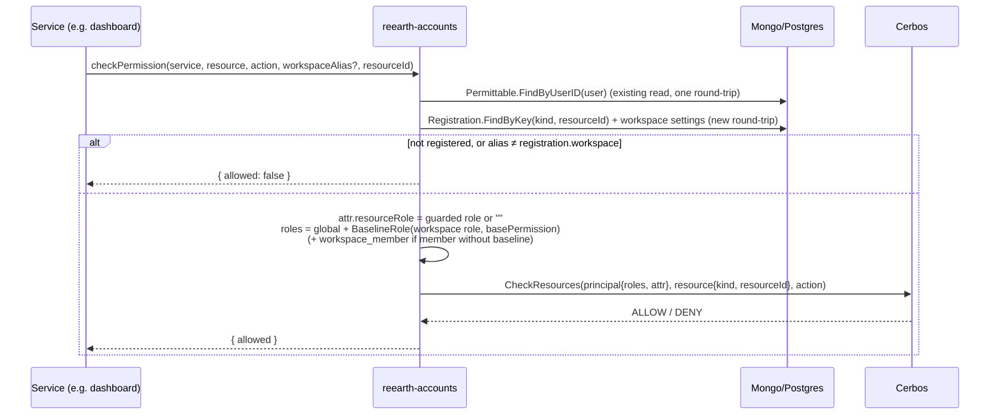
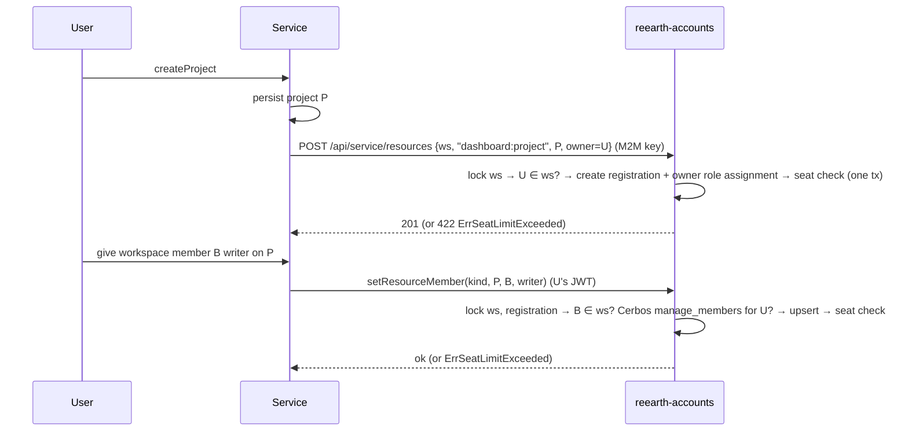
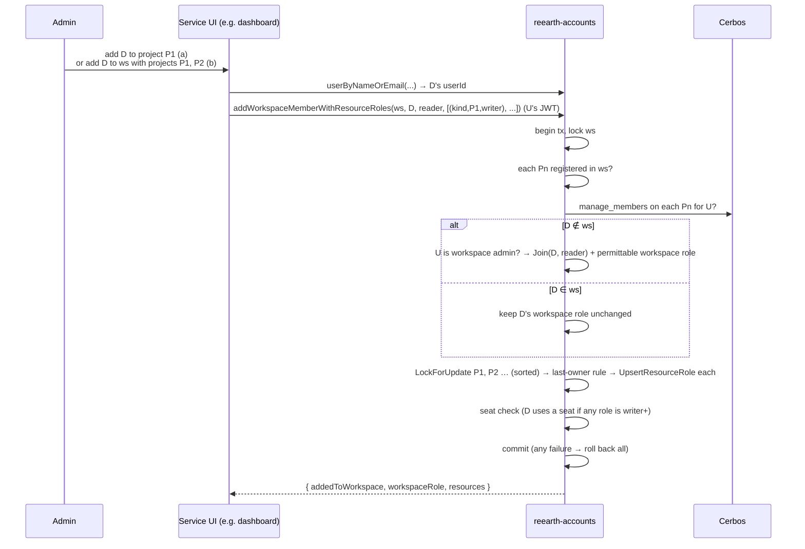
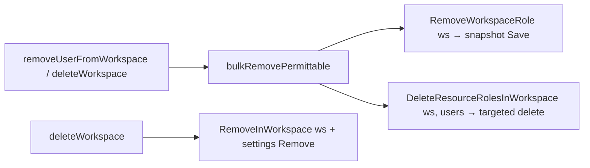
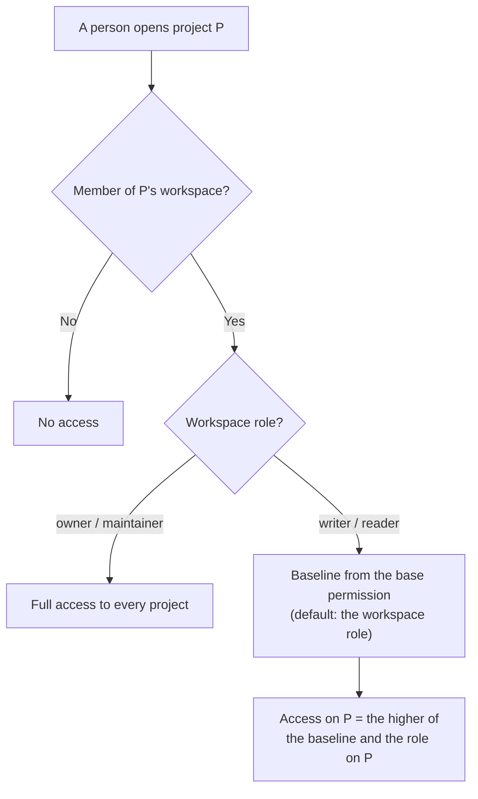
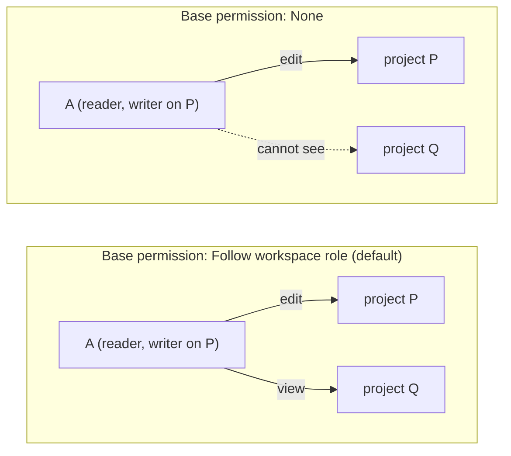

# Resource Role Assignment (Generic Per-Resource Membership)

> **Status: DRAFT.** Lets members and roles be set **per project** — and, more
> generally, per resource of any service — so that services (dashboard,
> visualizer, cms, …) can have project members without each building its own
> membership system, and **without reearth-accounts learning what a project
> is**. The first to use it is Dashboard projects. In code, a role assignment is
> represented by types and tables named `...Binding` / `resource_bindings`.
>
> Japanese version: [resource-role-binding.ja.md](resource-role-binding.ja.md)

## How to read this document

Sections from *Goals* onward include technical content. Please review in two
steps:

1. **Concept first.** Read *Background / Problem Statement* and check whether
   the concept feels right: does anything seem off, contradictory, or confusing
   for customers?
2. **Then technical adoption.** Read *Goals* and the sections after it, and
   check how difficult it would be to adopt this in each service (dashboard,
   visualizer, cms, flow) and what concerns you see. *Solution Options* holds
   the system design details and is for readers interested in the
   implementation.

## Document Signature

|           |                |
|-----------|----------------|
| Creator   | soneda-yuya    |
| Leader    | TBD            |
| Task Link | TBD            |
| Developer | TBD            |

## Background / Problem Statement

### Motivation (product context)

- While introducing SSO, we discussed whether users should be able to create
  workspaces freely, and there was a request to make workspace creation
  restrictable via an option. With that restriction, a single workspace would
  have to hold many projects.
  Why an organization using SSO wants to restrict workspace creation:
  - **Company data stays under the company's control.** If anyone can create a
    workspace, employees can put company projects and data in workspaces that
    the organization's administrators cannot see or manage.
  - **Leaving the company really cuts off access.** SSO / SCIM removes a
    departing employee from the organization's workspaces, but workspaces they
    created themselves stay outside that control, along with the data in them.
  - **Members are managed in one place.** Administrators want to manage who can
    access what in the organization's workspace, instead of chasing many
    workspaces created by individual employees.
- But restricting workspace creation raises a new problem. Today every member
  of a workspace sees every project in it, so once all employees work in one
  organization workspace, there is no way to keep teams from seeing each
  other's projects. The organization needs to decide, per project, who can see
  it — while everyone stays a member of the workspace, managed by SSO / SCIM.
- Today members can only be assigned per workspace, so customers manage members
  workspace by workspace — even though the people involved differ from project
  to project. When customers want to share a project across workspaces, they
  currently copy the project into the target workspace.
- Assigning members and permissions per project lets a workspace function as an
  organization. This is a separate feature from SSO / SCIM, but we want to make
  it implementable early so it is ready when workspace creation can be
  restricted.
- The intended model is close to GitHub's. A workspace relates to its projects
  the way a GitHub organization relates to its repositories:

  | GitHub | Re:Earth |
  |---|---|
  | Organization member | Workspace member |
  | Organization owner | Workspace owner / maintainer |
  | Organization base permission (applies to all members on every repository) | Workspace **base permission** |
  | Repository role | Project role |

  With the base permission set to "None", members see only the projects they
  were given a role on — this is how teams in one workspace are kept apart, and
  how a partner company's staff can be given just one project.

  For example, what a workspace reader can see depends on the base permission:

  | Base permission | Projects a workspace reader can see |
  |---|---|
  | Follow workspace role (default) | Can view every project (same as today's Re:Earth) |
  | Reader | Can view every project |
  | Writer | Can view and edit every project |
  | None | Only the projects where they have a project role |

  Under every setting, on a project where they have a project role, their
  access goes up to that role (e.g. writer on project P → can edit P).
- Differences from GitHub:

  | Aspect | GitHub | Re:Earth |
  |---|---|---|
  | People outside the organization / workspace | *Outside collaborators* (access to a repository without being an organization member) | None. **Every person with access is a workspace member**, so SSO / SCIM, seats, the member list and removal are all managed in one place |
  | Per-member roles | Everyone except owners is a "member"; no per-person writer / reader distinction | Workspace writer / reader stay and govern workspace-level actions (e.g. creating projects) |
  | Base permission values and default | Choose from none / read / write / admin, etc.; default is read | Adds "Follow workspace role" and makes it the default, so nothing changes unless an admin changes it |
  | Seats | Every member is billed | Only members who can **edit** at least one project use a seat; view-only people are free (extends today's Dashboard rule that readers do not use a seat) |

### Current situation

- Permissions across Re:Earth are decided by reearth-accounts. Each service
  (dashboard, visualizer, cms, ...) asks accounts "may this user perform this
  action?" before allowing it.
- A user's role is held **per workspace** (plus a few platform-wide roles).
  Joining a workspace gives the same role on every project in that workspace.
- A permission check therefore only knows *which workspace* the request is
  about, not *which project*. There is no way to say "user A can edit project P
  but not project Q" within the same workspace, and adding someone to a
  workspace always shows them every project in it.

### Problem

Products need **project-level membership**: "user A, a reader of the workspace,
is an editor of project P", "in this workspace, members see only the projects
they were added to, so team X cannot see team Y's projects", and "user B from a
partner company is added to the workspace but can work on project P only".
Today the finest granularity accounts can express is the workspace.

If each service implements project membership on its own:

1. Invite / role-change / remove APIs and UI are duplicated per service.
2. Each service must react to **workspace membership changes** (user removed from
   workspace, workspace deleted) to clean up its project members. Only accounts
   owns that information, so every service needs an event/sync path, and a miss
   leaves a user with access to a project in a workspace they have left.
3. "A project member must be a member of the workspace" cannot be validated
   locally by the service without calling accounts anyway.
4. Permission rules end up scattered across every service, instead of being
   decided in one place (accounts).

### Constraint (the reason for this design's shape)

Accounts must **not** take over what a *project* is. Whether a project exists,
its name, visibility, content and lifecycle stay with each service. Accounts
only keeps what it needs to decide permissions: "this project belongs to this
workspace, and this user has this role on it", plus each workspace's base
permission.

## Goals

1. **Members and roles can be set per project.** A workspace member can be
   given a role on a specific project, not only on the whole workspace. The
   model is:
   - **Workspace owners and maintainers** always have full access to every
     project in the workspace.
   - **Workspace writers and readers** get, on every project, a baseline set by
     the workspace's base permission (Goal 7). By default this is their
     workspace role, exactly as today. A project role can **raise** their access
     on that project (for example, a workspace reader who is a writer on project
     P can edit P), but never lower it.
2. **Permission checks look at the specific project.** When a service asks
   accounts "may this user do this?", the answer can take the user's role on
   that particular project into account. The check always uses the workspace
   the project really belongs to, so a caller cannot get access by naming a
   different workspace.
3. **Membership rules stay consistent.** A project always belongs to exactly
   one workspace, every project member is a member of that workspace, and once
   a project has an owner it never ends up with none — even when several people
   change members at the same time.
4. **Leaving a workspace removes project access.** When a user is removed from a
   workspace, their roles on every project in that workspace are removed
   automatically. Services do not need to clean this up themselves.
5. **Accounts stays generic.** Accounts does not know what a "project" is. Any
   service can use the same mechanism for its own resources (for example, a CMS
   model) just by adding a permission policy, with no change to accounts.
6. **Nothing existing breaks.** Current permission checks and policies keep
   working exactly as they do today. Existing workspace roles do not change,
   and the default base permission reproduces today's behavior.
7. **Each workspace has a base permission** (name tentative), like a GitHub
   organization's base permission. Its values are "Follow workspace role"
   (default — today's behavior), "None", "Reader" and "Writer". It decides what
   writers and readers of the workspace get on every project; owners and
   maintainers always have full access. Workspace owners and maintainers can
   change it, and the change takes effect immediately. "None" plus project roles
   is the way to give someone access to only some projects.
8. **Access to specific projects can be given in one step.** From the UI, an
   admin can add a person directly to a project — adding them to the workspace
   at the same time if needed — or, while adding a person to the workspace,
   choose which projects they get. Either way it is one step that either fully
   succeeds or changes nothing (see *Design → Adding people from the UI*).
9. **Seats follow edit access.** A workspace member uses a seat if they can
   edit at least one project in the workspace; people who can only view, or see
   nothing, do not. Accounts counts seats in one place for every service and
   for billing, and keeps a workspace within its seat limit whenever a change
   would make someone start using a seat (see *Design → Seats*).

## Non-Goals

1. **Storing project details in accounts.** Names, visibility, owners, dates and
   other information about a project stay in the service that owns it.
2. **Checking that a project really exists.** Accounts trusts the service that
   registers the project. Only services can register projects, not users.
3. **Noticing on its own when a project is deleted.** The service that owns the
   project must tell accounts when it is deleted.
4. **Nested resources and inherited permissions** (for example folder → project
   → layer). These could be added later through permission policies.
5. **Integrations as project members.** In the first version only people (user
   accounts) can be project members, not integrations or API tokens.
6. **Using project properties in permission decisions** (for example "public"
   or "private"). See *Open Questions*; the first version decides by roles and
   the base permission only.
7. **Sending invitation emails for project membership.** The email mentions the
   project's name, which accounts does not know, so the service sends it.

## Functional Requirements

1. **Permission checks stay fast.** Checks that do not name a project cost
   exactly the same as today. Checks that name a project add only one small,
   quick lookup (which workspace the project belongs to, together with that
   workspace's base permission); the user's project roles are read together
   with the data accounts already loads.
2. **Names and IDs have size limits.** The resource type name and the resource
   ID have a maximum length and a fixed set of allowed characters, so stored
   data stays small and predictable.
3. **Designed for realistic scale.** Up to about 1,000 project role assignments
   per user, and up to about 1,000 members per project.
4. **Listing a project's members is quick.** It returns only who the members are
   and their roles; names and other details come from the service.
5. **Works with every database accounts supports.** Membership changes behave
   the same whichever database a deployment uses.
6. **Services can tell what a person may list.** For a workspace, accounts can
   tell a service whether a person sees every project (and at what level) or
   only the projects where they have a project role, so lists can be filtered
   correctly whatever the base permission.
7. **Seat usage is available per workspace.** Accounts can quickly say how many
   members of a workspace use a seat (and who), so billing and every service
   use the same number.

Technical details: see *Solution Options → Option 1 → Detailed requirements*.

## Solution Options

This section describes the system design in detail and is intended for readers
interested in the implementation; the other sections can be read without it.

### Option 1 (Recommended): Resource registration + role assignments embedded in `Permittable`

Three pieces of state, all opaque to accounts:

| State | Purpose |
|---|---|
| **Resource registration** `(resourceKind, resourceID) → workspaceID, version` | Authoritative workspace scope of the resource; proof the owning service registered it; per-resource serialization point for invariants |
| **Resource role** on `Permittable` `(workspaceID, resourceKind, resourceID, roleID)` | The user's role on that resource; read together with the permittable for zero-read lookup |
| **Workspace resource settings** `workspaceID → basePermission, seatLimit, version` | The workspace's base permission and seat limit; also the per-workspace lock (serialization point for every change that can affect seat usage: the one-step add, workspace member and role changes, editing project roles, project registration, and base-permission changes) |

#### Domain

```go
// server/pkg/resource/registration.go (new package, no service-specific code)
type Registration struct {
    createdAt   time.Time
    kind        Kind   // validated per FR-3
    resourceID  ID     // validated per FR-3
    version     int64  // bumped by every membership mutation of this resource
    workspaceID workspace.ID
}

// server/pkg/permittable/permittable.go
type Permittable struct {
    id             ID
    resourceRoles  []ResourceRole // NEW
    roleIDs        []role.ID
    updatedAt      time.Time
    userID         user.ID
    workspaceRoles []WorkspaceRole
}

type ResourceRole struct {
    resourceID   resource.ID
    resourceKind resource.Kind
    roleID       role.ID
    workspaceID  workspace.ID // copied from the registration
}
```

`ResourceRole(kind, id)` returns the user's role on a resource **only if the
user still holds a workspace role in `workspaceID`** (read-time guard, see
*Concurrency*). One role per `(kind, id)` per user. No `switch` on `kind`
anywhere in accounts.

Roles reuse the existing `roles` table (`owner` / `maintainer` / `writer` /
`reader`). Their meaning per resource kind is defined solely by that kind's
Cerbos policy.

**Base permission.**

```go
// server/pkg/resource/settings.go
type BasePermission string

const (
    BaseFollowWorkspaceRole BasePermission = "follow_workspace_role" // default; also when no row exists
    BaseNone                BasePermission = "none"
    BaseReader              BasePermission = "reader"
    BaseWriter              BasePermission = "writer"
)

type WorkspaceSettings struct {
    basePermission BasePermission
    seatLimit      *int  // nil = unlimited; set by billing (M2M)
    version        int64 // bumped by every write and by Lock
    workspaceID    workspace.ID
}

// BaselineRole returns a member's baseline role on every resource of the workspace.
// ok == false means "no baseline" (the member only gets resource roles).
func BaselineRole(workspaceRole role.RoleType, base BasePermission) (r role.RoleType, ok bool)
```

| Workspace role | Follow workspace role | None | Reader | Writer |
|---|---|---|---|---|
| `owner` / `maintainer` | same role | same role | same role | same role |
| `writer` | `writer` | — | `reader` | `writer` |
| `reader` | `reader` | — | `reader` | `writer` |

The setting is stored in accounts, in its own per-workspace record rather than
on the workspace document: the existing workspace flows save the workspace as a
snapshot (Mongo replaces the whole document), so a field there could be
reverted by a concurrent, stale workspace save. A missing record means
"Follow workspace role", so no data migration is needed. Existing workspace
roles are not changed.

**Seats.**

```go
// server/pkg/resource/seat.go
var editRoles = []role.RoleType{role.RoleOwner, role.RoleMaintainer, role.RoleWriter}

// UsesSeat reports whether a member uses a seat in the workspace: workspace role
// owner / maintainer, or a baseline in editRoles, or any valid resource role in editRoles.
func UsesSeat(p *permittable.Permittable, ws workspace.ID, base BasePermission) bool
```

Seat usage of a workspace = the number of distinct members for which `UsesSeat`
is true. With "Follow workspace role" and no resource roles this equals today's
Dashboard count (`GetCurrentSeatStatus` in reearth-dashboard
`server/pkg/subscription/service.go`, which counts members whose role is not
`reader`).

The seat limit is owned by billing and pushed to accounts (`seatLimit`, `nil` =
unlimited, the same as "no subscription" today), so accounts can enforce it in
the same transaction as the change. The existing `enforceMemberCount` hook
(`WorkspaceMemberCountEnforcer`, not wired today) is replaced by this check.

**Seat check (`ensureSeats`).** Runs under the workspace lock, after the change
has been applied inside the transaction and before commit: if
`seatUsage(after) > seatUsage(before)` and `seatUsage(after) > seatLimit`, the
transaction is rolled back with `ErrSeatLimitExceeded`. Changes that do not
increase usage are always allowed, even if the workspace is already over its
limit (for example after billing lowered it). Operations that can turn a
non-seat member into a seat member, and therefore run the check:

| Operation | Can add a seat when |
|---|---|
| `setResourceMember` | the new role is writer or above |
| `addWorkspaceMemberWithResourceRoles` | the new member's workspace role or any of the given resource roles is writer or above, or the baseline allows editing |
| `updateWorkspaceBasePermission` | the new value raises any baseline to writer (e.g. to `Writer`, or from `None` / `Reader` to "Follow workspace role") |
| `addUsersToWorkspace` / `updateUserOfWorkspace` / `transferWorkspaceOwnership` | a member gets `writer`, `maintainer` or `owner` |
| `POST /api/service/resources` with `ownerUserId` (project creation) | the creator did not use a seat before |

#### Storage

**PostgreSQL** — migration `0005_resource_role_binding.up.sql`:

```sql
CREATE TABLE resource_registrations (
    resource_kind text NOT NULL CHECK (octet_length(resource_kind) <= 64),
    resource_id   text NOT NULL CHECK (octet_length(resource_id) <= 128),
    workspace_id  text NOT NULL,
    version       bigint NOT NULL DEFAULT 0,
    created_at    timestamptz NOT NULL DEFAULT now(),
    PRIMARY KEY (resource_kind, resource_id)
);
CREATE INDEX resource_registrations_workspace_idx
    ON resource_registrations (workspace_id);

CREATE TABLE permittable_resource_roles (
    permittable_id text NOT NULL REFERENCES permittables(id) ON DELETE CASCADE,
    resource_kind  text NOT NULL,
    resource_id    text NOT NULL,
    workspace_id   text NOT NULL,
    role_id        text NOT NULL,
    PRIMARY KEY (permittable_id, resource_kind, resource_id),
    FOREIGN KEY (resource_kind, resource_id)
        REFERENCES resource_registrations (resource_kind, resource_id) ON DELETE CASCADE
);
CREATE INDEX permittable_resource_roles_resource_idx
    ON permittable_resource_roles (resource_kind, resource_id);
CREATE INDEX permittable_resource_roles_workspace_idx
    ON permittable_resource_roles (workspace_id, permittable_id);

CREATE TABLE resource_workspace_settings (
    workspace_id    text PRIMARY KEY,
    base_permission text NOT NULL DEFAULT 'follow_workspace_role'
        CHECK (base_permission IN ('follow_workspace_role', 'none', 'reader', 'writer')),
    seat_limit      integer CHECK (seat_limit >= 0),   -- NULL = unlimited
    version         bigint NOT NULL DEFAULT 0
);
```

```sql
-- 0005_resource_role_binding.down.sql
DROP TABLE IF EXISTS resource_workspace_settings;
DROP TABLE IF EXISTS permittable_resource_roles;
DROP TABLE IF EXISTS resource_registrations;
```

**MongoDB**

- New collection `resource_registrations` with a unique index on
  `{ resource_kind: 1, resource_id: 1 }` and an index on `{ workspace_id: 1 }`
  (schema registered via `mongoschemagen`, migration added per
  `server/CLAUDE.md`).
- New optional array `resource_roles` on the permittable document, with indexes
  `{ "resource_roles.resource_kind": 1, "resource_roles.resource_id": 1 }` and
  `{ "resource_roles.workspace_id": 1 }`.
- New collection `resource_workspace_settings` (`_id` = workspace ID,
  `base_permission`, `seat_limit`, `version`).

#### Repository changes (targeted writes, never snapshot writes)

The existing snapshot `Save` / `SaveMany` must not be able to overwrite or
resurrect resource roles:

- **Mongo** `Permittable.Save` switches from document replacement to
  `$set` of `role_ids`, `workspace_roles`, `updated_at` only. `resource_roles`
  is written exclusively by the targeted operations below.
- **Postgres** `Permittable.Save` already only rewrites
  `permittable_workspace_roles`; it is left untouched for resource roles.
- **Postgres** `hydrate` is replaced by a single query returning the base row
  plus `json_agg` sub-selects of workspace roles and resource roles (FR-2).

New repository interfaces:

```go
// resource.RegistrationRepo
FindByKey(ctx, kind, id) (*resource.Registration, error)
Create(ctx, r resource.Registration) error              // ErrAlreadyExists on duplicate
LockForUpdate(ctx, kind, id) (*resource.Registration, error) // must run inside a transaction
Remove(ctx, kind, id) error                              // also removes all role assignments
RemoveInWorkspace(ctx, workspaceID) error                // all registrations + role assignments

// resource.WorkspaceSettingsRepo
Find(ctx, workspaceID) (*resource.WorkspaceSettings, error) // default settings when no row
Lock(ctx, workspaceID) (*resource.WorkspaceSettings, error) // must run inside a transaction; creates the row on first use
SetBasePermission(ctx, workspaceID, base resource.BasePermission) error // after Lock
SetSeatLimit(ctx, workspaceID, limit *int) error                       // after Lock
Remove(ctx, workspaceID) error

// permittable.Repo (additions)
FindResourceMembers(ctx, kind, id) ([]permittable.ResourceMember, error) // projection: userID + roleID
CountResourceOwners(ctx, kind, id, ownerRoleID) (int, error)
UpsertResourceRole(ctx, userID, r permittable.ResourceRole) error
DeleteResourceRole(ctx, userID, kind, id) error
DeleteResourceRolesInWorkspace(ctx, workspaceID, userIDs) error
FindSeatUsers(ctx, workspaceID, baselineEditRoles []role.ID, editRoles []role.ID) ([]user.ID, error)
```

| Operation | Mongo | Postgres |
|---|---|---|
| `UpsertResourceRole` | single-document update: `$pull` the `(kind,id)` element then `$push` the new one (one `updateOne` with an aggregation pipeline) | `INSERT … ON CONFLICT (permittable_id, resource_kind, resource_id) DO UPDATE SET role_id = …` |
| `DeleteResourceRole` | `$pull` | `DELETE … WHERE permittable_id=$1 AND resource_kind=$2 AND resource_id=$3` |
| `DeleteResourceRolesInWorkspace` | `updateMany` + `$pull {workspace_id}` | `DELETE … WHERE workspace_id=$1 AND permittable_id = ANY($2)` |
| `FindResourceMembers` | aggregation `$match` → `$unwind` → `$match` → `$project {user_id, role_id}` | `SELECT p.user_id, r.role_id FROM permittable_resource_roles r JOIN permittables p …` |
| `LockForUpdate` | in a transaction: `findOneAndUpdate {$inc: {version: 1}}` (concurrent transactions on the same registration hit a write conflict and are retried) | `SELECT … FOR UPDATE` |
| `WorkspaceSettings.Lock` | in a transaction: `findOneAndUpdate {_id: ws} {$inc: {version: 1}}, upsert` (write conflict → retry) | `INSERT … ON CONFLICT DO NOTHING` then `SELECT … FOR UPDATE` |
| `FindSeatUsers` | aggregation on `permittables`: `$match` users with a workspace role in `ws` and (`workspace_roles` role ∈ baseline-edit roles **or** `resource_roles` `$elemMatch {workspace_id: ws, role_id ∈ edit roles}`) → `$project user_id` | `SELECT DISTINCT p.user_id FROM permittables p JOIN permittable_workspace_roles w … WHERE w.workspace_id=$1 AND (w.role_id = ANY($2) OR EXISTS (SELECT 1 FROM permittable_resource_roles r WHERE r.permittable_id = p.id AND r.workspace_id=$1 AND r.role_id = ANY($3)))` |
| Registration + settings for `checkPermission` | one aggregation on `resource_registrations`: `$match` by key → `$lookup` `resource_workspace_settings` by `workspace_id` | one query: `SELECT r.*, s.base_permission FROM resource_registrations r LEFT JOIN resource_workspace_settings s USING (workspace_id) WHERE …` |

#### Authorization check

`CheckPermissionInput` gains one optional field:

```graphql
input CheckPermissionInput {
  service: String!
  resource: String!
  action: String!
  workspaceAlias: String
  resourceId: String   # NEW
}
```

When `resourceId` is **absent**, behavior is unchanged — whatever the base
permission. Principal roles are the actual workspace roles, as today.

When `resourceId` is **present**:

1. Load the registration `(service:resource, resourceId)` together with its
   workspace's settings (one round-trip). **Not found → deny.**
2. If `workspaceAlias` is given and does not resolve to the registration's
   `workspaceID` → **deny**.
3. Principal roles = global roles + the user's **baseline role**
   `BaselineRole(workspace role, basePermission)` **in the registration's
   `workspaceID`** (the caller cannot choose the workspace). With "Follow
   workspace role" the baseline is the workspace role, so the roles are exactly
   what they would be today. When a workspace member has no baseline (`None`
   for a `writer` / `reader`), the evaluation-only role `workspace_member` is
   added instead (never stored; it gives Cerbos a non-empty role list and lets
   a policy recognize the case). A user with no workspace role in that
   workspace gets neither, and so is denied.
4. Principal attributes: `resourceRole` = the user's role on this resource after
   the read-time guard, or `""` if none; `workspaceRole` = the actual workspace
   role (or `""`), for policies that need it.
5. The Cerbos resource ID is the real `resourceId`.

**Default model.** Effective role on a resource = max(baseline role, resource
role). Workspace `owner` / `maintainer` always have a full baseline. For
`writer` / `reader` the baseline comes from the base permission; with `None`
they reach a resource only through a resource role. Each role means the same at
both levels (`owner` / `maintainer`: full control and member management;
`writer`: read and edit; `reader`: read), so a policy implements "max" as the
union of a role-list rule (now evaluated against the baseline role) and a
`resourceRole`-condition rule per action — Cerbos allows if either matches.
Because accounts substitutes the baseline into the principal roles, existing
role-list rules need no change: they automatically follow the base permission
for checks with a `resourceId` and keep using the actual workspace role for
checks without one.

Policies stay in each service's `definition.go`, using the conditions the
reearthx generator already supports. Example for `dashboard:project`:

```go
// dashboard: definition.go
resourceRole := func(expr string) *generator.Condition { return generator.SimpleExpr(expr) }
any := []string{"*"} // any principal role (incl. workspace_member); the condition does the gating

builder.AddResource("project", []generator.ActionDefinition{
    // baseline: with a resourceId these roles are the member's baseline role (workspace role + base permission)
    // ("workspace_member" is never listed here)
    generator.NewActionDefinition("read", []string{"owner", "maintainer", "writer", "reader"}),
    generator.NewActionDefinition("edit", []string{"owner", "maintainer", "writer"}),
    generator.NewActionDefinition("delete", []string{"owner", "maintainer"}),
    generator.NewActionDefinition("manage_members", []string{"owner", "maintainer"}),
    // project roles: add on top of the baseline; the only source of access without a baseline
    generator.NewActionDefinitionWithCondition("read", any, resourceRole(`P.attr.resourceRole != ""`)),
    generator.NewActionDefinitionWithCondition("edit", any, resourceRole(`P.attr.resourceRole in ["owner", "maintainer", "writer"]`)),
    generator.NewActionDefinitionWithCondition("delete", any, resourceRole(`P.attr.resourceRole in ["owner", "maintainer"]`)),
    generator.NewActionDefinitionWithCondition("manage_members", any, resourceRole(`P.attr.resourceRole in ["owner", "maintainer"]`)),
})
```

Because resource roles arrive as a principal **attribute**, not as principal
roles, a project `owner` is never mistaken for a workspace `owner`: a project
role counts only for the resource named in the check. Per-project visibility on
top of the base permission (e.g. a "visible to all members" project) is Open
Question 1.

**Policy note for members without a baseline.** Policies must grant
`workspace_member` nothing except through `P.attr.resourceRole` conditions.
Rules keyed to explicit role lists already exclude it (fail-closed). Rules that
grant on `*` without a `resourceRole` condition must be reviewed per service.
Workspace-level resources (e.g. `dashboard:workspace`, "create project", "list
projects") are checked without a `resourceId`, so they keep using the actual
workspace role: under `None` a workspace writer can still create a project (and
becomes its owner) and may call a list endpoint — **the service must filter the
list** (see *Listing what a user may see*).

**Listing what a user may see.** A list screen cannot call `checkPermission`
for every resource (Open Question 2). Services ask once per workspace:

```graphql
type ResourceAccess {
  workspaceId: ID!
  baselineRole: Role        # null = no baseline: only the bindings below are visible
  bindings: [ResourceBinding!]!
}
extend type Query {
  myResourceAccess(workspaceId: ID!, resourceKind: String!): ResourceAccess!
}
```

If `baselineRole` is set, the user sees every resource of the kind in the
workspace at least at that level; otherwise (a member under `None`) the service
lists only `bindings`.

#### Membership management API

**Lifecycle (M2M only)** — REST service routes, authenticated **only** by the
M2M API key (a user JWT is rejected). Registration is how accounts learns that a
resource exists and which workspace it belongs to; restricting it to services
removes any way for a user to claim an unregistered ID.

```
POST   /api/service/resources
       { workspaceId, resourceKind, resourceId, ownerUserId? }
       → creates the registration and, if ownerUserId is given, an `owner`
         role assignment, in one transaction under the workspace lock.
         ownerUserId must be a workspace member; seat check (the creator may
         start using a seat) → 422 ErrSeatLimitExceeded.
         409 if already registered with a different workspace; idempotent
         (200) if registered with the same workspace.
DELETE /api/service/resources/{resourceKind}/{resourceId}
       → removes the registration and every role assignment on the resource.
PUT    /api/service/workspaces/{workspaceId}/seat-limit
       { seatLimit: int | null }
       → billing sets the workspace's seat limit (null = unlimited). Lowering
         it below current usage is accepted; it only blocks further increases.
GET    /api/service/workspaces/{workspaceId}/seat-usage
       → { seatCount, seatLimit, seatUserIds } for billing.
```

**Membership and settings (user JWT, GraphQL)**:

```graphql
enum BasePermission { FOLLOW_WORKSPACE_ROLE NONE READER WRITER }

extend type Workspace {
  basePermission: BasePermission!   # FOLLOW_WORKSPACE_ROLE when never set
}

input SetResourceMemberInput {
  resourceKind: String!
  resourceId: String!
  userId: ID!
  role: Role!
}
input RemoveResourceMemberInput {
  resourceKind: String!
  resourceId: String!
  userId: ID!
}
input ResourceRoleInput {
  resourceKind: String!
  resourceId: String!
  role: Role!
}
input AddWorkspaceMemberWithResourceRolesInput {
  workspaceId: ID!
  userId: ID!
  workspaceRole: Role               # used only if the user is not yet a member; default reader; not owner
  resources: [ResourceRoleInput!]!  # 0..100 entries, distinct (kind, id)
}
input UpdateWorkspaceBasePermissionInput {
  workspaceId: ID!
  basePermission: BasePermission!
}

type ResourceMember { userId: ID!, role: Role! }
type ResourceBinding { workspaceId: ID!, resourceKind: String!, resourceId: String!, role: Role! }
type AddWorkspaceMemberWithResourceRolesPayload {
  addedToWorkspace: Boolean!        # false if the user was already a member
  workspaceRole: Role!              # the user's workspace role after the call
  resources: [ResourceBinding!]!
}
type WorkspaceSeatUsage {
  workspaceId: ID!
  seatCount: Int!                   # distinct members for which UsesSeat is true
  seatLimit: Int                    # null = unlimited
  seatUserIds: [ID!]!
}

extend type Query {
  resourceMembers(resourceKind: String!, resourceId: String!): [ResourceMember!]!
  # IDs only; the owning service hydrates names etc.
  myResourceBindings(resourceKind: String!, workspaceId: ID): [ResourceBinding!]!
  myResourceAccess(workspaceId: ID!, resourceKind: String!): ResourceAccess!
  workspaceSeatUsage(workspaceId: ID!): WorkspaceSeatUsage!
}

extend type Mutation {
  setResourceMember(input: SetResourceMemberInput!): ResourceMember
  removeResourceMember(input: RemoveResourceMemberInput!): Boolean!
  addWorkspaceMemberWithResourceRoles(
    input: AddWorkspaceMemberWithResourceRolesInput!
  ): AddWorkspaceMemberWithResourceRolesPayload
  updateWorkspaceBasePermission(input: UpdateWorkspaceBasePermissionInput!): Workspace
}
```

The user is identified by user ID, as in `addUsersToWorkspace`; the UI finds
them by name or email with the existing user lookup (`userByNameOrEmail` /
`searchUser`). No new email-based invitation is introduced.

"Workspace admin" below means the operator passes the existing workspace
check used by `addUsersToWorkspace` (`add_member`, i.e. workspace owner or
maintainer).

Guards (generic, no kind-specific code). Every mutation runs in **one
transaction**; locks are taken in a fixed order — workspace lock
(`WorkspaceSettings.Lock`) first where needed, then registrations sorted by
`(kind, id)` — and guards are evaluated after the locks:

| Operation | Locks | Guard |
|---|---|---|
| `setResourceMember` | workspace lock, then the registration | registration exists; target user is a member of the registration's workspace (else `ErrNotWorkspaceMember` — use `addWorkspaceMemberWithResourceRoles`); Cerbos allows `manage_members` on `(kind, id)` for the operator; if the change downgrades the last `owner`, reject; seat check |
| `removeResourceMember` | the registration | Cerbos `manage_members`, or operator == target (self-leave); if it removes the last `owner`, reject |
| `addWorkspaceMemberWithResourceRoles` | workspace lock, then each registration | every registration exists and belongs to `workspaceId` (else the whole call is rejected); Cerbos allows `manage_members` on each for the operator. If the user is **not yet a member**: operator is a workspace admin (v1, Open Question 7); personal workspace rejected; `workspaceRole` (default `reader`) is not `owner`, as in `addUsersToWorkspace`; then `Members().Join` and the permittable workspace role via the existing `bulkUpdatePermittable` path. If the user **is already a member**: workspace membership and role are left unchanged — never downgraded (`workspaceRole` is ignored). Then the last-owner rule per resource, `UpsertResourceRole` for each entry, and the seat check. Any failure rolls everything back |
| `updateWorkspaceBasePermission` | workspace lock | operator passes the existing workspace `manage` check (owner / maintainer); personal workspace rejected (v1, Open Question 9); then `SetBasePermission` and the seat check. Takes effect on the next `checkPermission` — nothing else is rewritten |
| `workspaceSeatUsage` | — | operator may read workspace members (`read_member`); the `seat-usage` route is M2M only |
| `resourceMembers` | — | Cerbos `read` on `(kind, id)`; result filtered by the read-time guard |
| `myResourceBindings` | — | operator's own role assignments only, filtered by the read-time guard |
| `myResourceAccess` | — | operator's own access only; `baselineRole` from `BaselineRole(...)`, `bindings` filtered by the read-time guard |
| `Workspace.basePermission` | — | anyone who can read the workspace (`read`) |

**Last-owner rule:** a membership mutation that would take the owner count of a
resource from ≥ 1 to 0 is rejected. A resource registered without an owner (e.g.
backfill) is managed by workspace roles until an owner is set. The unregister
endpoint is exempt.

Removing a user's last resource role (`removeResourceMember`) does **not**
remove them from the workspace (Open Question 8).

**Changes to existing workspace flows** (all take the workspace lock first, so
they serialize with the one-step add and with each other's seat checks):

- `addUsersToWorkspace`, `updateUserOfWorkspace`,
  `transferWorkspaceOwnership`: run the seat check (a member given `writer`,
  `maintainer` or `owner` may start using a seat).
- `removeUserFromWorkspace` / `removeMultipleUsersFromWorkspace`: also delete
  the users' role assignments in the workspace (`DeleteResourceRolesInWorkspace`).
- `deleteWorkspace` (`Workspace.Remove`): `RemoveInWorkspace(ws)` removes all
  registrations and role assignments of the workspace, and
  `WorkspaceSettings.Remove(ws)` removes its settings.

#### Concurrency

| Race | Mitigation |
|---|---|
| Two writers on different users of the same resource both pass the last-owner check | Both must take `LockForUpdate` on the same registration; the second waits (Postgres) or conflicts and retries (Mongo). The owner count is read after the lock. |
| Two services register the same `(kind, id)` | Primary key / unique index; the loser gets `ErrAlreadyExists`. |
| `setResourceMember` passes the workspace-membership check, then the user is removed from the workspace and the cascade runs before the role assignment is written | **Read-time guard**: a role assignment is honored only if the user currently holds a workspace role in the role assignment's workspace. The permittable is already loaded, so this costs no read. The orphaned row is harmless and is removed the next time the cascade or the unregister endpoint touches it. |
| A stale snapshot `Save` from the workspace flow overwrites a newer role assignment (or vice versa) | Snapshot saves never write `resource_roles`; role-assignment writes never write `workspace_roles` (see *Repository changes*). |
| Two admins add the same new person with `addWorkspaceMemberWithResourceRoles` at once (possibly with different projects) | Both take the workspace lock; the second waits / retries, then sees an existing member and only adds its role assignments. The workspace role is not changed and the seat is counted once. |
| Two admins make two different people start using a seat (new members, editing project roles, workspace role changes, project creation) when one seat is left | Every such operation takes the workspace lock and computes seat usage inside the transaction, so exactly one succeeds. |
| The base permission is raised while someone is given an editing project role | Both take the workspace lock; the second computes usage including the first. |
| A user is removed from the workspace while a one-step add for them runs | Both take the workspace lock. If the removal commits second, its cascade deletes the new role assignments; if first, the add treats the user as new (admin check, seat limit). The read-time guard covers any remaining gap. |
| Two multi-resource calls on overlapping resources deadlock | Fixed lock order: workspace lock, then registrations sorted by `(kind, id)`. |
| Two admins change the base permission at once, or a change races a workspace save | The setting lives in its own record and is written under the workspace lock; the last committed value wins, and no workspace snapshot `Save` can revert it. |
| A permission check runs while the base permission changes | The check reads the setting in the same round-trip as the registration, so it sees either the old or the new value; the next check sees the new one. Accounts does not cache the setting. Services that cache `checkPermission` / `myResourceAccess` results see the change after their cache TTL, so such caches must be short (or invalidated on change). |

#### Lifecycle and cascades

| Event | Who acts | Effect on role assignments |
|---|---|---|
| Resource created | Service (M2M) | `POST /api/service/resources` with `ownerUserId` = creator |
| Resource deleted | Service (M2M) | `DELETE /api/service/resources/{kind}/{id}`; members whose only editing role was on it stop using a seat. A missed call leaves an orphan registration — harmless (the resource no longer exists in the service) except that its editing roles still count as seats; cleaned by an optional sweeper later |
| Existing resources (pre-feature) | Service (M2M) | One-off backfill via the same endpoint (idempotent), before the service starts sending `resourceId` |
| Person added with `addWorkspaceMemberWithResourceRoles` | Accounts | Workspace membership (if new) and role assignments written in one transaction |
| A member's last role assignment in a workspace removed | Accounts | Only that role assignment is removed; workspace membership stays (the seat is freed if they can no longer edit anything) |
| Seat limit changed | Billing (M2M) | None; only future increases are checked against the new limit |
| User removed from workspace | Accounts | `bulkRemovePermittable` also calls `DeleteResourceRolesInWorkspace` |
| Workspace deleted (`Workspace.Remove`) | Accounts | `RemoveInWorkspace(ws)`: all registrations and role assignments of the workspace; the settings record is removed |
| Workspace deactivated / restored | Accounts | No change (mirrors workspace roles; data kept for restore) |
| Base permission changed | Accounts | None: role assignments are untouched; only the baseline derived at check time changes |
| User deleted (`DeleteMe`) | Accounts | Today `DeleteMe` does not delete the permittable. Role assignments are unreachable once the user is gone; deleting the permittable on `DeleteMe` is proposed as a follow-up fix (independent of this feature) |

**Pros**

- Workspace scope of a resource is authoritative and server-side, so a caller
  cannot borrow roles from another workspace.
- Only M2M-authenticated services can make a resource exist in accounts, so
  users cannot claim IDs.
- Resource-wide invariants are serialized on one record per resource, and
  workspace-wide decisions (one-step add, seats, base permission) on one record
  per workspace, on both backends.
- Role-assignment lookup stays inside the already-loaded permittable; the only
  new read is a primary-key lookup of the registration joined with the
  workspace settings.
- Everyone with access is a workspace member, so SSO / SCIM and removal keep
  working through the existing member flows, and seats are counted and
  enforced in one place, in the same transaction as the change.
- Accounts remains domain-agnostic: opaque kind/ID, semantics in policies.

**Cons**

- One extra round-trip for `checkPermission` calls that pass `resourceId`.
- Services must register resources (including a backfill) and unregister on delete.
- Mongo `Save` semantics change from replace to `$set` (touches existing code).
- Existing workspace member flows must take the workspace lock and run the seat
  check; billing must push seat limits to accounts.
- Under a base permission other than the default, services must filter lists
  with `myResourceAccess` instead of assuming workspace writers / readers see
  everything.

#### Detailed requirements

The technical form of *Functional Requirements*. The items are FR-1 to FR-8 in
order; other parts of this section refer to them by those numbers.

1. `checkPermission` without `resourceId`: **no change** in reads or in
   principal roles. With `resourceId`: **one additional round-trip** — the
   resource registration by primary key, joined with the workspace's settings
   by primary key (Postgres `LEFT JOIN`, Mongo `$lookup`). The role assignment
   itself is read from the already-loaded permittable.
2. On PostgreSQL, `Permittable.FindByUserID` loads the base row, workspace roles
   and resource roles in **one round-trip** (aggregated sub-selects), so adding
   resource roles does not add a query to `checkPermission`.
3. Field limits, enforced in the domain layer and as DB constraints:
   - `resourceKind`: ≤ 64 bytes, `^[a-z0-9-]{1,32}:[a-z0-9_-]{1,31}$`
   - `resourceID`: ≤ 128 bytes, `^[A-Za-z0-9_.:-]{1,128}$`
4. Expected scale: ≤ ~1,000 role assignments per user (≤ ~300 B each with the limits
   above, i.e. ≤ ~300 KB per Mongo document, well under 16 MB) and ≤ ~1,000
   members per resource.
5. Listing members of one resource is index-backed and returns only
   `(userId, role)` for that resource — it never hydrates whole aggregates.
6. All mutations work on both MongoDB and PostgreSQL backends and in the
   `memory` repo.
7. `myResourceAccess(ws, kind)` costs the already-loaded permittable plus one
   point read of the workspace's settings.
8. `workspaceSeatUsage(ws)` / the seat check is one index-backed query
   (`FindSeatUsers`, using the `workspace_id` indexes on workspace roles and
   resource roles) plus the settings record; it never loads whole workspaces.

Scope notes (technical form of *Non-Goals*):

- Resource existence is not validated. Accounts trusts the
  **M2M-authenticated** service that registers a resource, and relies on that
  service to call the unregister endpoint when the resource is deleted (see
  *Lifecycle and cascades*).
- v1 role assignments are for **user principals only**; integration (M2M)
  principals cannot hold resource roles.
- v1 `checkPermission` passes no resource attributes (e.g. `visibility`) to
  Cerbos; policies use roles only (see *Technical notes on open questions*).

#### Request flows (sequence diagrams)

##### Permission check with a resource ID



##### Project creation and adding a workspace member to it



##### Adding a person from the UI in one step (patterns a and b)

Pattern (a) passes one resource (the project being viewed); pattern (b) passes
the projects chosen in the workspace "add member" dialog. Both call the same
mutation.



##### Workspace member removal cascade



#### Technical notes: impact, tests, deployment, rollback, monitoring

##### Impact

1. **Permittable document/row size** grows by ≤ ~300 B per role assignment.
2. **Mongo `Permittable.Save`** changes from replace to `$set`; existing tests
   for permittable persistence must still pass, and a new test verifies that
   `Save` leaves `resource_roles` untouched.
3. **Cerbos resource ID change** when `resourceId` is passed: only callers that
   opt in are affected.
4. **Existing workspace member flows** take the workspace lock; member removal
   issues one additional targeted delete.
5. **Policy authoring**: role names are shared between workspace and resource
   scopes. A resource role must be checked only through `P.attr.resourceRole`
   (never as a principal role); role-list rules are evaluated against the
   baseline role when a `resourceId` is given, and `workspace_member` is never
   listed in them. Existing project policies of a service must be extended with
   the `resourceRole` rules (union = max), not replaced.
6. **gqlclient** (`server/pkg/gqlclient`) consumers need a version bump to use
   the new fields; old clients are unaffected (the workspace member list and
   the `Role` enum do not change).
7. **Base permission and lists**: services must not assume that a workspace
   `writer` / `reader` sees every resource; list endpoints use
   `myResourceAccess` and filter to `bindings` when `baselineRole` is null.
   Checks with a `resourceId` already follow the setting.
8. **Base permission UI**: the workspace settings screen shows and edits
   `Workspace.basePermission` (owners / maintainers only).
9. **Dashboard seat logic moves to accounts**: `GetCurrentSeatStatus` /
   `TempGetCurrentSeatStatus` (count of non-reader members) and the
   `IsOverUsedSeat` guard on project create / update / delete in reearth-dashboard
   `server/pkg/subscription/service.go` must use `workspaceSeatUsage` /
   `seat-usage` instead of counting members. Billing pushes `seatLimit` with
   `PUT /api/service/workspaces/{id}/seat-limit` whenever a subscription
   changes.
10. **New refusals**: `setResourceMember`, `addWorkspaceMemberWithResourceRoles`,
    `updateWorkspaceBasePermission`, `addUsersToWorkspace`,
    `updateUserOfWorkspace`, `transferWorkspaceOwnership` and project
    registration can return `ErrSeatLimitExceeded`; every caller must show a
    clear message.

##### Tests

1. **Unit** (`pkg/resource`, `pkg/permittable`): kind/ID validation and length
   limits; one role per resource; read-time guard drops role assignments without
   a matching workspace role; `BaselineRole` for every cell of the table above
   (a missing settings record = "Follow workspace role"); `UsesSeat` for each
   workspace role × base permission × resource-role combination.
2. **Interactor** (`internal/usecase/interactor`):
   - `CheckPermission`: no `resourceId` → unchanged roles whatever the setting
     (regression); unregistered resource → deny; alias of another workspace →
     deny; workspace roles taken from the registration, not the alias;
     `resourceRole` set/empty; with a `resourceId`, principal roles equal the
     baseline (`workspace_member` when none) for each base permission; a user
     with no workspace role → deny even with a stale role assignment.
   - Register: M2M only (JWT rejected); owner must be a workspace member;
     duplicate with same workspace is idempotent, different workspace is 409.
   - `setResourceMember` / `removeResourceMember`: non-member target rejected;
     denied without `manage_members`; self-leave allowed; last-owner
     protection; removing the last role assignment keeps workspace membership.
   - `addWorkspaceMemberWithResourceRoles`: a non-member joins with the given
     (default `reader`) workspace role and gets every role assignment; an
     existing member keeps their workspace role (no downgrade) and only gains
     role assignments; a resource from another workspace, an unregistered
     resource, a missing `manage_members`, a non-admin operator for a new
     person, `owner` as workspace role, a personal workspace, or the seat limit
     → whole call rejected with no membership and no role assignment left
     behind; last-owner rule applied.
   - `updateWorkspaceBasePermission`: owner / maintainer only; personal
     workspace rejected; the next check uses the new value.
   - `myResourceAccess`: `baselineRole` per setting and workspace role; null
     for a member under `None`.
   - `workspaceSeatUsage`: equals the old Dashboard count with the default
     setting and no resource roles; counts a reader with a writer resource role
     once however many such roles; excludes writers under `None` with only
     reader resource roles.
   - Seat check: with the limit reached, each operation in the *Seat check*
     table is rejected with `ErrSeatLimitExceeded` and leaves nothing behind;
     the same operation succeeds when it does not add a seat; seat-freeing
     operations succeed while over the limit; `seatLimit = null` never blocks.
   - Cascades: `RemoveUserMember` / `RemoveMultipleUserMembers` / `Remove`.
3. **Concurrency** (`make test-integration`, both backends): two goroutines
   removing the last two owners concurrently → exactly one succeeds; concurrent
   registrations of the same key → one succeeds; stale snapshot `Save` after
   `UpsertResourceRole` keeps the role assignment; two concurrent one-step adds
   of the same new person → joined once, both sets of role assignments present;
   two concurrent seat-adding operations of different kinds (one-step add,
   `setResourceMember` writer, project registration, base permission to
   `Writer`) with one seat left → exactly one succeeds.
4. **Repository**: Mongo, Postgres and memory implementations of every new
   operation; Postgres `FindByUserID` issues a single query.
5. **Migration**: `0005` up/down on an existing DB; existing permittables load
   with empty `resourceRoles`; workspaces without a settings record read as
   "Follow workspace role".
6. **E2E** (`server/e2e`): a `dashboard:project` test policy generated with the
   rules above; verify:
   - workspace `reader` without a role assignment → `read` allowed, `edit`
     denied, on every project of the workspace;
   - workspace `reader` + resource `writer` on P → `edit` allowed on P only;
   - workspace `writer` + resource `reader` on P → `edit` still allowed on P
     (a resource role never lowers access);
   - workspace `owner` → every action on every project;
   - user from another workspace → denied;
   - base permission `None`: workspace `reader` / `writer` without a role
     assignment → denied on every project; with resource `writer` on P →
     `read` / `edit` on P only; workspace `maintainer` → every action on every
     project;
   - base permission `Writer`: workspace `reader` → `edit` allowed on every
     project; base permission `Reader`: workspace `writer` → `edit` denied
     unless a resource role allows it.

##### Deployment

1. Backward compatible? **Yes.** New optional input field, new
   collections/tables, new routes and GraphQL fields and enum. Behavior is
   unchanged when `resourceId` is absent; the workspace member list and roles
   are unchanged.
2. Partial deployment? **Yes.** Order:
   1. Deploy accounts. With no `seatLimit` set, the seat check never blocks.
   2. Billing pushes `seatLimit` for every workspace; Dashboard switches
      `GetCurrentSeatStatus` / `IsOverUsedSeat` to `seat-usage`. Before the
      switch, compare `seatCount` with Dashboard's count for every workspace —
      with the default setting and no resource roles they are identical.
   3. Each service backfills registrations for existing resources (without
      `ownerUserId` for existing projects, so the backfill adds no seats).
   4. Each service starts registering on create / unregistering on delete.
   5. Each service deploys policies using `P.attr.resourceRole` and starts
      sending `resourceId`. Before step 5 the attribute is absent and conditions
      never match (fail-closed).
   6. Enable the UI for the one-step add.
   7. Services filter lists with `myResourceAccess`; only then enable the UI
      that changes the base permission. Until a workspace changes it, every
      workspace is "Follow workspace role", so steps 1–6 change nobody's access
      or seat count (apart from new editing project roles and new projects).
3. Notify: dashboard / visualizer / cms owners; billing owner; whoever maintains
   Cerbos policies.
4. Config changes: none (reuses the existing M2M API key).
5. DDL: Postgres migration `0005` runs automatically at startup (golang-migrate).
   Mongo: collection schema + indexes via the startup migration; no backfill in accounts.

##### Rollback

1. Notify the cause in the team Slack channel.
2. Disable the one-step-add and base-permission UIs, then revert consumer
   services / policies that rely on `resourceId` / `resourceRole`. **Access
   widens** for workspaces whose base permission is not the default: the old
   version has no base permission, so their writers / readers see every project
   again. List those workspaces
   (`base_permission <> 'follow_workspace_role'`) and inform their admins before
   rolling back; prefer a fix-forward if any of them depend on `None`. Switch
   Dashboard's seat status back to its own member count; seat usage may jump
   for readers whose seats came from resource roles (they stop counting) and
   for workspaces on `None` (writers count again).
3. Roll back the accounts image. The old binary ignores the new collections,
   tables and `resource_roles` field, so **no data rollback is required**.
   Note: the old Mongo `Save` replaces the whole document and will drop
   `resource_roles` of any permittable it writes — acceptable during rollback,
   since the feature is disabled; services re-run the backfill on roll-forward.
   People added with the one-step add stay workspace members.
4. Only if the schema itself must be removed: run `0005` down (drops
   registrations, role assignments and workspace settings, including base
   permissions — take a dump first).

##### Post-deployment checks and monitoring

- Checklist
  - Create a project in dashboard staging; verify the registration and the
    creator's `owner` role assignment.
  - Give a workspace `reader` the resource role `writer` on a project; verify
    they can edit that project and still only read the others. Remove them from
    the workspace; verify all project access is lost.
  - Call `checkPermission` with the alias of another workspace; verify deny.
  - Before switching Dashboard, verify `seatCount` equals Dashboard's current
    count for every workspace.
  - `addWorkspaceMemberWithResourceRoles` for a user outside the workspace with
    `writer` on a project; verify they become a `reader` member with that role
    and appear in `seatUserIds`. With `reader` on the project instead, verify
    they do not.
  - With `seatCount == seatLimit`, `setResourceMember(writer)` for a reader;
    verify `ErrSeatLimitExceeded` and no change.
  - Verify that workspaces without a settings record report
    `FOLLOW_WORKSPACE_ROLE` and that checks for their members are unchanged.
  - `updateWorkspaceBasePermission(NONE)` on a staging workspace; verify a
    `reader` without resource roles is denied on every project,
    `myResourceAccess` returns `baselineRole: null`, a `maintainer` still has
    full access, and switching back restores access on the next check.
- Metrics
  - `checkPermission` p50/p95 latency with and without `resourceId`.
  - Error rate of register / unregister / `setResourceMember` /
    `addWorkspaceMemberWithResourceRoles` / `updateWorkspaceBasePermission`,
    including Mongo transaction retries and seat-limit rejections.
  - Count of role assignments per permittable (max / p99) to watch FR-4.
  - `ErrSeatLimitExceeded` count per operation and workspace; `workspaceSeatUsage`
    latency.
- Alerting
  - `checkPermission` error rate: Warning > 1%, Danger ≥ 5%.
  - `checkPermission` p95 latency: Warning > +20% vs baseline.

#### Technical notes on open questions

1. **Per-project visibility:** restricting members is done with the base
   permission. If a project must be visible to the whole workspace even under
   `None`, the proposal is an optional `attributes: JSON` on
   `CheckPermissionInput`, passed through to the Cerbos resource (e.g.
   `visibility`), and a rule such as `read` for `workspace_member` when
   `R.attr.visibility == "workspace"`; services would then also have to merge
   such projects into lists built from `myResourceAccess`.
2. **Batch checks:** a `checkPermissions` query over many `resourceId`s for list
   screens. Cerbos `CheckResources` already supports multiple resources.
3. **Per-service M2M keys:** v1 accepts the existing shared M2M API key for
   register/unregister (`POST` / `DELETE /api/service/resources`). Option: scope
   each key to the kinds of its own service (`dashboard:*`).
4. **Orphan sweeper:** would remove registrations of resources deleted without
   calling the unregister endpoint.
5. **Integration members:** M2M tokens as resource principals (possibly needed
   by cms).
6. **UI placement:** no accounts change either way. Both patterns call
   `addWorkspaceMemberWithResourceRoles`, from whichever service hosts the
   screen; giving an existing member a project role can also use
   `setResourceMember`.
7. **Default workspace role and who may add new people:** the default is the
   `workspaceRole` default in `addWorkspaceMemberWithResourceRoles` (`reader`).
   Letting project `manage_members` holders add new people would drop the
   workspace-admin check for the "not yet a member" branch.
8. **Remove from the workspace with the last project role:** if decided,
   `removeResourceMember` (and unregister) would, in the same transaction and
   under the workspace lock, remove a member whose last role assignment in the
   workspace was removed — only when that member has no baseline (`None`), via
   the existing workspace member removal path. It does not affect seats: such
   a member already uses none.
9. **Base permission on personal / Free workspaces:** v1 rejects
   `updateWorkspaceBasePermission` on personal workspaces. Restricting it by
   plan would add a plan check (the same source `enforceMemberCount` uses) to
   that guard.
10. **`Maintainer` as a base permission value:** add `MAINTAINER` to the enum
    and a column to the `BaselineRole` table; nothing else changes. It would let
    every member manage every project's members, so it is left out of v1.
11. **Scope of the setting:** proposed platform-wide per workspace (one record
    per workspace, applied to every resource kind). A per-service setting would
    key the record by `(workspaceID, service)` and look it up by the
    registration's kind prefix; the round-trip in FR-1 stays the same.
12. **Exceeding the seat limit:** v1 rejects with `ErrSeatLimitExceeded` (422 on
    the M2M route) from `ensureSeats`. The alternative "allow and flag" would
    drop the rejection and expose `seatCount > seatLimit` through
    `workspaceSeatUsage`, as Dashboard's `IsOverUsedSeat` does today. Treating
    project creation differently would skip the check only for
    `POST /api/service/resources`.
13. **Meaning of "edit":** `UsesSeat` uses role levels (`editRoles` = writer,
    maintainer, owner), not per-service actions, so it is the same for every
    resource kind. If a service needs a different line, `editRoles` would have
    to become per kind (declared by the service, like its policy).

### Option 2: Role assignments in their own collection/table (no embedding)

Same registration and API, but role assignments live in a standalone
`resource_bindings (kind, id, userID, role)` collection/table instead of on the
permittable.

**Pros:** no permittable growth; member listing is a plain index scan; snapshot
`Save` semantics do not need to change.

**Cons:** `checkPermission` needs a second extra read (the role assignment) on top of
the registration; workspace cascades touch two stores.

**Decision:** Option 1. Revisit Option 2 if per-user role-assignment counts approach
FR-4 or if the Mongo `Save` change proves risky.

### Alternative considered and rejected: membership in each service

Rejected because of the duplication and cascade problems in *Problem* (1)–(4).
The variant "services keep members but pass the role to Cerbos as an attribute"
solves only (4).

### Alternative considered and rejected: outside collaborators

GitHub-style outside collaborators (people with project roles who are not
workspace members) were considered and rejected: they would need a second kind
of membership, separate seat counting and their own removal and listing flows,
and they would sit outside SSO / SCIM management. With the base permission set
to "None", adding a person as a workspace member with only some project roles
gives the same access while keeping everyone in one member list.

## Design

**For each project, accounts keeps only two facts: which workspace it belongs
to, and who holds which role on it.** For each workspace, it also keeps one
setting: the base permission. Everything else about the project stays in the
service.

### Workspace members, roles and the base permission

- **Everyone with access to a project is a workspace member.** People are
  added to the workspace as today (by an admin, or by SSO / SCIM), appear in
  the member list, use a seat if they can edit something (see *Seats*), and lose
  all access when removed.
- **Workspace roles** (owner / maintainer / writer / reader) are unchanged and
  still govern workspace-level things, such as managing members or creating
  projects.
  - **Owners and maintainers** always have full access to every project, like
    GitHub organization owners.
  - **Writers and readers** get, on every project, the level set by the
    workspace's base permission (below). A project role can raise their access
    on that project, never lower it.
- Unlike GitHub, there are no outside collaborators: a partner company's staff
  are added as workspace members too, and the base permission plus project
  roles decide what they can see.

### Base permission

Each workspace has a **base permission** (name tentative), like a GitHub
organization's base permission. It decides what writers and readers of the
workspace get on every project:

| Base permission | Writers and readers get, on every project |
|---|---|
| **Follow workspace role** (default) | Their workspace role — exactly today's behavior |
| **None** | Nothing; they see only projects where they have a project role |
| **Reader** | View |
| **Writer** | View and edit |

- Owners and maintainers always have full access, whatever the setting.
- On each project, a writer or reader gets the higher of the base permission and
  their project role.
- Only workspace owners and maintainers can change it, and the change takes
  effect immediately for all members.
- **Giving access to only some projects.** Set the base permission to "None"
  and give people project roles. For example:
  - **Teams in one SSO workspace.** When workspace creation is restricted and
    all employees work in one organization workspace, each team gets project
    roles on its own projects; employees stay workspace members managed by SSO /
    SCIM, and each sees only their own projects.
  - **A partner company's staff.** Add them to the workspace (as readers, for
    example) with a role on the one project they work on; they see nothing else.

Example: what a workspace **reader** can see under each setting:

| Base permission | Projects a workspace reader can see |
|---|---|
| Follow workspace role (default) | Can view every project (same as today's Re:Earth) |
| Reader | Can view every project |
| Writer | Can view and edit every project |
| None | Only the projects where they have a project role |

Under every setting, on a project where they have a project role, their access
goes up to that role (e.g. writer on project P → can edit P).

#### Diagrams

How access to a project is decided:



Example: workspace W with projects P and Q. A is a workspace reader and a writer on P.



### Seats

Re:Earth bills per seat per workspace. **A workspace member uses a seat if they
can edit at least one project in the workspace.** People who can only view, or
see nothing, do not use a seat. A member uses a seat if any of these is true:

- their workspace role is owner or maintainer (they can edit everything);
- the base permission lets them edit every project (a writer under "Follow
  workspace role", or anyone under "Writer");
- they have a project role that allows editing (writer, maintainer or owner) on
  at least one project.

Each person counts once, however many projects they can edit. With the default
base permission and no project roles, this is exactly today's Dashboard rule:
everyone except readers uses a seat.

Examples:

- A workspace **reader** who is a **writer on project P** uses a seat.
- A workspace **writer** under "None" whose project roles are all **reader**
  does not use a seat.
- A workspace **reader** under "Writer" uses a seat (they can edit every project).
- **Creating a project** makes the creator its owner, so a reader who creates a
  project starts using a seat.

Seat usage changes as soon as project roles, workspace roles or the base
permission change. When a change would make someone start using a seat and the
workspace has no seat left, the change is refused with a clear message (Open
Question 12); changes that free seats are always allowed.

### Checking a permission on a project

1. A service asks accounts whether a user may do something (for example, edit)
   on a specific project.
2. Accounts looks up which workspace the project belongs to. If the service
   never registered the project, or the request names a different workspace,
   the answer is "no".
3. Accounts combines the user's role in that workspace, the workspace's base
   permission and the user's role on the project (if any), and applies the
   service's permission policy:
   - a workspace **owner or maintainer** has full access;
   - a workspace **writer or reader** gets the higher of what the base
     permission gives them and their project role (with "None", only their
     project role);
   - anyone who is not a member of the workspace has no access.
4. A project role only counts while the user is still a member of the project's
   workspace.
5. Checks that do not name a project (for example "may this user create a
   project in this workspace?") still use the workspace role, as today. So when
   a service lists projects, it asks accounts whether the person sees every
   project or only those where they have a project role, and filters the list
   accordingly.

### Creating a project and adding members

1. A user creates a project in a service. The service saves it and registers it
   with accounts, naming the creator as its owner (the creator must be a
   workspace member). So even under "None", the creator can see the project.
2. Someone allowed to manage the project's members gives a workspace member a
   role on it (for example, writer). Accounts checks that the person is in the
   workspace and that the operator may manage members, then saves the role.
   People who are not yet in the workspace are added through the one-step flow
   below.
3. Member changes on the same project are processed one at a time, so the last
   owner can never be removed, even when two people act at once. Members can
   leave a project themselves, except the last owner.
4. A project registered without an owner (for example, one that existed before
   this feature) is managed through workspace roles until an owner is set.

### Adding people from the UI

An admin can give someone access to specific projects in **one step**, in
either of two ways. Either everything succeeds or nothing changes.

- **(a) From a project:** add a person directly to the project. If they are not
  yet a workspace member, they are added to the workspace at the same time —
  as a reader by default (tentative); the admin may choose another workspace
  role — and given the project role.
- **(b) From the workspace:** when adding a person to the workspace, choose
  which projects they get and with which roles.

Adding a new person to the workspace uses a seat if the result lets them edit
something (see *Seats*), and in the first version only workspace owners and
maintainers can do it. If the person is
already a member, they just get the project roles; their workspace role is not
changed. With the base permission "Follow workspace role", a person added as a
reader can still view every project; to limit them to the chosen projects, the
workspace uses "None".

### Removing people

- **Removing a person from the workspace** removes their workspace role and all
  their project roles in that workspace, in the same step.
- **Removing someone's last project role** does **not** remove them from the
  workspace; they stay a member until an admin removes them. If they can no
  longer edit anything, they stop using a seat.
- **Deleting a workspace** removes all its project registrations and project
  roles. Deactivating a workspace removes nothing, so it can be restored.

### Example: Dashboard projects

| Who | Base permission "Follow workspace role" (default) | Base permission "None" | Uses a seat? |
|---|---|---|---|
| Workspace owner / maintainer | View, edit and delete every project, and manage its members | Same | Yes |
| Workspace writer | View and edit every project | Only projects where they have a project role, with that role | Default: yes. "None": only with a writer-or-above project role |
| Workspace reader | View every project | Only projects where they have a project role, with that role | Only with a writer-or-above project role |
| A project role held by a workspace writer / reader | Adds to their workspace role on that project only — for example, a workspace reader who is a writer on a project can edit it. Never reduces access | Is their access to that project | A writer, maintainer or owner project role makes them use a seat |

Project role permissions: owner / maintainer — view, edit, delete and manage
members; writer — view and edit; reader — view. With "Reader" or "Writer" as the
base permission, workspace writers and readers get that level on every project,
plus anything their project roles add (under "Writer" they all use a seat).
People who are not workspace members have no access. Whether a single project can be opened to the whole workspace
even under "None" is an open question.

Technical details: see *Solution Options → Option 1 → Request flows (sequence
diagrams)*.

## Potential Impact

1. **Slightly more stored data per user.** Each project role adds a few hundred
   bytes to the user's permission data.
2. **A change in how accounts saves permission data.** In one of the databases
   accounts supports, the way permission data is saved changes so that
   workspace changes and project role changes never overwrite each other. This
   is covered by the existing tests plus a new one.
3. **Only services that opt in are affected.** Permission checks change only for
   services that start naming a specific project; everything else behaves as
   today.
4. **Removing a workspace member does a little more work**, because their
   project roles in that workspace are removed in the same step.
5. **Role names are shared between workspaces and projects.** "Owner",
   "maintainer", "writer" and "reader" exist at both levels. Whoever writes a
   service's permission policy must treat "project owner" and "workspace owner"
   as different things, and must keep the model: owners and maintainers see
   every project, and writers and readers get what the base permission gives
   plus their project roles.
6. **Only services that use the feature need to update.** Services that use the
   new features must update the client library they use to talk to accounts;
   services that don't update keep working unchanged.
7. **Services must not assume workspace writers and readers see everything.**
   When a workspace's base permission is not the default, project lists and
   other screens must show writers and readers only what they may see.
8. **The base permission must be visible in the UI.** The workspace settings
   screen shows it and lets owners and maintainers change it, so admins can
   tell why someone cannot see a project.
9. **Seat counts change with access.** Giving someone a writer role on one
   project, changing a workspace role, creating a project, or changing the base
   permission can change seat usage at once. Changing the base permission to
   "Writer" can make every reader start using a seat in one step. Billing and
   every service must take the seat count from accounts, not count members
   themselves, and some actions can now be refused when the workspace has no
   seat left.

Technical details: see *Solution Options → Option 1 → Technical notes: impact,
tests, deployment, rollback, monitoring*.

## Test Plan

1. **Basic rules.** Resource type names and IDs are validated and size-limited;
   a user has at most one role per project; a project role is ignored once the
   user is no longer in the project's workspace.
2. **Permission checks.**
   - Checks that do not name a project give exactly the same results as today,
     whatever the base permission.
   - A project that was never registered → denied.
   - Naming a workspace other than the project's own → denied.
   - The user's workspace role is always taken from the project's real
     workspace, not from what the caller says.
   - With the default base permission, a workspace writer or reader without a
     project role keeps exactly the access their workspace role gives on every
     project.
   - A project role raises a writer's or reader's access on that project only (a
     workspace reader who is a project writer can edit it) and never lowers it
     (a workspace writer who is a project reader can still edit it).
3. **Registering projects.** Only services can register (a user's login is
   rejected); the owner must be a workspace member; registering the same
   project again in the same workspace is harmless, but in a different
   workspace it is rejected.
4. **Managing members.** A project role can be given only to workspace members
   (people outside are added through the one-step addition in item 9); people
   without permission to manage members are refused; members can leave a
   project themselves; the last owner cannot be removed or downgraded;
   removing someone's last project role keeps them in the workspace.
5. **Cleanup.** Removing one or several users from a workspace, or deleting the
   workspace, removes their project roles.
6. **Simultaneous changes.** Two people removing the last two owners at the same
   time → exactly one succeeds. Two services registering the same project at the
   same time → exactly one succeeds. A workspace change saved at the same time
   as a project role change does not wipe out the project role. Two admins
   adding the same new person at the same time → the person is added once and
   gets both sets of project roles. Two admins each making a different person
   start using a seat when one seat is left → exactly one succeeds.
7. **Every supported database**, including the database upgrade and its undo on
   existing data, and existing users loading correctly with no project roles.
8. **End to end.** With a sample Dashboard project policy, check the results for
   a workspace reader with and without a project role, a workspace writer with
   a lower project role, a workspace owner, a user from another workspace, and
   — under "None" — a reader with and without a project role and a maintainer.
9. **Adding people in one step.**
   - (a) Adding a person who is not in the workspace to a project makes them a
     member (a reader by default) with that project role, in one step.
   - (b) Adding a person to the workspace with several projects gives exactly
     those project roles, in one step.
   - All-or-nothing: if any part fails (a project from another workspace, no
     permission, the seat limit reached, …), the person is not added and gets no
     project roles.
   - Adding a person who is already a member only adds project roles; their
     workspace role is not changed or downgraded.
   - Only workspace owners and maintainers can add new people; they use a seat
     if they can edit something.
10. **Base permission.**
    - A workspace that never changed it behaves exactly as today.
    - With "None", writers and readers see only projects where they have a
      project role; owners and maintainers still see everything; a member who
      creates a project can see it.
    - With "Reader" or "Writer", writers and readers get that level on every
      project, plus their project roles.
    - Only owners and maintainers can change it, and the change applies to the
      next check.
    - Project lists show members under "None" only their own projects.
11. **Seats.**
    - With the default base permission and no project roles, the seat count is
      the same as today's Dashboard count (everyone except readers).
    - A reader who becomes a writer on one project starts using a seat; losing
      that role frees it.
    - A writer under "None" with only reader project roles uses no seat.
    - Changing the base permission to "Writer" counts every reader; changing it
      to "None" frees seats of members without edit-level project roles.
    - Creating a project makes the creator use a seat.
    - Each person counts once, however many projects they can edit.
    - When no seat is left, every change that would make someone start using a
      seat is refused with a clear message, and nothing changes; changes that
      free seats always succeed. Two admins taking the last seat at the same
      time → exactly one succeeds.

Technical details: see *Solution Options → Option 1 → Technical notes: impact,
tests, deployment, rollback, monitoring*.

## Deployment Plan

1. **Backward compatible? Yes.** Everything is added alongside what exists.
   Services that don't name a project in permission checks see no change, and
   workspace members and roles do not change.
2. **Can it be rolled out gradually? Yes.** Order:
   1. Deploy accounts. It does not limit seats until billing tells it each
      workspace's seat limit.
   2. Billing gives accounts each workspace's seat limit and switches to
      accounts' seat count. With the default base permission and no project
      roles yet, the count is identical to today's Dashboard rule (everyone
      except readers), so nobody's seat usage changes.
   3. Each service registers its existing projects with accounts (a one-off
      backfill).
   4. Each service starts registering new projects when they are created and
      telling accounts when they are deleted.
   5. Each service turns on its project-level permission rules and starts naming
      the project in permission checks. Until this step, project roles have no
      effect, so nobody gains access by mistake (fail-closed).
   6. The UI for adding people in one step is turned on.
   7. Services filter project lists by what each person may see; then the UI
      for changing the base permission is turned on. Every workspace starts at
      "Follow workspace role", so nobody's access or seat usage changes until
      an admin changes something — the rollout is safe.
3. **Who to notify:** the dashboard / visualizer / cms owners, the billing
   owner, and whoever maintains the permission policies.
4. **Configuration changes:** none.
5. **Database changes:** applied automatically when accounts starts. Accounts
   itself does not need to convert any existing data.

Technical details: see *Solution Options → Option 1 → Technical notes: impact,
tests, deployment, rollback, monitoring*.

## Rollback Plan

1. Share the cause in the team Slack channel.
2. First, turn off the UI for adding people in one step and for changing the
   base permission, and turn off project-level permission rules in the services
   that use them. **Rolling back widens access** in workspaces whose base
   permission is not the default: their writers and readers see every project
   again. Tell those workspaces' admins first, and prefer fixing forward if
   they rely on "None". Switch billing back to its own seat count (everyone
   except readers); seat usage may differ for people whose seats came from
   project roles.
3. Roll accounts back to the previous version. The previous version simply
   ignores the new data, so **no data rollback is required**.
   Note: while the previous version runs, it may drop the project roles of users
   whose permission data it saves. This is acceptable because the feature is off
   at that point; services re-run the backfill when the feature is rolled out
   again. People added in one step stay workspace members.
4. Only if the new data structures must be removed completely: run the database
   downgrade. It deletes all project registrations, project roles and base
   permission settings, so take a backup first.

Technical details: see *Solution Options → Option 1 → Technical notes: impact,
tests, deployment, rollback, monitoring*.

## Post Deployment

- Checklist
  - Create a project in Dashboard staging; check that it is registered and that
    the creator is its owner.
  - Make a workspace reader a writer on one project; check that they can edit
    that project and can still only view the others. Remove them from the
    workspace; check that they lose access to every project.
  - Ask for a permission on the project while naming a different workspace;
    check that it is denied.
  - Before switching billing, check that accounts' seat count equals
    Dashboard's current count for every workspace.
  - From the project, add a person who is not in the workspace as a writer on
    it; check that they become a reader member with that project role and use
    a seat. Add another as a reader on it; check that they use no seat.
  - With no seat left, try to give a reader a writer project role; check that it
    is refused with a clear message and nothing changes.
  - From the workspace, add a person and choose two projects; check that they
    get exactly those two project roles.
  - Check that existing workspaces show "Follow workspace role" and that their
    members' access has not changed.
  - Set a staging workspace's base permission to "None"; check that a reader
    with no project roles sees no projects (also in project lists), a maintainer
    still sees all of them, and setting it back restores access immediately.
- Metrics
  - How long permission checks take (typical and slowest 5%), with and without a
    project named.
  - Error rate of registering / unregistering projects, changing members,
    adding people in one step and changing the base permission, including
    automatic retries and seat-limit rejections.
  - Number of project roles per user (maximum and top 1%), to watch the ~1,000
    per user assumption.
  - Number of changes refused because no seat was left, per workspace.
- Alerting
  - Permission check error rate: Warning above 1%, Danger at 5% or more.
  - Permission check response time (slowest 5%): Warning when more than 20%
    slower than the usual baseline.

Technical details: see *Solution Options → Option 1 → Technical notes: impact,
tests, deployment, rollback, monitoring*.

## Open Questions

1. **Do we need per-project visibility?** Keeping members from seeing projects
   is done with the base permission ("None" plus project roles). What remains
   is the opposite case: under "None", should a single project be openable to
   the whole workspace (a "visible to all members" project), as GitHub does
   with internal repositories? That would need accounts to know a project's
   visibility. Deferred until a product needs it.
2. **Should list screens be able to check many projects at once?** A screen that
   lists projects needs a permission answer for each one; one combined check
   would be faster.
3. **Should each service's credentials be limited to its own resources?** In the
   first version, all services register projects with the same shared service
   credential. Should each service be able to register only its own kinds of
   resources (for example, Dashboard only Dashboard projects)?
4. **Should we build an automatic cleanup** for projects that a service deleted
   without telling accounts, or rely on services always telling accounts?
5. **Do integrations need to be project members** (for example, in cms)?
6. **Where are members managed in the UI?** Should project membership be managed
   only in the Dashboard, or also within each service's own screens
   (visualizer / cms / flow)? This does not change accounts (every screen uses
   the same membership functions), but it affects which services need UI work
   and is to be decided together with the designer. It also decides where the
   two one-step patterns in *Design → Adding people from the UI* appear: (a)
   adding a person from a project's screen, and (b) choosing projects in the
   workspace "add member" dialog.
7. **What workspace role do people added from a project get, and who may add
   them?** Tentatively reader, and the admin may choose. May a project owner who
   is not a workspace owner or maintainer add new people to the workspace this
   way, given that it can use a paid seat? (Proposed for the first version: no —
   only workspace owners and maintainers.)
8. **Should removing a person's last project role also remove them from the
   workspace?** Today it does not: under "None" such a member sees no projects
   but stays in the member list until an admin removes them. They no longer
   use a seat, so this is about keeping the member list tidy; removing them
   automatically may surprise admins.
9. **Should Free plans and personal workspaces offer the base permission?** A
   personal workspace has a single member, so the first version does not offer
   it there. Whether it is a paid-plan feature is a product decision.
10. **Should "Maintainer" be allowed as a base permission value?** It would let
    every writer and reader manage every project's members. The first version
    offers only "Follow workspace role", "None", "Reader" and "Writer".
11. **Should the base permission be per service or platform-wide?** Proposed:
    one setting per workspace that applies to every service (Dashboard,
    Visualizer, CMS, Flow), so admins set it once and people see the same thing
    everywhere.
12. **What happens when a change would exceed the seat limit?** Giving someone
    an editing project role, raising a workspace role, changing the base
    permission, adding a person, or creating a project can make someone start
    using a seat. Proposed: refuse the change with a clear message saying the
    workspace has no seat left (so a reader at the limit cannot create a
    project). Alternatives: allow it and flag the workspace as over its seats,
    as Dashboard does today, or treat project creation differently.
13. **Does "edit" mean the same in every service?** The seat rule counts writer,
    maintainer and owner roles as "can edit" everywhere. Is that right for
    Visualizer, CMS and Flow, or does any service have a role that edits
    without being writer, or a writer that cannot really edit?

Technical details: see *Solution Options → Option 1 → Technical notes on open
questions*.

## Reviewed by

- Technical Architect: [name]
- Technical Leader: [name]
- Peers: [name]
