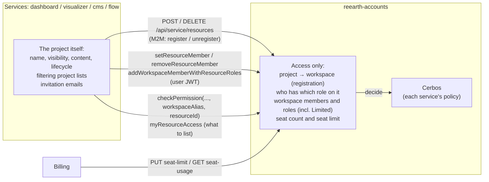
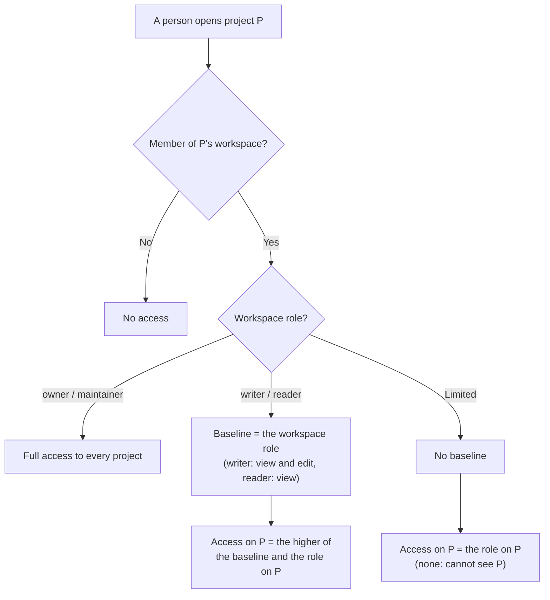
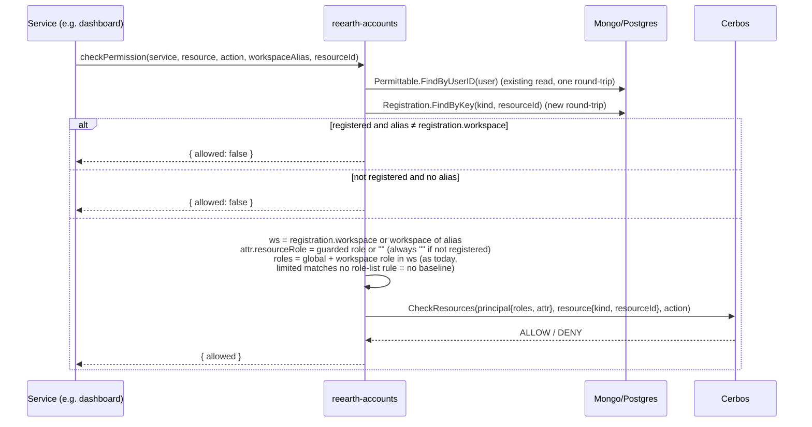
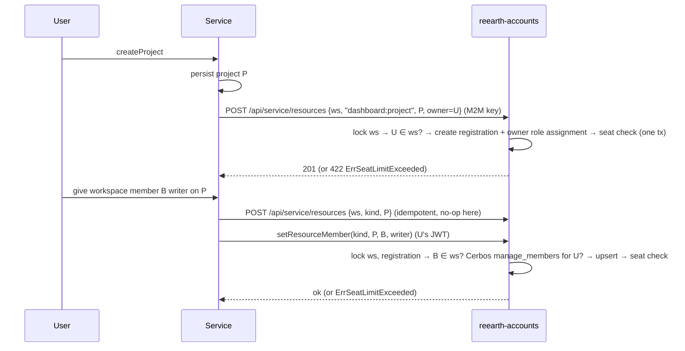
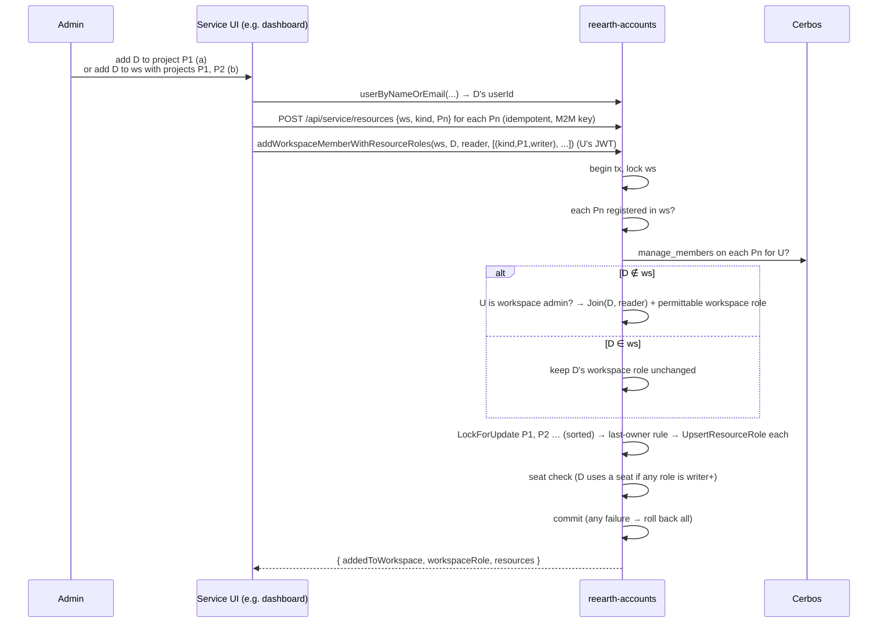
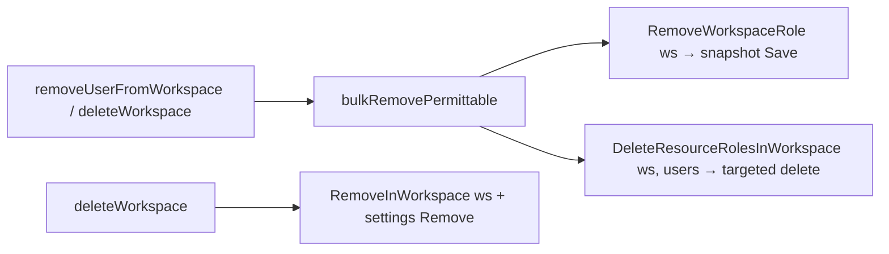
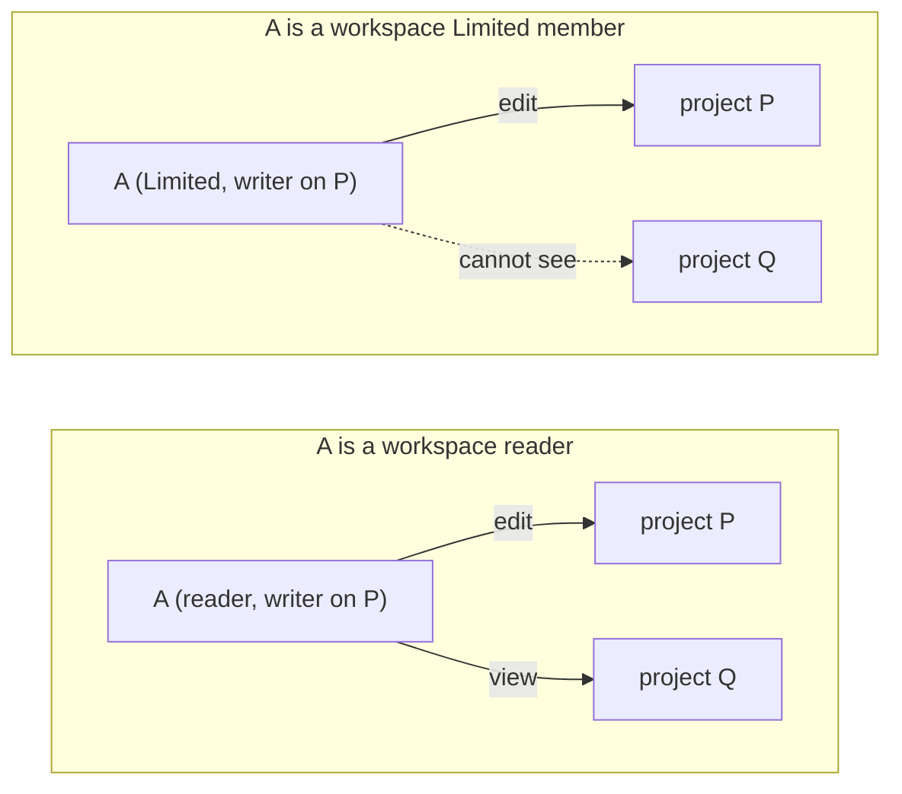

# Resource Role Assignment (Generic Per-Resource Membership)

> **Status: DRAFT.** Lets members and roles be set **per project** — and, more
> generally, per resource of any service — so that services (dashboard,
> visualizer, cms, …) can have project members without each building its own
> membership system, and **without reearth-accounts learning what a project
> is**. The first to use it is Dashboard projects. In code, a role assignment is
> represented by types and tables named `...Binding` / `resource_bindings`.
>
> Japanese version: [resource-role-binding.ja.md](resource-role-binding.ja.md).
> If the two versions differ, the Japanese version takes precedence.

## Summary

**Problem.** Today every workspace member sees every project in the workspace,
so teams in one organization workspace (or a partner company's staff) cannot be
kept to their own projects. **Decision.** Projects follow the workspace role by
default; a project role can only raise access on that project; a new per-person
workspace role, **Limited**, sees only the projects where it has a project role.
Accounts stores only "this project belongs to this workspace" and "this user
has this role on it" — it never learns what a project is.

### Workspace roles

| Workspace role | Projects by default | On a project P where they have a project role | Uses a seat |
|---|---|---|---|
| Owner / maintainer | Full access to every project (as today) | Already full access | Yes |
| Writer | View and edit every project (as today) | The higher of writer and the role on P | Yes |
| Reader | View every project (as today) | The higher of reader and the role on P | Only with a writer-or-above project role somewhere |
| Limited (new) | None | Exactly the role on P | Only with a writer-or-above project role somewhere |

### Rules

- A project role only **raises** access, never lowers it. Effective access on a
  project = the higher of the baseline (the workspace role; none for Limited)
  and the project role.
- **Everyone with access is a workspace member** (no outside collaborators), so
  SSO / SCIM, the member list, seats and removal stay in one place.
- **Removing someone from the workspace removes all their project roles** in it,
  in the same step.
- **A seat = can edit at least one project.** Each person counts once. Because
  "reader" no longer guarantees "free", the UI shows the seat separately from
  the role.
- **Accounts never learns what a project is.** Services register their
  resources; their name, visibility, content and lifecycle stay in the service.
  There is no workspace-wide base permission.

### Representative cases

| Case | Workspace role | Project role | Uses a seat |
|---|---|---|---|
| As today (no project roles) | owner / maintainer / writer / reader | None | Yes, except readers |
| A reader edits only project P (and views the rest) | Reader | Writer on P | Yes |
| A partner's staff sees only P | Limited | Reader on P | No |
| A partner's staff edits only P | Limited | Writer on P | Yes |
| Team X cannot see team Y's projects | Limited (team X's members) | Roles on team X's projects | Yes if any of those roles is writer or above |

### Who owns what



A project is registered only when needed: on creation (creator as owner), or
before its first project role. Existing projects are not registered in bulk,
and no existing data is converted.

### How access to a project is decided



### Scope

| Item | Status | Details |
|---|---|---|
| Project roles (raise only), checks that name the project | Now | Goals 1, 2 |
| Limited workspace role | Now | Goal 7 |
| Project roles removed with workspace membership | Now | Goal 4 |
| One-step add from the UI (from a project, or from the workspace) | Now | Goal 8 |
| Seats follow edit access, shown separately from the role | Now | Goal 9 |
| Per-project "only people added" setting | Later | Non-Goal 9, Open Question 1 |
| Teams | Later | Non-Goal 10 |
| Integrations as project members | Later | Non-Goal 5, Open Question 5 |
| Where members are managed (Dashboard only, or each service too) | Open | Open Question 6 |
| Workspace role for people added from a project, and who may add them | Open | Open Question 7 |
| What a Limited member can see and do at the workspace level | Open | Open Question 10 |
| How the seat is shown, and what happens at the seat limit | Open | Open Questions 11, 12 |
| Public projects and seats | Open | Open Question 15 |
| Access requests | Open | Open Question 16 |

### Details

[Background / Problem Statement](#background--problem-statement) ·
[Goals](#goals) · [Non-Goals](#non-goals) ·
[Solution Options](#solution-options) · [Design](#design) ·
[Open Questions](#open-questions)

## How to read this document

Start with *Summary* for the overall design.

Sections from *Goals* onward include technical content. Please review in two
steps:

1. **Concept first.** Read *Background / Problem Statement* and check whether
   the concept feels right: does anything seem off, contradictory, or confusing
   for customers?
2. **Then technical adoption.** Read *Goals* and the sections after it, and
   check how difficult it would be to adopt this in each service (dashboard,
   visualizer, cms, flow) and what concerns you see. *Solution Options* holds
   the system design details and is for readers interested in the
   implementation.

## Document Signature

|           |                |
|-----------|----------------|
| Creator   | soneda-yuya    |
| Leader    | TBD            |
| Task Link | TBD            |
| Developer | TBD            |

## Background / Problem Statement

### Motivation (product context)

- While introducing SSO, we discussed whether users should be able to create
  workspaces freely, and there was a request to make workspace creation
  restrictable via an option. With that restriction, a single workspace would
  have to hold many projects.
  Why an organization using SSO wants to restrict workspace creation:
  - **Company data stays under the company's control.** If anyone can create a
    workspace, employees can put company projects and data in workspaces that
    the organization's administrators cannot see or manage.
  - **Leaving the company really cuts off access.** SSO / SCIM removes a
    departing employee from the organization's workspaces, but workspaces they
    created themselves stay outside that control, along with the data in them.
  - **Members are managed in one place.** Administrators want to manage who can
    access what in the organization's workspace, instead of chasing many
    workspaces created by individual employees.
- But restricting workspace creation raises a new problem. Today every member
  of a workspace sees every project in it, so once all employees work in one
  organization workspace, there is no way to keep teams from seeing each
  other's projects. The organization needs to decide, per project, who can see
  it — while everyone stays a member of the workspace, managed by SSO / SCIM.
- Today members can only be assigned per workspace, so customers manage members
  workspace by workspace — even though the people involved differ from project
  to project. When customers want to share a project across workspaces, they
  currently copy the project into the target workspace.
- Assigning members and permissions per project lets a workspace function as an
  organization. This is a separate feature from SSO / SCIM, but we want to make
  it implementable early so it is ready when workspace creation can be
  restricted.
- The intended model is close to GitHub's. A workspace relates to its projects
  the way a GitHub organization relates to its repositories:

  | GitHub | Re:Earth |
  |---|---|
  | Organization member | Workspace member |
  | Organization owner | Workspace owner / maintainer |
  | Repository role | Project role |

  By default, access to projects follows the workspace role (same as today's
  Re:Earth). On top of that, a new workspace role, **Limited**, is added: a
  Limited member sees only the projects they were given a role on — this is how
  teams in one workspace are kept apart, and how a partner company's staff can
  be given just one project.

  What each workspace role can see:

  | Workspace role | Projects they can see |
  |---|---|
  | Owner / maintainer | Full access to every project (same as today) |
  | Writer | Can view and edit every project (same as today) |
  | Reader | Can view every project (same as today) |
  | Limited (new) | Only the projects where they have a project role |

  Under every role, on a project where they have a project role, their access
  goes up to that role (e.g. a workspace reader who is a writer on project P →
  can edit P). A project role never lowers access.
- Differences from GitHub:

  | Aspect | GitHub | Re:Earth |
  |---|---|---|
  | People outside the organization / workspace | *Outside collaborators* (access to a repository without being an organization member) | None. **Every person with access is a workspace member**, so SSO / SCIM, seats, the member list and removal are all managed in one place |
  | Per-member roles | Everyone except owners is a "member"; no per-person writer / reader distinction | Workspace writer / reader stay, and **Limited** is added; these govern workspace-level actions (e.g. creating projects). Limited narrows, per person, the visible projects to those where they have a project role |
  | Organization-wide base access | A base permission (none / read / write / admin, etc.; default read) applies uniformly to every member on every repository | None. Each member's workspace role is the baseline. To restrict only some people, make those people Limited. Of the products compared (Notion, Figma, Felt, Miro, ArcGIS Online, CARTO, Vercel, GitLab, …), only GitHub has such a workspace-wide setting; it applies to everyone at once (restricting one partner restricts the whole workspace) and adds a concept users must learn |
  | Seats | Every member is billed | Only members who can **edit** at least one project use a seat; view-only people and Limited members are free unless they can edit some project (extends today's Dashboard rule that readers do not use a seat) |

### Current situation

- Permissions across Re:Earth are decided by reearth-accounts. Each service
  (dashboard, visualizer, cms, ...) asks accounts "may this user perform this
  action?" before allowing it.
- A user's role is held **per workspace** (plus a few platform-wide roles).
  Joining a workspace gives the same role on every project in that workspace.
- A permission check therefore only knows *which workspace* the request is
  about, not *which project*. There is no way to say "user A can edit project P
  but not project Q" within the same workspace, and adding someone to a
  workspace always shows them every project in it.

### Problem

Products need **project-level membership**: "user A, a reader of the workspace,
is an editor of project P", "in this workspace, members see only the projects
they were added to, so team X cannot see team Y's projects", and "user B from a
partner company is added to the workspace but can work on project P only".
Today the finest granularity accounts can express is the workspace.

If each service implements project membership on its own:

1. Invite / role-change / remove APIs and UI are duplicated per service.
2. Each service must react to **workspace membership changes** (user removed from
   workspace, workspace deleted) to clean up its project members. Only accounts
   owns that information, so every service needs an event/sync path, and a miss
   leaves a user with access to a project in a workspace they have left.
3. "A project member must be a member of the workspace" cannot be validated
   locally by the service without calling accounts anyway.
4. Permission rules end up scattered across every service, instead of being
   decided in one place (accounts).

### Constraint (the reason for this design's shape)

Accounts must **not** take over what a *project* is. Whether a project exists,
its name, visibility, content and lifecycle stay with each service. Accounts
only keeps what it needs to decide permissions: "this project belongs to this
workspace, and this user has this role on it".

## Goals

1. **Members and roles can be set per project.** A workspace member can be
   given a role on a specific project, not only on the whole workspace. The
   model is:
   - **Workspace owners and maintainers** always have full access to every
     project in the workspace.
   - **Workspace writers** can view and edit every project, and **readers** can
     view every project. This is their baseline, exactly as today.
   - **Workspace Limited members** (Goal 7) have no baseline: they see only the
     projects where they have a project role.
   - A project role can **raise** access on that project (for example, a
     workspace reader who is a writer on project P can edit P), but never lower
     it. Effective access is the higher of the baseline and the project role.
2. **Permission checks look at the specific project.** When a service asks
   accounts "may this user do this?", the answer can take the user's role on
   that particular project into account. The check uses the workspace the
   project belongs to. For a project that has ever had a project role, accounts
   remembers that workspace, so a caller cannot get access by naming a different
   one. For a project that has never had a project role, the service's own
   record of its workspace is used (not user input).
3. **Membership rules stay consistent.** A project always belongs to exactly
   one workspace, every project member is a member of that workspace, and once
   a project has an owner it never ends up with none — even when several people
   change members at the same time.
4. **Leaving a workspace removes project access.** When a user is removed from a
   workspace, their roles on every project in that workspace are removed
   automatically. Services do not need to clean this up themselves.
5. **Accounts stays generic.** Accounts does not know what a "project" is. Any
   service can use the same mechanism for its own resources (for example, a CMS
   model) just by adding a permission policy, with no change to accounts.
6. **Nothing existing breaks.** Current permission checks and policies keep
   working exactly as they do today. The meaning of existing workspace roles
   does not change, and Limited changes nothing until someone is given it.
   - **Compatibility and migration:** existing data (members, workspace roles,
     permission data, projects) is used as is. There is no data conversion and
     no bulk registration of existing projects (no backfill). The new storage is
     created automatically on startup and stays empty until the feature is
     used. A project is registered in accounts only when it first gets a project
     role (or when it is created from now on). With no Limited members and no
     project roles, every permission check and seat count is exactly the same
     as today.
7. **A Limited workspace role is added.** It is set per person: a Limited
   member sees only the projects where they have a project role, and has no
   baseline access to any other project. It is for a partner company's staff,
   or for a member who should not see anything outside their own projects.
   Like any other role, a Limited member is a workspace member, so SSO / SCIM,
   the member list and removal stay in one place (still no outside
   collaborators). It is set the same way as any other workspace role, and the
   change takes effect immediately. There is no workspace-wide base access
   setting (see *Alternative considered and rejected: a workspace-wide base
   permission*).
8. **Access to specific projects can be given in one step.** From the UI, an
   admin can add a person directly to a project — adding them to the workspace
   at the same time if needed — or, while adding a person to the workspace,
   choose which projects they get. Either way it is one step that either fully
   succeeds or changes nothing (see *Design → Adding people from the UI*).
9. **Seats follow edit access.** A workspace member uses a seat if they can
   edit at least one project in the workspace; people who can only view, or see
   nothing, do not. So owners, maintainers and writers use a seat, and readers
   and Limited members are free unless they have a writer-or-above role on some
   project. Accounts counts seats in one place for every service and for
   billing, and keeps a workspace within its seat limit whenever a change would
   make someone start using a seat. Because "reader" no longer guarantees
   "free", the UI shows the seat separately from the role (see *Design →
   Seats*).

## Non-Goals

1. **Storing project details in accounts.** Names, visibility, owners, dates and
   other information about a project stay in the service that owns it.
2. **Checking that a project really exists.** Accounts trusts the service that
   registers the project. Only services can register projects, not users. For a
   project that is not registered yet, accounts trusts the workspace the service
   tells it.
3. **Noticing on its own when a project is deleted.** The service that owns the
   project must tell accounts when it is deleted.
4. **Nested resources and inherited permissions** (for example folder → project
   → layer). These could be added later through permission policies, but are
   out of scope this time.
5. **Integrations as project members.** In the first version only people (user
   accounts) can be project members, not integrations or API tokens.
6. **Using project properties in permission decisions** (for example "public"
   or "private"). See *Open Questions*; the first version decides by roles
   only. This is about deciding who can view or edit, not
   about how seats are counted (public projects and seats are Open Question 15).
7. **Sending invitation emails for project membership.** The email mentions the
   project's name, which accounts does not know, so the service sends it.
8. **Registering existing projects in bulk (backfill).** A project is registered
   when it is needed (when it first gets a project role, or when it is created
   from now on).
9. **A per-project "only people added" setting.** A setting to choose, per
   project, between "everyone in the workspace" and "only people added", to
   hide a confidential project from ordinary writers / readers, is not added
   this time. It will be added later as an optional feature if and when a real
   case comes up; the raise-only model of project roles does not block adding
   it later (Open Question 1). Until then, hiding a project from ordinary
   members requires making those members Limited.
10. **Teams.** "Teams" (adding a group of people to a project at once) are
    something customers want, as confirmed by sales, but they are out of scope
    this time to keep the scope manageable.

## Functional Requirements

1. **Permission checks stay fast.** (FR-1, FR-2) Checks that do not name a project cost
   exactly the same as today. Checks that name a project add only a small,
   quick lookup (which workspace the project belongs to); the user's workspace
   role and project roles are read together with the data accounts already
   loads.
2. **Names and IDs have size limits.** (FR-3) The resource type name and the resource
   ID have a maximum length and a fixed set of allowed characters, so stored
   data stays small and predictable.
3. **Designed for realistic scale.** (FR-4) Up to about 1,000 project role assignments
   per user, and up to about 1,000 members per project.
4. **Listing a project's members is quick.** (FR-5) It returns only who the members are
   and their roles; names and other details come from the service.
5. **Works with every database accounts supports.** (FR-6) Membership changes behave
   the same whichever database a deployment uses.
6. **Services can tell what a person may list.** (FR-7) For a workspace, accounts can
   tell a service whether a person sees every project (and at what level) or
   only the projects where they have a project role (Limited), so lists can be
   filtered correctly for Limited members too.
7. **Seat usage is available per workspace.** (FR-8) Accounts can quickly say how many
   members of a workspace use a seat (and who), so billing and every service
   use the same number.

Technical details: see *Solution Options → Option 1 → Detailed requirements*.

## Solution Options

This section describes the system design in detail and is intended for readers
interested in the implementation; the other sections can be read without it.

### Option 1 (Recommended): Resource registration + role assignments embedded in `Permittable`

Three pieces of state, all opaque to accounts:

| State | Purpose |
|---|---|
| **Resource registration** `(resourceKind, resourceID) → workspaceID, version` | Authoritative workspace scope of the resource; proof the owning service registered it; per-resource serialization point for invariants. **Created only when needed** (on creation, or before the first resource role). Existing resources are not registered in bulk |
| **Resource role** on `Permittable` `(workspaceID, resourceKind, resourceID, roleID)` | The user's role on that resource; read together with the permittable for zero-read lookup |
| **Workspace resource settings** `workspaceID → seatLimit, version` | The workspace's seat limit; also the per-workspace lock (serialization point for every change that can affect seat usage: the one-step add, workspace member and role changes, editing project roles, and project registration) |

#### Domain

```go
// server/pkg/resource/registration.go (new package, no service-specific code)
type Registration struct {
    createdAt   time.Time
    kind        Kind   // validated per FR-3
    resourceID  ID     // validated per FR-3
    version     int64  // bumped by every membership mutation of this resource
    workspaceID workspace.ID
}

// server/pkg/permittable/permittable.go
type Permittable struct {
    id             ID
    resourceRoles  []ResourceRole // NEW
    roleIDs        []role.ID
    updatedAt      time.Time
    userID         user.ID
    workspaceRoles []WorkspaceRole
}

type ResourceRole struct {
    resourceID   resource.ID
    resourceKind resource.Kind
    roleID       role.ID
    workspaceID  workspace.ID // copied from the registration
}
```

`ResourceRole(kind, id)` returns the user's role on a resource **only if the
user still holds a workspace role in `workspaceID`** (read-time guard, see
*Concurrency*). One role per `(kind, id)` per user. No `switch` on `kind`
anywhere in accounts.

Roles reuse the existing `roles` table (`owner` / `maintainer` / `writer` /
`reader`). Their meaning per resource kind is defined solely by that kind's
Cerbos policy.

**Limited and the baseline role.**

```go
// server/pkg/role/enum.go (addition)
RoleLimited = RoleType("limited") // workspace role only; never a resource role

// server/pkg/resource/baseline.go
// BaselineRole returns a member's baseline role on every resource of the workspace:
// the workspace role itself, except limited, which has no baseline
// (ok == false: the member only gets resource roles).
func BaselineRole(workspaceRole role.RoleType) (r role.RoleType, ok bool)
```

| Workspace role | Baseline role |
|---|---|
| `owner` / `maintainer` / `writer` / `reader` | the same role (as today) |
| `limited` | — (resource roles only) |

`limited` is a new value for workspace roles only. It is stored where the other
workspace roles are (the workspace members and the permittable's workspace
roles), so no new storage is needed. Its `roles` row is created by the startup
migration (`internal/app/migration.go`), as `maintainer` is. `limited` cannot
be used as a resource role (rejected with `role.ErrInvalidRole`). There is no
workspace-wide base access setting, so the baseline is decided by the
workspace role alone.

**Workspace settings.**

```go
// server/pkg/resource/settings.go
type WorkspaceSettings struct {
    seatLimit   *int  // nil = unlimited; set by billing (M2M)
    version     int64 // bumped by every write and by Lock
    workspaceID workspace.ID
}
```

This record exists for the seat limit and for the workspace lock that
serializes changes affecting seat usage. It is stored in accounts, in its own
per-workspace record rather than on the workspace document: the existing
workspace flows save the workspace as a snapshot (Mongo replaces the whole
document), so a field there could be reverted by a concurrent, stale workspace
save. A missing record means no limit (`seatLimit = nil`) and is created on
first lock, so no data migration is needed.

**Seats.**

```go
// server/pkg/resource/seat.go
var editRoles = []role.RoleType{role.RoleOwner, role.RoleMaintainer, role.RoleWriter}

// UsesSeat reports whether a member uses a seat in the workspace: a workspace role
// in editRoles (owner / maintainer / writer), or any valid resource role in editRoles.
// reader and limited use a seat only through a resource role.
func UsesSeat(p *permittable.Permittable, ws workspace.ID) bool
```

Seat usage of a workspace = the number of distinct members for which `UsesSeat`
is true. With no Limited members and no resource roles this equals today's
Dashboard count (`GetCurrentSeatStatus` in reearth-dashboard
`server/pkg/subscription/service.go`, which counts members whose role is not
`reader`).

The seat limit is owned by billing and pushed to accounts (`seatLimit`, `nil` =
unlimited, the same as "no subscription" today), so accounts can enforce it in
the same transaction as the change. The existing `enforceMemberCount` hook
(`WorkspaceMemberCountEnforcer`, not wired today) is replaced by this check.

**Seat check (`ensureSeats`).** Runs under the workspace lock, after the change
has been applied inside the transaction and before commit: if
`seatUsage(after) > seatUsage(before)` and `seatUsage(after) > seatLimit`, the
transaction is rolled back with `ErrSeatLimitExceeded`. Changes that do not
increase usage are always allowed, even if the workspace is already over its
limit (for example after billing lowered it). Operations that can turn a
non-seat member into a seat member, and therefore run the check:

| Operation | Can add a seat when |
|---|---|
| `setResourceMember` | the new role is writer or above |
| `addWorkspaceMemberWithResourceRoles` | the new member's workspace role or any of the given resource roles is writer or above |
| `addUsersToWorkspace` / `updateUserOfWorkspace` / `transferWorkspaceOwnership` | a member gets `writer`, `maintainer` or `owner` (a change to `reader` / `limited` never adds a seat) |
| `POST /api/service/resources` with `ownerUserId` (project creation) | the creator did not use a seat before |

#### Storage

**PostgreSQL** — migration `0005_resource_role_binding.up.sql`:

```sql
CREATE TABLE resource_registrations (
    resource_kind text NOT NULL CHECK (octet_length(resource_kind) <= 64),
    resource_id   text NOT NULL CHECK (octet_length(resource_id) <= 128),
    workspace_id  text NOT NULL,
    version       bigint NOT NULL DEFAULT 0,
    created_at    timestamptz NOT NULL DEFAULT now(),
    PRIMARY KEY (resource_kind, resource_id)
);
CREATE INDEX resource_registrations_workspace_idx
    ON resource_registrations (workspace_id);

CREATE TABLE permittable_resource_roles (
    permittable_id text NOT NULL REFERENCES permittables(id) ON DELETE CASCADE,
    resource_kind  text NOT NULL,
    resource_id    text NOT NULL,
    workspace_id   text NOT NULL,
    role_id        text NOT NULL,
    PRIMARY KEY (permittable_id, resource_kind, resource_id),
    FOREIGN KEY (resource_kind, resource_id)
        REFERENCES resource_registrations (resource_kind, resource_id) ON DELETE CASCADE
);
CREATE INDEX permittable_resource_roles_resource_idx
    ON permittable_resource_roles (resource_kind, resource_id);
CREATE INDEX permittable_resource_roles_workspace_idx
    ON permittable_resource_roles (workspace_id, permittable_id);

CREATE TABLE resource_workspace_settings (
    workspace_id text PRIMARY KEY,
    seat_limit   integer CHECK (seat_limit >= 0),   -- NULL = unlimited
    version      bigint NOT NULL DEFAULT 0
);
```

```sql
-- 0005_resource_role_binding.down.sql
DROP TABLE IF EXISTS resource_workspace_settings;
DROP TABLE IF EXISTS permittable_resource_roles;
DROP TABLE IF EXISTS resource_registrations;
```

The migration only creates tables and indexes; it converts no existing rows.
The new tables stay empty until the feature is used. Workspace member roles are
already unconstrained `text`, so `limited` needs no schema change (its `roles`
row is created by the startup migration).

**MongoDB**

- New collection `resource_registrations` with a unique index on
  `{ resource_kind: 1, resource_id: 1 }` and an index on `{ workspace_id: 1 }`
  (schema registered via `mongoschemagen`, migration added per
  `server/CLAUDE.md`).
- New optional array `resource_roles` on the permittable document, with indexes
  `{ "resource_roles.resource_kind": 1, "resource_roles.resource_id": 1 }` and
  `{ "resource_roles.workspace_id": 1 }`.
- New collection `resource_workspace_settings` (`_id` = workspace ID,
  `seat_limit`, `version`).
- The `limited` entry in the `roles` collection is created by the startup
  migration, as on Postgres.

#### Repository changes (targeted writes, never snapshot writes)

The existing snapshot `Save` / `SaveMany` must not be able to overwrite or
resurrect resource roles:

- **Mongo** `Permittable.Save` switches from document replacement to
  `$set` of `role_ids`, `workspace_roles`, `updated_at` only. `resource_roles`
  is written exclusively by the targeted operations below.
- **Postgres** `Permittable.Save` already only rewrites
  `permittable_workspace_roles`; it is left untouched for resource roles.
- **Postgres** `hydrate` is replaced by a single query returning the base row
  plus `json_agg` sub-selects of workspace roles and resource roles (FR-2).

New repository interfaces:

```go
// resource.RegistrationRepo
FindByKey(ctx, kind, id) (*resource.Registration, error)
Create(ctx, r resource.Registration) error              // ErrAlreadyExists on duplicate
LockForUpdate(ctx, kind, id) (*resource.Registration, error) // must run inside a transaction
Remove(ctx, kind, id) error                              // also removes all role assignments
RemoveInWorkspace(ctx, workspaceID) error                // all registrations + role assignments

// resource.WorkspaceSettingsRepo
Find(ctx, workspaceID) (*resource.WorkspaceSettings, error) // default settings when no row
Lock(ctx, workspaceID) (*resource.WorkspaceSettings, error) // must run inside a transaction; creates the row on first use
SetSeatLimit(ctx, workspaceID, limit *int) error            // after Lock
Remove(ctx, workspaceID) error

// permittable.Repo (additions)
FindResourceMembers(ctx, kind, id) ([]permittable.ResourceMember, error) // projection: userID + roleID
CountResourceOwners(ctx, kind, id, ownerRoleID) (int, error)
UpsertResourceRole(ctx, userID, r permittable.ResourceRole) error
DeleteResourceRole(ctx, userID, kind, id) error
DeleteResourceRolesInWorkspace(ctx, workspaceID, userIDs) error
FindSeatUsers(ctx, workspaceID, editRoles []role.ID) ([]user.ID, error)
```

| Operation | Mongo | Postgres |
|---|---|---|
| `UpsertResourceRole` | single-document update: `$pull` the `(kind,id)` element then `$push` the new one (one `updateOne` with an aggregation pipeline) | `INSERT … ON CONFLICT (permittable_id, resource_kind, resource_id) DO UPDATE SET role_id = …` |
| `DeleteResourceRole` | `$pull` | `DELETE … WHERE permittable_id=$1 AND resource_kind=$2 AND resource_id=$3` |
| `DeleteResourceRolesInWorkspace` | `updateMany` + `$pull {workspace_id}` | `DELETE … WHERE workspace_id=$1 AND permittable_id = ANY($2)` |
| `FindResourceMembers` | aggregation `$match` → `$unwind` → `$match` → `$project {user_id, role_id}` | `SELECT p.user_id, r.role_id FROM permittable_resource_roles r JOIN permittables p …` |
| `LockForUpdate` | in a transaction: `findOneAndUpdate {$inc: {version: 1}}` (concurrent transactions on the same registration hit a write conflict and are retried) | `SELECT … FOR UPDATE` |
| `WorkspaceSettings.Lock` | in a transaction: `findOneAndUpdate {_id: ws} {$inc: {version: 1}}, upsert` (write conflict → retry) | `INSERT … ON CONFLICT DO NOTHING` then `SELECT … FOR UPDATE` |
| `FindSeatUsers` | aggregation on `permittables`: `$match` users with a workspace role in `ws` and (`workspace_roles` role ∈ edit roles **or** `resource_roles` `$elemMatch {workspace_id: ws, role_id ∈ edit roles}`) → `$project user_id` | `SELECT DISTINCT p.user_id FROM permittables p JOIN permittable_workspace_roles w … WHERE w.workspace_id=$1 AND (w.role_id = ANY($2) OR EXISTS (SELECT 1 FROM permittable_resource_roles r WHERE r.permittable_id = p.id AND r.workspace_id=$1 AND r.role_id = ANY($2)))` |
| Registration for `checkPermission` | `findOne` on `resource_registrations` by key | `SELECT … FROM resource_registrations WHERE resource_kind=$1 AND resource_id=$2` |

#### Authorization check

`CheckPermissionInput` gains one optional field:

```graphql
input CheckPermissionInput {
  service: String!
  resource: String!
  action: String!
  workspaceAlias: String
  resourceId: String   # NEW
}
```

When `resourceId` is **absent**, behavior is unchanged. Principal roles are the
actual workspace roles, as today.

When `resourceId` is **present**, the service also passes `workspaceAlias`, as
today (the project's workspace, read from the service's own data, not from user
input).

1. Load the registration `(service:resource, resourceId)` (one round-trip, by
   primary key).
2. **If registered:** the deciding workspace = the registration's `workspaceID`.
   If `workspaceAlias` is given and does not resolve to it → **deny** (the
   caller cannot choose the workspace).
   **If not registered** (it has never had a resource role): the deciding
   workspace = the workspace resolved from `workspaceAlias`. Without
   `workspaceAlias` → **deny**. No resource roles exist yet, so the decision
   comes from the workspace role only — exactly today's result for every role
   other than `limited`.
3. Principal roles = global roles + the user's actual workspace role **in the
   deciding workspace** — the same roles as today; the baseline is the
   workspace role itself, so nothing is substituted. `limited` is passed as is:
   it is never listed in a role-list rule, so it grants no baseline, while still
   giving Cerbos a non-empty role list and letting a policy recognize the case.
   A user with no workspace role in that workspace gets none, and so is denied.
4. Principal attributes: `resourceRole` = the user's role on this resource after
   the read-time guard, or `""` if none; `workspaceRole` = the actual workspace
   role (or `""`), for policies that need it.
5. The Cerbos resource ID is the real `resourceId`.

**Default model.** Effective role on a resource = max(baseline role, resource
role). The baseline is `BaselineRole(workspace role)`: the role itself for
`owner` / `maintainer` / `writer` / `reader`, and no baseline for `limited`
(they reach a resource only through a resource role). Each role means the same
at both levels (`owner` / `maintainer`: full control and member management;
`writer`: read and edit; `reader`: read), so a policy implements "max" as the
union of a role-list rule (evaluated against the workspace role) and a
`resourceRole`-condition rule per action — Cerbos allows if either matches.
Principal roles are the same as today, so existing role-list rules need no
change.

Policies stay in each service's `definition.go`, using the conditions the
reearthx generator already supports. Example for `dashboard:project`:

```go
// dashboard: definition.go
resourceRole := func(expr string) *generator.Condition { return generator.SimpleExpr(expr) }
any := []string{"*"} // any principal role (incl. limited); the condition does the gating

builder.AddResource("project", []generator.ActionDefinition{
    // baseline: these roles are the member's workspace role, as today
    // ("limited" is never listed here: it has no baseline)
    generator.NewActionDefinition("read", []string{"owner", "maintainer", "writer", "reader"}),
    generator.NewActionDefinition("edit", []string{"owner", "maintainer", "writer"}),
    generator.NewActionDefinition("delete", []string{"owner", "maintainer"}),
    generator.NewActionDefinition("manage_members", []string{"owner", "maintainer"}),
    // project roles: add on top of the baseline; the only source of access without a baseline
    generator.NewActionDefinitionWithCondition("read", any, resourceRole(`P.attr.resourceRole != ""`)),
    generator.NewActionDefinitionWithCondition("edit", any, resourceRole(`P.attr.resourceRole in ["owner", "maintainer", "writer"]`)),
    generator.NewActionDefinitionWithCondition("delete", any, resourceRole(`P.attr.resourceRole in ["owner", "maintainer"]`)),
    generator.NewActionDefinitionWithCondition("manage_members", any, resourceRole(`P.attr.resourceRole in ["owner", "maintainer"]`)),
})
```

Because resource roles arrive as a principal **attribute**, not as principal
roles, a project `owner` is never mistaken for a workspace `owner`: a project
role counts only for the resource named in the check. A per-project "only
people added" setting is a later addition (*Non-Goals*, Open Question 1).

**Policy note for Limited members.** Policies must grant `limited` nothing
except through `P.attr.resourceRole` conditions. Rules keyed to explicit role
lists already exclude it (fail-closed). Rules that grant on `*` without a
`resourceRole` condition must be reviewed per service. Workspace-level
resources (e.g. `dashboard:workspace`, "create project", "list projects") and
accounts' own policy (workspace `read`, `read_member`, … in
`internal/rbac/definitions.go`) are checked without a `resourceId` against the
actual workspace role, and no existing rule lists `limited`, so by default a
Limited member is granted nothing at the workspace level. Which actions get
`limited` is decided in Open Question 10. A Limited member must still be able
to list their own projects, so the list endpoint is granted to `limited` too,
and **the service must filter the list** (see *Listing what a user may see*).

**Listing what a user may see.** A list screen cannot call `checkPermission`
for every resource (Open Question 2). Services ask once per workspace:

```graphql
type ResourceAccess {
  workspaceId: ID!
  baselineRole: Role        # null = no baseline: only the bindings below are visible
  bindings: [ResourceBinding!]!
}
extend type Query {
  myResourceAccess(workspaceId: ID!, resourceKind: String!): ResourceAccess!
}
```

If `baselineRole` is set, the user sees every resource of the kind in the
workspace at least at that level (registered or not — the service lists all of
its resources); otherwise (a Limited member) the service lists only
`bindings`. Every resource in `bindings` has a role, so it is always
registered.

#### Membership management API

**Lifecycle (M2M only)** — REST service routes, authenticated **only** by the
M2M API key (a user JWT is rejected). Registration is how accounts learns that a
resource exists and which workspace it belongs to; restricting it to services
removes any way for a user to claim an unregistered ID.

**Registering when needed (lazy registration).** Services register only in
these cases; existing resources are never registered in bulk.

- On creation, with the creator as `ownerUserId` (every resource created from
  now on is registered).
- Before giving an existing resource its first resource role (before calling
  `setResourceMember` / `addWorkspaceMemberWithResourceRoles`), without
  `ownerUserId`. The service reads `workspaceId` from its own data.

Registration is idempotent, so a service may call it every time before granting
a role. A registration without roles is decided the same way as no
registration (workspace role only), so a registration left
behind by a failed role grant is harmless.

```
POST   /api/service/resources
       { workspaceId, resourceKind, resourceId, ownerUserId? }
       → registers the resource on first use (creation, or before its first
         resource role). If ownerUserId is given, also an `owner` role
         assignment, in one transaction under the workspace lock.
         ownerUserId must be a workspace member; seat check (the creator may
         start using a seat) → 422 ErrSeatLimitExceeded.
         Idempotent: 200 if already registered with the same workspace (no
         change); 409 ErrWorkspaceMismatch if registered with a different one.
DELETE /api/service/resources/{resourceKind}/{resourceId}
       → removes the registration and every role assignment on the resource.
         Idempotent: 204 also when the resource was never registered.
PUT    /api/service/workspaces/{workspaceId}/seat-limit
       { seatLimit: int | null }
       → billing sets the workspace's seat limit (null = unlimited). Lowering
         it below current usage is accepted; it only blocks further increases.
GET    /api/service/workspaces/{workspaceId}/seat-usage
       → { seatCount, seatLimit, seatUserIds } for billing.
```

**Membership (user JWT, GraphQL)**:

```graphql
enum Role {
  reader
  writer
  owner
  maintainer
  limited      # NEW: workspace role only; rejected as a resource role
}

input SetResourceMemberInput {
  resourceKind: String!
  resourceId: String!
  userId: ID!
  role: Role!
}
input RemoveResourceMemberInput {
  resourceKind: String!
  resourceId: String!
  userId: ID!
}
input ResourceRoleInput {
  resourceKind: String!
  resourceId: String!
  role: Role!
}
input AddWorkspaceMemberWithResourceRolesInput {
  workspaceId: ID!
  userId: ID!
  workspaceRole: Role               # used only if the user is not yet a member; default reader; not owner; may be limited
  resources: [ResourceRoleInput!]!  # 0..100 entries, distinct (kind, id)
}

type ResourceMember { userId: ID!, role: Role! }
type ResourceBinding { workspaceId: ID!, resourceKind: String!, resourceId: String!, role: Role! }
type AddWorkspaceMemberWithResourceRolesPayload {
  addedToWorkspace: Boolean!        # false if the user was already a member
  workspaceRole: Role!              # the user's workspace role after the call
  resources: [ResourceBinding!]!
}
type WorkspaceSeatUsage {
  workspaceId: ID!
  seatCount: Int!                   # distinct members for which UsesSeat is true
  seatLimit: Int                    # null = unlimited
  seatUserIds: [ID!]!
}

extend type Query {
  resourceMembers(resourceKind: String!, resourceId: String!): [ResourceMember!]!
  # IDs only; the owning service hydrates names etc.
  myResourceBindings(resourceKind: String!, workspaceId: ID): [ResourceBinding!]!
  myResourceAccess(workspaceId: ID!, resourceKind: String!): ResourceAccess!
  workspaceSeatUsage(workspaceId: ID!): WorkspaceSeatUsage!
}

extend type Mutation {
  setResourceMember(input: SetResourceMemberInput!): ResourceMember
  removeResourceMember(input: RemoveResourceMemberInput!): Boolean!
  addWorkspaceMemberWithResourceRoles(
    input: AddWorkspaceMemberWithResourceRolesInput!
  ): AddWorkspaceMemberWithResourceRolesPayload
}
```

`limited` is a value added to the existing `Role` enum. It can be used by the
existing mutations that set a workspace role (`addUsersToWorkspace`,
`updateUserOfWorkspace`) and by
`AddWorkspaceMemberWithResourceRolesInput.workspaceRole`. Passing `limited` as
a resource role (`SetResourceMemberInput.role`, `ResourceRoleInput.role`) is
rejected.

The user is identified by user ID, as in `addUsersToWorkspace`; the UI finds
them by name or email with the existing user lookup (`userByNameOrEmail` /
`searchUser`). No new email-based invitation is introduced.

"Workspace admin" below means the operator passes the existing workspace
check used by `addUsersToWorkspace` (`add_member`, i.e. workspace owner or
maintainer).

Guards (generic, no kind-specific code). Every mutation runs in **one
transaction**; locks are taken in a fixed order — workspace lock
(`WorkspaceSettings.Lock`) first where needed, then registrations sorted by
`(kind, id)` — and guards are evaluated after the locks:

| Operation | Locks | Guard |
|---|---|---|
| `setResourceMember` | workspace lock, then the registration | `role` is not `limited` (else `ErrInvalidRole`); registration exists (else `ErrNotRegistered` — the service first calls the idempotent registration); target user is a member of the registration's workspace (else `ErrNotWorkspaceMember` — use `addWorkspaceMemberWithResourceRoles`); Cerbos allows `manage_members` on `(kind, id)` for the operator; if the change downgrades the last `owner`, reject; seat check |
| `removeResourceMember` | the registration | Cerbos `manage_members`, or operator == target (self-leave); if it removes the last `owner`, reject |
| `addWorkspaceMemberWithResourceRoles` | workspace lock, then each registration | no resource role is `limited`; every registration exists and belongs to `workspaceId` (else the whole call is rejected; the service first calls the idempotent registration for each resource); Cerbos allows `manage_members` on each for the operator. If the user is **not yet a member**: operator is a workspace admin (v1, Open Question 7); personal workspace rejected; `workspaceRole` (default `reader`) is not `owner`, as in `addUsersToWorkspace` (`limited` is allowed); then `Members().Join` and the permittable workspace role via the existing `bulkUpdatePermittable` path. If the user **is already a member**: workspace membership and role are left unchanged — never downgraded (`workspaceRole` is ignored). Then the last-owner rule per resource, `UpsertResourceRole` for each entry, and the seat check. Any failure rolls everything back |
| `workspaceSeatUsage` | — | operator may read workspace members (`read_member`); the `seat-usage` route is M2M only |
| `resourceMembers` | — | Cerbos `read` on `(kind, id)`; result filtered by the read-time guard |
| `myResourceBindings` | — | operator's own role assignments only, filtered by the read-time guard |
| `myResourceAccess` | — | operator's own access only; `baselineRole` from `BaselineRole(workspace role)` (null for Limited), `bindings` filtered by the read-time guard |

**Last-owner rule:** a membership mutation that would take the owner count of a
resource from ≥ 1 to 0 is rejected. A resource registered without an owner
(when an existing resource first gets, say, a writer) is managed by workspace
roles until an owner is set. The unregister endpoint is exempt.

Removing a user's last resource role (`removeResourceMember`) does **not**
remove them from the workspace (Open Question 8).

**Changes to existing workspace flows** (all take the workspace lock first, so
they serialize with the one-step add and with each other's seat checks):

- `addUsersToWorkspace`, `updateUserOfWorkspace`,
  `transferWorkspaceOwnership`: run the seat check (a member given `writer`,
  `maintainer` or `owner` may start using a seat). `addUsersToWorkspace` and
  `updateUserOfWorkspace` accept `limited` (same guards as for other roles). A
  change to `limited` does not touch resource roles; only the baseline derived
  at check time changes.
- `removeUserFromWorkspace` / `removeMultipleUsersFromWorkspace`: also delete
  the users' role assignments in the workspace (`DeleteResourceRolesInWorkspace`).
- `deleteWorkspace` (`Workspace.Remove`): `RemoveInWorkspace(ws)` removes all
  registrations and role assignments of the workspace, and
  `WorkspaceSettings.Remove(ws)` removes its settings.

#### Concurrency

| Race | Mitigation |
|---|---|
| Two writers on different users of the same resource both pass the last-owner check | Both must take `LockForUpdate` on the same registration; the second waits (Postgres) or conflicts and retries (Mongo). The owner count is read after the lock. |
| The first registration of the same `(kind, id)` runs twice at once (e.g. two admins give roles on the same existing project at the same time) | Primary key / unique index; the loser gets `ErrAlreadyExists` and re-reads the registration. Same workspace → continues as success (idempotent); different workspace → 409 `ErrWorkspaceMismatch`. |
| A permission check runs during the first registration | The check sees either "not registered" or "registered". No roles exist yet, so both give the same result from the workspace role. |
| `setResourceMember` passes the workspace-membership check, then the user is removed from the workspace and the cascade runs before the role assignment is written | **Read-time guard**: a role assignment is honored only if the user currently holds a workspace role in the role assignment's workspace. The permittable is already loaded, so this costs no read. The orphaned row is harmless and is removed the next time the cascade or the unregister endpoint touches it. |
| A stale snapshot `Save` from the workspace flow overwrites a newer role assignment (or vice versa) | Snapshot saves never write `resource_roles`; role-assignment writes never write `workspace_roles` (see *Repository changes*). |
| Two admins add the same new person with `addWorkspaceMemberWithResourceRoles` at once (possibly with different projects) | Both take the workspace lock; the second waits / retries, then sees an existing member and only adds its role assignments. The workspace role is not changed and the seat is counted once. |
| Two admins make two different people start using a seat (new members, editing project roles, workspace role changes, project creation) when one seat is left | Every such operation takes the workspace lock and computes seat usage inside the transaction, so exactly one succeeds. |
| Someone's workspace role is raised to writer while they are given an editing project role | Both take the workspace lock; the second computes usage including the first. |
| A user is removed from the workspace while a one-step add for them runs | Both take the workspace lock. If the removal commits second, its cascade deletes the new role assignments; if first, the add treats the user as new (admin check, seat limit). The read-time guard covers any remaining gap. |
| Two multi-resource calls on overlapping resources deadlock | Fixed lock order: workspace lock, then registrations sorted by `(kind, id)`. |
| Billing changes the seat limit while a workspace save runs | The limit lives in its own record and is written under the workspace lock; the last committed value wins, and no workspace snapshot `Save` can revert it. |
| A permission check runs while a member's workspace role is changed to (or from) Limited | The check uses the workspace role in the permittable it already loads, so it sees either the old or the new role; the next check sees the new one. Services that cache `checkPermission` / `myResourceAccess` results see the change after their cache TTL, so such caches must be short (or invalidated on change). |

#### Lifecycle and cascades

| Event | Who acts | Effect on role assignments |
|---|---|---|
| Resource created (after this feature ships) | Service (M2M) | `POST /api/service/resources` with `ownerUserId` = creator |
| Resource deleted | Service (M2M) | `DELETE /api/service/resources/{kind}/{id}`; members whose only editing role was on it stop using a seat. A missed call leaves an orphan registration — harmless (the resource no longer exists in the service) except that its editing roles still count as seats; cleaned by an optional sweeper later |
| Existing resources (pre-feature) | — | Not registered. Permission checks are decided by the workspace role in the `workspaceAlias` workspace |
| An existing resource gets its first resource role | Service (M2M) → Accounts | The service calls `POST /api/service/resources` without `ownerUserId` (idempotent), then `setResourceMember` / `addWorkspaceMemberWithResourceRoles` |
| Person added with `addWorkspaceMemberWithResourceRoles` | Accounts | Workspace membership (if new) and role assignments written in one transaction |
| A member's last role assignment in a workspace removed | Accounts | Only that role assignment is removed; workspace membership stays (the seat is freed if they can no longer edit anything) |
| Seat limit changed | Billing (M2M) | None; only future increases are checked against the new limit |
| User removed from workspace | Accounts | `bulkRemovePermittable` also calls `DeleteResourceRolesInWorkspace` |
| Workspace deleted (`Workspace.Remove`) | Accounts | `RemoveInWorkspace(ws)`: all registrations and role assignments of the workspace; the settings record is removed |
| Workspace deactivated / restored | Accounts | No change (mirrors workspace roles; data kept for restore) |
| A member's workspace role changed to / from Limited | Accounts | None: role assignments are untouched; only the baseline derived at check time changes (no baseline for Limited). A member changed to Limited stops using a seat unless they hold an editing resource role |
| User deleted (`DeleteMe`) | Accounts | Today `DeleteMe` does not delete the permittable. Role assignments are unreachable once the user is gone; deleting the permittable on `DeleteMe` is proposed as a follow-up fix (independent of this feature) |

**Pros**

- Workspace scope of a resource is authoritative and server-side, so a caller
  cannot borrow roles from another workspace.
- Only M2M-authenticated services can make a resource exist in accounts, so
  users cannot claim IDs.
- Resource-wide invariants are serialized on one record per resource, and
  workspace-wide decisions (one-step add, seats) on one record per workspace,
  on both backends.
- Role-assignment lookup stays inside the already-loaded permittable; the only
  new read is a primary-key lookup of the registration.
- There is no workspace-wide permission setting, and Limited only adds one value to the
  existing workspace roles, so there is no extra concept for users to learn
  and nothing extra to store.
- Everyone with access is a workspace member, so SSO / SCIM and removal keep
  working through the existing member flows, and seats are counted and
  enforced in one place, in the same transaction as the change.
- Accounts remains domain-agnostic: opaque kind/ID, semantics in policies.

**Cons**

- One extra round-trip for `checkPermission` calls that pass `resourceId`.
- Services must register resources on creation and before their first role
  (no backfill), and unregister on delete.
- For unregistered resources, the correct workspace depends on the
  `workspaceAlias` the service passes (accounts enforces it once registered).
- Mongo `Save` semantics change from replace to `$set` (touches existing code).
- Existing workspace member flows must take the workspace lock and run the seat
  check; billing must push seat limits to accounts.
- In case there are Limited members, services must filter lists with
  `myResourceAccess` instead of assuming every workspace member sees
  everything.
- The `Role` enum gains a value, so consumers that handle workspace roles must
  support `limited`.
- A single project cannot be hidden from ordinary members (those members must
  be made Limited). If needed, an "only people added" setting is added later
  (*Non-Goals*).

#### Detailed requirements

The technical form of *Functional Requirements*. The items are FR-1 to FR-8 in
order; other parts of this section refer to them by those numbers. Each item in
*Functional Requirements* is labeled with its FR numbers (1 → FR-1 and FR-2,
2 → FR-3, 3 → FR-4, 4 → FR-5, 5 → FR-6, 6 → FR-7, 7 → FR-8).

1. `checkPermission` without `resourceId`: **no change** in reads or in
   principal roles. With `resourceId`: **one additional round-trip** — the
   resource registration by primary key (if not registered, just that miss;
   `workspaceAlias` is already resolved today). The workspace role and the role
   assignment are read from the already-loaded permittable.
2. On PostgreSQL, `Permittable.FindByUserID` loads the base row, workspace roles
   and resource roles in **one round-trip** (aggregated sub-selects), so adding
   resource roles does not add a query to `checkPermission`.
3. Field limits, enforced in the domain layer and as DB constraints:
   - `resourceKind`: ≤ 64 bytes, `^[a-z0-9-]{1,32}:[a-z0-9_-]{1,31}$`
   - `resourceID`: ≤ 128 bytes, `^[A-Za-z0-9_.:-]{1,128}$`
4. Expected scale: ≤ ~1,000 role assignments per user (≤ ~300 B each with the limits
   above, i.e. ≤ ~300 KB per Mongo document, well under 16 MB) and ≤ ~1,000
   members per resource.
5. Listing members of one resource is index-backed and returns only
   `(userId, role)` for that resource — it never hydrates whole aggregates.
6. All mutations work on both MongoDB and PostgreSQL backends and in the
   `memory` repo.
7. `myResourceAccess(ws, kind)` costs only the already-loaded permittable (no
   extra read).
8. `workspaceSeatUsage(ws)` / the seat check is one index-backed query
   (`FindSeatUsers`, using the `workspace_id` indexes on workspace roles and
   resource roles) plus the seat-limit record; it never loads whole workspaces.

Scope notes (technical form of *Non-Goals*):

- Resource existence is not validated. Accounts trusts the
  **M2M-authenticated** service that registers a resource, and relies on that
  service to call the unregister endpoint when the resource is deleted (see
  *Lifecycle and cascades*). For unregistered resources, it trusts the
  `workspaceAlias` the service passes to `checkPermission`.
- Existing resources are not backfilled (lazy registration).
- v1 role assignments are for **user principals only**; integration (M2M)
  principals cannot hold resource roles.
- v1 `checkPermission` passes no resource attributes (e.g. `visibility`) to
  Cerbos; policies use roles only (see *Technical notes on open questions*).

#### Request flows (sequence diagrams)

##### Permission check with a resource ID



##### Project creation and adding a workspace member to it



##### Adding a person from the UI in one step (patterns a and b)

Pattern (a) passes one resource (the project being viewed); pattern (b) passes
the projects chosen in the workspace "add member" dialog. Both call the same
mutation.



##### Workspace member removal cascade



#### Technical notes: impact, tests, deployment, rollback, monitoring

##### Impact

1. **Permittable document/row size** grows by ≤ ~300 B per role assignment.
2. **Mongo `Permittable.Save`** changes from replace to `$set`; existing tests
   for permittable persistence must still pass, and a new test verifies that
   `Save` leaves `resource_roles` untouched.
3. **Cerbos resource ID change** when `resourceId` is passed: only callers that
   opt in are affected.
4. **Existing workspace member flows** take the workspace lock; member removal
   issues one additional targeted delete.
5. **Policy authoring**: role names are shared between workspace and resource
   scopes. A resource role must be checked only through `P.attr.resourceRole`
   (never as a principal role); role-list rules are evaluated against the
   workspace role, as today, and `limited` is never listed in them. Existing
   project policies of a service must be extended with the `resourceRole` rules
   (union = max), not replaced.
6. **gqlclient** (`server/pkg/gqlclient`) consumers need a version bump to use
   the new fields. The `Role` enum gains `limited`, so consumers that read the
   workspace member list or roles must support the new value before any
   Limited member appears. Other old clients are unaffected.
7. **Limited and lists**: services must not assume that every workspace member
   sees every resource; list endpoints use `myResourceAccess` and filter to
   `bindings` when `baselineRole` is null. Checks with a `resourceId` already
   follow Limited.
8. **Limited and seat UI**: the workspace members screen adds Limited to the
   role choices (changeable by owners / maintainers only, as with existing role
   changes) and shows the seat separately from the role (*Design → Seats*).
9. **Dashboard seat logic moves to accounts**: `GetCurrentSeatStatus` /
   `TempGetCurrentSeatStatus` (count of non-reader members) and the
   `IsOverUsedSeat` guard on project create / update / delete in reearth-dashboard
   `server/pkg/subscription/service.go` must use `workspaceSeatUsage` /
   `seat-usage` instead of counting members. Billing pushes `seatLimit` with
   `PUT /api/service/workspaces/{id}/seat-limit` whenever a subscription
   changes.
10. **New refusals**: `setResourceMember`, `addWorkspaceMemberWithResourceRoles`,
    `addUsersToWorkspace`,
    `updateUserOfWorkspace`, `transferWorkspaceOwnership` and project
    registration can return `ErrSeatLimitExceeded`; every caller must show a
    clear message.
11. **Lazy registration and `workspaceAlias`**: services register a project on
    creation and call the idempotent registration before giving an existing
    project its first role. For `checkPermission` with a `resourceId`, they read
    the project's workspace from their own data and pass it as
    `workspaceAlias` (unregistered projects are decided by it).
12. **Compatibility and migration**: no existing data is converted and nothing
    is backfilled. The new tables / collections are created on startup and stay
    empty until the feature is used. With no Limited members and no resource
    roles, `checkPermission` results and `seatCount` are the same as today.
13. **Limited works only in services that adopted it**: `limited` is listed in
    no existing policy's role lists, so in a service that does not yet have the
    `resourceRole` rules a Limited member is granted nothing (fail-closed).

##### Tests

1. **Unit** (`pkg/resource`, `pkg/permittable`): kind/ID validation and length
   limits; one role per resource; read-time guard drops role assignments without
   a matching workspace role; `BaselineRole` for every workspace role in the
   table above (no baseline for `limited`); `UsesSeat` for each workspace role
   (including `limited`) × resource-role combination; `limited` is a valid
   `role.RoleType` and is rejected as a resource role.
2. **Interactor** (`internal/usecase/interactor`):
   - `CheckPermission`: no `resourceId` → unchanged roles for existing roles
     (regression); unregistered resource + alias → decided by the alias
     workspace's role (today's result for every role but `limited`; `limited`
     denied); unregistered + no alias →
     deny; registered + alias of another workspace → deny; for registered
     resources, workspace roles taken from the registration, not the alias;
     `resourceRole` set/empty; with a `resourceId`, principal roles still equal
     the actual workspace role (including `limited`); a user
     with no workspace role → deny even with a stale role assignment.
   - Register: M2M only (JWT rejected); owner must be a workspace member;
     duplicate with same workspace is idempotent (roles unchanged), different
     workspace is 409; a registration without `ownerUserId` alone does not
     change any decision; unregister succeeds even when never registered.
   - `setResourceMember` / `removeResourceMember`: unregistered resource →
     `ErrNotRegistered`; a `limited` role → rejected; non-member target rejected;
     denied without `manage_members`; self-leave allowed; last-owner
     protection; removing the last role assignment keeps workspace membership.
   - `addWorkspaceMemberWithResourceRoles`: a non-member joins with the given
     (default `reader`; `limited` allowed) workspace role and gets every role
     assignment; an
     existing member keeps their workspace role (no downgrade) and only gains
     role assignments; a resource from another workspace, an unregistered
     resource, a missing `manage_members`, a non-admin operator for a new
     person, `owner` as workspace role, a personal workspace, or the seat limit
     → whole call rejected with no membership and no role assignment left
     behind; last-owner rule applied.
   - `limited` through `updateUserOfWorkspace` / `addUsersToWorkspace`: owner /
     maintainer only (the existing guards); the next check uses the new role;
     resource roles are unchanged.
   - `myResourceAccess`: `baselineRole` per workspace role; null for a Limited
     member.
   - `workspaceSeatUsage`: equals the old Dashboard count with no Limited
     members and no resource roles; counts a reader / Limited member with a
     writer resource role once however many such roles; excludes a Limited
     member with only reader resource roles.
   - Seat check: with the limit reached, each operation in the *Seat check*
     table is rejected with `ErrSeatLimitExceeded` and leaves nothing behind;
     the same operation succeeds when it does not add a seat; seat-freeing
     operations succeed while over the limit; `seatLimit = null` never blocks.
   - Cascades: `RemoveUserMember` / `RemoveMultipleUserMembers` / `Remove`.
3. **Concurrency** (`make test-integration`, both backends): two goroutines
   removing the last two owners concurrently → exactly one succeeds; concurrent
   registrations of the same key → one succeeds; stale snapshot `Save` after
   `UpsertResourceRole` keeps the role assignment; two concurrent one-step adds
   of the same new person → joined once, both sets of role assignments present;
   two concurrent seat-adding operations of different kinds (one-step add,
   `setResourceMember` writer, project registration, `updateUserOfWorkspace`
   to writer) with one seat left → exactly one succeeds; two concurrent first
   registrations of the same existing resource → one registration, both
   succeed.
4. **Repository**: Mongo, Postgres and memory implementations of every new
   operation; Postgres `FindByUserID` issues a single query.
5. **Migration**: `0005` up/down on an existing DB; no existing row is changed;
   existing permittables load with empty `resourceRoles`; workspaces without a
   settings record read as unlimited; the `limited` `roles` row is created once
   on startup; checks on existing projects with no registration give the same
   results as today.
6. **E2E** (`server/e2e`): a `dashboard:project` test policy generated with the
   rules above; verify:
   - workspace `reader` without a role assignment → `read` allowed, `edit`
     denied, on every project of the workspace;
   - workspace `reader` + resource `writer` on P → `edit` allowed on P only;
   - workspace `writer` + resource `reader` on P → `edit` still allowed on P
     (a resource role never lowers access);
   - workspace `owner` → every action on every project;
   - user from another workspace → denied;
   - unregistered project (with alias): today's result for every role but
     `limited`;
   - workspace `limited`: without a role assignment → denied on every project
     (including unregistered ones); with resource `writer` on P → `read` /
     `edit` on P only; with resource `reader` on P → `read` on P only.

##### Deployment

1. Backward compatible? **Yes.** New optional input field, new
   collections/tables, new routes and GraphQL fields, and `limited` added to
   the `Role` enum. Behavior is unchanged when `resourceId` is absent; the
   workspace member list and roles are unchanged until someone is made
   Limited. No existing data is converted and nothing is backfilled.
2. Partial deployment? **Yes.** Order:
   1. Deploy accounts. With no `seatLimit` set, the seat check never blocks.
   2. Billing pushes `seatLimit` for every workspace; Dashboard switches
      `GetCurrentSeatStatus` / `IsOverUsedSeat` to `seat-usage`. Before the
      switch, compare `seatCount` with Dashboard's count for every workspace —
      with no Limited members and no resource roles they are identical.
   3. Each service starts registering on create (creator as owner) /
      unregistering on delete, and calling the idempotent registration before a
      resource's first role. Existing resources are not registered.
   4. Each service deploys policies using `P.attr.resourceRole` and starts
      sending `resourceId` (and, as today, `workspaceAlias`). Existing projects
      with no registration give today's results. Before step 4 the attribute is
      absent and conditions never match (fail-closed).
   5. Enable the UI for the one-step add.
   6. Services filter lists with `myResourceAccess` and deploy policies and
      gqlclient that support `limited` (Open Question 10); only then enable the
      UI that lets admins choose Limited. Nobody is Limited at first, so steps
      1–5 change nobody's access or seat count (apart from new editing project
      roles and new projects).
3. Notify: dashboard / visualizer / cms owners; billing owner; whoever maintains
   Cerbos policies.
4. Config changes: none (reuses the existing M2M API key).
5. DDL: Postgres migration `0005` runs automatically at startup (golang-migrate).
   Mongo: collection schema + indexes via the startup migration. No existing
   row is changed and there is no backfill, in accounts or in any service. The
   new tables / collections stay empty until the feature is used.

##### Rollback

1. Notify the cause in the team Slack channel.
2. Disable the one-step-add UI and the UI for choosing Limited, then revert
   consumer services / policies that rely on `resourceId` / `resourceRole`.
   **Watch for Limited members**: the old version does not know `limited`, so
   it cannot handle such members correctly (role conversion may fail). Before
   rolling back, list the members whose workspace role is `limited` and inform
   their admins; prefer a fix-forward if any workspace uses Limited. Rolling
   back requires changing those members to another role, and making them
   readers lets them see every project (**access widens**). Switch Dashboard's
   seat status back to its own member count; seat usage may jump for readers
   whose seats came from resource roles (they stop counting) and for former
   Limited members (as a result of their new role).
3. Roll back the accounts image. The old binary ignores the new collections,
   tables and `resource_roles` field, so **no data rollback is required**.
   Note: the old Mongo `Save` replaces the whole document and will drop
   `resource_roles` of any permittable it writes — acceptable during rollback,
   since the feature is disabled, but dropped role assignments do not come back
   by themselves (there is no backfill) and must be granted again after
   roll-forward, so keep the rollback window short. Registrations stay (a
   registration without roles is decided like no registration). People added
   with the one-step add stay workspace members.
4. Only if the schema itself must be removed: run `0005` down (drops
   registrations, role assignments and workspace settings, including seat
   limits — take a dump first). Workspace members' `limited` roles live
   outside `0005`, so down does not remove them (change them first, as in 2).

##### Post-deployment checks and monitoring

- Checklist
  - Create a project in dashboard staging; verify the registration and the
    creator's `owner` role assignment.
  - `checkPermission` (with alias) on an existing project with no registration
    gives the same result as before the deploy. Give that project its first
    role with `setResourceMember`; verify it is registered at that point.
  - Give a workspace `reader` the resource role `writer` on a project; verify
    they can edit that project and still only read the others. Remove them from
    the workspace; verify all project access is lost.
  - Call `checkPermission` with the alias of another workspace; verify deny.
  - Before switching Dashboard, verify `seatCount` equals Dashboard's current
    count for every workspace.
  - `addWorkspaceMemberWithResourceRoles` for a user outside the workspace with
    `writer` on a project; verify they become a `reader` member with that role
    and appear in `seatUserIds`. With `reader` on the project instead, verify
    they do not.
  - With `seatCount == seatLimit`, `setResourceMember(writer)` for a reader;
    verify `ErrSeatLimitExceeded` and no change.
  - Verify that checks for members of workspaces without Limited members are
    unchanged.
  - On a staging workspace, make a member `limited` with
    `updateUserOfWorkspace`; verify they are denied on every project without a
    resource role, `myResourceAccess` returns `baselineRole: null`, giving them
    resource `writer` on P lets them edit only P and puts them in
    `seatUserIds`, and changing them back to `reader` lets them view every
    project on the next check.
- Metrics
  - `checkPermission` p50/p95 latency with and without `resourceId`.
  - Error rate of register / unregister / `setResourceMember` /
    `addWorkspaceMemberWithResourceRoles`, including Mongo transaction retries
    and seat-limit rejections.
  - Count of role assignments per permittable (max / p99) to watch FR-4.
  - `ErrSeatLimitExceeded` count per operation and workspace; `workspaceSeatUsage`
    latency.
- Alerting
  - `checkPermission` error rate: Warning > 1%, Danger ≥ 5%.
  - `checkPermission` p95 latency: Warning > +20% vs baseline.

#### Technical notes on open questions

1. **Per-project "only people added":** if added, give the registration an
   optional `restricted: Boolean` that the service sends at registration and
   when the setting changes (the same shape as `public` in Open Question 15).
   On a `restricted` resource the `writer` / `reader` baseline is not used, and
   the decision comes from resource roles only, as for Limited (accounts either
   substitutes the principal roles or passes an attribute to the policy).
   `myResourceAccess` returns such resources so services can drop them from
   lists. The raise-only model and the role assignments stay as they are, so
   the v1 design does not need to change.
2. **Batch checks:** a `checkPermissions` query over many `resourceId`s for list
   screens. Cerbos `CheckResources` already supports multiple resources.
3. **Per-service M2M keys:** v1 accepts the existing shared M2M API key for
   register/unregister (`POST` / `DELETE /api/service/resources`). Option: scope
   each key to the kinds of its own service (`dashboard:*`).
4. **Orphan sweeper:** would remove registrations of resources deleted without
   calling the unregister endpoint.
5. **Integration members:** M2M tokens as resource principals (possibly needed
   by cms).
6. **UI placement:** no accounts change either way. Both patterns call
   `addWorkspaceMemberWithResourceRoles`, from whichever service hosts the
   screen; giving an existing member a project role can also use
   `setResourceMember`.
7. **Default workspace role and who may add new people:** the default is the
   `workspaceRole` default in `addWorkspaceMemberWithResourceRoles` (`reader`).
   Letting project `manage_members` holders add new people would drop the
   workspace-admin check for the "not yet a member" branch.
8. **Remove from the workspace with the last project role:** if decided,
   `removeResourceMember` (and unregister) would, in the same transaction and
   under the workspace lock, remove a member whose last role assignment in the
   workspace was removed — only when that member has no baseline (Limited), via
   the existing workspace member removal path. It does not affect seats: such
   a member already uses none.
9. **Limited on personal / Free workspaces:** members cannot be added to a
   personal workspace in the first place, so Limited is never used there.
   Restricting it by plan would add a plan check (the same source
   `enforceMemberCount` uses) to the guard that gives `limited` in
   `addUsersToWorkspace` / `updateUserOfWorkspace` /
   `addWorkspaceMemberWithResourceRoles`.
10. **What a Limited member can see at the workspace level:** workspace-level
    checks use the actual workspace role without a `resourceId`, and no
    existing rule lists `limited`, so by default Limited is granted nothing
    (fail-closed). Once decided, `limited` is added only to the allowed actions
    in accounts' policy (workspace `read`, `read_member`, … in
    `internal/rbac/definitions.go`) and in each service's workspace-level
    policies (creating projects, …). This also decides the minimum a Limited
    member needs to reach their own projects, such as the workspace `read`
    needed to open the workspace. Names of projects they have no role on stay
    out of lists filtered with `myResourceAccess`.
11. **Seat display:** grouping by "uses a seat / free" and the "19 of 25"
    warning can be built from the existing `workspaceSeatUsage` (`seatUserIds`,
    `seatCount`, `seatLimit`). A breakdown such as "Writer on 1 project" needs
    each member's count of editing resource roles; if needed, a per-member
    breakdown is added to `workspaceSeatUsage` once the design is settled.
12. **Exceeding the seat limit:** v1 rejects with `ErrSeatLimitExceeded` (422 on
    the M2M route) from `ensureSeats`. The alternative "allow and flag" would
    drop the rejection and expose `seatCount > seatLimit` through
    `workspaceSeatUsage`, as Dashboard's `IsOverUsedSeat` does today. Treating
    project creation differently would skip the check only for
    `POST /api/service/resources`.
13. **Meaning of "edit":** `UsesSeat` uses role levels (`editRoles` = writer,
    maintainer, owner), not per-service actions, so it is the same for every
    resource kind. If a service needs a different line, `editRoles` would have
    to become per kind (declared by the service, like its policy).
14. **Workspace of unregistered projects:** for unregistered projects,
    `workspaceAlias` is trusted. To have accounts always enforce the workspace,
    a service can register existing projects without `ownerUserId` at any time
    (idempotent, and it changes no decision). The same endpoint works whether
    done all at once or gradually per service.
15. **Public projects and seats:** to make them free, give the registration an
    optional `public: Boolean` that the service sends at registration and when
    visibility changes (e.g. a new M2M route
    `PUT /api/service/resources/{kind}/{id}/visibility`). `UsesSeat` /
    `FindSeatUsers` would then not count roles on public resources as editing
    roles. A visibility change runs `ensureSeats` under the workspace lock, and
    making a resource private is refused with `ErrSeatLimitExceeded` if it would
    exceed the limit. Unregistered projects have no roles, so they are not
    affected. Nothing is done in v1.
16. **Access requests:** a request record keyed by `(workspaceId, resourceKind,
    resourceId, targetUserId or email)` (requester, role, state). Approval only
    calls `addWorkspaceMemberWithResourceRoles` or `setResourceMember` with the
    approver's identity, so the existing guards (`manage_members`, workspace
    admin for a new person, last-owner rule) and the seat check apply as is. A
    new person known only by email becomes a user through the existing user
    lookup / invitation flow before approval. The workspace member list
    (`read_member`) is a workspace-level check without `resourceId`, so whether
    Limited members see it depends on whether `limited` is added to
    `read_member` (Open Question 10).

### Option 2: Role assignments in their own collection/table (no embedding)

Same registration and API, but role assignments live in a standalone
`resource_bindings (kind, id, userID, role)` collection/table instead of on the
permittable.

**Pros:** no permittable growth; member listing is a plain index scan; snapshot
`Save` semantics do not need to change.

**Cons:** `checkPermission` needs a second extra read (the role assignment) on top of
the registration; workspace cascades touch two stores.

**Decision:** Option 1. Revisit Option 2 if per-user role-assignment counts approach
FR-4 or if the Mongo `Save` change proves risky.

### Alternative considered and rejected: membership in each service

Rejected because of the duplication and cascade problems in *Problem* (1)–(4).
The variant "services keep members but pass the role to Cerbos as an attribute"
solves only (4).

### Alternative considered and rejected: outside collaborators

GitHub-style outside collaborators (people with project roles who are not
workspace members) were considered and rejected: they would need a second kind
of membership, separate seat counting and their own removal and listing flows,
and they would sit outside SSO / SCIM management. Adding a person as a Limited
workspace member with only some project roles gives the same access while
keeping everyone in one member list.

### Alternative considered and rejected: a workspace-wide base permission

Earlier versions of this document recommended a per-workspace base permission
like a GitHub organization's ("Follow workspace role" / "None" / "Reader" /
"Writer"), deciding workspace-wide what writers and readers get on every
project. It was rejected after the UX review, because:

- Of the products compared (Notion, Figma, Felt, Miro, ArcGIS Online, CARTO,
  Vercel, GitLab, …), only GitHub has a workspace-wide base access setting.
- It is all-or-nothing: restricting one person, for example a partner company's
  staff member, restricts everyone in the workspace.
- It adds a concept users must learn.

What "None" was meant to achieve (showing someone only some projects) is done
per person with Limited.

### Alternative considered and rejected: per-project visibility capped by the workspace role

The UX review also compared a per-project setting, "Everyone in workspace" /
"Only people added", where viewing / editing on a project is capped by the
workspace role. It is not adopted for v1: a cap cannot express "a workspace
reader who is a writer on one project". That is one of the main motivations of
this feature, so project roles only raise access, keeping workspace
permissions separate from project permissions. Its "only people added" part
can be added on top of the raise-only model later, so it is left as a future
addition for when a real case comes up (*Non-Goals*, Open Question 1).

## Design

**For each project, accounts keeps only two facts: which workspace it belongs
to, and who holds which role on it.** For each workspace, it keeps only the
seat limit it receives from billing. Everything else about the project stays in
the service.

**A project is not registered in accounts until it is needed.** Without a
project role, access to a project comes from the workspace role, so accounts
does not need to know about a project until it gets a project role. Existing
projects are therefore not registered in bulk (no backfill). Projects created
from now on are registered at creation, with the creator as owner. Existing
projects are registered when they first get a project role.

### Workspace members and roles

- **Everyone with access to a project is a workspace member.** People are
  added to the workspace as today (by an admin, or by SSO / SCIM), appear in
  the member list, use a seat if they can edit something (see *Seats*), and lose
  all access when removed.
- **Workspace roles** (owner / maintainer / writer / reader, plus the new
  Limited) still govern workspace-level things, such as managing members or
  creating projects. On projects, the workspace role is the baseline.
  - **Owners and maintainers** always have full access to every project, like
    GitHub organization owners.
  - **Writers** can view and edit every project, and **readers** can view
    every project (as today).
  - **Limited** members have no baseline; they see only the projects where they
    have a project role (below).
  - A project role can raise access on that project, never lower it.
- Unlike GitHub, there are no outside collaborators: a partner company's staff
  are added as workspace members too (usually as Limited), and their project
  roles decide what they can see.

### Limited

**Limited** is a per-person workspace role. A Limited member sees only the
projects where they have a project role, and has no access at all to any other
project.

| Workspace role | Projects they can see |
|---|---|
| Owner / maintainer | Full access to every project (same as today) |
| Writer | Can view and edit every project (same as today) |
| Reader | Can view every project (same as today) |
| Limited (new) | Only the projects where they have a project role |

Under every role, on a project where they have a project role, their access
goes up to that role (e.g. a workspace reader who is a writer on project P →
can edit P).

- **When to use it:**
  - **A partner company's staff.** Add them to the workspace as Limited, with a
    role on the one project they work on; they see nothing else.
  - **A member who should not see anything outside their own projects.** Even
    when workspace creation is restricted and all employees work in one
    organization workspace, such members are made Limited and given project
    roles on their own projects; they stay workspace members managed by SSO /
    SCIM, and each sees only their own projects.
- A Limited member is a workspace member like any other, so SSO / SCIM, the
  member list and removal all stay in one place. It is set with the existing
  way of changing a workspace role (by owners and maintainers), and the change
  takes effect immediately.
- **There is no workspace-wide base access setting.** Only the people who need
  to be restricted are made Limited; other members are not affected (see
  *Alternative considered and rejected: a workspace-wide base permission*).
- **What a Limited member can see or do at the workspace level** (the member
  list, names of projects they have no role on, creating projects) is not
  decided (Open Question 10).
- A setting to hide a single project from ordinary writers and readers ("only
  people added") is not added this time (*Non-Goals*). Until then, to hide a
  project from ordinary members, those members are made Limited.

#### Diagrams

How access to a project is decided:


Example: workspace W with projects P and Q. A is a writer on P.



### Seats

Re:Earth bills per seat per workspace. **A workspace member uses a seat if they
can edit at least one project in the workspace.** People who can only view, or
see nothing, do not use a seat. A member uses a seat if any of these is true:

- their workspace role is owner, maintainer or writer (they can edit
  everything);
- they have a project role that allows editing (writer, maintainer or owner) on
  at least one project.

So readers and Limited members are free unless they have a writer-or-above role
on some project. Each person counts once, however many projects they can edit.
With no Limited members and no project roles, this is exactly today's
Dashboard rule: everyone except readers uses a seat. Unregistered projects have
no project roles, so they never change seat counts. Whether a project is public
or private does not matter: someone who can edit only public projects also uses
a seat (Open Question 15).

Examples:

- A workspace **reader** who is a **writer on project P** uses a seat.
- A workspace **Limited** member whose project roles are all **reader** does
  not use a seat.
- A workspace **Limited** member who is a **writer on project P** uses a seat.
- **Creating a project** makes the creator its owner, so a reader who creates a
  project starts using a seat.

Seat usage changes as soon as project roles or workspace roles change. When a
change would make someone start using a seat and the workspace has no seat
left, the change is refused with a clear message (Open Question 12); changes
that free seats are always allowed.

**The UI shows the seat separately from the role,** because "reader" no longer
guarantees "free" (the same idea as Figma separating seat and role). This is
the agreed UX direction; the exact UI is to be explored in design (Open
Question 11). For example:

- The member list shows the role and the seat side by side ("Reader · Writer on
  1 project · uses a seat").
- The Members page is grouped by seat ("Uses a seat" / "Free") instead of by
  role.
- Before making a reader or a Limited member a writer on a project, the UI
  warns that it uses a seat ("This uses a seat (19 of 25)").

### Checking a permission on a project

1. A service asks accounts whether a user may do something (for example, edit)
   on a specific project.
2. Accounts looks up which workspace the project belongs to.
   - **Registered projects** (ones that have had a project role, or were created
     after this feature): accounts uses the workspace it remembers. If the
     request names a different workspace, the answer is "no".
   - **Unregistered projects** (existing projects that have never had a project
     role): accounts uses the workspace the service tells it, read from the
     service's own data. There are no project roles yet, so the answer comes
     from the workspace role only — exactly today's result for everyone except
     Limited members, who cannot see them.
   - Because of this difference, using the right workspace for an unregistered
     project is up to the service (using its own data, not user input). Once
     the project is registered, accounts enforces it.
3. Accounts combines the user's role in that workspace and the user's role on
   the project (if any), and applies the service's permission policy:
   - a workspace **owner or maintainer** has full access;
   - a workspace **writer or reader** gets the higher of their workspace role
     and their project role;
   - a workspace **Limited** member gets only their project role (no access
     without one);
   - anyone who is not a member of the workspace has no access.
4. A project role only counts while the user is still a member of the project's
   workspace.
5. Checks that do not name a project (for example "may this user create a
   project in this workspace?") still use the workspace role, as today. So when
   a service lists projects, it asks accounts whether the person sees every
   project or only those where they have a project role (Limited), and filters
   the list accordingly.

### Creating a project and adding members

1. A user creates a project in a service. The service saves it and registers it
   with accounts, naming the creator as its owner (the creator must be a
   workspace member). So even if Limited members are allowed to create projects
   (Open Question 10), the creator can see the project. Projects that existed
   before this feature are not registered.
2. Someone allowed to manage the project's members gives a workspace member a
   role on it (for example, writer). If the project is not registered yet, the
   service registers it at this point. Accounts checks that the person is in the
   workspace and that the operator may manage members, then saves the role.
   People who are not yet in the workspace are added through the one-step flow
   below.
3. Member changes on the same project are processed one at a time, so the last
   owner can never be removed, even when two people act at once. Members can
   leave a project themselves, except the last owner.
4. A project that existed before this feature may have no owner even after it
   is registered with its first role. Until an owner is set, it is managed
   through workspace roles.

### Adding people from the UI

An admin can give someone access to specific projects in **one step**, in
either of two ways. Either everything succeeds or nothing changes.

- **(a) From a project:** add a person directly to the project. If they are not
  yet a workspace member, they are added to the workspace at the same time —
  as a reader by default (tentative); the admin may choose another workspace
  role — and given the project role.
- **(b) From the workspace:** when adding a person to the workspace, choose
  which projects they get and with which roles.

Adding a new person to the workspace uses a seat if the result lets them edit
something (see *Seats*), and in the first version only workspace owners and
maintainers can do it. If the person is
already a member, they just get the project roles; their workspace role is not
changed. A person added as a reader can view every project, not just the chosen
ones; to limit them to the chosen projects, add them with the Limited workspace
role.

**Who can add people.** Anyone who can manage a project's members (that
project's owner / maintainer, or a workspace owner / maintainer) can add an
existing workspace member to the project directly. Adding someone who is not
yet in the workspace needs a workspace owner or maintainer in the first
version. So an "access request" flow is needed when:

- the person who wants someone added (the requester) is a writer / reader on
  the project (cannot manage members), or
- the person to be added is not yet in the workspace.

A flow where a project member searches the workspace's users (or enters an
email address for a new person), picks a role and sends a request, and someone
who can approve accepts or declines it, is considered as a possible follow-up
(*Open Question 16*).

**To decide (UI/UX): where membership is managed.** We need to decide, from a
UI/UX point of view, whether project members (including patterns (a) and (b)
above) are managed **only from the Dashboard**, or **also from each service**
(visualizer / cms / flow). accounts works the same either way, but the choice
decides which services need UI work and where users go to manage access. To be
decided together with the designer (*Open Question 6*).

### Removing people

- **Removing a person from the workspace** removes their workspace role and all
  their project roles in that workspace, in the same step.
- **Removing someone's last project role** does **not** remove them from the
  workspace; they stay a member until an admin removes them. If they can no
  longer edit anything, they stop using a seat.
- **Deleting a workspace** removes all its project registrations and project
  roles. Deactivating a workspace removes nothing, so it can be restored.

### Example: Dashboard projects

| Who | What they can see and do | Uses a seat? |
|---|---|---|
| Workspace owner / maintainer | View, edit and delete every project, and manage its members | Yes |
| Workspace writer | View and edit every project | Yes |
| Workspace reader | View every project | Only with a writer-or-above project role |
| Workspace Limited member | Only projects where they have a project role, with that role | Only with a writer-or-above project role |
| A project role held by a workspace writer / reader | Adds to their workspace role on that project only — for example, a workspace reader who is a writer on a project can edit it. Never reduces access | A writer, maintainer or owner project role makes them use a seat |
| A project role held by a workspace Limited member | Is their access to that project | A writer, maintainer or owner project role makes them use a seat |

Project role permissions: owner / maintainer — view, edit, delete and manage
members; writer — view and edit; reader — view. People who are not workspace
members have no access. A setting to hide a single project from ordinary
writers and readers ("only people added") is a future addition (*Non-Goals*).

Technical details: see *Solution Options → Option 1 → Request flows (sequence
diagrams)*.

## Potential Impact

1. **Slightly more stored data per user.** Each project role adds a few hundred
   bytes to the user's permission data.
2. **A change in how accounts saves permission data.** In one of the databases
   accounts supports, the way permission data is saved changes so that
   workspace changes and project role changes never overwrite each other. This
   is covered by the existing tests plus a new one.
3. **Only services that opt in are affected.** Permission checks change only for
   services that start naming a specific project; everything else behaves as
   today.
4. **Removing a workspace member does a little more work**, because their
   project roles in that workspace are removed in the same step.
5. **Role names are shared between workspaces and projects.** "Owner",
   "maintainer", "writer" and "reader" exist at both levels. Whoever writes a
   service's permission policy must treat "project owner" and "workspace owner"
   as different things, and must keep the model: owners and maintainers see
   every project, writers and readers get their workspace role plus their
   project roles, and Limited members get only their project roles.
6. **Only services that use the feature need to update.** Services that use the
   new features must update the client library they use to talk to accounts;
   services that don't update keep working unchanged. However, because Limited
   is added to the workspace roles, services that show or handle workspace
   roles must support it before Limited is used.
7. **Services must not assume every workspace member sees everything.** Project
   lists and other screens must show Limited members only what they may see.
8. **Limited and seats must be visible in the UI.** The workspace members
   screen adds Limited to the role choices and shows the seat separately from
   the role (*Design → Seats*), so admins can tell why someone cannot see a
   project, or why someone uses a seat.
9. **Seat counts change with access.** Giving someone a writer role on one
   project, changing a workspace role, or creating a project can change seat
   usage at once. A workspace reader may use a seat, so "reader" no longer
   means "free". Billing and
   every service must take the seat count from accounts, not count members
   themselves, and some actions can now be refused when the workspace has no
   seat left.
10. **No data migration.** Existing members, workspace roles, permission data
    and projects are used as is, with no conversion and no bulk registration
    (backfill). The new storage is created automatically on startup and stays
    empty until the feature is used. With no Limited members and no project
    roles, every permission check and seat count is the same as today.
11. **The workspace of an unregistered project is up to the service.** For a
    project that has never had a project role, accounts trusts the workspace
    the service tells it. The service must read it from its own data, never
    from user input. Once the project gets a project role and is registered,
    accounts enforces it. Each service must register projects on creation and
    before giving an existing project its first role. This is not a new risk:
    every permission check today already decides by the workspace the service
    passes, on the same assumption. For registered projects accounts also
    checks it, so this is safer than today.
12. **Limited works only in services that support project-level permissions.**
    In a service that does not yet support them, a Limited member sees nothing
    (fail-closed).
13. **A single project cannot be hidden from ordinary members.** The "only
    people added" setting is a future addition (*Non-Goals*); until then, the
    people to hide it from must be made Limited.

Technical details: see *Solution Options → Option 1 → Technical notes: impact,
tests, deployment, rollback, monitoring*.

## Test Plan

1. **Basic rules.** Resource type names and IDs are validated and size-limited;
   a user has at most one role per project; a project role is ignored once the
   user is no longer in the project's workspace; Limited can be used only as a
   workspace role, never as a project role.
2. **Permission checks.**
   - Checks that do not name a project give exactly the same results as today
     for existing roles.
   - An existing project that is not registered → decided by the workspace role
     in the workspace the service tells accounts; exactly today's result for
     everyone except Limited members, who cannot see it. If no workspace is
     given → denied.
   - For a registered project, naming a workspace other than the project's own
     → denied.
   - For a registered project, the user's workspace role is always taken from
     the project's real workspace, not from what the caller says.
   - A workspace writer or reader without a project role keeps exactly the
     access their workspace role gives on every project.
   - A project role raises a writer's or reader's access on that project only (a
     workspace reader who is a project writer can edit it) and never lowers it
     (a workspace writer who is a project reader can still edit it).
3. **Registering projects.** Only services can register (a user's login is
   rejected); the owner must be a workspace member; registering the same
   project again in the same workspace is harmless, but in a different
   workspace it is rejected. New projects are registered on creation; existing
   projects are registered only when they first get a project role. Existing
   projects are never registered in bulk.
4. **Managing members.** A project role can be given only to workspace members
   (people outside are added through the one-step addition in item 9); people
   without permission to manage members are refused; members can leave a
   project themselves; the last owner cannot be removed or downgraded;
   removing someone's last project role keeps them in the workspace.
5. **Cleanup.** Removing one or several users from a workspace, or deleting the
   workspace, removes their project roles.
6. **Simultaneous changes.** Two people removing the last two owners at the same
   time → exactly one succeeds. Two services registering the same project at the
   same time → exactly one succeeds. A workspace change saved at the same time
   as a project role change does not wipe out the project role. Two admins
   adding the same new person at the same time → the person is added once and
   gets both sets of project roles. Two admins each making a different person
   start using a seat when one seat is left → exactly one succeeds.
7. **Every supported database**, including the database upgrade and its undo on
   existing data; existing data is not changed; existing users load correctly
   with no project roles; checks on existing projects with no registration give
   the same results as today.
8. **End to end.** With a sample Dashboard project policy, check the results for
   a workspace reader with and without a project role, a workspace writer with
   a lower project role, a workspace owner, a user from another workspace, and
   a workspace Limited member with and without a project role.
9. **Adding people in one step.**
   - (a) Adding a person who is not in the workspace to a project makes them a
     member (a reader by default) with that project role, in one step.
   - (b) Adding a person to the workspace with several projects gives exactly
     those project roles, in one step.
   - All-or-nothing: if any part fails (a project from another workspace, no
     permission, the seat limit reached, …), the person is not added and gets no
     project roles.
   - Adding a person who is already a member only adds project roles; their
     workspace role is not changed or downgraded.
   - Only workspace owners and maintainers can add new people; they use a seat
     if they can edit something.
10. **Limited.**
    - A workspace with no Limited members behaves exactly as today.
    - A Limited member sees only projects where they have a project role (not
      unregistered projects either); owners, maintainers, writers and readers
      are as today.
    - As with any other role change, only owners and maintainers can make a
      member Limited, and the change applies to the next check; changing them
      back restores the access of their workspace role right away.
    - Project lists show Limited members only their own projects.
    - Workspace-level actions not granted to Limited are refused (following
      what Open Question 10 decides).
11. **Seats.**
    - With no Limited members and no project roles, the seat count is the same
      as today's Dashboard count (everyone except readers).
    - A reader or Limited member who becomes a writer on one project starts
      using a seat; losing that role frees it.
    - A Limited member with only reader project roles uses no seat.
    - Changing a writer to Limited frees their seat unless they have an
      edit-level project role.
    - Creating a project makes the creator use a seat.
    - Each person counts once, however many projects they can edit.
    - When no seat is left, every change that would make someone start using a
      seat is refused with a clear message, and nothing changes; changes that
      free seats always succeed. Two admins taking the last seat at the same
      time → exactly one succeeds.

Technical details: see *Solution Options → Option 1 → Technical notes: impact,
tests, deployment, rollback, monitoring*.

## Deployment Plan

1. **Backward compatible? Yes.** Everything is added alongside what exists.
   Services that don't name a project in permission checks see no change, and
   workspace members and roles do not change until someone is made Limited.
   Existing data (members, workspace roles, permission data, projects) is used
   as is, with no conversion and no bulk registration (backfill). With no
   Limited members and no project roles, every permission check and seat count
   is the same as today.
2. **Can it be rolled out gradually? Yes.** Order:
   1. Deploy accounts. It does not limit seats until billing tells it each
      workspace's seat limit.
   2. Billing gives accounts each workspace's seat limit and switches to
      accounts' seat count. With no Limited members and no project roles yet,
      the count is identical to today's Dashboard rule (everyone
      except readers), so nobody's seat usage changes.
   3. Each service starts registering projects on creation and before giving an
      existing project its first role, and telling accounts when they are
      deleted. Existing projects are not registered.
   4. Each service turns on its project-level permission rules and starts naming
      the project in permission checks. Existing projects with no registration
      give the same results as today. Until this step, project roles have no
      effect, so nobody gains access by mistake (fail-closed).
   5. The UI for adding people in one step is turned on.
   6. Services filter project lists by what each person may see and support
      Limited; then the UI for choosing Limited is turned on. Nobody is Limited
      at first, so nobody's access or seat usage changes until an admin makes
      someone Limited — the rollout is safe.
3. **Who to notify:** the dashboard / visualizer / cms owners, the billing
   owner, and whoever maintains the permission policies.
4. **Configuration changes:** none.
5. **Database changes:** applied automatically when accounts starts. Only new
   storage is created; existing data is not converted. The new storage stays
   empty until the feature is used. There is no data migration and no backfill.

Technical details: see *Solution Options → Option 1 → Technical notes: impact,
tests, deployment, rollback, monitoring*.

## Rollback Plan

1. Share the cause in the team Slack channel.
2. First, turn off the UI for adding people in one step and for choosing
   Limited, and turn off project-level permission rules in the services that
   use them. **Watch for workspaces with Limited members**: the previous
   version does not know Limited, so it cannot handle such members correctly.
   Tell those workspaces' admins first, and prefer fixing forward if they rely
   on Limited. Rolling back requires changing those members to another role,
   and making them readers lets them see every project (**access widens**).
   Switch billing back to its own seat count (everyone except readers); seat
   usage may differ for people whose seats came from project roles.
3. Roll accounts back to the previous version. The previous version simply
   ignores the new data, so **no data rollback is required**.
   Note: while the previous version runs, it may drop the project roles of users
   whose permission data it saves. This is acceptable because the feature is off
   at that point, but dropped roles do not come back by themselves (there is no
   backfill) and must be granted again after rolling out again, so keep the
   rollback window short. People added in one step stay workspace members.
4. Only if the new data structures must be removed completely: run the database
   downgrade. It deletes all project registrations, project roles and seat
   limit settings, so take a backup first.

Technical details: see *Solution Options → Option 1 → Technical notes: impact,
tests, deployment, rollback, monitoring*.

## Post Deployment

- Checklist
  - Create a project in Dashboard staging; check that it is registered and that
    the creator is its owner.
  - Check that a project that existed before this feature can be seen exactly as
    before. Give it its first role; check that it is registered at that point.
  - Make a workspace reader a writer on one project; check that they can edit
    that project and can still only view the others. Remove them from the
    workspace; check that they lose access to every project.
  - Ask for a permission on the project while naming a different workspace;
    check that it is denied.
  - Before switching billing, check that accounts' seat count equals
    Dashboard's current count for every workspace.
  - From the project, add a person who is not in the workspace as a writer on
    it; check that they become a reader member with that project role and use
    a seat. Add another as a reader on it; check that they use no seat.
  - With no seat left, try to give a reader a writer project role; check that it
    is refused with a clear message and nothing changes.
  - From the workspace, add a person and choose two projects; check that they
    get exactly those two project roles.
  - Check that in existing workspaces without Limited members, members' access
    has not changed.
  - Make a member of a staging workspace Limited; check that they cannot see
    projects where they have no project role (also in project lists), that
    making them a writer on one project lets them edit only that project and
    makes them use a seat, and that changing them back to reader lets them
    view every project immediately.
- Metrics
  - How long permission checks take (typical and slowest 5%), with and without a
    project named.
  - Error rate of registering / unregistering projects, changing members and
    adding people in one step, including automatic retries and seat-limit
    rejections.
  - Number of project roles per user (maximum and top 1%), to watch the ~1,000
    per user assumption.
  - Number of changes refused because no seat was left, per workspace.
- Alerting
  - Permission check error rate: Warning above 1%, Danger at 5% or more.
  - Permission check response time (slowest 5%): Warning when more than 20%
    slower than the usual baseline.

Technical details: see *Solution Options → Option 1 → Technical notes: impact,
tests, deployment, rollback, monitoring*.

## Open Questions

1. **When should a per-project "only people added" setting be added?** Not in
   the first version (*Non-Goals*). Today, hiding a project from ordinary
   members requires making those members Limited. If a real case comes up of
   hiding a confidential project from ordinary writers and readers, it is added
   as an optional feature. That would need accounts to know the project's
   setting. The raise-only model of project roles does not block adding it
   later.
2. **Should list screens be able to check many projects at once?** A screen that
   lists projects needs a permission answer for each one; one combined check
   would be faster.
3. **Should each service's credentials be limited to its own resources?** In the
   first version, all services register projects with the same shared service
   credential. Should each service be able to register only its own kinds of
   resources (for example, Dashboard only Dashboard projects)?
4. **Should we build an automatic cleanup** for projects that a service deleted
   without telling accounts, or rely on services always telling accounts?
5. **Do integrations need to be project members** (for example, in cms)?
6. **Where are members managed in the UI?** Should project membership be managed
   only in the Dashboard, or also within each service's own screens
   (visualizer / cms / flow)? This does not change accounts (every screen uses
   the same membership functions), but it affects which services need UI work
   and is to be decided together with the designer. It also decides where the
   two one-step patterns in *Design → Adding people from the UI* appear: (a)
   adding a person from a project's screen, and (b) choosing projects in the
   workspace "add member" dialog.
7. **What workspace role do people added from a project get, and who may add
   them?** Tentatively reader, and the admin may choose (Limited, to show them
   only that project). May a project owner who
   is not a workspace owner or maintainer add new people to the workspace this
   way, given that it can use a paid seat? (Proposed for the first version: no —
   only workspace owners and maintainers.)
8. **Should removing a person's last project role also remove them from the
   workspace?** Today it does not: a Limited member then sees no projects
   but stays in the member list until an admin removes them. They no longer
   use a seat, so this is about keeping the member list tidy; removing them
   automatically may surprise admins.
9. **Should Free plans offer Limited?** A personal workspace has a single
   member, so Limited is never used there. Whether Limited is a paid-plan
   feature is a product decision.
10. **What can a Limited member see and do at the workspace level?** What a
    Limited member can do inside a project is decided by their project role,
    but workspace-level things are not decided, for example:
    - whether they can see the workspace member list;
    - whether they can see the names (the list) of projects they have no role
      on;
    - whether they can create projects.
    Proposed: hidden / not allowed is safer.
11. **How should the seat be shown separately from the role?** Because
    "reader" no longer guarantees "free", we agreed to show the seat separately
    from the role (*Design → Seats*). How the member list shows it, how the
    Members page is grouped, and the warning before a change that uses a seat
    are to be worked out in design.
12. **What happens when a change would exceed the seat limit?** Giving someone
    an editing project role, raising a workspace role, adding a person, or
    creating a project can make someone start using a seat. Proposed: refuse the change with a clear message saying the
    workspace has no seat left (so a reader at the limit cannot create a
    project). Alternatives: allow it and flag the workspace as over its seats,
    as Dashboard does today, or treat project creation differently.
13. **Does "edit" mean the same in every service?** The seat rule counts writer,
    maintainer and owner roles as "can edit" everywhere. Is that right for
    Visualizer, CMS and Flow, or does any service have a role that edits
    without being writer, or a writer that cannot really edit?
14. **Is it fine to leave the workspace of unregistered projects to the
    service?** For an existing project that has never had a project role, the
    service tells accounts which workspace it belongs to, from its own data, and
    accounts trusts it (as with today's permission checks). Once the project gets
    a project role and is registered, accounts enforces it. Is this enough, or
    should each service, in the future, gradually register existing projects too
    so that accounts always enforces it (optional, and possible at any time)?
15. **Does someone who can edit only public projects use a seat?** Under the
    current rule, anyone who can edit at least one project uses a seat, public
    or private. GitHub does not charge outside collaborators on public
    repositories, but Re:Earth has no outside collaborators, so making this free
    would be a new pricing rule for members. Accounts would then need to know
    whether each project is public or private (today it does not; the services
    own that), for example by the service telling it at registration and when it
    changes. Seat counts would also change when a project's visibility changes,
    and making a project private could be refused when it would exceed the seat
    limit. Proposed: keep "can edit anywhere → uses a seat" in the first version
    and decide together with the business / billing side.
16. **Should there be "access requests"?** As described in *Design → Adding
    people from the UI*, a project writer / reader cannot add members, and adding
    someone who is not yet in the workspace needs a workspace owner / maintainer.
    Should a project member be able to search the workspace's users (or enter an
    email address for a new person), pick a role and send a request? It would be
    approved by the project's owner / maintainer for an existing workspace
    member, and by a workspace owner / maintainer when the person must join the
    workspace or would use a new seat. Approval runs the existing one-step add
    (all-or-nothing, same seat check). Open points:
    - Where requests are stored and shown (accounts, or each service /
      Dashboard), and how people are notified.
    - Whether people can request access for themselves (like "request access"
      when opening a link to a private project).
    - Whether it is in the first version or a follow-up. Proposed: a follow-up;
      the first version provides the APIs that approval would call (the one-step
      add and so on).
    - Searching the workspace's users: workspace members can see the member list
      today. This is workspace-level, not project-level; whether Limited
      members can see it is decided in Open Question 10.

Technical details: see *Solution Options → Option 1 → Technical notes on open
questions*.

## Reviewed by

- Technical Architect: [name]
- Technical Leader: [name]
- Peers: [name]
- UX: Mykyta. After a review comparing the workspace-wide base permission with
  per-project visibility ("Everyone in workspace" / "Only people added", with
  view / edit capped by the workspace role), we dropped the workspace-wide base
  permission, added a Limited workspace role, and show the seat separately
  from the role (see the *Alternative considered and rejected* sections).
